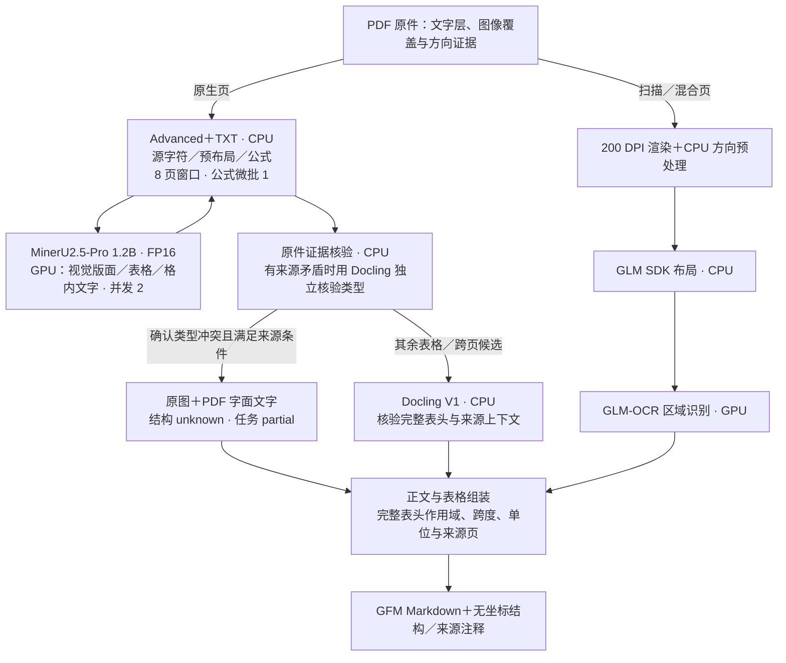
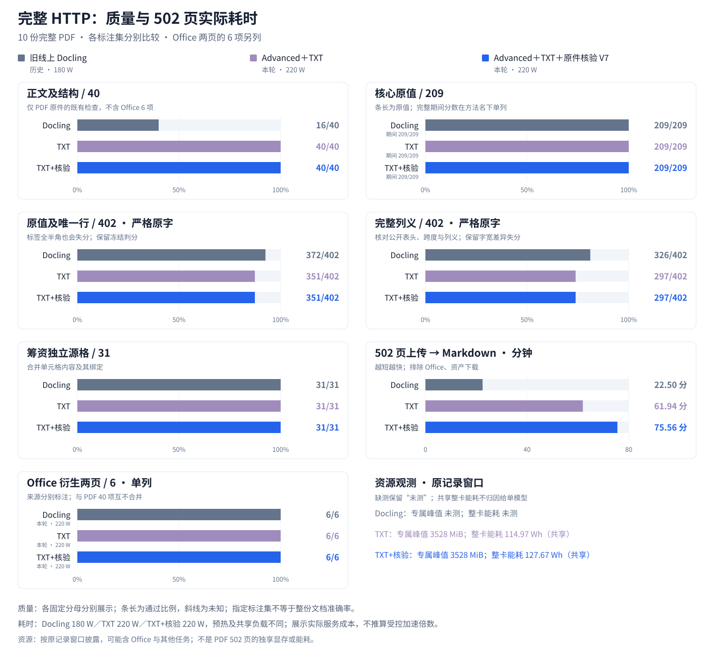
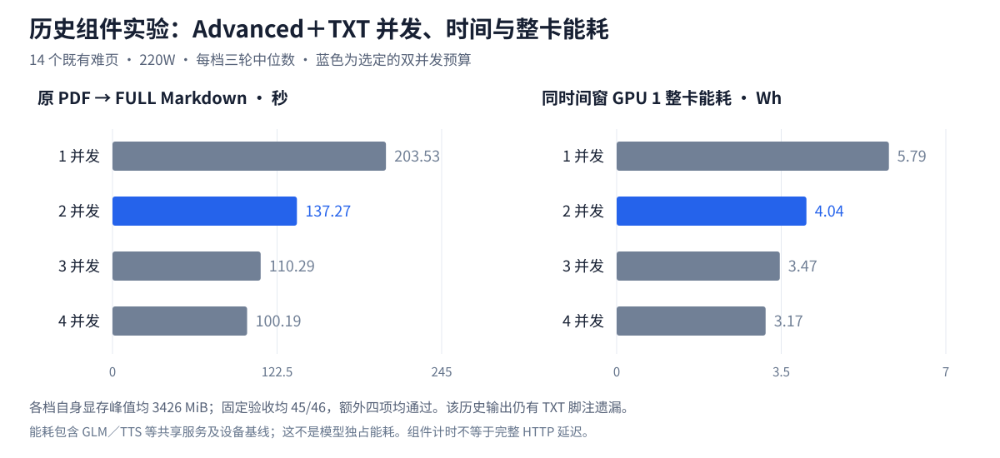

<p align="center">
  
</p>

# moparse

moparse 是一个自托管的多模态内容解析服务，用在 PDF、Office 文档、图片或视频与
RAG 等下游系统之间。

它解决的问题很直接：不同文件格式需要不同的处理工具，而把详细坐标和解析器内部对象
直接交给业务 LLM 又慢又难用。moparse 在内部利用版面、坐标和多模型证据完成解析，
最终只输出一份普通 GFM Markdown：保留标题、段落、列表、表格和页间连续关系，不再把
表格二次改写为专用 XML 或文档 JSON。图片和视频以标准 Markdown 列表及下载链接保留。

服务按文本层和图像证据选择处理方式。Office 嵌图直接提取；原生 PDF 保留模型识别到
的图片；扫描、混合页保留整页来源图。模型识别与图像边界在[比较报告](benchmark/report.md)中记录。
`describe_images=true` 可按需识别已提取图片中的可见文字；独立视频通过 FFmpeg 采样
关键帧，输出带时间戳的帧文字摘要，不生成无文字证据的场景描述。
任务状态、错误和无坐标资产清单仍使用 JSON 控制协议；文档内容只有 Markdown。

## 项目边界

本项目负责恢复“内容中可见了什么、结构如何”；它不负责表格业务语义重写、Embedding、
索引、问答、实体消歧、领域关系或事件 ontology。

## 功能

- PDF、DOCX、PPTX、PNG、JPEG、WebP、TIFF、BMP 及 MP4、MOV、MKV、WebM、AVI；
- Office 嵌图提取、原生 PDF 模型图片和扫描整页图保留；按需识字、资产去重与下载；
- 独立视频关键帧和带时间戳的帧文字摘要；
- 单一自动解析策略；可显式跳过扫描 PDF 页并只保留页面图像；
- 唯一的 GFM Markdown 文档结果；坐标和候选用于内部验证，原生 worker 证据随任务私有保存；
- 表格保留为 GFM；跨页合并与重复表头删除要求完整表头和列义一致，不同表头保持各自
  作用范围；多级表头、合并单元格、单位和来源页关联按原件保留；
- 无坐标 `table-structure` 注释保留原模型表头角色及合并跨度，未知结构明确标记；
- 小文件同步解析，异步 Job、持久化状态和 SSE 进度；
- `/health`、`/ready`、后端能力探测、Swagger、ReDoc；
- MCP 2.x Streamable HTTP；
- API Key、独立 Admin Token、上传校验和 SSRF 防护；
- CPU-only 主镜像，以及 GPU 模型服务分离部署。

## 快速开始：CPU-only

默认配置不启动也不要求 GLM，数字原生 PDF 可独立解析：

```bash
cp .env.example .env
docker network create moparse_backend
docker compose up -d --build moparse
docker compose ps
```

打开：

- Web UI: <http://localhost:12303/>
- Swagger: <http://localhost:12303/docs>
- ReDoc: <http://localhost:12303/redoc>
- Health: <http://localhost:12303/health>
- MCP: <http://localhost:12303/mcp>

首次转换会下载 Docling 布局/表格模型，`/ready` 在初始化期间可能暂时返回
非 2xx。moparse 健康检查为首次下载/初始化保留 10 分钟 `start_period`。
模型保存在 Compose 命名卷中，重启不会重复下载。

容器使用 `DOCLING_LOCAL_ARTIFACTS_PATH` 作为本服务的离线目录配置。不要在
空目录上设置上游同名变量 `DOCLING_ARTIFACTS_PATH`，否则 Docling 会将其视为
已准备好的离线目录并关闭自动下载。

同步解析一个自制测试 PDF：

```bash
curl --fail-with-body http://localhost:12303/v1/content/parse \
  -F file=@tests/fixtures/native-report.pdf \
  -F scan_policy=auto \
  -F language=zh,en \
  -o result.md
```

## 模型配置与选择依据

**V7 已部署，完成 550 页真实 HTTP 评测及正式地址的 159 页复验。
原表头、筹资合并格、正常续表的功能检查及公开 GFM 格式检查通过。
NASA 时间轴保持 partial／unknown，保留原图和原字层。
完整评分、已知识别错误和实际部署收据见[比较报告](benchmark/report.md)。**

本轮选定的组合为 **MinerU 4.0.12 Advanced＋TXT／MinerU2.5-Pro-2605-1.2B／vLLM，
GPU 请求并发 2；扫描、混合页使用 GLM-OCR＋官方 SDK／200 DPI／方向预处理开启。**
原生页的正文从 PDF 文本层获取文字；Advanced 的视觉版面、表格结构和单元格文字由 GPU 模型识别。
预布局、公式、字符匹配、文档组装和主 API 在 CPU 上运行。CPU worker 使用 8 页处理窗口、
公式微批量 1，并在每份文档结束后回收空闲堆内存；全部页面和公式依次处理。
Office 原生文字继续直接提取，图片及扫描页由 GLM 处理。

本轮组合开启 `MINERU_HEADER_VERIFIER=docling`：只对跨页候选用 Docling V1
核对完整头带、跨度、列几何、标题和单位。两端全部一致才合并和删重复头；验证器不替换
Advanced 的正文或表格值。官方 OTSL 不编码表头角色，单靠 Advanced 会保守拆开续表。
同时开启 `MINERU_SOURCE_VERIFIER=docling`：原生表格与 PDF 字层出现来源矛盾时，再核验
独立解析的区域类型。只有原件位置唯一、独立结果判为图片且没有重叠表格候选等证据同时满足时，
才在原位保留原图与 PDF 字面文字，明确标记 `unknown`；其他不确定情况保留原候选与告警。
来源保全后的任务状态仍为 `partial`，Markdown 和原图可正常下载。原始模型表格及验证证据
留在私有日志中。字符次数核验只能发现部分矛盾，不能证明内容完整或数值正确。
最终配置、质量与实际耗时以[完整接口比较报告](benchmark/report.md)为准。



仅有相同列数、相似排版或部分相同文字，不足以删除跨页表头。只有原件完整表头及列义
一致才允许去重；无法证明时保留表头并拆开。`table-source` 保留来源关联，不按指标名补期间。
[原始错误判断、删头代码和原件复验](docs/cross-page-header-fix-20261015.md)保留了修复依据。

### 完整文档的质量与时间



图中对照了本轮原件核验 V7 与既有组合的完整接口结果。
同一批 10 份完整 PDF／502 页，Advanced＋TXT＋Docling 原件核验 V7 的正文／结构条件为
**40/40**，旧 Docling＋GLM 为 **16/40**；核心原值与期间两组均为 **209/209**。
补充财务的原值及唯一行为 **351/402**、完整列义 **297/402**，低于旧组合的
**372/402、326/402**。这些分母对应指定标注，不能视为整份文档准确率。

原件核验 V7 上传至 Markdown 合计 **75.56 分钟**；纯 Advanced＋TXT 为 **61.94 分钟**，
旧 Docling 历史请求为 **22.50 分钟**。旧记录为 180W，本轮为 220W，缓存和共享负载也有差异。
正文完整性、续表与来源关联是本次选择依据。两处财务数字分隔符误读、扫描印章识别错误、
手签姓名重复、Census 扫描表年龄行折叠及错误数字仍未解决。
119 页原件第 14 页已恢复 GFM，但源件 16 列与模型 17 列的差异仍在，完整表头作用域保持 unknown；
全半角差异也保留严格失分。
[逐项比较报告](benchmark/report.md)记录原件与实际输出，不将这些问题计为通过。

### 为什么选择 Advanced＋TXT

固定 14 个难页的五种调用方式已分别比较：Docling 通过 22／46，Standard＋TXT 通过
40／46，Advanced＋TXT 及两种纯视觉方式通过 45／46。额外四项源字符／状态检查中，
Advanced＋TXT 为 4／4，纯视觉 TF、vLLM 分别为 0／4、1／4。Standard 在这些输入上更快，
但有合并跨度和旋转表结构退化。这些是历史组件结果，完整 HTTP 验收另列。


原先剩余的脚注截断定位到 MinerU 原生字符匹配的坐标方向判断：旋转字符仍按水平轴
筛选，导致行首尾字符被丢弃。修复在依赖源代码的字符归属层统一书写方向；不增加句子、
财务关键词或文件页码规则。上游文件版本与修复前后 SHA 均锁定，版本不符时构建会失败。
应用使用官方完整 typed-block 渲染，保留页眉、页脚、列表、公式与业务附注。

### 双并发的时间和资源



同一批 14 个难页、相同权重和 FP16、同一 GPU 220W，三轮耗时中位数为：并发 1
**203.531 秒**、并发 2 **137.267 秒**、并发 3 **110.288 秒**、并发 4 **100.190 秒**。
四档结果一致，模型自身显存峰值均为 **3426 MiB**。并发 2 为本项目选定的共享资源预算；
并发 4 在该实验中更快、整卡能耗也更低，可作为批处理选项。图中能耗包含同卡常驻服务。

### 正式数据集与比较报告

[benchmark/](benchmark/README.md) 是方法、数据、评分和报告的正式入口，当前报告统一维护在
[benchmark/report.md](benchmark/report.md)。已登记 29 个方法、消融配置及修订版本，历史结果保留来源、
权重、输出阶段、计时边界及文件 SHA；不把离线组件耗时当作完整接口耗时。
登记表包含已淘汰和未完成的修订，具体完成范围与失败原因均见对应证据。

`moparse-v1` 当前含 **14 份输入、543 页**：原有 10 份 PDF／502 页及 Office 转换件 2 页
作为已使用的回归集，首次封存的表单、技术报告、历史扫描统计表共 39 页。
这些原件先于首次模型输出完成 36 项标注（含 3 个完整小表、2 个跨格）；首轮暴露 IRS 适配错误后，
后续结果单列为开发复测。另封存 NASA、GSA、NARA 三份完整原件／7 页及 28 条来源条件，
用于新原件比较。识别组合在两组输出前冻结；最终适配及资源修订在基线输出后，依据旧回归件调整
来源注释顺序、公式微批量和处理窗口。两种时间边界在报告中分别记录。主集与附加集保留各自版本及 SHA，标注只覆盖明确列出的内容。
本轮原件证据保全修订是在看到 NASA 失败后开发，550 页均作为已暴露的开发回归；
首次封存记录与固定 28 条条件保持原样，后补的时间轴与物理格检查单独登记。
209 项原值／期间、402 项补充财务行、46 项正文／结构检查等集合分别计分，重叠分母不相加。
原件、HTTP 大响应及模型留在本地，提交清单、源件标注、冻结评分器与汇总证据。

完整文档验收通过真实 `/v1/content/parse`，`scan_policy=auto`，不设置 `unit_range`；
大文件按既有 202 异步协议等待原任务完成，再下载最终 Markdown、来源图和资产。
同时记录客户端端到端耗时、服务 CPU／RAM、GPU 利用率、自身显存及共享整卡能耗。

## 部署模式

| 模式 | 主服务 | OCR 服务 | 启动方式 |
|---|---|---|---|
| CPU-only | 本项目 CPU 镜像 | 关闭，适合数字 PDF/Office | `docker compose up -d --build moparse` |
| 本机 GLM | CPU 主服务 | 独立 vLLM，默认 GPU 1 | `docker compose --profile glm up -d --build` |
| 完整 Docling＋GLM SDK | CPU Docling＋SDK | GPU 1 GLM-OCR | `docker compose --profile glm-sdk up -d --build` |
| **Advanced＋TXT＋GLM SDK** | CPU API＋原生文档 worker＋SDK | GPU MinerU（并发 2）及 GLM-OCR | `docker compose --profile mineru --profile glm-sdk up -d --build` |
| 远程 GLM | CPU 主服务 | 已部署的 GLM-OCR 和 SDK | 配置 URL 后只启动 `moparse` |

### Advanced＋TXT＋GLM SDK

先构建并准备锁定模型，再启动 GPU 服务（支持离线转移模型卷）：

```bash
docker network create moparse_backend  # 已存在时直接使用
docker compose --profile mineru build mineru-vllm mineru-native
docker volume create moparse-mineru-models
docker volume create moparse-mineru-small-models
docker run --rm --entrypoint python \
  -v moparse-mineru-models:/models/mineru \
  -v moparse-mineru-small-models:/models/mineru-native \
  ghcr.io/scisaga/moparse-native-worker:0.5.0 \
  scripts/download_mineru_models.py \
  --vlm-dir /models/mineru --native-home /models/mineru-native
```

本地构建时将上面的镜像名换成 `.env` 中的 `MINERU_NATIVE_IMAGE`。脚本核对
[native_worker/models.lock.json](native_worker/models.lock.json) 中的固定 revision、大小及 SHA；
加 `--verify-only` 可完全离线核验，不加载模型。

`.env` 设置：

```dotenv
NATIVE_PARSER_BACKEND=mineru
MINERU_NATIVE_BASE_URL=http://mineru-native:8010
MINERU_NATIVE_TIMEOUT_SECONDS=7200
# 启用严格的独立表头验证；仅在新组合验收通过后选择。
MINERU_HEADER_VERIFIER=docling
MINERU_SOURCE_VERIFIER=docling
CONTENT_TIMEOUT_SECONDS=7200
MINERU_PROCESSING_WINDOW_SIZE=8
MINERU_MALLOC_TRIM=1
MOPARSE_CPU_MFR_BATCH_SIZE=1
GLM_OCR_ENABLED=1
GLM_SDK_ENABLED=1
GLM_SDK_ORIENTATION_ENABLED=1
GLM_SDK_RENDER_SCALE=2.7777777777777777
```

```bash
docker compose --profile mineru --profile glm-sdk up -d --build
curl --fail http://localhost:12303/ready
```

网页高级设置中的超时 `0` 表示采用服务端时限，新请求默认采用这个值。
已有浏览器保存的超时会保留；若仍为 `300` 秒，处理长文档前可将其改为 `0`。

GPU 权重固定为 `08aaea840498d49ce16247b6263196cf02814885`，FP16；vLLM 的请求并发和
`max_num_seqs` 均为 2，KV 缓存预算 128 MiB。主 API 与原生文档 worker 不挂载 GPU。
切换前核对显存余量与已有模型服务，已有 GLM／SDK 无须重启；迁移操作见[部署文档](docs/deployment.md)。

### Docling＋GLM-OCR＋SDK 基线

编辑 `.env`：

```dotenv
NATIVE_PARSER_BACKEND=docling
MINERU_HEADER_VERIFIER=off
MINERU_SOURCE_VERIFIER=off
DOCLING_PDF_BACKEND=pypdfium
DOCLING_TABLE_MODE=accurate
DOCLING_DO_CELL_MATCHING=0
GLM_OCR_ENABLED=1
GLM_SDK_ENABLED=1
GLM_SDK_ORIENTATION_ENABLED=1
# 200 / 72 DPI scale; larger rasters remain bounded by the pixel limit.
GLM_SDK_RENDER_SCALE=2.7777777777777777
GLM_SDK_MAX_IMAGE_PIXELS=8000000
GLM_GPU_DEVICE_ID=1
GLM_DTYPE=half
GLM_GPU_MEMORY_UTILIZATION=0.40
```

```bash
docker compose --profile glm-sdk up -d --build
docker compose --profile glm-sdk ps
curl --fail http://localhost:12303/v1/backends
```

SDK sidecar 在 CPU 上运行 PP-DocLayoutV3；扫描、混合页先按检测方向旋正，再进行
GLM-OCR 区域识别。结构验证不会补造原件文字或数值，无法确定的结构保留候选及告警。
`scan_policy=skip` 则关闭 PDF 扫描 OCR，将扫描页保存为整页资产并明确标记跳过。

Compose 默认使用 GPU `device_ids=1`。参考主机 GPU 1 为 RTX 2080 Ti（Turing），因此
vLLM 使用 FP16 `--dtype half`；主 parser 和 SDK sidecar 都不挂载 GPU。只需要基础
GLM OCR 时可使用 `glm` profile，完整扫描表格处理使用 `glm-sdk` profile。

### 使用远程 GLM-OCR 与 SDK

```dotenv
GLM_OCR_ENABLED=1
GLM_OCR_API_URL=http://gpu-host:8000/v1/chat/completions
GLM_OCR_MODEL=zai-org/GLM-OCR
GLM_SDK_ENABLED=1
GLM_SDK_URL=http://sdk-host:5002/glmocr/parse
GLM_SDK_ORIENTATION_ENABLED=1
# 200 / 72 DPI scale; larger rasters remain bounded by the pixel limit.
GLM_SDK_RENDER_SCALE=2.7777777777777777
GLM_SDK_MAX_IMAGE_PIXELS=8000000
```

```bash
docker compose up -d --build moparse
curl --fail http://localhost:12303/v1/backends
```

图片的可见文字识别和视频帧识字复用 GLM-OCR，不依赖额外的通用视觉模型。完整部署、
显卡校验、离线模型与反向代理说明见 [docs/deployment.md](docs/deployment.md)。

## API 概览

| 方法 | 路径 | 用途 |
|---|---|---|
| `POST` | `/v1/content/parse` | 小内容同步并持久化；视频/大输入自动返回 202 |
| `POST` | `/v1/content/jobs` | 创建异步任务 |
| `GET` | `/v1/content/jobs/{job_id}` | 查询持久化状态 |
| `GET` | `/v1/content/jobs/{job_id}/events` | SSE 进度 |
| `GET` | `/v1/content/jobs/{job_id}/result` | 获取/下载 GFM Markdown |
| `GET` | `/v1/content/jobs/{job_id}/assets` | 列出图片、视频与关键帧资产 |
| `GET` | `/v1/content/jobs/{job_id}/assets/{asset_id}` | 鉴权下载资产；视频支持 Range |
| `GET` | `/v1/content/jobs/{job_id}/bundle` | 按需生成 manifest 与资产 ZIP |
| `POST` | `/v1/content/jobs/{job_id}/retry` | 重试失败、部分完成或已取消的任务 |
| `DELETE` | `/v1/content/jobs/{job_id}` | 取消或删除任务 |
| `GET` | `/v1/backends` | 后端真实能力状态 |
| `GET` | `/health`, `/ready` | 存活与就绪检查 |
| `GET/POST` | `/mcp` | MCP Streamable HTTP |
| `POST` | `/admin/reload`, `/admin/cleanup` | 管理操作 |

请求参数、状态机、SSE 和错误协议见 [docs/api.md](docs/api.md)，在线 Schema
以 `/openapi.json` 为准。

若设置 `API_KEY`，公共受保护接口推荐使用：

```http
Authorization: Bearer <API_KEY>
```

`X-API-Key` 也可用作客户端兼容别名。管理接口始终使用独立的：

```http
X-Admin-Token: <ADMIN_TOKEN>
```

不要复用两个密钥，也不要把密钥放进 URL、Dockerfile 或日志。

## MCP

MCP 使用 Python SDK 2.x 的 Streamable HTTP 传输，暴露解析、任务状态、Markdown
结果和资产工具。大文件使用受控 `source_url`；MCP 不接受任意本地文件路径。

MCP v2 会校验 Host 和 Origin 防止 DNS rebinding。通过公网域名/反向代理
暴露时，必须把精确 `host[:port]` 和 Origin 添加到：

```dotenv
MCP_ALLOWED_HOSTS=localhost,127.0.0.1,[::1],moparse,mosaicparse,docs.example.com
MCP_ALLOWED_ORIGINS=http://localhost,http://127.0.0.1,https://docs.example.com
```

默认不使用通配符。

## 本地开发

需要 Python `>=3.13,<3.14`、uv、Node 20：

```bash
uv sync --frozen
npm --prefix frontend ci
npm --prefix frontend run build
DATA_DIR=./data STATIC_DIR=frontend/dist GLM_OCR_ENABLED=0 \
  uv run uvicorn app.main:app --host 0.0.0.0 --port 12303
```

依赖基线经过 Python 3.13 解算并提交在 `uv.lock`：

| 组件 | 锁定版本 |
|---|---:|
| Docling | `2.139.0` |
| TableFormer | `V1 Accurate` |
| PDF 后端／单元格匹配 | `PyPdfium`／`False` |
| docling-core／IBM models | `2.101.1`／`4.0.3` |
| PyPdfium | `5.12.1` |
| 官方 GLM SDK（独立 sidecar） | `glmocr 0.1.5` |
| FastAPI | `0.141.1` |
| MCP Python SDK | `2.0.0` |
| PyTorch CPU | `2.13.0+cpu` |
| vLLM GLM image | `v0.19.1` |

主服务的 PyTorch/torchvision 从官方 CPU wheel 索引锁定；`uv.lock` 不含
`nvidia-*` 或 CUDA Python 包。

CPU 基线使用 `DOCLING_COMPILE_MODELS=0`，避免首次文档触发耗时很长的
`torch.compile`；只应在固定硬件上完成预热与基准验证后开启。扫描 OCR 的超时、重试和
并发由 `GLM_OCR_*`、`GLM_SDK_*` 控制。

Docling 基线模式下，服务逐页分流：原生页交给 Docling，扫描／混合来源页交给 SDK。所选原生页
恰为一个连续段、达到 `DOCLING_PAGE_PARALLEL_MIN_PAGES` 且逐页原生文字充足时，
可用 `DOCLING_PAGE_WORKERS` 做页级并行；不连续原生段顺序转换，SDK 也逐页请求。
每个 worker 持有启动期加载、请求间复用的转换器，线程数由 `DOCLING_NUM_THREADS`
控制。缓存转换器总数为
`PARSER_WORKERS * DOCLING_PAGE_WORKERS`，配置上限为 32；调大前须同时核算 CPU 和内存。

## 验证

```bash
uv lock --check
uv sync --frozen
uv run ruff check .
uv run mypy app
uv run pytest --cov=app
uv run python scripts/export_openapi.py --check
uv run python scripts/generate_fixtures.py --check

npm --prefix frontend ci
npm --prefix frontend run lint
npm --prefix frontend run typecheck
npm --prefix frontend run test
npm --prefix frontend run build

docker compose config --quiet
docker build -t moparse:local .
```

CI 不下载或运行大模型；GLM 与 SDK 错误路径由 mock 服务覆盖。真实 GPU
回归应在专用环境执行。文档、图片和视频夹具由本项目脚本生成；另保留一份固定版本
的 MinerU 源码用于无推理的批处理测试，来源及许可见
[tests/fixtures/README.md](tests/fixtures/README.md)。

## 设计与许可证

- [架构](docs/architecture.md)
- [API](docs/api.md)
- [部署](docs/deployment.md)
- [基准测试](docs/benchmark.md)
- [完整模型比较与真实接口验证报告](benchmark/report.md)
- [项目 0.4.0 设计规格](docs/project-spec.md)

本项目原创代码使用 [Apache License 2.0](LICENSE)；MinerU 源码夹具保留其[上游许可](tests/fixtures/LICENSE.MinerU.md)。Docling、MinerU、GLM-OCR、模型权重
和容器镜像拥有各自许可证；部署者需要分别核查并遵守其版本对应条款。
