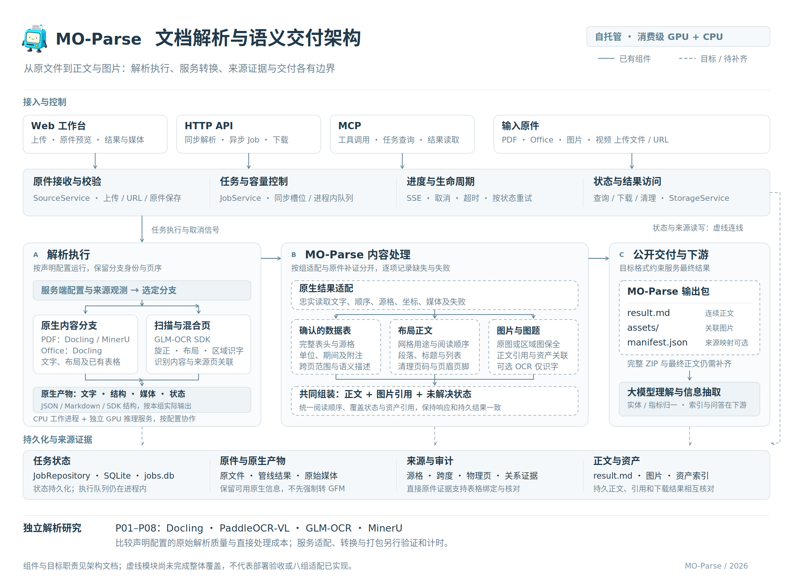
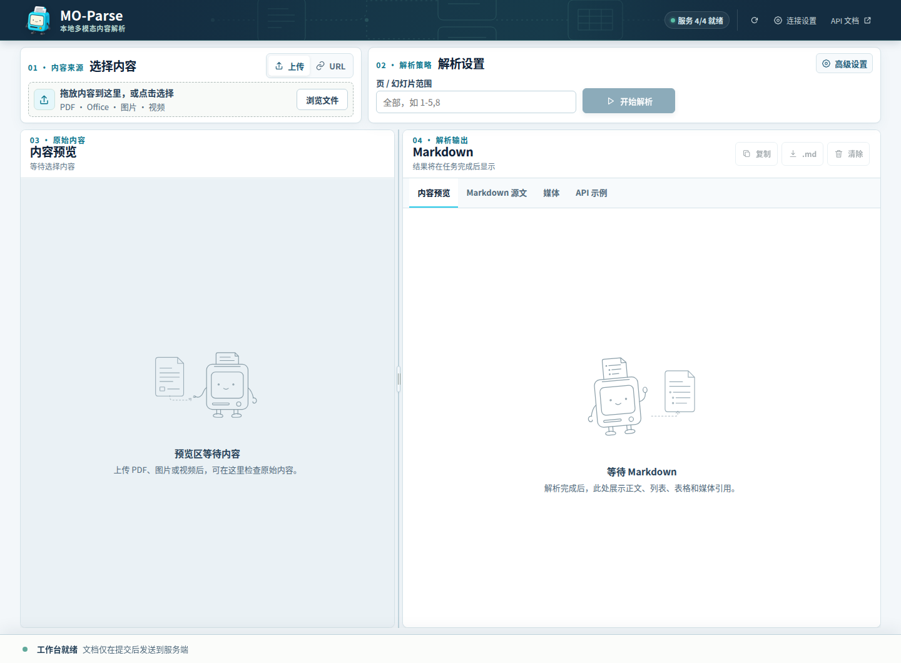

<p align="center">
  
</p>

<h1 align="center">MO-Parse</h1>

<p align="center">
  <a href="https://github.com/Scisaga/moparse/actions/workflows/ci.yml"></a>
  <a href="LICENSE"></a>
  <a href="pyproject.toml"></a>
  <a href="https://github.com/Scisaga/moparse/stargazers"></a>
  <a href="https://github.com/Scisaga/moparse/issues"></a>
</p>

<p align="center"><strong>在消费级 GPU 和 CPU 上探索高质量文档解析，让大模型更好地理解文档、提取信息。</strong></p>

MO-Parse 是可自托管的内容解析项目，提供 Web 工作台、HTTP API 和 MCP 接口。项目一方面研究不同解析方法的质量与实际成本，另一方面将解析结果整理为面向大模型的 Markdown 正文和关联图片。

[快速开始](#快速开始) · [输出格式](#为什么生成-mo-parse-格式) · [研究与进展](#研究与当前进展) · [文档导航](docs/README.md)

## 项目全貌



架构图展示请求与任务控制、原生内容及扫描分支、按内容类别处理的服务目标，以及任务状态、原生产物和来源证据的保存关系。实线模块表示已有组件，虚线模块表示仍需补齐的目标；完整职责与当前差距见[架构说明](docs/engineering/architecture.md)，各管线的原生格式与接入状态见[逐管线说明](docs/pipelines/README.md)。可[打开矢量原图](docs/assets/mo-parse-overview-poster.svg)查看细节。

## 内容工作台



工作台按选择内容、解析设置、原件预览和结果查看组织操作。上图为本地前端的实际空状态截图；桌面、手机预览和采集方式见[品牌与界面](docs/brand.md)。

## 为什么生成 MO-Parse 格式

文档版面通过位置、合并单元格和跨页表头表达关系。只提取文字，容易把数值与标题、单位、期间拆开；保留原始表格时，下游模型仍需还原这些关系。MO-Parse 希望在来源证据支持下，把这些关系写进连续、清楚的正文，减少大模型理解和抽取信息时需要自行猜测的部分。

这里的 **MO-Parse 格式**指[输出规范](docs/specs/moparse-output-spec.md)约定的 Markdown 正文与图片交付方式，正文文件为 `result.md`。它用常见的标题、段落、多层列表和图片引用组织内容，便于阅读，也便于直接交给大模型。

- **让关系随内容一起出现。** 确认的数据表以语义描述表达，将数值与完整标题、单位、期间及附注放在同一上下文中，帮助模型识别“谁、什么指标、何时、多少”。
- **让正文更连贯。** 按阅读顺序组织章节与网格中的正文，清理页码、重复页眉页脚，减少版面噪声对分段和理解的干扰。
- **保留图片与核对依据。** 图片随正文引用交付；内部保留来源证据和未解决状态，便于核对抽取结果。图片本身按原图交付，不生成图意描述。

例如，来源已经明确指标、单位和期间时，可表达为以下内容；这是格式示意，并非实测输出：

```markdown
## 主要财务指标

- 营业收入
  - 单位：万元
  - 2025 年度：1,234.50
  - 2024 年度：1,100.00
```

这种组织方式旨在帮助模型理解和抽取，实际收益仍需配对验证。转换只表达来源支持的内容；实体消歧、指标归一、事实去重、业务事件抽取、索引与问答由下游负责。详细规则及当前实现差距以[输出规范](docs/specs/moparse-output-spec.md)为准。

## 快速开始

CPU模式可独立处理数字原生PDF和Office文档：

```bash
cp .env.example .env
docker network create moparse_backend
docker compose up -d --build moparse
```

打开Web UI：<http://localhost:12303/>；API文档：<http://localhost:12303/docs>；MCP：<http://localhost:12303/mcp>。

首次解析可能下载Docling模型，初始化期间`/ready`可能暂未就绪。模型保存在命名卷中。离线模型、扫描OCR、MinerU/GLM模型服务、显卡配置与远程模型地址见[部署文档](docs/operations/deployment.md)和[运行配方](docs/operations/runtime-recipes.md)。

```bash
curl --fail-with-body http://localhost:12303/v1/content/parse \
  -F file=@tests/fixtures/native-report.pdf \
  -F scan_policy=auto \
  -F language=zh,en \
  -o result.md
```

大输入和视频返回202及Job身份，按Job查询并下载最终结果。网页超时`0`表示采用服务端时限。正式展示名为MO-Parse；仓库、Python包、Compose服务和既有配置标识继续使用`moparse`。

## 接口接入

| 接入方式 | 入口 | 适用场景 |
| --- | --- | --- |
| Web 工作台 | `http://localhost:12303/` | 上传或输入 URL、预览原件、查看正文与媒体 |
| HTTP API | `/v1/content/parse`、`/v1/content/jobs` | 同步解析、异步任务、进度与下载 |
| MCP | `/mcp` | 通过 MCP 工具调用内容解析 |

请求参数、鉴权、任务状态、资产和完整路由统一见[API 文档](docs/specs/api.md)，在线 Schema 以 `/openapi.json` 为准。当前 `bundle` 仅含资产与清单，包含 `result.md` 的完整输出包仍待实现。API Key、Admin Token 及 MCP 反向代理配置见[部署说明](docs/operations/deployment.md)。

## 研究与当前进展

项目沿两条工作线推进，具体顺序见[技术路线](docs/engineering/technical-route.md)：

| 工作线 | 要回答的问题 | 当前进展与入口 |
| --- | --- | --- |
| 解析研究 | 各方法在什么来源和版式上解析得更好，实际处理成本是多少 | 本轮八组各完成800页一次和80页三轮，统一评分、首版报告及原MO服务恢复已完成；结果见[当前统一评测报告](benchmark/reports/lite/report.md)，状态与限制由[评测索引](benchmark/reports/README.md)维护。TTS仅观测不控制，先前撤回测量不恢复；方法范围见[研究框架](docs/research/research-framework.md)与[固定配置](benchmark/pipelines-to-test.md) |
| 服务开发 | 如何保真读取原生结果，并交付适合下游消费的正文和图片 | 已有 API、Web UI、MCP、任务与资产能力；表格转换、正文清理及完整打包仍有缺口；见[架构](docs/engineering/architecture.md)与[输出规范当前差距](docs/specs/moparse-output-spec.md#9-当前实现差距与迁移) |

解析研究比较完整管线的原始质量与实际成本，候选可以保留自身的表格和页面信息；MO-Parse 最终格式转换另行开发、验证和计时。候选方法、资源与统一条件见[待测试管线](benchmark/pipelines-to-test.md)，任务与外部原件、独立标注交接见[评测任务](benchmark/evaluation-tasks.md)，路线内性能实验见[MinerU 调优](benchmark/mineru-tuning.md)。不沿用已移除的旧成绩。

本轮按明确授权的人工资料清单交付可迁移的[moparse-dataset-v1-lite](datasets/moparse-dataset-v1-lite/README.md)与[moparse-dataset-v1-full](datasets/moparse-dataset-v1-full/README.md)，沿用现有预期正文，不重新生成答案。本轮统一比较仅使用Lite，Full保留历史审核状态及未知，本轮不运行；包装、工程预检与自动评分不构成语料验收。[独立评测工具](moparse_eval/README.md)提供运行、评分和报告入口。[pdf_sample/extra/](pdf_sample/extra/)的六份公开PDF继续暂不处理，不用于解析、评测、调优、预热或上线判断。已有服务也支持Office嵌图、独立图片和视频关键帧识字，这些能力不自动扩大本轮研究范围。

## 开发与验证

需要Python`>=3.13,<3.14`、uv和Node20。主服务的PyTorch依赖锁定CPU wheel；GPU模型通过独立服务部署。

```bash
uv sync --frozen
npm --prefix frontend ci
npm --prefix frontend run build
DATA_DIR=./data STATIC_DIR=frontend/dist GLM_OCR_ENABLED=0 \
  uv run uvicorn app.main:app --host 0.0.0.0 --port 12303
```

```bash
uv lock --check
uv run ruff check .
uv run mypy app
uv run pytest
uv run python scripts/export_openapi.py --check
uv run python scripts/generate_fixtures.py --check
npm --prefix frontend run lint
npm --prefix frontend run typecheck
npm --prefix frontend run test
npm --prefix frontend run build
```

CI 使用生成夹具和模拟后端验证接口与错误处理，不能代替真实模型评测。新评测的输入、标注和评分要求见[评测任务](benchmark/evaluation-tasks.md)。Markdown 普通自然段保持一个物理行，编辑器使用软换行。

## 文档与许可证

按使用目的查阅[文档导航](docs/README.md)：

- 使用与接入：[部署](docs/operations/deployment.md) · [运行配方](docs/operations/runtime-recipes.md) · [API](docs/specs/api.md)。
- 格式与实现：[输出规范](docs/specs/moparse-output-spec.md) · [表格来源](docs/specs/table-source.md) · [管线适配](docs/pipelines/README.md) · [架构](docs/engineering/architecture.md)。
- 研究与计划：[研究框架](docs/research/research-framework.md) · [技术路线](docs/engineering/technical-route.md) · [评测任务](benchmark/evaluation-tasks.md) · [待测试管线](benchmark/pipelines-to-test.md) · [MinerU 调优](benchmark/mineru-tuning.md)。
- 维护约定：[AGENTS.md](AGENTS.md) · [品牌与图标](docs/brand.md) · [夹具与来源许可](tests/fixtures/README.md)。

本项目原创代码使用 [Apache License 2.0](LICENSE)。文档原件、模型权重、上游框架、容器和源码夹具分别遵循其许可证。
