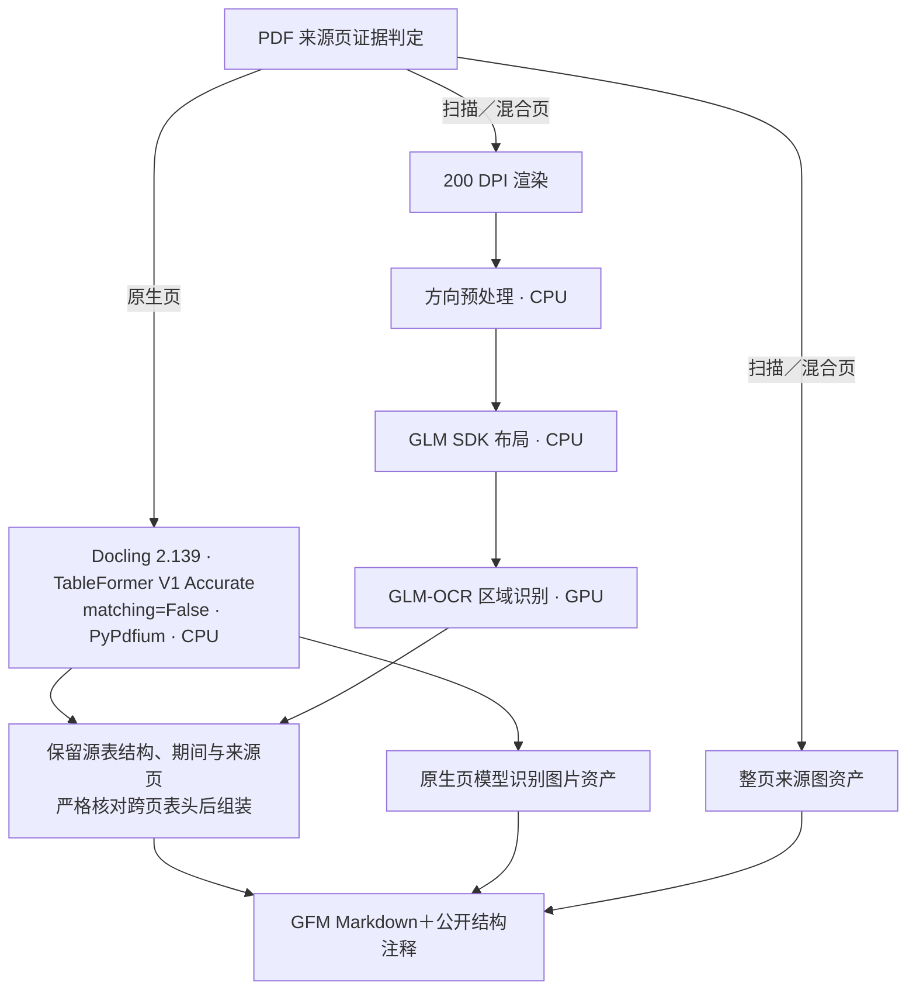
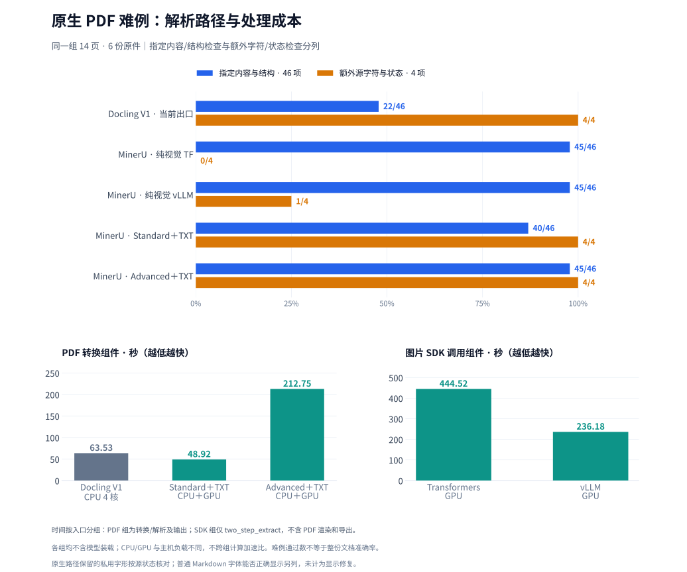
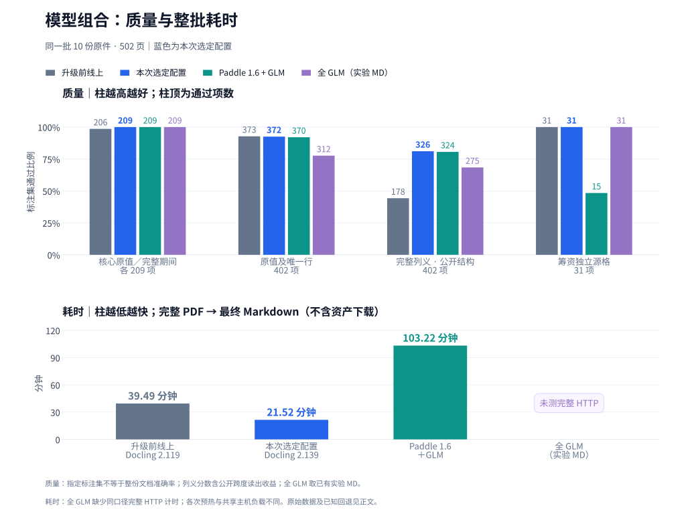

<p align="center">
  
</p>

# MosaicParse

MosaicParse 是一个自托管的多模态内容解析服务，用在 PDF、Office 文档、图片或视频与
RAG 等下游系统之间。

它解决的问题很直接：不同文件格式需要不同的处理工具，而把详细坐标和解析器内部对象
直接交给业务 LLM 又慢又难用。MosaicParse 在内部利用版面、坐标和多模型证据完成解析，
最终只输出一份普通 GFM Markdown：保留标题、段落、列表、表格和页间连续关系，不再把
表格二次改写为专用 XML 或文档 JSON。图片和视频以标准 Markdown 列表及下载链接保留。

服务按文本层和图像证据选择处理方式。Office 嵌图直接提取；原生 PDF 保留模型识别到
的图片；扫描、混合页保留整页来源图。原生 PDF 图像检测和裁边仍有[已知边界](benchmark-results/clean-model-comparison-20261015/report.md#已知识别与图像边界)。
`describe_images=true` 可按需识别已提取图片中的可见文字；独立视频通过 FFmpeg 采样
关键帧，输出带时间戳的帧文字摘要，不生成无文字证据的场景描述。
任务状态、错误和无坐标资产清单仍使用 JSON 控制协议；文档内容只有 Markdown。


## 项目边界

本项目负责恢复“内容中可见了什么、结构如何”；它不负责表格业务语义重写、Embedding、
索引、问答、实体消歧、领域关系或事件 ontology。

## 功能

- PDF、DOCX、PPTX、PNG、JPEG、WebP、TIFF、BMP 及 MP4、MOV、MKV、WebM、AVI；
- Office 嵌图提取、原生 PDF 模型图片和扫描整页图保留；按需识字、资产去重与下载；
- 独立视频关键帧和带时间戳的帧文字摘要；
- 单一自动解析策略；可显式跳过扫描 PDF 页并只保留页面图像；
- 唯一的 GFM Markdown 文档结果；坐标和候选证据只在单次解析内部使用；
- 表格保留为 GFM；跨页合并与重复表头删除要求完整表头和列义一致，不同表头保持各自
  作用范围；多级表头、合并单元格、单位和来源页关联按原件保留；
- 无坐标 `table-structure` 注释保留原模型表头角色及合并跨度，未知结构明确标记；
- 小文件同步解析，异步 Job、持久化状态和 SSE 进度；
- `/health`、`/ready`、后端能力探测、Swagger、ReDoc；
- MCP 2.x Streamable HTTP；
- API Key、独立 Admin Token、上传校验和 SSRF 防护；
- CPU-only 主镜像，以及 GPU 模型服务分离部署。

## 快速开始：CPU-only

默认配置不启动也不要求 GLM，数字原生 PDF 可独立解析：

```bash
cp .env.example .env
docker compose up -d --build mosaicparse
docker compose ps
```

打开：

- Web UI: <http://localhost:12303/>
- Swagger: <http://localhost:12303/docs>
- ReDoc: <http://localhost:12303/redoc>
- Health: <http://localhost:12303/health>
- MCP: <http://localhost:12303/mcp>

首次转换会下载 Docling 布局/表格模型，`/ready` 在初始化期间可能暂时返回
非 2xx。MosaicParse 健康检查为首次下载/初始化保留 10 分钟 `start_period`。
模型保存在 Compose 命名卷中，重启不会重复下载。

容器使用 `DOCLING_LOCAL_ARTIFACTS_PATH` 作为本服务的离线目录配置。不要在
空目录上设置上游同名变量 `DOCLING_ARTIFACTS_PATH`，否则 Docling 会将其视为
已准备好的离线目录并关闭自动下载。

同步解析一个自制测试 PDF：

```bash
curl --fail-with-body http://localhost:12303/v1/content/parse \
  -F file=@tests/fixtures/native-report.pdf \
  -F scan_policy=auto \
  -F language=zh,en \
  -o result.md
```

## 模型配置与选择依据

默认 PDF 管线为：**Docling 2.139.0／TableFormer V1 Accurate／matching=False／PyPdfium
处理原生页，GLM-OCR＋官方 SDK 以 200 DPI 处理扫描、混合页，方向预处理开启。** 主服务使用
CPU，GLM 在独立 GPU 服务运行；原生页无需经过 GPU，也不会根据指标名称生成期间。



### 正文保留与复杂表格

**2026-10-17 21:51 的服务修订保留所有可见原生页眉／页脚及表后业务附注。**
两页真实转换 PDF 的证券代码、证券简称、原标题与记录日期已通过新 job 复验；
跨页不同期间表头、筹资合并格和正常续表的实际接口验收继续通过；上线后另重跑 203 页完整输入。新建完整 10 份 PDF／502 页
加该两页输入，共 504 页，固定质量集合与 05:15 发布版相同；本次 502 页取得 Markdown 为
**22.50 分钟**。镜像内 352 项后端测试通过，旧结果与资产 314 个文件 SHA 未变。

修复恢复原模型中已有、但出口遗漏的源节点；433 原生页同源回放恢复 979 个节点，
其中 3 个是业务附注，其余是页眉页脚。134 页文件的六类问题目前恢复第 74 页政策一类，
其余长格截断、金额与上标串接、说明行错位和六列续表缺格，以及 119 页第 87 页侧向表仍存在。
另有一组续表因页码分类不一致而保守拆开，内容保留。这些问题与替代管线逐项实测统一见
[完整报告](benchmark-results/clean-model-comparison-20261015/report.md#正文遗漏与替代管线实测2026-10-17)。

### 原生页替代管线：同 14 页的实际比较



固定内容／结构 46 项：当前 Docling 22、纯视觉 TF／vLLM 各 45、Standard＋TXT 40、
**Advanced＋TXT 45**；额外四类源字符／状态检查依次为 4、0、1、4、**4**。
图中 PDF 转换与图片 SDK 调用分别计时；原生私用字形的普通字体显示另列，不按“已出现”算显示修复。

**下一步首选候选组合：原生页 MinerU 4.0.12 Advanced＋TXT＋MinerU2.5-Pro-2605-1.2B／vLLM，
扫描、混合页继续 GLM-OCR＋SDK／200 DPI／方向开启。** Standard 虽快，却让已正确的正常筹资表
丢跨度、旋转表转置；Advanced 保住这些结构及额外四类源内容。它仍在第 87 页官方 TXT
回填环节把完整 22 字脚注截为 15 字，默认导出还会过滤证券标识，因此实验使用官方 FULL 视图。
新管线须修复该遗漏、适配既有逐格来源后再跑全量 HTTP；**当前线上仍为上文的 Docling＋GLM**。
[五组逐项证据、资源和推荐依据](benchmark-results/clean-model-comparison-20261015/report.md#同一模型不同调用路径的完整比较)。

### 历史组合的固定标注集与完整 HTTP 成本

以下图表对应 **05:15 发布版**的组合选择；其 21.52 分钟保留原批次归属。
21:51 出口修订已用相同 502 页重新实跑，固定集合的分数相同、耗时为上文的 22.50 分钟。

10 份原件共 502 页。原值、期间和唯一行使用冻结内容评分；完整列义统一读取结果自己携带
的公开结构注释，兼容历史 `clean-table` 和现行 `table-structure`，不使用私有坐标选表。
列义通过要求数值对应的完整表头及作用范围得到确认。选定配置已重新调用真实接口处理完整
10 份 PDF，并下载最终 Markdown 和全部资产。



上半为质量分组柱，柱顶标通过项数、横轴标总项数；下半为同批完整 PDF 的实际接口耗时。
两部分颜色对应同一组合；全 GLM 缺少同口径整批 HTTP 计时，图中明确标为未测。

| 组合 | 核心原值 / 209 | 完整期间 / 209 | 原值及唯一行 / 402 | 完整列义：读取公开结构注释 / 402 | 筹资独立源格 / 31 |
|---|---:|---:|---:|---:|---:|
| 升级前线上：Docling 2.119／V1／True／默认后端及完整应用处理 | 206 | 206 | 373 | 178 | 31 |
| **本次发布前完整 HTTP 回归：Docling 2.139／V1／False／PyPdfium＋GLM SDK（200 DPI）** | **209** | **209** | **372** | **326** | **31** |
| Paddle 1.6 原生方向 OFF＋GLM SDK 方向 ON | 209 | 209 | 370 | 324 | 15 |
| 全 GLM＋方向预处理 ON | 209 | 209 | 312 | 275 | 31 |

这张表的新旧管线均来自 10 月 17 日的完整 HTTP 请求；Paddle 1.6 来自 10 月 16 日完整
HTTP 结果；全 GLM 来自已生成的实验 Markdown 重评分。请求、最终结果、评分及实际部署
版本统一保存在[完整报告](benchmark-results/clean-model-comparison-20261015/report.md)。
这些是指定标注集成绩，各集合存在重叠。对同一份历史 Docling 输出，仅忽略／读取公开
跨度注释，完整列义确认就从 180 变为 326（+146）；正文、原值和行关系均不变。这个差值
来自结构读出，不是识字精度提高。原冻结读者的原始成绩与只读消融保留在完整报告中。

已知局限：仍存在股东数末位截断，以及个别金额负号／小数点丢失、邻行数字混入等错误。
独立逐格核对还发现“稀释每股收益（元／股）”缺右括号，财务 30／30 不代表行标签逐字完整。
这包含相对旧线上确认的回退，不能只看汇总净分；[逐格失败与图像边界](benchmark-results/clean-model-comparison-20261015/report.md#已知识别与图像边界)完整保留。

| 原生 4 页组件对照 | 预热后耗时中位数 | 推理资源 |
|---|---:|---|
| **Docling V1／False／PyPdfium** | **12.94 秒** | **4 线程 CPU，不占 GPU** |
| Paddle 1.6／方向 OFF | 32.78 秒 | GPU 显存约 2.82 GiB |
| 全 GLM／方向 ON | 10.74 秒 | GLM 服务常驻显存约 11.34 GiB |

组件耗时为三轮中位数，Paddle 和 GLM 从已渲染图片开始，未包含 PDF 渲染。完整 502 页
实际接口累计耗时为：**本次选定配置 21.52 分钟取得 Markdown，含全部资产下载 21.54 分钟**；
旧线上 39.49 分钟，Paddle 组合 103.22 分钟。这些是各次实际运行，预热和共享主机负载并未
完全控制，不能当作重复测量后的固定加速比。

本批 433 个原生来源页由 CPU 处理，69 个扫描／混合页实际调用 SDK。约每 2 秒采样，
API／SDK 的 CPU 平均占用为 535.69%／150.60%（100% 为一个核），进程树 RSS 峰值为
6.172／5.148 GiB；GLM 进程显存约 11.34 GiB，SDK 请求窗口内其 GPU SM 利用率平均
68.65%、峰值 99%。时间及资源的完整统计口径见报告。

浙江出版的两组期间表头、原值和每股收益单位通过 30／30；相同表头续表通过 33／33，
10 个表头叶项和 7 个筹资行绑定均通过。69 张整页来源图的 RGB／来源页，以及全部
79 个资产的 HTTP 下载／SHA 核验通过。线上于 **2026-10-17 05:15（北京时间）**更新为
本次验收镜像；部署后又通过 3 份／59 页接口复测，覆盖浙江出版、正常续表和扫描件。
原有 10 份结果及 195 个资产核验不变。

上述 502 页图表及 21.52 分钟属于 05:15 发布版。**17:46 的 r3 API** 已补强标题、完整单位
声明和表间上下文检查，模型、200 DPI 与方向配置未变；r3 部署后重新完成 31 页异步及 4 页同步
接口复验，原问题验收通过，详见[独立逐格再验证](benchmark-results/clean-model-comparison-20261015/report.md#独立逐格再验证2026-10-17)。

**扫描输入的 DPI 是组合配置的一部分。** `1225475375.pdf` 第 8 页、同一 SDK／GLM 和 90° 方向下，
144 DPI 输入（1684×1191）遗漏上期短期借款 `142,000,000.00`；200 DPI 输入
（2338×1653）正确保留同一行的 `100,000,000.00`／`142,000,000.00`，无损旋转与旧仿射
两种 200 DPI 输入均通过。69 个扫描／混合页的新 200 DPI 未旋转 RGB 像素与冻结实验
输入全部一致。该问题来自首次接入遗漏 DPI，不能归因于模型权重退化；这个对照也不证明
任何 PDF 都是 200 DPI 更好，完整语料结果见报告。

## 部署模式

| 模式 | 主服务 | OCR 服务 | 启动方式 |
|---|---|---|---|
| CPU-only | 本项目 CPU 镜像 | 关闭，适合数字 PDF/Office | `docker compose up -d --build mosaicparse` |
| 本机 GLM | CPU 主服务 | 独立 vLLM，默认 GPU 1 | `docker compose --profile glm up -d --build` |
| **完整 GLM SDK** | CPU 主服务＋CPU 布局 sidecar | 复用 GPU 1 的 GLM-OCR | `docker compose --profile glm-sdk up -d --build` |
| 远程 GLM | CPU 主服务 | 已部署的 GLM-OCR 和 SDK | 配置 URL 后只启动 `mosaicparse` |

### 完整 GLM-OCR＋SDK（推荐）

编辑 `.env`：

```dotenv
DOCLING_PDF_BACKEND=pypdfium
DOCLING_TABLE_MODE=accurate
DOCLING_DO_CELL_MATCHING=0
GLM_OCR_ENABLED=1
GLM_SDK_ENABLED=1
GLM_SDK_ORIENTATION_ENABLED=1
# 200 / 72 DPI scale; larger rasters remain bounded by the pixel limit.
GLM_SDK_RENDER_SCALE=2.7777777777777777
GLM_SDK_MAX_IMAGE_PIXELS=8000000
GLM_GPU_DEVICE_ID=1
GLM_DTYPE=half
GLM_GPU_MEMORY_UTILIZATION=0.40
```

```bash
docker compose --profile glm-sdk up -d --build
docker compose --profile glm-sdk ps
curl --fail http://localhost:12303/v1/backends
```

SDK sidecar 在 CPU 上运行 PP-DocLayoutV3；扫描、混合页先按检测方向旋正，再进行
GLM-OCR 区域识别。结构验证不会补造原件文字或数值，无法确定的结构保留候选及告警。
`scan_policy=skip` 则关闭 PDF 扫描 OCR，将扫描页保存为整页资产并明确标记跳过。

Compose 默认使用 GPU `device_ids=1`。参考主机 GPU 1 为 RTX 2080 Ti（Turing），因此
vLLM 使用 FP16 `--dtype half`；主 parser 和 SDK sidecar 都不挂载 GPU。只需要基础
GLM OCR 时可使用 `glm` profile，完整扫描表格处理使用 `glm-sdk` profile。

### 使用远程 GLM-OCR 与 SDK

```dotenv
GLM_OCR_ENABLED=1
GLM_OCR_API_URL=http://gpu-host:8000/v1/chat/completions
GLM_OCR_MODEL=zai-org/GLM-OCR
GLM_SDK_ENABLED=1
GLM_SDK_URL=http://sdk-host:5002/glmocr/parse
GLM_SDK_ORIENTATION_ENABLED=1
# 200 / 72 DPI scale; larger rasters remain bounded by the pixel limit.
GLM_SDK_RENDER_SCALE=2.7777777777777777
GLM_SDK_MAX_IMAGE_PIXELS=8000000
```

```bash
docker compose up -d --build mosaicparse
curl --fail http://localhost:12303/v1/backends
```

图片的可见文字识别和视频帧识字复用 GLM-OCR，不依赖额外的通用视觉模型。完整部署、
显卡校验、离线模型与反向代理说明见 [docs/deployment.md](docs/deployment.md)。

## API 概览

| 方法 | 路径 | 用途 |
|---|---|---|
| `POST` | `/v1/content/parse` | 小内容同步并持久化；视频/大输入自动返回 202 |
| `POST` | `/v1/content/jobs` | 创建异步任务 |
| `GET` | `/v1/content/jobs/{job_id}` | 查询持久化状态 |
| `GET` | `/v1/content/jobs/{job_id}/events` | SSE 进度 |
| `GET` | `/v1/content/jobs/{job_id}/result` | 获取/下载 GFM Markdown |
| `GET` | `/v1/content/jobs/{job_id}/assets` | 列出图片、视频与关键帧资产 |
| `GET` | `/v1/content/jobs/{job_id}/assets/{asset_id}` | 鉴权下载资产；视频支持 Range |
| `GET` | `/v1/content/jobs/{job_id}/bundle` | 按需生成 manifest 与资产 ZIP |
| `POST` | `/v1/content/jobs/{job_id}/retry` | 重试失败任务 |
| `DELETE` | `/v1/content/jobs/{job_id}` | 取消或删除任务 |
| `GET` | `/v1/backends` | 后端真实能力状态 |
| `GET` | `/health`, `/ready` | 存活与就绪检查 |
| `GET/POST` | `/mcp` | MCP Streamable HTTP |
| `POST` | `/admin/reload`, `/admin/cleanup` | 管理操作 |

请求参数、状态机、SSE 和错误协议见 [docs/api.md](docs/api.md)，在线 Schema
以 `/openapi.json` 为准。

若设置 `API_KEY`，公共受保护接口推荐使用：

```http
Authorization: Bearer <API_KEY>
```

`X-API-Key` 也可用作客户端兼容别名。管理接口始终使用独立的：

```http
X-Admin-Token: <ADMIN_TOKEN>
```

不要复用两个密钥，也不要把密钥放进 URL、Dockerfile 或日志。

## MCP

MCP 使用 Python SDK 2.x 的 Streamable HTTP 传输，暴露解析、任务状态、Markdown
结果和资产工具。大文件使用受控 `source_url`；MCP 不接受任意本地文件路径。

MCP v2 会校验 Host 和 Origin 防止 DNS rebinding。通过公网域名/反向代理
暴露时，必须把精确 `host[:port]` 和 Origin 添加到：

```dotenv
MCP_ALLOWED_HOSTS=localhost,127.0.0.1,[::1],mosaicparse,docs.example.com
MCP_ALLOWED_ORIGINS=http://localhost,http://127.0.0.1,https://docs.example.com
```

默认不使用通配符。

## 本地开发

需要 Python `>=3.13,<3.14`、uv、Node 20：

```bash
uv sync --frozen
npm --prefix frontend ci
npm --prefix frontend run build
DATA_DIR=./data STATIC_DIR=frontend/dist GLM_OCR_ENABLED=0 \
  uv run uvicorn app.main:app --host 0.0.0.0 --port 12303
```

依赖基线经过 Python 3.13 解算并提交在 `uv.lock`：

| 组件 | 锁定版本 |
|---|---:|
| Docling | `2.139.0` |
| TableFormer | `V1 Accurate` |
| PDF 后端／单元格匹配 | `PyPdfium`／`False` |
| docling-core／IBM models | `2.101.1`／`4.0.3` |
| PyPdfium | `5.12.1` |
| 官方 GLM SDK（独立 sidecar） | `glmocr 0.1.5` |
| FastAPI | `0.141.1` |
| MCP Python SDK | `2.0.0` |
| PyTorch CPU | `2.13.0+cpu` |
| vLLM GLM image | `v0.19.1` |

主服务的 PyTorch/torchvision 从官方 CPU wheel 索引锁定；`uv.lock` 不含
`nvidia-*` 或 CUDA Python 包。

CPU 基线使用 `DOCLING_COMPILE_MODELS=0`，避免首次文档触发耗时很长的
`torch.compile`；只应在固定硬件上完成预热与基准验证后开启。扫描 OCR 的超时、重试和
并发由 `GLM_OCR_*`、`GLM_SDK_*` 控制。

服务先逐页分流：原生页交给 Docling，扫描／混合来源页交给 SDK。Docling 所选原生页
恰为一个连续段、达到 `DOCLING_PAGE_PARALLEL_MIN_PAGES` 且逐页原生文字充足时，
可用 `DOCLING_PAGE_WORKERS` 做页级并行；不连续原生段顺序转换，SDK 也逐页请求。
每个 worker 持有启动期加载、请求间复用的转换器，线程数由 `DOCLING_NUM_THREADS`
控制。缓存转换器总数为
`PARSER_WORKERS * DOCLING_PAGE_WORKERS`，配置上限为 32；调大前须同时核算 CPU 和内存。

## 验证

```bash
uv lock --check
uv sync --frozen
uv run ruff check .
uv run mypy app
uv run pytest --cov=app
uv run python scripts/export_openapi.py --check
uv run python scripts/generate_fixtures.py --check

npm --prefix frontend ci
npm --prefix frontend run lint
npm --prefix frontend run typecheck
npm --prefix frontend run test
npm --prefix frontend run build

docker compose config --quiet
docker build -t mosaic-parse:local .
```

CI 不下载或运行大模型；GLM 与 SDK 错误路径由 mock 服务覆盖。真实 GPU
回归应在专用环境执行。夹具全部由本项目脚本生成，不包含第三方文档原文，
详见 [tests/fixtures/README.md](tests/fixtures/README.md)。

## 设计与许可证

- [架构](docs/architecture.md)
- [API](docs/api.md)
- [部署](docs/deployment.md)
- [基准测试](docs/benchmark.md)
- [完整模型比较与真实接口验证报告](benchmark-results/clean-model-comparison-20261015/report.md)
- [项目 0.4.0 设计规格](docs/project-spec.md)

本项目代码使用 [Apache License 2.0](LICENSE)。Docling、GLM-OCR、模型权重
和容器镜像拥有各自许可证；部署者需要分别核查并遵守其版本对应条款。
