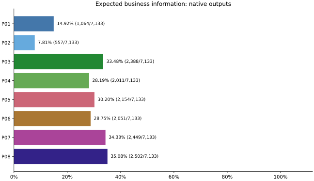

# MO-Parse expected统一程序评测

本报告以现有expected为唯一验收标准，所有结果由同一冻结评分程序生成。八组原生输出横向比较，P07/P08最终正文按修改前后配对比较。

评分协议：`mo-parse-expected-only-v1`；软件：`b2d1a022a2a4225608203449ef64d19571112320c05e2b91be69cc9fdae83643`。质量范围为保存的quality800运行；性能重复不增加独立质量样本。

## 八组原生输出

| 管线 | 业务字段正确 | 业务字段错误 | 固定目标 |
| --- | ---: | ---: | ---: |
| P01 | 1,064 | 6,069 | 7,133 |
| P02 | 557 | 6,576 | 7,133 |
| P03 | 2,388 | 4,745 | 7,133 |
| P04 | 2,011 | 5,122 | 7,133 |
| P05 | 2,154 | 4,979 | 7,133 |
| P06 | 2,051 | 5,082 | 7,133 |
| P07 | 2,449 | 4,684 | 7,133 |
| P08 | 2,502 | 4,631 | 7,133 |

标题、正文、列表、单位及图题文字分别统计，不与业务字段混合成加权总分。完整分项见summary.json，逐项证据见private/target-details.csv和评分JSON。

| 管线 | heading | image_alt_text | item | text | unit_caption |
| --- | ---: | ---: | ---: | ---: | ---: |
| P01 | 1,232/1,698 | 139/315 | 880/1,812 | 1,243/3,669 | 35/45 |
| P02 | 1,228/1,698 | 139/315 | 868/1,812 | 1,241/3,669 | 34/45 |
| P03 | 1,410/1,698 | 147/315 | 1,436/1,812 | 2,458/3,669 | 36/45 |
| P04 | 1,450/1,698 | 157/315 | 1,382/1,812 | 2,476/3,669 | 36/45 |
| P05 | 1,439/1,698 | 146/315 | 1,042/1,812 | 1,758/3,669 | 36/45 |
| P06 | 1,375/1,698 | 144/315 | 1,428/1,812 | 2,430/3,669 | 36/45 |
| P07 | 1,374/1,698 | 146/315 | 1,411/1,812 | 2,435/3,669 | 36/45 |
| P08 | 1,440/1,698 | 158/315 | 1,388/1,812 | 2,493/3,669 | 36/45 |

## P07/P08实际正文变化

| 管线 | 新增正确 | 原正确项损失 | 新增正确业务字段 | 丢失正确业务字段 | 数值字面新增一致 | 字面退化 |
| --- | ---: | ---: | ---: | ---: | ---: | ---: |
| P07 | 91 | 0 | 82 | 0 | 44 | 0 |
| P08 | 73 | 0 | 63 | 0 | 24 | 0 |

以上变化来自实际保存的最终Markdown，内部IR和未打印关系不能补分。数值字面诊断单独比较实际打印的值，不增加业务分母或覆盖业务错误。评分器读取修复本身不算正文改善；原生与最终正文的结果分别保留。

## 原生正确信息保留门槛

| 管线 | 原生正确业务目标 | 正文仍正确 | 业务目标丢失 | 全部目标丢失 | 门槛通过 |
| --- | ---: | ---: | ---: | ---: | --- |
| P07 | 2,449 | 2,449 | 0 | 0 | 是 |
| P08 | 2,502 | 2,502 | 0 | 0 | 是 |

这项门槛直接比较原生输出与当前实际Markdown，覆盖业务字段及标题、正文、单位、图题文字等全部内容目标；旧正文到新正文没有新增退化，不能代替原生信息保留。逐项差异见private/native-preservation.json。

## expected覆盖与具体错误

共同程序已对本轮173个样本的声明expected范围完成比较；每项只有正确或错误。覆盖记录位于coverage.json，内容位置和候选证据保存在逐项结果中。

错误按缺失、数值、单位、期间、业务归属、附注及冲突分别保留，不通过历史原图裁定或旧标注状态退出分母。普通正文按完整文本比较，字符差异与业务字段关系分开报告。逐项错误及其最早出现的输出阶段见private/target-details.csv和failure-stages.json：原生已错记为native_output，原生正确而正文错误记为final_markdown_conversion；该归因不冒充识别、适配或渲染内部根因诊断。

## 执行与采用

本次评分复用保存输出，不产生新的模型推理或解析耗时。各版本执行软件与候选路径保存在评分产物；后处理成本单列，不与原生历史时间相加。

程序对照完成不等于所有输出正确。P07/P08仍有错误的条目继续进入正文缺陷清单；有原正确项损失的修改不能据净增益采用。图片语义不在本轮范围。

## 本次代码修改的单独效果

上表保留最早版本至最终版本的完整变化；本表只比较本次修改开始时的已保存正文与此次CPU回放正文，两侧仍用同一冻结程序重新评分。

| 管线 | 新增正确 | 原正确项损失 | 数值字面新增一致 | 字面退化 |
| --- | ---: | ---: | ---: | ---: |
| P07 | 29 | 0 | 5 | 0 |
| P08 | 33 | 0 | 8 | 0 |

## 处理成本与环境

原生历史处理时间与CPU后处理回放分别列出；未测量值保留缺失，不估算新的端到端时间。预热和初始化保存在execution-costs.json中，不进入正式轮次。

| 管线/版本 | quality800秒 | perf80第1轮秒 | 第2轮秒 | 第3轮秒 |
| --- | ---: | ---: | ---: | ---: |
| P01原生 | 1565.346 | 201.004 | 199.899 | 199.424 |
| P02原生 | 1478.303 | 186.266 | 186.332 | 187.188 |
| P03原生 | 11576.992 | 1001.961 | 893.875 | 937.507 |
| P04原生 | 11826.903 | 778.186 | 967.767 | 778.310 |
| P05原生 | 2908.116 | 278.233 | 275.325 | 276.465 |
| P06原生 | 1619.337 | 202.435 | 202.140 | 202.872 |
| P07原生 | 2411.696 | 279.992 | 276.897 | 274.570 |
| P08原生 | 3327.525 | 316.181 | 310.530 | 311.491 |
| P07-previous正文 | 213.816 | 28.043 | 27.785 | 27.419 |
| P08-previous正文 | 183.092 | 27.680 | 27.463 | 27.424 |
| P07-intermediate正文 | 235.537 | 29.948 | 28.967 | 28.274 |
| P08-intermediate正文 | 182.626 | 27.677 | 27.045 | 27.192 |
| P07-current正文 | 216.087 | 28.397 | 28.021 | 27.742 |
| P08-current正文 | 194.046 | 29.270 | 28.915 | 28.821 |

历史原生运行的TTS观察状态：`observed_activity`；起止计数记录的新增任务：5。TTS驻留且工作负载不受控，短调用可能漏观测；不能称为独占或TTS空闲环境。实际条件和观察范围随原执行记录保存。

正文回放的CPU、内存、网络、GPU设备及软件身份逐版本保存在execution-costs.json；候选环境不提供expected，不调用模型。本轮未部署或操作运行服务。

## 正文版本与资产交付

| 评分组 | 保存正文的运行目录 | 执行软件 |
| --- | --- | --- |
| P07-previous | `/opt/moparse/benchmark/reports/20261031-units-continuations-04/p07` | `dba742040fc1cfb54722d7b190f915dc9131e3e83a724660abdc5c35f822ce33` |
| P08-previous | `/opt/moparse/benchmark/reports/20261031-units-continuations-04/p08` | `dba742040fc1cfb54722d7b190f915dc9131e3e83a724660abdc5c35f822ce33` |
| P07-intermediate | `/opt/moparse/benchmark/reports/20261101-expected-only-06/p07` | `8b292af10747c75ab187fcbb46d2839434faf71d24b85b4cac1a686cc3c8d74d` |
| P08-intermediate | `/opt/moparse/benchmark/reports/20261101-expected-only-06/p08` | `8b292af10747c75ab187fcbb46d2839434faf71d24b85b4cac1a686cc3c8d74d` |
| P07-current | `/opt/moparse/benchmark/reports/20261101-preservation-repair-08/p07` | `f5e9063bfd2ac64be79796389d4cdaf3ad3770a8820a0628a1b245fff05a8a03` |
| P08-current | `/opt/moparse/benchmark/reports/20261101-preservation-repair-08/p08` | `f5e9063bfd2ac64be79796389d4cdaf3ad3770a8820a0628a1b245fff05a8a03` |

Markdown图片alt文字仅作字面对照，单列为image_alt_text；图题正文和正文引用仍属于文字目标。资产文件及引用交付另按候选自己的文件和清单记录，不据alt、文件存在或数量声称图像内容理解。

| 评分组 | 声明资产文件 | 已保存文件 | Markdown图片引用 | 引用有文件 | 引用缺文件 |
| --- | ---: | ---: | ---: | ---: | ---: |
| P01 | 591 | 591 | 591 | 591 | 0 |
| P02 | 591 | 591 | 591 | 591 | 0 |
| P03 | 710 | 710 | 540 | 540 | 0 |
| P04 | 710 | 710 | 540 | 540 | 0 |
| P05 | 605 | 605 | 605 | 605 | 0 |
| P06 | 540 | 540 | 540 | 249 | 291 |
| P07 | 533 | 533 | 533 | 249 | 284 |
| P08 | 592 | 592 | 592 | 592 | 0 |
| P07-previous | 383 | 383 | 383 | 383 | 0 |
| P08-previous | 592 | 592 | 592 | 592 | 0 |
| P07-intermediate | 383 | 383 | 383 | 383 | 0 |
| P08-intermediate | 592 | 592 | 592 | 592 | 0 |
| P07-current | 383 | 383 | 383 | 383 | 0 |
| P08-current | 592 | 592 | 592 | 592 | 0 |

## 文档范围与开发暴露

本轮涉及44份文档、33个文档家族；逐文档与家族成绩位于summary.json。

本轮Lite输出及expected语法已用于读取器和正文转换开发，不能宣称独立测试集成绩。已有样本暴露声明分别保留；性能重复不增加独立文档数。
