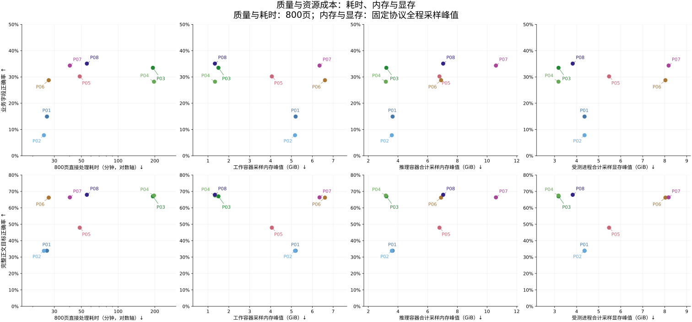

## 内存、显存与质量成本比较

质量与800页直接处理耗时取当前冻结结果；资源取原执行完整协议的采样记录，包含初始化、预热、quality800与perf80。记录没有各样本完整起止时刻，不能把全程资源峰值改称800页阶段峰值。

| 管线 | 800页秒 | 工作容器内存GiB | 推理容器合计内存GiB | 受测显存GiB | 观测向量的支配者 |
| --- | ---: | ---: | ---: | ---: | --- |
| P01 | 1565.346 | 5.201 | 3.638 | 4.359 | 无 |
| P02 | 1478.303 | 5.171 | 3.583 | 4.359 | 无 |
| P03 | 11576.992 | 1.502 | 3.214 | 3.178 | 无 |
| P04 | 11826.903 | 1.339 | 3.182 | 3.178 | 无 |
| P05 | 2908.116 | 4.062 | 6.793 | 5.473 | 无 |
| P06 | 1619.337 | 6.607 | 6.902 | 8.031 | 无 |
| P07 | 2411.696 | 6.346 | 10.599 | 8.176 | 无 |
| P08 | 3327.525 | 1.333 | 7.043 | 3.822 | 无 |

内存来自Docker stats的已用内存显示；推理侧先在同一采样轮内合计当前受测容器，再取峰值。容器读取有先后；工作容器与推理容器分开采样，因此不相加成整条管线的同时内存峰值。显存使用同次进程查询中归属受测容器及其子进程的合计，不使用Torch allocated/reserved代替总量，也不把预算上限当实测使用。

支配检验同时比较业务字段、标题、图片alt字面、列表、正文、单位说明六类正确率及耗时、两项内存、受测显存共十维，不合成加权分数；质量分子分母见report.md。另分别计算只用业务或正文正确率的五维比较，结果保存在resource-costs.json。缺测不按零处理，不给出完整支配结论。结论仅针对记录中的观测向量；有限采样可能漏过更短峰值，不能据此声称实际资源的精确最优或普遍方法优劣。

各面板都是单项成本投影，不以灰叉或阶梯线表示全面支配。速度更快可以同时需要更多内存或显存。

### 采样覆盖与共驻环境

| 管线 | 工作内存有效轮/总轮 | 推理内存有效轮/总轮 | 显存归属有效轮/总轮 | 工作采样间隔中位数/最大秒 | 推理采样间隔中位数/最大秒 | TTS显存峰GiB | 整卡显存峰GiB |
| --- | ---: | ---: | ---: | ---: | ---: | ---: | ---: |
| P01 | 1194/1195 | 1220/1222 | 1220/1222 | 2.013/2.037 | 2.013/3.179 | 4.998 | 9.361 |
| P02 | 1134/1135 | 1161/1162 | 1160/1162 | 2.013/2.033 | 2.013/3.339 | 5.191 | 9.555 |
| P03 | 7305/7307 | 7315/7316 | 7314/7316 | 2.013/2.043 | 2.013/2.690 | 5.191 | 8.373 |
| P04 | 7279/7282 | 7288/7291 | 7289/7291 | 2.012/2.035 | 2.012/3.251 | 5.191 | 8.373 |
| P05 | 1940/1941 | 1968/1970 | 1966/1970 | 2.013/2.183 | 2.013/2.817 | 5.191 | 10.668 |
| P06 | 1170/1171 | 623/628 | 624/628 | 2.013/2.502 | 4.026/5.054 | 5.191 | 13.227 |
| P07 | 1683/1684 | 881/883 | 880/883 | 2.013/2.255 | 4.026/4.088 | 5.191 | 13.371 |
| P08 | 2182/2183 | 2208/2209 | 2206/2209 | 2.013/2.233 | 2.013/6.112 | 5.191 | 9.018 |

实际采样周期包括串行Docker及GPU查询，0.25秒只是轮间等待，不能称为250毫秒采样精度。缺失轮次保留在覆盖分母中。TTS保持共驻、负载不受控；TTS与整卡值仅描述环境，不进入受测资源支配计算，也不通过相减制造管线显存。

### 最终正文CPU后处理内存

| 管线 | 800页进程RSS采样峰GiB | 有内存记录的样本 | GPU |
| --- | ---: | ---: | --- |
| P07 | 0.816 | 173/173 | 未挂载 |
| P08 | 0.787 | 173/173 | 未挂载 |

后处理RSS单列，不能与原生阶段不同时发生的峰值相加。原始测量路径及测量文件身份见resource-costs.json；本次只呈现已有记录，没有重新推理、测量或操作服务。
