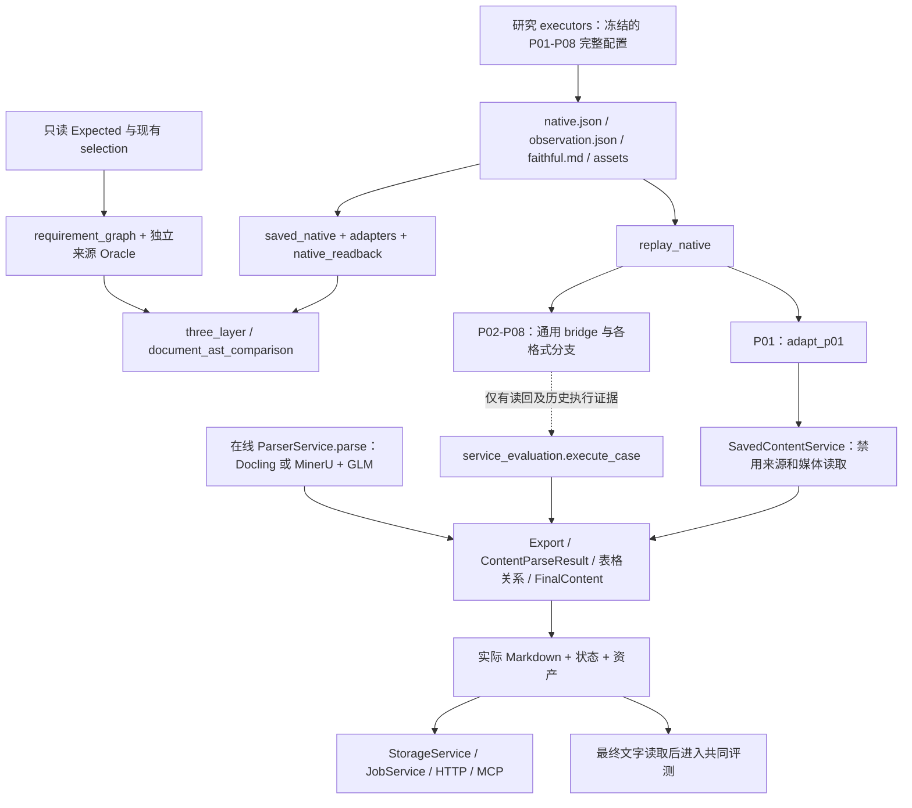

# MO-Parse 整体架构与评测体系审查

审查日期：2026-11-12。审查对象：HEAD `13698628fcc3d1ad552ea5c73feb3ad7ed1612a8` 的源码、有效保存原生 JSON、普通文本、阶段证据和既有验证记录。本报告是架构决策与后续开发说明；质量结果、成本原记录及正式状态仍由[唯一 Lite 报告](report.md)和[评测索引](../README.md)维护。

**决策：先调整共享适配契约和公共内容处理链，再继续接入；停止把 P02 当作下一条独立纵向开发线。** 当前工程已有可复用的导出、表格关系、最终正文、状态和存储组件，但尚未形成八管线共同消费、来源完整、阶段可归因的统一架构。P01 三页闭环证明了一个可用的实现切面，也暴露出公共服务对 `saved_p01` 的依赖。应抽取这个切面的通用能力，以 P01 双分支与 P05 全页 GLM 作第一条横向验证，再用 P03/P04 检查另一种真实结构。不能复制 P01 并逐条增加身份判断。

## 审查现场、证据等级与执行边界

`/opt/mosaic-parse` 与 `/opt/moparse` 均解析到 `/opt/moparse`。接手 HEAD 与任务给出的参考提交相同，工作区干净。本轮读取了八组各 173 份 quality800 的 `native.json`，共 1,384 份保存对象，另读取了 current 要求图、P01 最终正文与阶段证据；只统计字段、来源义务和已有阻塞状态，没有生成候选判定。本轮不重新认证 Expected 或语料。

| 证据标记 | 含义与限度 |
| --- | --- |
| A | 源码与实际调用关系已证实；没有执行相关生产服务 |
| B | 已保存 JSON、文本或阶段记录已证实；字段存在不等于内容正确 |
| C | 既有测试与执行记录支持，注明受控 fixture 或真实保存输入；本轮未重跑软件回归 |
| D | 文档声明，当前源码或材料尚不能支持同等范围的实现结论 |
| E | 当前材料不足或本轮权限不允许验证，保持 unknown |
| F | 本报告的架构建议，尚未实施，也不构成新增执行许可 |

| 身份或状态 | 本轮核对结果 |
| --- | --- |
| 当前软件身份 | 按 `cli.code_identity` 的算法仅读取源码及安装元数据重算：`8e41f4c2c66d808223eb286698d716f3557d11fa2a6c78e78969110518da83e3`；与 P01 最终回归相同 |
| 测试身份 | `tests/source_only.json` SHA-256 `5003397f6a3c9dc97c17271aaebb08af26b7f366ac2a2545522c09a90cd75547`；记录中的 176 个已审查文件哈希与当前相符，其中 163 个测试模块、13 个共享依赖；81 个模块继续排除 |
| 既有回归记录 | [source-only-final.json](../../runs/lite/service/development/p01-closure/source-only-final.json) 和 [JUnit](../../runs/lite/service/development/p01-closure/source-only-final.xml) 记录 4,029 项通过，JUnit SHA-256 `2527b7b924f157acfd4892d46236841be02bb845f3a2ea2c770856b1bd0e022d`；这是历史软件验证身份，不是本轮新测试成果 |
| 唯一要求 current | [requirements/current/index.json](../../runs/lite/requirements/current/index.json)，SHA-256 `09918d7c652aee0d306dc603cbf7c827c6ca01996b8a436d72fb8d4f803b6884`；173 份，`structure_blocked`，`document_ast/1`，`candidate_read=false`，质量继续撤回 |
| current 绑定差异 | 要求 current 的 `software_id=279041a7896ce2dca90646e088978fa754128be253fe179e52ea46ad95a25af4`，早于当前软件；`requirement_gate` 不会接受它作为当前软件的正式门禁。本轮保留原记录，没有重建或重签 |
| 正式服务 current | `benchmark/runs/lite/service/current/index.json` 不存在；既有 `current/p07`、`current/p08` 目录及 P01 development 不是新的八组原子 current 索引 |
| P01 开发样本 | `vanke-repurchase-share-changes-p001-003`，两页 Docling、一页 GLM；原件名 `1201917092.pdf`、原件 SHA 和物理页 1–3 来自既有声明，原件字节本轮未打开或重新验真 |
| P01 输入身份 | [实际 native.json](../../runs/lite/artifacts/P01/measured-quality800-r1/vanke-repurchase-share-changes-p001-003/native.json) SHA-256 `2feddedb01493ad21c58b06dfbfea5a94fd763cb89dd93591b4083f0e94b010b` |
| P01 最终正文与证据 | [final.md](../../runs/lite/service/current/p01/development/vertical-closure-vanke-3p/final.md) SHA-256 `9e2c899567e66599ee29fde3ed71cff3d4d8842f154bd3bdf676336335eb81a7`；[evidence.json](../../runs/lite/service/current/p01/development/vertical-closure-vanke-3p/evidence.json) SHA-256 `b9d22098b797ce2e62ea80825acd7e441c82710b62bfa958c92d9668c2c6df9e`；[最终绑定](../../runs/lite/service/development/p01-closure/final-binding.json) SHA-256 `d8c2e1c96759ecda0925bcf6bebd26456b3cc9ac6215c3ab107a459c828ef3fd` |

接手数字经核对保持：63 份独立来源及合同记录，55 份历史保护基线，107 份比较责任不完整，3 份责任完整但缺整样本独立验收，5 个输入范围目标。63 的依据是 [stage5-oracle-validation](../../runs/lite/requirements/validation/stage5-oracle-validation.json) 的 `executed_sample_ids`；55 的依据是 [baseline-preservation](../../runs/lite/requirements/validation/baseline-preservation.json) 的 `phase3.original_55_current_bound_oracles_passed`。手写断言聚合仍为 `8ff38e32c4e1bf10996c09cf79a22975a232bd03fbc63c63b1abcb2852177ab6`，本轮核对文件未变。这些是原验证范围的保留，不是当前新软件已获得全量独立门禁。

本轮只形成此报告并最小同步三份技术文档。没有修改生产代码、adapter、IR、Expected、评分合同、selection 或任何 current；没有执行转换、候选比较、回放、评分、PDF/图片文件读取、字层、OCR、模型、GPU/TTS/服务操作、部署、提交或推送。JSON 内嵌媒体字段仅作为已有字段观察，未解码或检验媒体内容。历史执行偏差及中止记录保持原样。

## 第一部分：当前真实架构

### 1.1 三条实际链路

虚线表示当前未取得七组新纵向验收，图不表示本轮执行了任一转换。在线源码与保存结果开发入口共享一些函数，入口条件、来源处理、媒体和 IR 构建仍不同。【A/B】

### 1.2 原生生成与保存

研究生产者是 [executors.py](../../../moparse_eval/executors.py#L41) 的 `PIPELINES`、`_SDKs`、`execute_in_worker`，不是在线 `ParserService.parse`。P01/P02 由 `_docling_run` 和 `_glm_page` 组成；P03/P04 由 `_paddle_page` 调完整 Paddle 页面服务；P05 全页 `_glm_page`；P06/P07 由 `_mineru_run` 和 `_glm_page` 组成；P08 `_visual_page` 调官方 two-step SDK。`_init_docling` 实际选择 V1/V2 的不同 options 类，`_mineru_run` 实际传 `tier`，不是改显示名。【A】

保存根为 `benchmark/runs/lite/artifacts/PXX/measured-quality800-r1/<sample>/`。`native.json` 保存 pipeline、config、pages、documents、page_processing；`observation.json` 保存执行状态、页状态、失败、读取块、资源和计时；`faithful.md` 是 SDK/研究导出；媒体文件与 GLM raw 阶段视图另存。只有这些对象组合才构成完整的保存结果，`native.json` 本身没有统一的作业终态。【A/B，executors.py:880、1092、1123】

| 对象 | 真实产生方式 | 保全与限制 |
| --- | --- | --- |
| Docling `documents[]` | `document.export_to_dict()` 加 conversion `status/errors`、`research_group_pages/research_assets` | 同一连续 Docling 段保存一次，页 raw 用 `native_document/source_page` 引用；不会因每页引用复制为多份正文 |
| GLM raw | SDK `json_result/markdown_result/raw_json_result/original_images/image_files` | 主结果、格式器前审计、显示和媒体是不同角色；`research_cross_view_order` 明确 unknown |
| MinerU 文档与页 | `middle_json` 完整文档，页 raw 另有 typed `blocks` 和官方渲染字段 | middle 与页投影并存，不能将相同内容重复计票；官方 renderer 的格式化属于 SDK |
| Paddle raw | 页面 JSON 的 `res`、区域及布局检测结果；另保存 SDK 区域导出、媒体和生成观测 | 布局 score 与文字识别正确率不是同一概念；SDK Markdown 不是另一份独立答案 |
| P08 raw | `ContentBlock[]` 加 `research_export_markdown/research_asset` | 图片裁出、官方 `json2md` 为已声明执行工作；没有 PDF 字层、字符级来源或原生标题树 |

`_native_snapshot` 对不可序列化对象显式写失败并标 `native_preserved=false`，所以“保存 JSON”不是无条件无损保证。`_glm_page` 只保存所选 SDK 入口实际暴露的字段；SDK 之前的未返回内容不能从末端恢复。P08 保存解码块，不含完整解码前布局生成文本，不能据此判定模型是否曾生成某种未保存属性。当前 1,384 份 quality800 顶层 `research_export_errors` 均为空，不能把这个观察扩大为所有 SDK 内部阶段均无丢失。【A/B/E】

研究 `faithful.md` 对 GLM 会附带明示的 raw 独立审计阶段；它适合检查已有视图，不适合作为统一主答案全文直接评分。`read_saved_native` 以 declared branch 调 `READERS`，GLM 主答案仍是 `json_result`。如果将 `faithful.md` 改名 adapted 或同时累计两个 GLM 视图，会引入重复正文和阶段归因错误。【A，executors.py:496；saved_native.py:12】

在线入口只在 [ParserService._build_adapters](../../../app/services/parser_service.py#L101) 注册 Docling 或 MinerU 原生后端与 GLM；没有八个 PXX 的在线注册表。生产 Docling `_export_conversion` 先导成页文字、表格和图片候选，没有在该链保留研究保存对象同等完整的阅读树；MinerU 客户端保存完整 HTTP 响应，但 worker `export_source_blocks` 明确省略 `image_base64`；GLM `_record_response` 保存收到的 HTTP 字节，无法保存服务端没有返回的 `image_files` 对象。研究侧保全不能冒充这些生产交接缺口已解决。【A，docling_standard.py:824；mineru_native_remote.py:465；native_worker/server.py:115；glm_sdk_remote.py:694】

结论是：八组有效研究 JSON 均存在，不能将其中某整条管线写成“原生结果已无法恢复”；但未保存的 SDK 前阶段、生产传输省略项、真实图片可读性，以及缺少明确角色或字符来源的信息，目前不能完整恢复或验证。【B/E】

### 1.3 服务转换的实际输入、输出和损失点

| 阶段及函数 | 实际输入 → 输出 | 来源、状态与主要限制 |
| --- | --- | --- |
| `replay_native`，service_replay_native.py:181 | 保存 JSON + `StoredSource` 元数据 → `DocumentParseResult`、bridge 审计 | P01 特判调 `adapt_p01`；其他分支使用 `render_saved_page`、生产 GLM renderer、固定 typed MinerU projector 或 visual projector。没有 Expected 入参 |
| `adapt_p01`，service_p01_adapter.py:668 | Docling 引用树和 GLM 主区域 → 有序块、表格片段、媒体声明、页状态 | 补充 `type/content/markdown` 消费字段，原 label/payload 另存；Docling 多页文字按完整 charspan 分配；局部未知保全邻居 |
| `apply_source_stages`，service_source_policy.py:20 | 实际 branch capability → 页证据、表格补充、正文补充 | 仅 Docling/MinerU 原生页可用字层/矢量；开发入口显式 `allow_source_reads=False`。这些代码本轮未执行 |
| `ExportService.apply_document`，export_service.py:115 | 页内容 + `TableFragment` → document Markdown、plain text、`TableSourceView` | 调 `assemble_logical_tables`，默认保留物理标记供后续清理；仍依赖精确拥有的显示片段，P01 才产生 exported producer ledger |
| `DocumentIRService.build/_page`，ir_service.py:207、357 | document + fragments + 来源证据 → `ContentParseResult` | 仅 `saved_p01` 按保存原生块逐节点建 IR 并保序；其他入口可能按 PDF 原生块或一页扁平正文建 IR、再几何排序。默认还读源文件求 SHA，开发入口传 declared SHA 禁用 |
| `prepare_native_table_scopes/native_scopes`，table_context_service.py:653、191 | 原生块、源格、局部上下文 → 分类、header scopes、`TextRef` | 消费 `type/content`；目前只有 MinerU 或 `saved_structure.pipeline==P01` 进入已支持分类路径，不是八组公共能力 |
| `TableSemanticsService._apply_owned`，table_semantics_service.py:1045 | 源片段与作用域 → `SemanticTableView`、已打印关系正文 | `CellRef/ValueRelation/SemanticRecord` 保留原格；partial 保全剩余行。`saved_p01` 才选择 nested lists 并输出对应 producer edits |
| 资产 | 在线 `MultimodalService.enrich_page_content`；保存开发由 `SavedContentService.finalize` 记声明 | P01 开发不创建成功资产，声明 2、交付 0，保持 partial；不得用路径或 URI 当图片可读性证明 |
| `FinalContentService.apply`，final_content_service.py:178 | 当前实际 rendering → 最终 Markdown、plain text、精确编辑日志 | 消费 `type/markdown`，清内部标记及明确家具、有限续接；部分范围守卫、空白整理和状态仍依赖 `saved_p01` |
| `StorageService.write_result`，storage_service.py:243 | 最终正文 + assets + warnings → `result.md`、资产索引、日志 | 默认不持久完整 native 私有属性、IR 和语义图；来源可追溯须靠独立日志/sidecar，不能只保留 result 对象的公开序列化 |
| `JobService` 与 API/MCP | 实际 `result.markdown`、`parse_result.status` → 同步正文或持久任务结果 | 同步和异步完成路径均读取 partial；这部分源码已接通。没有本轮线上状态或接口验收 |

在线真实顺序是 `ParserService.parse → _parse_native_pages → _apply_scan_ocr → PDFTableEvidenceService → NativeTextService → Export → Quality → IR → assets → TableSemantics → FinalContent`。保存开发顺序是 `close_p01_document → replay_native/adapt_p01 → 禁止来源阶段 → SavedContentService.finalize → Export → IR → 媒体状态 → TableSemantics → FinalContent → Storage`。正式保存回放的 `execute_case` 还会打开/旋正 PDF 并做资产处理，因此本轮没有调用它来证明纯 JSON 链路。【A】

状态保全也尚非统一契约：原始运行失败和资源/截止状态主要在 observation，`replay_native` 的入参没有原 observation，只能从 native 页和 envelope 重建局部状态。已有失败若不体现在 native envelope，不能凭重新读到文字就恢复其完整执行状态。通用 Docling/Paddle bridge 又把任何局部 warning 作为该页 FAILED，而 P01 区分 WARNING 与硬 FAILED；这是源码中的策略差异，需先统一阶段/类别责任，不能把它误报为管线真实失败率差异。【A，service_replay_native.py:181、294；service_p01_adapter.py:878】

P01 的实际七阶段为 adapted、source_pages、native_pages、exported、assets、semantic、final；前两项来源补充阶段为 not_applicable，资产阶段没有文字变化。实际证据是一个 45 源格、5 条记录的 comparison 表转成 nested lists，37 个非空格有最终位置、8 个空字面未填值，最终两个“图片未交付”仍在正文。已有记录的 368 项字段核对和 producer edits 证明这个样本的格式/交接行为，不能证明 Expected 比较或全量 P01 内容正确。【B/C】

`p01_native_closure.format_readback_checks` 直接核对 native 字段，部分定位/复制辅助函数与 adapter 共用；它能暴露字段丢失，却不能单独充当独立正确性 Oracle。真实输入行为、独立受控语义断言及 Expected 来源验收仍分开保存。【A/C】

不能把 IR 的存在误解为“所有后续阶段都消费 IR”。`TableSemanticsService` 主要消费私有 fragments/views/native blocks 和 document rendering，`FinalContentService` 主要消费 rendering、私有块和编辑记录；公共 `ContentParseResult` 同时是资产/状态消费视图。当前实际架构是多个并存投影加字符串替换，并非单一 IR 驱动的完整语义流水线。【A】

### 1.4 评测链与边界

canonical Expected 是已有作者内容，本轮没有生成或重写；程序“生成 Expected”实际指生成只读评测视图。`expected_readback.declared_scope/read_expected` 读取既有 `source-map.json` 声明的行段与 manifest 的物理页，保留 raw、原始行号、列表父级及范围外依赖。`authorized_source_inventory/source_obligations` 在业务解释前登记授权来源，`requirement_graph.compile_requirement_graph` 编译有限语义和 T/L/B 投影，`attach_document_ast` 再固定内容责任。JSON 是派生模型，XML 是同对象可读投影。【A，expected_readback.py:182、253；requirement_graph.py:342；document_ast_comparison.py:248】

Native 路径是 `expected_evaluation.native_observation → read_saved_native → read_native_relations → three_layer.read_candidate`。Final 路径是 `final_observation → 实际 final.md → markdown_observation → 同一 read_candidate/grade_layers`；final.json 仅供应资产元数据，不能从内部语义关系补答案。`service_observation` 可对实际正文用精确编辑映射提供来源，`service_stages` 冻结真实阶段并保存对象变更；这些都是证据设施，不独立判定质量。【A，expected_evaluation.py:56、145、216；service_observation.py:1120】

`grade_layers` 选择既有 typed 比较或 `grade_document_content`；`requirement_ast` 返回 equivalent/conflict/missing/unresolved，`expected_report.validate_evidence` 重放来源、位置与比较过程，`layer_aggregation` 拒绝未决结果冒充二元错误并作独立层汇总。Frozen software 和 source gate 在候选读取前检查；当前没有通过这条完整链的八组新成绩。【A/B】

## 第二部分：P01–P08 原生格式的真实差异

### 2.1 实际盘点范围和矩阵

下表均来自本轮读取的各组全部 173 份 quality800 JSON；不是抽看八份文档后推定。每组 800 个输入页。P01/P02/P06/P07 均为 701 页原生分支 + 99 页 GLM；P03/P04/P05/P08 各为本组 800 页。混合组中相同 GLM 分支不能再当作四种框架的独立识别能力。

| 维度 | P01 | P02 | P03 | P04 | P05 | P06 | P07 | P08 |
| --- | --- | --- | --- | --- | --- | --- | --- | --- |
| 配置实物 | Docling 2.139 V1 + GLM | 同包 V2 + GLM | Paddle VL 1.5 | Paddle VL 1.6 | 全页 GLM SDK | MinerU 4.0.12 Standard/TXT + GLM | 同版 Advanced/TXT + GLM | MinerU visual SDK 2.0.7 |
| 原生对象组织 | Docling `body/groups/$ref` | 同左 | `res.parsing_res_list` | 同左 | 主区域页列表 | `docvortex.middle/pages/blocks` | 同左，更多 list 容器 | 平面 `ContentBlock[]` |
| 原生阅读树 | 有引用树；非完整标题树 | 同左 | 无该树字段 | 无该树字段 | 无该树字段 | typed 容器嵌套 | typed 容器嵌套 | 无该树字段 |
| 页面区域 | `prov/page_no/bbox/charspan` | 同左 | bbox、多边形、block order | 同左 | index、bbox_2d、多边形 | page_idx、块 bbox | 同左 | 调用页、bbox、angle |
| 表格源格 | `table_cells` | `table_cells`，结果不同 | 内容 HTML 槽位 | 同左 | HTML 或 Markdown 槽位 | table_body HTML 槽位 | 同左 | content HTML/Markdown 槽位 |
| rowspan/colspan | 显式索引和 span | 同左 | 由实际 HTML 提供 | 同左 | 由实际 HTML 提供，GFM 不补 | 由实际 HTML 提供 | 同左 | 依 content 语法；不补缺失 |
| 父子关系 | parent/children、列表组 | 同左 | group_id 是分组观测，不等于父树 | 同左 | 主区域无父树 | typed content、caption/footnote | 另有 list/sub_type | 没有 parent/level 字段 |
| 坐标来源 | Docling PDF points，原点分项；GLM 0–1000 | 同左 | 输入图 pixel，左上框 | 同左 | 输入图 0–1000 | 归一化 0–1；GLM 0–1000 | 同左 | 输入图 0–1；不含 PDF 字符来源 |
| charspan | Docling prov 有；GLM 无 | 同左 | 未提供 | 未提供 | 未提供 | typed 字符字面，不是 PDF charspan | 同左 | 未提供 |
| 原生图片 | picture/image、研究媒体声明 | 同左 | research_media/region_media | 同左 | image_path/image_files | image_body/原媒体字段及研究引用 | 同左 | research_asset 为研究裁图引用 |
| 置信度 | 保存主对象无统一 confidence | 同左 | layout boxes 有 score；文字置信度 unknown | 同左 | 保存主区域未提供 score | 保存 typed 块无统一 confidence | 同左 | 当前块未提供 score |
| 失败状态 | conversion envelope + observation | 同左 | observation/生成观测 | 同左 | observation；不能推造 SDK 内部失败 | observation + typed 投影错误 | 同左 | observation；没有完整前解码状态 |
| 主要研究读取器 | read_docling + read_glm | 同左 | read_paddle | 同左 | read_glm | read_mineru + read_glm | 同左 | read_visual |
| 当前服务读取器 | adapt_p01 专用路径 | 通用 Docling/GLM bridge | render_saved_page | 同左 | GLM 生产 renderer | pinned projector + MinerU renderer | 同左 | project_visual_blocks + renderer |
| 已验证范围 | 一个三页真实纵向开发样本 + 受控用例 | 受控/既有单页读回，非纵向验收 | 同左 | 同左 | 同左 | typed 准备缺口；受控测试可注入 projector | 同左；另有历史服务结果 | 受控/既有单页与历史服务结果，非当前全量验收 |

“未提供”限于已保存对象的该字段，不是对模型潜在能力的推断；不能由其他管线补齐。媒体列只确认声明及引用字段，本轮没有核验图片字节、完整裁区或可读性。表内 HTML 源格是模型输出语法的来源，不是原 PDF 字符级格证据。【B/E】

### 2.2 已确认的差异及当前映射

**Docling V1/V2。** 两组各有 164 个 Docling 文档 envelope、15,525 个 texts、251 个 tables、342 个 pictures、642 个 groups。V1 11,293 个格、516 个有跨度的格；V2 14,308 个格、69 个有跨度的格。相同 schema 不代表相同表格答案；这些是结构统计，不判断谁正确。两组均有 53 个文字节点带多页 provenance，P01 adapter 已有 charspan 分配与 occurrence 身份，通用 `read_docling` 则按 emitted 集合只发一个节点；研究位置模型与服务逐页 occurrence 的核对仍需独立检查，不能直接将 P01 处理复制成研究重排。【A/B，adapters.py:613；service_p01_adapter.py:239】

原生 `orig/text`、`parent/children`、`prov`、表格起止 offset、角色、`row_section/fillable` 都在保存对象。reader 保留引用和 cell 补充字段，P01 stage sidecar 另保留 payload、原 bbox 和分支页；`ParsedTable/TableCell` 只有消费子集。当前两组没有含 `ref` 的 rich cell；对 rich cell 的受控测试不能写成真实样本已经验证。【A/B/C】

**Paddle 1.5/1.6。** 两组都实际保存 `block_label/block_content/block_bbox/block_id/block_order/group_id/block_polygon_points` 与 `layout_det_res.boxes[].score/coordinate/order/polygon_points`。每组 2,405 个区域 `block_order=None`，未知顺序必须保留。`read_paddle` 用数组位置生成 `native_sequence`，保留 group_id，却不把 block_order、多边形或布局 score 显式提升为消费字段；`render_saved_page` 的 `native_payload` 可保存区域原字段，但页级 layout_det_res 仍只在 native 根对象。当前 IR 的几何回排不能替代原生顺序。

两组相同输入的 800 页 layout_det_res 完全相同，parsing_res_list 仅 203 页完全相同，区域 SDK 导出仅 205 页完全相同。这与共享布局模型、不同识别模型的配置相容；不能因版式统计相同就宣称两组误用了同一结果，也不能据差异数量判质量。必须保留两组模型/执行身份。【A/B】

**GLM。** 四组混合 GLM 主区域均各有 1,471 项，P05 全页有 9,104 项。主字段是 `index/label/native_label/bbox_2d/polygon/content/image_path`，没有保存主视图的父树或字符 span。`json_result` 与 markdown_result 是同 SDK 的派生视图，raw_json_result 是审计阶段，不能相加。P01 `_glm_blocks` 严格处理单图包装、局部页 0、实际 index、HTML 角色和原 payload；其他组仍调生产 `_page_regions/_render_regions`，并不自动获得 P01 的来源定位与消费字段。HTML colspan 不是 bbox 等分推出来的源格。【A/B】

**MinerU Standard/Advanced。** 实物均是 `docvortex.middle`，不是旧 `pdf_info`。Standard 有 249 个 table/table_body，未观察到 list 容器；Advanced 有 241 个 table/table_body、285 个 list 容器。两组存在行内 styles、hyperlink、`continues_prev`、caption/footnote、`cell_merge`；扁平文本不足以保存这些差异。`read_mineru` 递归保留容器和行内注记，服务 projector 则要求固定 `docvortex==0.5.16` 并调用官方 renderer；本轮 `.venv` 的包元数据显示 DocVortex/MinerU 未安装，读取 middle JSON 不等于完成 typed 服务投影。【A/B/E】

`attach_source_tables` 按结构 ordinal 给服务片段附原表，没有独立 native table ID 的逐对象强绑定；它是需收紧的映射点，特别是局部畸形表被隔离时。当前没有在本轮执行转换来判定某个实际对象发生错绑，不将静态风险写成已发生的质量错误。【A/E，service_native_adapters.py:92】

**P08。** 保存的是 type/bbox/angle/content/merge_prev，不含 heading level、parent、OCR 字层、源字符或单元格 bbox。官方 `json2md` 的已有显示与服务 `project_visual_blocks` 增加标题 Markdown、包 table_body 是不同阶段；后者不能计为原生恢复了层级。视觉 list 类型不是 Advanced 的嵌套 list 树。复用 HTML 解析、表格绑定和渲染算法合理，套用 P07 的 PDF 补充、原生父树或格坐标不合理。【A/B】

代表性实物均可按 `artifacts/PXX/measured-quality800-r1/vanke-repurchase-share-changes-p001-003/native.json` 定位。本轮在各组全量 JSON 上核对字段形状，随后读取这些相同三页范围的实际节点、表格和分支；没有用 Expected 答案判断 adapter 正确性。已保存的非空媒体数据不在本轮的内容验收范围。

### 2.3 原生字段的实际去向

下表按当前源码追踪，不把未执行的消费路径写成真实 Final 验收。原生对象根始终是原保存 JSON；“审计保留”也不等于字段已被公共消费者正确使用。

| 管线 | adapter 实际读取 | 进入消费模型/Final 的范围 | 审计保留与未验证部分 |
| --- | --- | --- | --- |
| P01 | 阅读树、parent/children、prov/charspan、源格/角色/跨度、主 GLM 区域、媒体声明 | 逐节点 blocks/regions、表格投影、来源支持的 nested lists、实际文字与 partial | orig/完整 payload/原框/引用/页映射在 stage sidecar；只验证三页，媒体、丰富格引用和原 PDF 逆变换未完成 |
| P02 | 同一 read_docling 的树/格，render_saved_page 保留 native_payload；GLM 走旧 renderer | 页文字和 TableFragment 可生成；未接 P01 的统一逐节点 IR/分类准入，不能宣称同等 Final | 原树/源格仍可回到 native；V2 映射和通用消费者的完整去向待真实纵向验收 |
| P03 | parsing_res_list、正文、HTML 槽位、框、group_id、研究区域导出/媒体 | 当前 bridge 生成页正文/表片段；Paddle 无逐块共同 IR 来源类型，表分类未通用接入 | 区域 payload 保留 order/多边形，页级检测 score 留 native；没有本轮 Final 结论 |
| P04 | 与 P03 相同的格式族，保留独立 1.6 输入身份 | 同 P03 的当前消费限制 | 不能借 P03 的正确字段或测试替代自身实际输出去向；同样没有本轮 Final 验收 |
| P05 | 主 json_result 的 label/native_label/content/index/bbox，HTML/Markdown 与区域渲染 | 当前通用路径生成页/表格/图片候选；没有 P01 完整消费映射，媒体字节不在本轮验证 | raw_json_result/markdown_result 单独 native 审计；不向正文累计第二份答案；全页格式验证仍需开展 |
| P06 | middle typed 页与容器、行内 span、HTML、caption/footnote；共享 GLM 主视图 | 源码声明官方 projector 到生产 renderer、fragments 与公共关系服务；固定依赖未就绪，本轮未执行 | middle 与研究页投影均保留；正文/注记/引用的逐对象 Final 去向待固定环境验证 |
| P07 | 同族 typed 结构，另有 Advanced list/sub_type/续接 | 生产风格 blocks 可被现有表格/最终服务读取；历史 Final 不能替代当前同版验证 | 保留历史 baseline/current 与原生工件；未取得当前八组共同链路验收 |
| P08 | 平面 visual 块、角色、原序、content/bbox/angle/merge_prev、HTML 及媒体声明 | projector 生成服务 Markdown 和 table_body，公共服务处理已有内容；没有原生父树或字符来源 | 原 content 与服务投影分开，原生层级缺失保持未知；历史服务结果与受控测试不等于当前全量验收 |

HTML reader 保留显式 `id/headers/scope/ARIA` 和跨度，服务 `TableCellFragment/TableCell` 只消费部分角色，原 HTML 属性主要留在 native_evidence；它们不会因存在于审计中自动参与最终关系校验。各组原生 confidence、polygon、raw label 等字段未被 Final 消费时应作为审计能力保留，不能默认删除，也不能把它们当作已在产品中发挥作用。【A】

## 第三部分：统一 IR 审查

### 3.1 当前模型实际能做什么

仓库没有 `DocumentEvidenceIR` 类，也没有独立名为 `SourceEvidence` 的通用类。实际是 [DocumentParseResult](../../../app/models/parse_result.py#L150) 的私有证据字段、[ContentParseResult](../../../app/models/content_result.py#L409) 的服务消费投影、[SourceRegionEvidence](../../../app/models/source_evidence.py#L18) 的 PDF 未知区域证据，以及 table_service/table_semantics 中的关系对象。文档中的名称不能当作另一套已实现 IR。【A】

| 模型 | 有效能力 | 不足与责任判定 |
| --- | --- | --- |
| `ContentRegion/TextBlock` | 区域类别、归一化框、阅读序、文字、质量、来源类别 | 无原生父子/引用边、原始与派生文字分工、坐标变换链；作为消费视图可保留，作为唯一原生 IR 不足，属 B/C |
| `ParsedTable/TableCell` | 物理表、源页、行列、跨度、表头标记、文字和已有位置 | generated cell_id 不能替代 native JSON locator；无 row_section/fillable/丰富格引用和显式来源角色依据；补内部关联，属 B |
| `TableFragment/TableCellFragment` | 源格、显示 rows、作用域、context_refs、native/pdf evidence、续接和保全 | 含源数据、显示、分类和推断，职责混在一个可变对象；需要明确字段归属和依赖，不必重写整个表格系统，属 A/B |
| `CellRef/ValueRelation` | 值格与完整行列头、单位、期间、附注、真实空白声明 | 可复用；需要可解到原生对象的跨投影映射，不能只到服务格号，属 A/B |
| `SemanticRecord/SemanticTableView` | 记录、分组、局部转换/保留、覆盖格和未解决原因 | 来源关系与显示分开合理；nested_lists 的选择不应受 P01 名称控制，属 A |
| `SourceRegionEvidence` | PDF 字形、来源区域、原表和未知结构的局部保全 | 依赖 glyphs、PDF 尺寸等，无法作为视觉 SDK/HTML 的共同来源对象；须保留为 PDF 专用证据，属 C/D |
| `DocumentParseResult` 私有字段 | 可并存原生块、片段、上下文、关系和最终编辑账本 | 多个 object/list/dict 缺少一致契约；公开序列化不保全它们，须有固定持久证据与引用，属 B |

### 3.2 十项保真核对

| 核对项 | 当前事实 | 决策 |
| --- | --- | --- |
| 原生对象身份 | P01 sidecar 有 native_path/native_payload；服务格另生成 fragment/cell ID | 引用必须同时绑定 native 工件 SHA、视图和 pointer，不能只靠一个路径字符串 |
| 父子与阅读序 | Docling reader 有树边，MinerU 有容器；P01 IR 保序，其余可能扁平或几何排序 | 原生边与服务显示序分开保留；不从 bbox 造父级 |
| 页面和分支 | native 有 page、source_page/page_idx、page_processing；P01 明确 local/original 身份 | 抽取统一页映射；混合 GLM 局部 0 不得变成物理 0 或继承 Docling 来源 |
| 原字与派生字 | raw payload 与 P01 text/markdown 分开，最终有 edit ledger | 将这种区分扩展成共同契约；不得用改写后的文字反填原字 |
| 原表与推断表 | native source_cells、source_header_scopes、pdf/native_evidence 并存 | 标明直接观测、格式投影、服务判断及来源补充，不把 inferred header 写成 native role |
| 源格与消费格 | 原生 cell pointer → fragment 行列 → generated TableCell → CellRef | 保留明确映射，禁止 ordinal 或同文匹配成为唯一绑定证据 |
| 原 bbox 与转换框 | P01 sidecar 有原点、原框和 service_bbox，`NormalizedBBox` 只有变换后框 | 内部保存 frame、尺寸、原点、旋转/裁剪及未知变换；本轮未验证原 PDF 逆变换 |
| 原引用与生成引用 | native $ref/HTML headers 与 service fragment、semantic token 并存 | 保留原引用命名空间和派生边依据；不能相互覆盖 |
| 原始失败与转换失败 | observation、conversion envelope、local errors、warnings 分散 | 汇总时保留 failure stage/category；原生缺失、读取软件错误、未支持转换、媒体未验证分开 |
| 持久可定位性 | 研究 native 根对象保留；P01 evidence 保留关键 payload；Storage 不保存全部私有图 | 明确证据工件和 root 身份，输出包/日志保存不能仅靠内存 native_path |

`ir_service._source_kind` 对未识别 backend 默认返回 Docling，saved-block 分支目前只区分 GLM 与 Docling；`ProvenanceSourceKind` 没有 Paddle 或 unknown。这在当前受限 P01 输入中不等于已发生误标，却使“直接把其他管线接进现有逐块 IR”不成立。新内部来源必须表达真实 producer/branch 和 unknown；不要为通用接入把 Paddle 冒充 Docling，也不要为此在下一轮顺带扩大公开 API。【A/F】

### 3.3 最小调整范围

**A：保留并修使用方式。** 保留表格源格、`CellRef/ValueRelation/TextRef`、记录及 partial 保全、导出/最终编辑重放、Storage 原子写入。它们已能表达局部有证据的数据关系，无需换成万能图数据库或重新做一套语义表格。

**B：补内部字段与关联。** 在现有 `DocumentParseResult` 的私有证据交接处定义小而明确的 adapter 输出：有序消费块、原生引用及 occurrence、分支页映射、原字与显示字、原框与服务框、原生关系、媒体声明、原始失败和适配失败、能力与未知。以一份内部当前定义和源码摘要标识，不建立旧格式兼容链。`ContentParseResult` 继续是现有 API/资产消费投影，公开协议保持。

**C：停止把简化消费模型当全部原生模型。** 原生 Docling 引用图、MinerU 嵌套内容、HTML 槽位及视觉平面区域不必强制同形；保留 native 工件为证据根、用明确引用连接共同消费模型。PDF 字形来源类不能承担所有格式。无需在共同模型重建每个 SDK 的全部可选字段，但任何未提升字段都须能回到稳定的原对象。

**D：不恢复原生未提供的信息。** GLM/Paddle/P08 的原 PDF charspan、视觉块的原生标题父树、HTML 格的真实 PDF bbox、未返回的 SDK 图片/失败细节都保持缺失或 unknown。服务若将来从有权限来源补充，应独立归因与计时，不能改变 Native 成绩。

迁移先从 P01 已验证行为抽取，保留其 native/final/evidence 原字节，不重新命名为历史 baseline。Docling V2 共享同一读取族，只保留 V2 结构输入与模型身份差异。第一轮以 P01 原节点/格去向、状态和精确编辑不退化为验收，另以全页 GLM 检验独立来源分支；不要求重跑历史结果才能保留追溯。

## 第四部分：评测设计审查

### 4.1 三个评价对象应分阶段成立

| 对象 | 真正要回答的问题 | 输入和判据 | 当前实现状态 |
| --- | --- | --- | --- |
| Native Parsing Quality | 固定完整解析配置在相同 Expected 范围保留了哪些文字、关系和业务内容，成本及失败怎样 | 保存主原生视图，经忠实读取后对同一只读 Expected；不能加入 MO-Parse 修复 | 有独立研究入口和保存产物，正式三层成绩撤回 |
| Normalization Quality | 原生结果中已经存在的信息是否完整、正确地交给共同消费链 | 原生对象与适配投影逐字段、逐关系、逐来源核对；Expected 不向 adapter 供应答案 | 有 P01 局部 format checks、stage 对象账本及受控格式测试，没有独立完整验收面 |
| Final Product Quality | 共同处理后的实际 Markdown、媒体、状态和持久交付是否满足目标 | 对同一 Expected 作 T/L/B，另验来源、资产、输出契约及配对增损 | P01 三页工程闭环 partial；P07/P08 有历史配对；八组新统一验收未完成 |

三层 T/L/B 是要求的三个观察轴，不是三个处理阶段。它们可以分别用于 Native 与 Final；不能只算一次，再给同一个结果贴三个阶段名。Normalization 首先是原生信息保全与合法投影的工程验收，不应再造一套可以抵消丢失的平均分。需要归因时，将同一 requirement 的 Native 证据、适配去向、Final 证据及最早变化阶段连起来，既有 T/L/B 和配对增损可复用。【F】

例如原生没有多层表头关系，服务依据同一原生材料中的明确作用域恢复后，Native 只能评价原生可观察表达；适配只负责不丢已有信息；服务恢复动作属于公共内容处理，Final 可以记录改善。若从额外 PDF 来源恢复，另记输入条件和成本。不能将恢复后的关系回填 native observation，或让 normalization 替解析器获得成功。【A/F】

**Native Benchmark 与 MO-Parse Product Benchmark 应分开成立。** 二者共享输入身份、Expected、既定要求与共同判定器，比较对象与处理边界不同。源码已经支持 Native-only：`evaluate_saved` 先声明八组 Native，只有传入可选的 `service_baseline_root/current_root` 才追加历史配对或八组 current；不能说 Native 评分一律依赖服务转换。传入 current 时，`_service_inputs(current=True)` 才要求 active 的八组原子索引。应保留这种可选编排能力，补明确阶段归属、normalization 验收和报告边界，无需另建一套 scorer 或重复入口；正式 source gate、冻结和同版重评仍执行。本轮没有运行已有 Native-only 入口。【A/F，expected_evaluation.py:316、387】

### 4.2 T/L/B 的概念、算法与解释限制

| 层 | 实际定义与计算 | 本轮判断 |
| --- | --- | --- |
| T | `three_layer._text_layer` 先按规范字面匹配，再对剩余完整单元以 Levenshtein 相似度 ≥0.35 召回；累计 N 和 S/D/I，`100 × max(0,N-S-D-I)/N`；全局先累计再截断 | 是相对于 Expected 要求文字的一致性。Expected 含整理后的业务表达，不能称原 PDF 的逐字 OCR 准确率。Native 与 Final 应分别计算；单元配对策略仍可能受分块影响 |
| L | 每条固定的明确关系一票；含标题/列表归属、阅读序、表头绑定、限定与必要续接；值错不自动等于关系错 | 是可观察关系准确性，不是像素版面分。无父树的 SDK 可用实际表达证明关系；不能把角色默认显示级别当模型预测层级。需阶段归因区分适配丢失和原生错误 |
| B | 完整业务断言一票，包含主体、属性、值及全部适用限定；定位不使用正确数值；精确有理数量等价单独执行 | typed 数量、期间、条件、否定及关系必须保留；无法解释的完整陈述可按已固定、独立验收的内容合同承担，不能无限扩展通用语言解析或把未覆盖内容改成已覆盖 |

依据为 [three_layer.py:1882、1927](../../../moparse_eval/three_layer.py#L1882)、[layer_aggregation.py:114](../../../moparse_eval/layer_aggregation.py#L114) 与[当前合同](../../evaluation-tasks.md#three-layer-evaluation)。四态用于程序可判定性；只有已经可靠判定的 correct/incorrect 才进入正式汇总，unresolved 不是 0，也不是 N/A。【A】

空白、字宽、Markdown/HTML 控制语法和合法折行由读取/投影政策处理，严格字面差异另留证；数字、单位、符号和否定不可被清洗。服务中的 HTML/GFM→列表是产品转换，评分中暴露 HTML/GFM 结构是忠实读回，两者不能相互替代。T 不因取走 B 的数值便只剩“普通正文”；L 不因 T 错而整层归零；B 不因句子原样保存就自动获得其所有类型化限定。【A/F】

保持用户确定的 `S=(T+L+B)/3`。三层等权可作为当前项目的决策约定，但三层相关、B 的票数粒度和“重要”范围依赖固定 Expected 编译政策，总分不是三个统计独立测量的平均，也不是客观通用冠军指标。目前实现将可解释的明确业务属性纳入，尚没有独立的业务严重程度分层来证明每项同等重要；不应靠继续扩张语法解释器解决研究重要性问题。关键业务错误、未知、来源和交付门槛应与三层并列，不暗改权重、封顶或另加质量加权成本分。【A/F】

TLB 足以承接当前 Expected 中的文字、明确逻辑和业务要求，**不足以单独回答完整原生几何准确率、原 PDF 逐字 OCR、图片内容正确性或完整产品交付**。这些超出当前参考或权限的研究问题应明确未测，不增加图像语义任务或用新标注替换既有答案。

来源和交付更适合按下表报告，不作为可被文字分数抵消的第四分项。这里的门槛是架构建议；当前正式执行仍按现有合同和授权，不在本轮增删准入项。【F】

| 情况 | 合适的表达 | 阻断范围 |
| --- | --- | --- |
| 对象身份/视图来源冲突，或软件无法可靠读取 | 来源可信度硬门槛及具体未知证据 | 阻断依赖这些来源的判定、阶段归因及完整产品声明；不能因文字碰巧正确而通过 |
| 原生真实缺失、失败或未处理 | 原运行状态、错误阶段及保留分母的候选缺失 | 可在已验证 scorer 下如实判相应要求错误，不能因 failed 状态删除样本 |
| 已有信息未被适配或比较器读出 | normalization/software failure | 阻断相关发布，先修读回；不转嫁为解析器错误 |
| 图片未交付或引用不闭合、包无正文 | 产品 partial、交付覆盖和明确原因 | 阻断完整交付/采用；文字分层的局部证据按明确范围另报，不将图片缺失折算成 T 后称完成 |
| 信息性 warning | 保留原 code、来源、范围和影响 | 不把所有 warning 一律当硬失败；未知内容或交付不足才按其真实影响阻断 |

现有 `candidate_delivery` 只从清单、引用和文件 stat 提供交付观测，不检验图片内容；`StorageService.build_bundle` 目前还会跳过没有路径的资产并继续写包。它们不能单独提供完整交付 gate 的全部证明，本轮也没有运行这些媒体或打包路径。【A/E】

### 4.3 独立 Oracle、软件回归、真实格式与候选比较

| 证据 | 当前能支持的结论 | 不能支持的结论 |
| --- | --- | --- |
| 63 份独立来源/合同 Oracle | 原验证软件下，手写来源声明、责任与受控能力通过；文件与 current 原身份保留 | 63 份真实解析候选已正确，或全 173 份已完成 |
| 45 项既有能力记录 | 数量、作用域、递归 AST、容量、内容顺序等对应已有执行用例 | 全比较能力 gate 已通过；记录本身明确 `full_comparison_capability_gate=not_passed` |
| `test_three_layer_native_formats.py` | 五种真实字段形状的独立虚构 fixture 可进入共同 grader，包含关系与错值反例 | 五种实际保存原生文档均完成质量验收；文件 docstring 明确 invented content |
| `test_service_replay_eight_pipelines.py` | 分支、HTML 引用、媒体声明、来源许可等受控接口行为 | 八组真实转换验收；P06/P07 一些测试注入 projector，不证明固定 SDK 环境已准备好 |
| P01 三页真实 JSON 到正文 | 真实字段读回、共用函数调用、来源去向、状态与文本持久化的局部闭环 | Expected 评分、媒体完成、全部 P01 或其余七组通过 |
| 4,029 项 source-only 回归 | 当前软件与已审查文本/JSON 测试身份一致，历史运行有通过记录 | 本轮重跑、模型推理质量、真实候选比较或正式评分许可 |
| `expected_report.validate_evidence` | 逐项证据可重放、汇总与判定一致 | 判定的独立正确性；重放和编译器共用实现仍有共错风险 |

Expected 和 candidate 都经过有限的公共语义读取器，这有一致性价值，也存在共同错误导致自证的风险。`source_obligations` 的独立原文盘点、编译前手写断言和突变测试必须保留；真实 Expected 不作候选自比较。产品增强代码与评分可以共享无损语法读取，不应共享“补答案”的判断和最终正确性 Oracle。【A/C/F】

### 4.4 107 份责任缺口的实际分类

本轮逐份读取 173 份 current 图的 `comparison_coverage`，关联 `obligations` 到原始 inventory 的 layers、`analysis_limitations` 到 unresolved 的 layers；只统计现有 blocking，不重新执行比较或修改状态。107 份身份完整列在附录 A。累计有 6,703 条 blocking obligation、5,222 条 blocking limitation；二者互有关联，不能相加当作独立缺陷、未识别句数或业务错误数。

| 分类 | 当前证据与数量 | 对下一阶段的实际阻断 |
| --- | --- | --- |
| 1. T 文字责任 | 23 份有 340 条 T 来源义务 pending；若连同现有 T 标记 limitation，涉及 27 份 | 阻断对应文字范围的完整 T 结论；不阻断仅读原生结构、抽取共同 adapter 契约 |
| 2. L 结构/归属责任 | 103 份有 L 层 blocking limitation，其中 96 份还有 L 层 blocking obligation | 阻断这些范围的 L 判定及完整三层成绩；不是所有无关关系均不可研究 |
| 3. B 业务责任 | 103 份有 B 层 blocking limitation，其中 95 份还有 B 层 blocking obligation | 阻断相应业务、数量或范围结论；不能拿全段保文掩盖既定 typed 要求 |
| 4. 来源可信度 | 已存 coverage 的 source_complete/structure_complete 均为 173/173；未显示以 source_complete=false 分类的样本 | 这只是生成要求来源清单的状态，不证明语料真值、adapter 引用可靠或当前软件 gate 通过；后者因身份/独立证据等仍阻断 |
| 5. 完整性/交付 | 107 是 Expected 比较责任集合，不是媒体或 ZIP 缺陷清单，无法由它推导缺图数量 | 媒体及 ZIP 单独阻断 Product 完整交付；P01 2 处媒体缺失、bundle 缺 Markdown 是已有独立证据，不混进 107 降数 |
| 6. 仅局部关系/表达 | 有精确来源和少量 blocker 的样本，例见下文；未建立可自动验收的“局部无害”分类 | 可隔离做组件诊断，必须保留该样本未通过状态；未修改合同前不能据此发布局部分或完整研究结论 |
| 7. 完整内容已承担的语言分析 | 全 173 图有 30,713 条 `language_analysis_only`；107 份都同时包含这类已承担限制和真正 blocker | 这些已承担项不要求再修通用语言分析才能进行内容比较；但不能据此豁免同样本的其他阻塞 |
| 8. 额外输入/授权 | 5 个既定跨页范围目标，身份见下表；本轮无权修改范围或回到原件 | 阻断这些输入依赖的完整接受与全范围质量发布；不阻断 source-free 适配工程。其他 grammar pending 不等于需要更多 PDF |

按现有 layers 的互斥签名，107 = **80 份 LB + 23 份 TLB + 4 份 T**。这是已登记影响层的审查视图，不能把其余层直接改成 passed；缺少整样本 Oracle、candidate 读取和当前软件绑定等门槛仍独立存在。4 份只登记 T 阻塞的是 `hkex-audit-committee-p109-111`、`hkex-quarterly-results-p074`、`huawei-financial-summary-p007`、`tencent-title-transfer-status-p115-117`。

23 份 T 来源义务与 27 份 T 限制样本不是同一口径。额外有 T limitation 而没有 T pending obligation 的四份是 `huawei-digital-energy-p037-040`、`nvidia-business-manufacturing-people-p096-104`、`pboc-policy-columns-p019-026`、`tencent-title-transfer-status-p115-117`。旧诊断中“167 份有非 deferred semantic pending”统计的是语义解释视图，不能继续当作比较责任缺口总数；应以 current 的 107 及具体 responsibility 为准。

| 局部实例 | 实际阻塞记录 | 允许的结论与禁止的放宽 |
| --- | --- | --- |
| `hkex-financial-cards-p010` | 1 条 `compound_metric_series_interpretation_unsupported`，关联 11 条 blocking obligation，涉及 L/B | 能确定修复入口是复合指标系列，不需先实现通用英文语法；1 条 limitation 不等于仅 1 个业务要求 |
| `sf-auditor-grid-prose-responsibilities-p087-088` | 1 条 `enumeration_introduction_roles_unresolved`，3 条 blocking obligation，涉及 L/B | 局部引导/归属不应阻止其他 adapter 字段盘点；不能删掉引导句给整个样本通过 |
| `tencent-title-transfer-status-p115-117` | 0 条 blocking obligation，仍有 1 条 T `source_has_no_supported_semantic_disposition` | “pending obligation 为 0”仍不足以通过，需独立核实这条限制的真实文字责任 |
| P01 开发样本 | current 要求图仍有 5 条 blocking obligation、3 条 L/B limitation | 真实转换工程可成立，Expected 比较仍不完整，恰好说明两种验收不等同 |

上述精确记录均可由附录 A 对应图的 `comparison_coverage` 与 `unresolved` 定位。`source_obligation_pending`、列表范围、独立字段角色和系列数量是主要 blocking 家族；不能仅凭 reason 名称自动判定哪个可转为 language_analysis_only，必须核对精确来源、父链、既定表示责任和独立断言。

| 保留输入范围目标 | 原有 Expected 依赖位置 |
| --- | --- |
| alibaba-strategies-p009-010 | complex-alibaba-2025-annual，L230 |
| midea-strategy-p025-036 | complex-midea-2024-annual，L417 |
| pboc-banking-columns-p029-040 | complex-pboc-stability-2024，L540 |
| pboc-macro-columns-p011-018 | complex-pboc-stability-2024，L252 |
| pboc-policy-columns-p019-026 | complex-pboc-stability-2024，L252 |

Alibaba L2353 的两种附着仍是原有独立语义歧义，不能选一个有利答案，也不能因有完整内容证明便宣称其因果/目的附着已经解释。3 份责任完整但未独立整样本验收仍为 `iea-adoption-ai-types-p025-031`、`pingan-business-highlights-p012-013`、`pingan-health-senior-care-p025-030`；它们不属于 107，也不自动加入 63。

结论是：**107 不必全部先修才能开始共享适配和公共链路工程；现有正式评分和八组回放门槛不能因此提前解除。** 对已隔离的能力可以保留软件/格式结论；若未来希望发布单层或预声明局部研究，须先得到明确合同与执行授权，固定其原有要求、覆盖限制和失败政策，不能本轮把 107 排除、用 66 或 63 份替代正式分母。

### 4.5 门禁究竟阻断什么

`requirement_gate.validate_expected_structure_gate` 不只查总数或 passed 字段：它检查当前 software、完整 selection、生成图及覆盖摘要、每份独立来源 case、比较能力和突变证据，再重新绑定 canonical。`semantic/1` 要求语义解释完整；`document_ast/1` 可保留已由固定内容责任承担的语言分析，仍要求来源、结构、责任与独立验收完整。`content_comparison_ready` 不是许可。【A，requirement_gate.py:75、128】

`service_evaluation.launch` 在 warmup/measured 之前也核对 source gate、软件和无答案 receipt；worker 再验 receipt，不能以“只是预热”绕过。`activate_executions` 要求八组同软件、同 scope、实际 final 文件且通过验证，才原子写 current/index.json。正式 scoring 另须当前冻结、真实格式及候选诊断，已知读取缺陷不能记为候选错误。【A】

目前既存在实质的 107+3 和输入范围限制，也存在 current 要求与当前软件身份不匹配。应先承认这些是不同门槛，不能用重新写 software_id、复制通过摘要或增加测试数修复。对于纯格式工程，另保留明确受限的开发入口；对于正式回放和评分，继续执行现有严格门禁。【F】

## 第五部分：公平实验设计

### 5.1 已有共同条件与残余偏差

| 项目 | 源码/保存证据 | 审查判断 |
| --- | --- | --- |
| 输入和预处理 | 同一 Lite 声明、共同方向模型、200 DPI RGB、方向只处理一次；混合配置用同一 `_route` 策略 | 保留输入 SHA、page_processing、分支和初始化身份；不因“同样 800 页”便忽略逐样本/分支差异 |
| 路由 | P01/P02/P06/P07 原生与共享 GLM；P03/P04/P05/P08 全页本组识别 | 比较完整固定配置，不能解释为底层模型的纯识别胜负；原生 701 与共享 99 页应分别披露 |
| 框架内部处理 | Docling 的 reading order/TableFormer、Paddle 的布局/区域格式器、GLM formatter、MinerU typed renderer/视觉后处理 | 都属于各声明管线的 native 边界；不能把 SDK 已完成处理记为 MO-Parse 收益 |
| 图片 | 研究执行在固定入口生成/裁取媒体，生产/开发媒体入口不同 | 原生媒体保全与 Product 完整包分别验收；本轮不作图片正确性判断 |
| 工程投入 | P01 多轮专用修复、nested_lists 和逐节点 IR；其余组主要是旧 bridge | 现在直接比较八组 Final 会混合原生质量和接入成熟度。先使共用能力按证据适用，不给其他组自动补假结构 |
| 来源许可 | `branch_capabilities/permitted_pages/apply_source_stages` 按真实页 branch 授权 | 同一公共版本仍可能有不同合法输入信息。Product 应先比较所有组 source-free 条件；额外 PDF 补充另作明确配置，不能与视觉组混称同条件 |
| 开发暴露 | Expected、保存 Lite 和 P01 选择均已用于工程开发 | 属开发材料，不作未见测试集。分层按完整文档/家族，perf 重复不是独立样本 |

当前没有证据表明每条管线受到同等人工实现投入，也没有已验证的八组 Final 同条件成绩；这不使有效 Native 保存结果失效。应区分“当前产品接入能力比较”和“固定共同处理后的解析器组合比较”。后者需先冻结共同处理能力，再看同输入的实际结果。【A/B/F】

本轮还读取了 `benchmark/execution-lock.json` 的实际配置：V1/V2 的 TableFormer revision 分别为 `fc0f2d45e2218ea24bce5045f58a389aed16dc23` 与 `e41ba5da7ef69004f4b329168791c2987abf917c`，Paddle 1.5/1.6 的 VLM revision 分别为 `2a4195faa5e7914c12f2fc601d72c81caf8d2da5` 与 `c5630abae1d940eafe0697512a0325494b02ab42`；P03/P04 声明共享布局 revision。这里核对的是冻结记录，没有打开模型权重重新验真，也没有操作模型服务。【B/E】

锁内八组 `graphs.evidence` 仍指向已不存在的 `benchmark/reports/20261026-repaired-preflight-02/execution-readiness.json`，当前 `benchmark/runs/lite/preflight/execution-readiness.json` 存在。本轮仅确认引用地址断开及新位置存在，没有把两者自动判成相同证据或重写历史锁；后续冻结审查应通过原身份追溯。这是证据地址的缺口，不能据此反推原执行不曾发生或改写已存成本。【B/E】

### 5.2 公共处理与身份冻结

各层需记录 native 执行锁/模型与 SDK 身份、adapter 代码摘要、内部契约当前定义摘要、IR 构建代码、table context/semantics、FinalContent、输出规范文档摘要、scorer 与要求图/Oracle/输入 scope、资源及允许来源。当前 `cli.code_identity` 一次性哈希 evaluator、app、native_worker 及部分依赖，能拒绝脏软件混用，但不能独立说明哪个阶段发生变化；保存到分组件身份有利于归因，仍要有统一执行总身份。【A/F】

这是记录单一当前定义的身份，不是建设多版本 IR、自动迁移或保留旧评分兼容入口。历史 native、baseline、成本和已有证据保持字节，不用当前转换器“升级”历史答案。公共处理更改后，相关所有组用同版本重验/重评；不能只重算 P01，再与旧 P02 或旧 P07/P08 混排。

### 5.3 成本核查

原始数据为 [processing-cost-summary.json](data/processing-cost-summary.json) 及其指向的 run/observation；Native 原执行 `run_id=20261026-lite-v3`，软件 `c6e7f5c0cdcbb8801d17595c515fcbe7794111c396bfe58a6d0ab71a199db28e`。下表只抄录原测量并以原数据的每输入页字段展示口径，不生成新成绩或排名。

| 管线 | quality800 处理秒数合计 | 每输入页秒数 | perf80 三轮中位秒数 |
| --- | ---: | ---: | ---: |
| P01 | 1565.35 | 1.9567 | 199.90 |
| P02 | 1478.30 | 1.8479 | 186.33 |
| P03 | 11576.99 | 14.4712 | 937.51 |
| P04 | 11826.90 | 14.7836 | 778.31 |
| P05 | 2908.12 | 3.6351 | 276.46 |
| P06 | 1619.34 | 2.0242 | 202.44 |
| P07 | 2411.70 | 3.0146 | 276.90 |
| P08 | 3327.53 | 4.1594 | 311.49 |

这些是 worker 个案直接时钟的合计，不是整批墙钟。`execute_in_worker` 从共同预处理前计时，包含必要渲染、解析、SDK 导出、JSON 编码和必要媒体准备，在纯持久化前结束；初始化与预热另记。不能把只含某一原生分支的 server duration、source-only 回归约 397 秒或 P01 开发转换时间替换进此表。【A/B】

历史 P07/P08 baseline/current 另有 CPU 后处理成本：P07 quality 合计分别 216.09/216.84 秒，P08 分别 194.05/181.99 秒。它们属于不同历史软件，不能给本次共享链调整提供成本值。`execute_case` 已分 native bridge、来源、exports、IR、assets、semantics、final content，并把载入、最终持久化及 stage ledger 单列；snapshot capture 开销留在处理时间并有独立观测。adapter 读回与其显示投影目前融合在 bridge，没有八组独立、同版的纯 adapter 成本，也没有可比的人工开发成本记录，保持 unknown。【A/B/E】

原生 CPU 前处理为 8 CPU/8 GiB，推理服务宿主为 4 CPU/20 GiB，自有评测 GPU 预算 16 GiB；原 CPU 后处理为 8 CPU/8 GiB、串行、无 GPU/网络。16 个分析进程只适用于保存输出分析，不修改这些执行资源。配额不是物理核独占，独立峰值不可相加。TTS 共驻、负载不受控，原始首尾计数从 71 到 76，短调用可能未观察；不能解释为独占或空闲 GPU。原 GPU 捕获例外属于冻结记录，不在本轮修复或重新试验。

以后比较应同时展示固定 Expected 范围的 Native/Final T/L/B、关键错误和增损、各阶段实际成本、每页成本、文档类别/家族及失败分布；不将历史 Native + 新后处理时长相加冒充新端到端测量，不从目前无质量成绩的成本表选择“最优解析器”。

## 第六部分：明确的架构决策

| 决策 | 模块或做法 | 依据及影响 |
| --- | --- | --- |
| 保留 | 八组独立 native 工件、声明分支、共同研究读取、原始成本 | 研究原始对象与服务派生对象分离成立；不需要重新推理或改写历史结果 |
| 保留 | 表格源格/作用域/关系模型、partial 剩余保全、精确 final edits、Storage 原子落盘 | 已支持有证据的内容表达改善；P01 可作为保全锚点，不能扩大为全量验收 |
| 抽取共享能力 | P01 的单图 GLM 包装、Docling occurrence、消费块、媒体未知和逐节点来源交接 | 同格式为五个读取族，P01/P02 共享 Docling，所有 GLM 分支共享主视图规范；不写八个重复处理器 |
| 抽取共享能力 | 表格上下文/语义/最终清理的能力输入与状态传播 | 以来源类型、明确关系、边界和能力决定行为，移除 `saved_p01` 准入及输出风格判断；保留实际 branch 权限 |
| 调整 | 私有证据交接与 IR 构建 | 原生引用、页映射、来源/派生差异必须结构化；公共消费视图不能吞掉丰富原生能力，也不承担所有 SDK 字段 |
| 调整 | 适配前后信息去向与阶段验收 | Normalization 以原生信息为核对对象；增加 IR 建立时的明确证据边界，现有七阶段没有独立 IR 快照；不另造质量总分 |
| 保留并明确归属 | 已有 Native-only 与可选 Product 编排；补分组件身份 | 源码已能独立选择研究对象，不重复建设入口；加强阶段标记、normalization 验收、固定完整分母与各自报告边界。本轮不改门禁 |
| 延后 | P02 独立纵向开发、其余组全量转换、八组 replay、正式评分、部署 | 先闭合共享输入契约和横向实物验证；正式执行继续受门禁与明确授权控制 |
| 延后 | 媒体字节验收与完整 ZIP | 这是必要产品交付，不是本轮只读审查可执行事项；后续需有相应输入权限和接口验收 |
| 废弃其后续使用 | 以管线名选择公共分类/渲染、以研究 Markdown 补 adapter、均分 bbox 当源格、无证据 ordinal 当唯一身份 | 会使接入成熟度变成成绩、来源推断变成原生能力；本轮只提出替换方向，没有删除核心代码 |
| 停止扩张 | 把通用自然语言完整解释当所有文档保文的前提 | 已有 document_ast 合同支持独立内容责任；只补实际阻塞的有限数量、范围和结构，保留 typed 保护，不靠批量改状态降 107 |

公共层应处理：内容分类、表格上下文和关系、明确页面家具、正文顺序与有限续接、最终 Markdown、partial/warnings、来源交接、资产清单及 Storage。adapter 应处理：原生包装/字段、对象引用与页身份、坐标变换、原生表格语法、失败和媒体声明。公共层不接收 Expected，也不以 P01/P02/P03、公司名或文件名选规则；能力差异由具体证据而非身份白名单表达。【F】

### 6.1 目标交接结构与责任

下表是最小修改的目标，不是已实现或本轮新执行流程。

| 层 | 输入 → 输出 | 来源、错误与身份要求 |
| --- | --- | --- |
| 原生解析 | 声明输入 → 各 SDK 实际返回 | 固定 pipeline/model/SDK、输入和资源；保留部分返回、失败和未处理页 |
| 原生保存 | 实际返回 → native + observation + 导出 + 媒体声明/文件 | 不替换原对象；工件 SHA 和各视图用途；缺失或不可序列化明确记录 |
| 格式适配 | 各自原生格式 → `DocumentParseResult` 及私有有序内容证据 | 五读取族、原生对象/occurrence/页映射、原字/显示字、原框/变换、媒体和原始/适配错误；代码与契约摘要 |
| 统一消费模型 | 已适配内容 → `ContentParseResult` 和关系消费对象 | 保留向 native 根对象的映射，不把消费模型充当所有 native 的替代；单一当前定义 |
| 公共内容处理 | 明确能力和已保全内容 → 分类、范围、关系、正文、状态 | 推断与直接观测分开，有未决则保全，记录真实 producer edits；固定 context/semantics/final 代码 |
| 最终交付 | 实际正文 + 实际资产 → Storage、HTTP/MCP、完整包 | 字节一致、引用可用、manifest、partial/warning；输出规范与交付身份，不混内部审计正文 |
| 分阶段评测 | native、适配去向、实际 final → 各阶段证据与结果 | Expected 只进入判定侧；TLB 两阶段各算、normalization 单独保真验收；共同 scorer/要求/Oracle 和完整 scope |

## 第七部分：新的工程推进路线

### 阶段一：抽取共同交接，横向验证 P01 与 P05

第一项公共能力是**有来源、保序、可表达未知和失败的 adapter 消费契约**，以及唯一的 source-free finalization 调度。先解决真实字段不相容和 `saved_p01` 分叉，再扩张内容语义规则。以 P01 已有三页材料作保全锚点，以 P05 已保存全页 GLM 检验相同格式解码在另一个 pipeline 上进入同一公共服务；这是第一条横向验证路线，不是复刻一个 P05 专用最终处理器。

交付是原字段到消费字段/审计的去向、共享格式解码、统一页与引用身份、公共 finalization 和状态、实际阶段/IR 证据。验收须包含真实保存 JSON 的独立格式核对与受控反例，保持 P01 既有正文、源格去向、媒体 partial、原生字节和公开 schema；变化如来自明确缺陷修复，逐项说明原生证据和真实正文影响。所有主视图、空视图、局部未知、错误分支、原点、charspan 和媒体声明都须有可复核结果；只通过合成模块不够。

阻断条件是原生对象不可定位、读回依赖 Expected、GLM 视图混加、缺少状态、公共服务仍按 PXX 决定行为、或无法证明 P01 保全。上述实现/转换需下一轮明确授权；本轮没有执行。

### 阶段二：Paddle 横向反证，再接同族差异与独立视觉格式

第二条路线选 P03/P04。理由是它们提供像素框、可空 order、布局 score、多边形、HTML 表格及媒体映射，能反证共享契约是否只为 P01 设计。一个 Paddle 读取族保留 1.5/1.6 的独立执行身份，不能把 layout bbox 变为 cell bbox，不能把 group_id 变为父子关系；对正文网格与确认数据表分别验收。

P02 在阶段一契约稳定后作为 Docling 族的 V2 差异验证接入，重点验本轮观察到的源格数量、跨度、角色和多页 occurrence 差异；不单开一条公共内容规则。P06/P07 准备固定 DocVortex 环境后共享 typed reader/projector，分别验 Standard/Advanced 容器、caption/footnote、list 与续接，禁止用注入 projector 的测试替代真实固定依赖。P08 保留独立视觉块 adapter，只共享明确 HTML 槽位和公共消费能力，验证无字层、无父树时的 unknown 和 partial。

这一阶段的交付是五个格式族对八配置的能力矩阵、真实格式的来源去向和同一公共处理链结果；保留 native/ref/consumer/rendering 的差异。验收以字段/关系不丢、状态不伪造、能力边界和实际正文为准，不要求所有格式拥有相同 native 字段，也不以共同函数数量或新增测试数为完成指标。

阻断条件是缺少固定依赖、原生关系被扁平化后无法追溯、默认 Docling 来源被错误泛化、ordinal 映射没有唯一证据、视觉路径获得额外字层，或媒体未知被改成成功。资产字节和包交付须按另行允许范围完成，不能在纯文本阶段宣称完整产品。

### 阶段三：独立修复评测阻塞，再启动受限诊断和正式执行

先按附录 A 的实际 T/L/B 阻塞修复必要的有界来源责任、范围和已有 typed 合同；给 3 份责任完整样本补独立整样本验收；保留五个输入范围及 Alibaba 歧义。不要把阶段一、二的格式工程锁死在“先理解所有自然语言”，也不要反过来把格式验收当 Expected 要求完整。

保存输出诊断的最早时点是：后续有明确授权，独立格式/来源核对通过、局部 Expected 要求和比较反例可执行后，按现有 strict subset diagnostic 约束进行有界真实文字诊断；不需要先全量 replay，不产生正式主分或缩小正式分母。本轮不启动此诊断。若是全范围诊断，则仍须当前完整冻结和结构绑定，不能把 173 个 sample 显式写出来绕过门禁。

**八组真实 replay** 的必要条件是新的明确执行授权、八配置来源权限与固定依赖准备、共享链真实格式和状态预检、P01 保全、同软件下的要求图/来源 Oracle/能力/突变证据和当前 expected gate、完整原生 scope，以及 8 CPU/8 GiB、串行、断网、禁 GPU、expected 不挂载的隔离环境。五个范围按既有门禁保持，不通过删除或放宽来制造门禁。warmup 同样受约束。当前这些条件未满足；本报告不授权 replay。

新执行生成独立 `service/executions/<identity>/pXX`，阶段和失败保留；只有八组同版同范围、实际 final 和验证齐全才原子选择 current。P07/P08 历史 baseline 保留，P01–P06 不制造历史 baseline。Product 先报告 source-free 条件；任何允许的 PDF 补充另列来源及成本，严守各 branch 许可。

**正式评分** 还必须有同一只读 Expected 的全部责任及独立验收、当前 scorer 冻结、真实保存输出诊断支持且无已知读取缺陷、各层合法分母、完整范围与五个输入范围的明确接受条件。保存输出分析使用 16 个 CPU 进程；统一重评所有受影响 Native 与实际 Final，分别报告 T/L/B、同目标增损、错误及覆盖。只有单层局部可靠证据时，保留其限定结论，不发布完整成绩、排名或采用结论。部署、提交和推送继续另行授权。

### 下一轮 Codex 的具体代码切入点

| 优先级 | 文件和函数 | 应做的最小工作 |
| --- | --- | --- |
| 1 | `app/models/native_content.py`（拟新增的小型私有交接类型）；`app/models/parse_result.py:DocumentParseResult` | 定义原生引用、页/branch/occurrence、原字与显示字、原框与消费框、失败和能力的交接；复用现有结果容器，不新建万能文档 IR 或公开 API |
| 1 | `moparse_eval/service_p01_adapter.py:_docling_blocks/_glm_blocks/_render/adapt_p01`；`service_native_adapters.py:render_saved_page/_table/attach_source_tables` | 抽出格式解码和服务消费投影，保留 P01 薄配置入口；先消除两种块字典的不相容，再收紧逐表来源绑定 |
| 1 | `moparse_eval/adapters.py:read_docling/read_glm`；拟新增 `app/adapters/native_readers.py` | 只抽出服务/研究共同需要的无损读取原语到中性模块，避免 app 依赖评分模块；研究主视图政策和判定仍留 evaluator，不顺带重写全部读取器 |
| 1 | `app/services/saved_content_service.py:SavedContentService.finalize`；`moparse_eval/service_replay_native.py:replay_native` | 共同 source-free finalization 按已验证契约和能力接纳，不查 `saved_p01`，不默认开启来源/媒体读取 |
| 1 | `app/services/ir_service.py:build/_page/_source_kind` | 按共同有序内容建消费视图，保留 native locator 与真实来源；拒绝 unknown 默认 Docling，保持公开 schema |
| 1 | `app/services/table_context_service.py:native_scopes/prepare_native_table_scopes`；`table_semantics_service.py:_apply_owned`；`final_content_service.py:apply` | 以直接结构/来源及作用域替代 P01 白名单；统一 nested_lists、编辑证据、branch 续接约束和 partial，不取消未知守卫 |
| 2 | `moparse_eval/service_stages.py:capture_stage/_object_inventory/stage_edit_ledger`；`p01_native_closure.py` | 为适配及 IR 交接增加明确证据边界，保留原有开发工件；字段/对象变更账本不能代替质量判断 |
| 2 | `adapters.py:read_paddle/read_mineru/read_visual`；`service_replay_native.py:project_mineru_blocks` | 按真实字段补交接和固定环境验证，保留五族差异；不恢复 native 缺失信息 |
| 3 | `moparse_eval/requirement_graph.py`、`document_ast_comparison.py`、`requirement_gate.py` | 只修具体来源/责任缺口并重新独立验收；当前 gate 先保持，禁止改字段重签为 passed |
| 3 | `moparse_eval/expected_evaluation.py:evaluate_saved/_service_inputs`；`service_evaluation.py:prepare_run/launch/activate_executions` | 保留既有 Native-only/可选 Product 路径，补明确阶段身份与验收记录，同时保持完整分母、冻结、source gate、原子 current 和隔离；本轮不改 |

相应验证应扩展现有 `test_p01_saved_content`、`test_service_replay_eight_pipelines`、`test_three_layer_native_formats`、`test_native_table_context`、`test_moparse_eval_service_observation`、`test_service_stages` 和独立来源 Oracle；先审查模块及 I/O，再按授权执行。表列新增文件是明确建议，不表示已创建或用户已批准实施。

## 第八部分：不应该继续做的事情与最终回答

1. 不复制 P01 做 P02，并继续给公共服务加入 `PXX`、`saved_pXX`、公司名、文件名或 Expected 特例；共享格式族与真实 branch 能力才是分工依据。
2. 不先把 native 全部导成 GFM，再从 GFM 反推原先已有的引用、跨度和层级；不以 faithful.md 补适配缺失或合并 GLM 主/审计答案。
3. 不将可定位 native_path 等同无损；不把原字段留在临时内存就称持久可追溯，不用 ordinal 或同文相似当唯一身份。
4. 不把所有未知自然语言转成主谓宾作为所有内容比较的前置条件；也不扩大完整内容责任吞掉受保护的数量、期间、条件、父级或关系。
5. 不用测试通过数、coverage 数、编译数量、absence of pending、stage ledger、报告复现或 368 项字段相等冒充真实候选正确。
6. 不把解析器、SDK formatter、adapter、公共增强和 scorer readback 的收益混为同一种收益；不把 Final 与其他组 Native 混排。
7. 不让文字分数抵消伪造来源、未交付图片或 partial；不把资产清单/哈希/文件存在当图片内容验收，不增加图片语义任务。
8. 不因成本表齐全就选择胜者；不把历史 Native 时间与新服务时间相加，不把开发/评分耗时计作解析成本，不宣称 TTS 空闲或 GPU 独占。
9. 不重写 Expected、selection、五个输入范围、历史 baseline 或原成本，不生成新的正式 current，不在本轮转换、比较、回放、评分、部署、提交或推送。
10. 不用本报告的 F 类建议修改现有门禁；正式评分、全范围诊断、真实 replay 与代码实施的授权分别保留。

| 必须直接回答的问题 | 审查结论 |
| --- | --- |
| 1. 已有合理的统一内容处理架构吗？ | 有合理组件和局部切面，尚无八管线共同消费的完整统一架构；接口、证据和阶段归因仍分叉 |
| 2. P01 可复用什么？ | 逐节点保序、原生来源/occurrence、主视图处理、表格关系、精确编辑、媒体未知和状态。P01 名称判断、V1 配置、Docling/GLM 专用解码及样本选择不进入公共内容层 |
| 3. P02 是否下一条独立开发？ | 否。共同契约后作为 Docling V2 差异验收，不再复制完整纵向链 |
| 4. P03–P08 如何接入？ | Paddle 族、GLM 族、typed MinerU 族、独立 visual 族接共同消费契约；保留配置、分支和能力差异 |
| 5. IR 是否结构调整？ | 需要有界内部调整和稳定来源关联；不重写现有公开消费模型，不把所有原生图压成 TextBlock，也不建设万能 IR |
| 6. TLB 足够吗？ | 能共用于 Expected 下 Native/Final 的三个要求轴，但须另有阶段归属与 normalization 验收；不能单独证明来源、资产、原 PDF OCR 或完整产品 |
| 7. 两个 benchmark 是否分开？ | 是，固定共同输入/要求/判定器，分开 Native 质量成本与 Product 增损交付，不混分或混排 |
| 8. 107 中哪些真正阻断？ | 27 份涉及现有 T 限制、103 份涉及 L/B；这些阻断相应完整结论，不阻断无答案的格式工程。已承担的语言分析不必继续扩张；全范围正式门槛仍保留 |
| 9. 何时八组 replay？ | 下一轮明确授权，当前软件的结构/独立验收及比较门槛、五族真实格式/来源/依赖预检和隔离资源均满足之后；现在不启动 |
| 10. 下一轮改什么？ | 先按上一表优先级 1 调整 P01/通用 bridge 的交接、saved finalization、IR 和三个公共内容服务；然后横向验证 P05、Paddle 与同族差异 |

最终推荐：**调整架构后再继续。** 这次调整复用已经实现的内容增强和证据链，把其接入前提从“P01 特许”改为“有证据的共同输入契约”；它服务于研究和自托管产品两个目标，不以继续增加管线专用补丁或无限扩张评测语法来替代产品交付。

## 附录 A：107 份比较责任缺口的身份与层归属

本表由本轮只读检查 current 记录及其已保存 comparison_coverage 得出。O 是 blocking obligation 数，U 是 blocking limitation 数；两者关联且可能重复，不能相加当缺陷数。“语言”是同样本已承担的 language_analysis_only 条数，“范围”是保留的输入依赖条数。层为已有 obligation/limitation 的 layers 并集；不表示其余层已经取得正式验收。每行链接指向实际图，具体 obligation_id、issue_id、来源行段和父级责任仍以该图为准。没有改动任何状态或分母。

| 序号 | 样本及当前要求图 | 阻塞层 | O | U | 语言 | 范围 | 首个主要 limitation reason |
| --- | --- | --- | ---: | ---: | ---: | ---: | --- |
| 1 | [alibaba-business-risks-p109-112](../../runs/lite/requirements/current/samples/alibaba-business-risks-p109-112.json) | LB | 149 | 69 | 367 | 0 | source_obligation_pending |
| 2 | [alibaba-international-and-data-risks-p117-124](../../runs/lite/requirements/current/samples/alibaba-international-and-data-risks-p117-124.json) | LB | 61 | 27 | 768 | 0 | source_obligation_pending |
| 3 | [alibaba-strategies-p009-010](../../runs/lite/requirements/current/samples/alibaba-strategies-p009-010.json) | LB | 77 | 39 | 163 | 1 | source_obligation_pending |
| 4 | [alibaba-trade-sanction-risks-p113-116](../../runs/lite/requirements/current/samples/alibaba-trade-sanction-risks-p113-116.json) | LB | 110 | 50 | 437 | 0 | source_obligation_pending |
| 5 | [beijing-media-disposal-p001-008](../../runs/lite/requirements/current/samples/beijing-media-disposal-p001-008.json) | LB | 26 | 6 | 129 | 0 | field_sequence_prefix_role_unresolved |
| 6 | [bis-economic-review-p022-025](../../runs/lite/requirements/current/samples/bis-economic-review-p022-025.json) | LB | 3 | 3 | 238 | 0 | source_obligation_pending |
| 7 | [bis-financial-risk-boxes-p035-041](../../runs/lite/requirements/current/samples/bis-financial-risk-boxes-p035-041.json) | LB | 15 | 15 | 534 | 0 | source_obligation_pending |
| 8 | [bis-fiscal-productivity-policy-p042-051](../../runs/lite/requirements/current/samples/bis-fiscal-productivity-policy-p042-051.json) | LB | 5 | 5 | 774 | 0 | source_obligation_pending |
| 9 | [bis-policy-boxes-p026-034](../../runs/lite/requirements/current/samples/bis-policy-boxes-p026-034.json) | LB | 19 | 20 | 614 | 0 | source_obligation_pending |
| 10 | [byd-bilingual-front-p001-012](../../runs/lite/requirements/current/samples/byd-bilingual-front-p001-012.json) | TLB | 211 | 29 | 258 | 0 | field_sequence_prefix_role_unresolved |
| 11 | [byd-outlook-finance-p037-044](../../runs/lite/requirements/current/samples/byd-outlook-finance-p037-044.json) | LB | 22 | 22 | 303 | 0 | narrative_predicate_unresolved |
| 12 | [byd-product-cards-p025-036](../../runs/lite/requirements/current/samples/byd-product-cards-p025-036.json) | LB | 7 | 8 | 375 | 0 | narrative_predicate_unresolved |
| 13 | [fiyta-terms-financials-p001-010](../../runs/lite/requirements/current/samples/fiyta-terms-financials-p001-010.json) | TLB | 117 | 114 | 142 | 0 | source_obligation_pending |
| 14 | [hkex-audit-committee-p109-111](../../runs/lite/requirements/current/samples/hkex-audit-committee-p109-111.json) | T | 4 | 4 | 189 | 0 | source_obligation_pending |
| 15 | [hkex-ceo-review-p021-027](../../runs/lite/requirements/current/samples/hkex-ceo-review-p021-027.json) | LB | 3 | 4 | 291 | 0 | source_obligation_pending |
| 16 | [hkex-financial-cards-p010](../../runs/lite/requirements/current/samples/hkex-financial-cards-p010.json) | LB | 11 | 1 | 46 | 0 | compound_metric_series_interpretation_unsupported |
| 17 | [hkex-investment-and-resources-p075-080](../../runs/lite/requirements/current/samples/hkex-investment-and-resources-p075-080.json) | TLB | 55 | 109 | 176 | 0 | list_group_scope_interpretation_unsupported |
| 18 | [hkex-key-tables-p011](../../runs/lite/requirements/current/samples/hkex-key-tables-p011.json) | TLB | 117 | 155 | 6 | 0 | source_obligation_pending |
| 19 | [hkex-quarterly-results-p074](../../runs/lite/requirements/current/samples/hkex-quarterly-results-p074.json) | T | 30 | 30 | 285 | 0 | source_obligation_pending |
| 20 | [hkex-risk-committee-p112-117](../../runs/lite/requirements/current/samples/hkex-risk-committee-p112-117.json) | LB | 0 | 59 | 282 | 0 | list_group_scope_interpretation_unsupported |
| 21 | [huawei-address-p004-005](../../runs/lite/requirements/current/samples/huawei-address-p004-005.json) | LB | 6 | 7 | 100 | 0 | cjk_circumstance_nominal_possessor_unresolved |
| 22 | [huawei-automotive-p047](../../runs/lite/requirements/current/samples/huawei-automotive-p047.json) | LB | 1 | 8 | 41 | 0 | cjk_narrative_predicate_unresolved |
| 23 | [huawei-business-review-p017](../../runs/lite/requirements/current/samples/huawei-business-review-p017.json) | LB | 2 | 15 | 103 | 0 | list_group_scope_interpretation_unsupported |
| 24 | [huawei-carrier-business-p018-022](../../runs/lite/requirements/current/samples/huawei-carrier-business-p018-022.json) | LB | 17 | 17 | 202 | 0 | list_group_scope_interpretation_unsupported |
| 25 | [huawei-cash-and-risk-p064-065](../../runs/lite/requirements/current/samples/huawei-cash-and-risk-p064-065.json) | LB | 11 | 3 | 82 | 0 | enumeration_introduction_roles_unresolved |
| 26 | [huawei-chairman-p008-010](../../runs/lite/requirements/current/samples/huawei-chairman-p008-010.json) | LB | 6 | 9 | 98 | 0 | cjk_narrative_predicate_unresolved |
| 27 | [huawei-cloud-business-p033-036](../../runs/lite/requirements/current/samples/huawei-cloud-business-p033-036.json) | LB | 4 | 9 | 124 | 0 | source_obligation_pending |
| 28 | [huawei-cybersecurity-p054-057](../../runs/lite/requirements/current/samples/huawei-cybersecurity-p054-057.json) | LB | 70 | 51 | 95 | 0 | enumeration_member_semantics_unresolved |
| 29 | [huawei-digital-energy-p037-040](../../runs/lite/requirements/current/samples/huawei-digital-energy-p037-040.json) | TLB | 21 | 28 | 143 | 0 | cjk_narrative_predicate_unresolved |
| 30 | [huawei-enterprise-business-p023-027](../../runs/lite/requirements/current/samples/huawei-enterprise-business-p023-027.json) | LB | 13 | 11 | 184 | 0 | source_obligation_pending |
| 31 | [huawei-financial-summary-p007](../../runs/lite/requirements/current/samples/huawei-financial-summary-p007.json) | T | 4 | 4 | 162 | 0 | source_obligation_pending |
| 32 | [huawei-industry-trends-p011-013](../../runs/lite/requirements/current/samples/huawei-industry-trends-p011-013.json) | LB | 5 | 9 | 115 | 0 | cjk_narrative_predicate_unresolved |
| 33 | [huawei-progress-p006](../../runs/lite/requirements/current/samples/huawei-progress-p006.json) | LB | 7 | 20 | 33 | 0 | cjk_narrative_predicate_unresolved |
| 34 | [huawei-research-quality-p048-050](../../runs/lite/requirements/current/samples/huawei-research-quality-p048-050.json) | LB | 8 | 4 | 118 | 0 | cjk_narrative_quoted_scope_unresolved |
| 35 | [huawei-services-connection-computing-p028-032](../../runs/lite/requirements/current/samples/huawei-services-connection-computing-p028-032.json) | LB | 32 | 33 | 177 | 0 | source_obligation_pending |
| 36 | [huawei-statements-p068-070](../../runs/lite/requirements/current/samples/huawei-statements-p068-070.json) | LB | 0 | 7 | 25 | 0 | list_group_scope_interpretation_unsupported |
| 37 | [huawei-terminal-business-p041-046](../../runs/lite/requirements/current/samples/huawei-terminal-business-p041-046.json) | LB | 6 | 10 | 170 | 0 | cjk_narrative_predicate_unresolved |
| 38 | [huawei-vision-p015-016](../../runs/lite/requirements/current/samples/huawei-vision-p015-016.json) | LB | 3 | 4 | 50 | 0 | narrative_predicate_unresolved |
| 39 | [huaweitech-5ga-p007-009](../../runs/lite/requirements/current/samples/huaweitech-5ga-p007-009.json) | LB | 1 | 2 | 112 | 0 | list_group_scope_interpretation_unsupported |
| 40 | [huaweitech-apn6-p027-030](../../runs/lite/requirements/current/samples/huaweitech-apn6-p027-030.json) | LB | 7 | 4 | 100 | 0 | list_group_scope_interpretation_unsupported |
| 41 | [huaweitech-editorial-spread-p002](../../runs/lite/requirements/current/samples/huaweitech-editorial-spread-p002.json) | LB | 3 | 4 | 36 | 0 | source_obligation_pending |
| 42 | [huaweitech-future-optical-p024-026](../../runs/lite/requirements/current/samples/huaweitech-future-optical-p024-026.json) | LB | 24 | 24 | 153 | 0 | source_has_no_supported_semantic_disposition |
| 43 | [huaweitech-intelligence-address-p004-006](../../runs/lite/requirements/current/samples/huaweitech-intelligence-address-p004-006.json) | LB | 65 | 52 | 127 | 0 | narrative_predicate_unresolved |
| 44 | [huaweitech-metro-p016-019](../../runs/lite/requirements/current/samples/huaweitech-metro-p016-019.json) | LB | 0 | 6 | 118 | 0 | list_group_scope_interpretation_unsupported |
| 45 | [huaweitech-odn-p010-015](../../runs/lite/requirements/current/samples/huaweitech-odn-p010-015.json) | LB | 9 | 13 | 211 | 0 | list_group_scope_interpretation_unsupported |
| 46 | [iea-infrastructure-capabilities-p032-036](../../runs/lite/requirements/current/samples/iea-infrastructure-capabilities-p032-036.json) | LB | 104 | 7 | 218 | 0 | field_sequence_prefix_role_unresolved |
| 47 | [iea-outlook-computing-rating-table-p062-070](../../runs/lite/requirements/current/samples/iea-outlook-computing-rating-table-p062-070.json) | LB | 0 | 48 | 472 | 0 | list_group_scope_interpretation_unsupported |
| 48 | [midea-business-p013-024](../../runs/lite/requirements/current/samples/midea-business-p013-024.json) | LB | 137 | 154 | 297 | 0 | source_obligation_pending |
| 49 | [midea-front-p001-012](../../runs/lite/requirements/current/samples/midea-front-p001-012.json) | TLB | 149 | 216 | 171 | 0 | source_obligation_pending |
| 50 | [midea-fx-derivatives-p001-004](../../runs/lite/requirements/current/samples/midea-fx-derivatives-p001-004.json) | LB | 14 | 13 | 95 | 0 | source_obligation_pending |
| 51 | [midea-strategy-p025-036](../../runs/lite/requirements/current/samples/midea-strategy-p025-036.json) | LB | 172 | 159 | 137 | 1 | cjk_narrative_predicate_unresolved |
| 52 | [moutai-governance-environment-p030-039](../../runs/lite/requirements/current/samples/moutai-governance-environment-p030-039.json) | TLB | 198 | 358 | 339 | 0 | source_obligation_pending |
| 53 | [moutai-governance-p018-029](../../runs/lite/requirements/current/samples/moutai-governance-p018-029.json) | TLB | 164 | 121 | 458 | 0 | source_obligation_pending |
| 54 | [moutai-introduction-p001-008](../../runs/lite/requirements/current/samples/moutai-introduction-p001-008.json) | TLB | 366 | 58 | 162 | 0 | field_sequence_prefix_role_unresolved |
| 55 | [moutai-transactions-p040-049](../../runs/lite/requirements/current/samples/moutai-transactions-p040-049.json) | TLB | 493 | 592 | 273 | 0 | source_obligation_pending |
| 56 | [nhu-subsidiary-guarantees-p001-003](../../runs/lite/requirements/current/samples/nhu-subsidiary-guarantees-p001-003.json) | LB | 9 | 1 | 70 | 0 | field_sequence_prefix_role_unresolved |
| 57 | [nvidia-business-manufacturing-people-p096-104](../../runs/lite/requirements/current/samples/nvidia-business-manufacturing-people-p096-104.json) | TLB | 10 | 4 | 881 | 0 | enumeration_introduction_roles_unresolved |
| 58 | [nvidia-business-overview-p018-019](../../runs/lite/requirements/current/samples/nvidia-business-overview-p018-019.json) | LB | 0 | 8 | 27 | 0 | list_group_scope_interpretation_unsupported |
| 59 | [nvidia-ceo-letter-p010-014](../../runs/lite/requirements/current/samples/nvidia-ceo-letter-p010-014.json) | LB | 225 | 145 | 489 | 0 | source_obligation_pending |
| 60 | [nvidia-global-regulatory-risks-p111-120](../../runs/lite/requirements/current/samples/nvidia-global-regulatory-risks-p111-120.json) | LB | 277 | 115 | 1151 | 0 | source_obligation_pending |
| 61 | [nvidia-illustrated-review-p002-009](../../runs/lite/requirements/current/samples/nvidia-illustrated-review-p002-009.json) | LB | 7 | 7 | 93 | 0 | source_obligation_pending |
| 62 | [nvidia-management-estimates-ratio-table-p128-132](../../runs/lite/requirements/current/samples/nvidia-management-estimates-ratio-table-p128-132.json) | LB | 172 | 42 | 442 | 0 | field_sequence_prefix_role_unresolved |
| 63 | [nvidia-meeting-notice-toc-p015-016](../../runs/lite/requirements/current/samples/nvidia-meeting-notice-toc-p015-016.json) | LB | 7 | 3 | 222 | 0 | coordinated_action_granularity_unsupported |
| 64 | [nvidia-officers-risk-supply-p105-110](../../runs/lite/requirements/current/samples/nvidia-officers-risk-supply-p105-110.json) | LB | 170 | 92 | 494 | 0 | source_obligation_pending |
| 65 | [nvidia-proxy-summary-p020-024](../../runs/lite/requirements/current/samples/nvidia-proxy-summary-p020-024.json) | LB | 265 | 27 | 297 | 0 | entity_role_semantics_unsupported |
| 66 | [nvidia-regulatory-governance-equity-p121-127](../../runs/lite/requirements/current/samples/nvidia-regulatory-governance-equity-p121-127.json) | LB | 150 | 90 | 608 | 0 | source_obligation_pending |
| 67 | [pboc-banking-columns-p029-040](../../runs/lite/requirements/current/samples/pboc-banking-columns-p029-040.json) | LB | 29 | 42 | 339 | 1 | cjk_narrative_predicate_unresolved |
| 68 | [pboc-committees-p002-003](../../runs/lite/requirements/current/samples/pboc-committees-p002-003.json) | LB | 0 | 27 | 4 | 0 | list_group_scope_interpretation_unsupported |
| 69 | [pboc-contents-p007-008](../../runs/lite/requirements/current/samples/pboc-contents-p007-008.json) | LB | 1 | 37 | 5 | 0 | list_group_scope_interpretation_unsupported |
| 70 | [pboc-macro-columns-p011-018](../../runs/lite/requirements/current/samples/pboc-macro-columns-p011-018.json) | LB | 25 | 30 | 249 | 1 | source_obligation_pending |
| 71 | [pboc-overview-p004-006](../../runs/lite/requirements/current/samples/pboc-overview-p004-006.json) | LB | 42 | 36 | 21 | 0 | narrative_predicate_unresolved |
| 72 | [pboc-policy-columns-p019-026](../../runs/lite/requirements/current/samples/pboc-policy-columns-p019-026.json) | TLB | 41 | 31 | 215 | 1 | source_has_no_supported_semantic_disposition |
| 73 | [pboc-statistical-tables-p101-108](../../runs/lite/requirements/current/samples/pboc-statistical-tables-p101-108.json) | TLB | 41 | 58 | 75 | 0 | source_obligation_pending |
| 74 | [peoples-network-fundraising-p001-003](../../runs/lite/requirements/current/samples/peoples-network-fundraising-p001-003.json) | TLB | 21 | 15 | 47 | 0 | source_obligation_pending |
| 75 | [pingan-financials-p001-004](../../runs/lite/requirements/current/samples/pingan-financials-p001-004.json) | TLB | 159 | 190 | 171 | 0 | series_independent_field_role_unsupported |
| 76 | [pingan-fundraising-assurance-p003-007](../../runs/lite/requirements/current/samples/pingan-fundraising-assurance-p003-007.json) | LB | 9 | 6 | 90 | 0 | narrative_predicate_unresolved |
| 77 | [pingan-summary-and-profile-p004-005](../../runs/lite/requirements/current/samples/pingan-summary-and-profile-p004-005.json) | TLB | 390 | 41 | 52 | 0 | field_sequence_prefix_role_unresolved |
| 78 | [sf-auditor-grid-prose-responsibilities-p087-088](../../runs/lite/requirements/current/samples/sf-auditor-grid-prose-responsibilities-p087-088.json) | LB | 3 | 1 | 57 | 0 | enumeration_introduction_roles_unresolved |
| 79 | [sf-industry-business-review-p017-024](../../runs/lite/requirements/current/samples/sf-industry-business-review-p017-024.json) | LB | 5 | 4 | 314 | 0 | cjk_measurement_sequence_incomplete |
| 80 | [sf-margin-profit-ebitda-p037-039](../../runs/lite/requirements/current/samples/sf-margin-profit-ebitda-p037-039.json) | TLB | 40 | 42 | 63 | 0 | cjk_narrative_predicate_unresolved |
| 81 | [sf-network-infographics-p027-031](../../runs/lite/requirements/current/samples/sf-network-infographics-p027-031.json) | LB | 1 | 13 | 265 | 0 | list_group_scope_interpretation_unsupported |
| 82 | [sf-revenue-operating-cost-tables-p035-036](../../runs/lite/requirements/current/samples/sf-revenue-operating-cost-tables-p035-036.json) | LB | 8 | 1 | 41 | 0 | enumeration_introduction_roles_unresolved |
| 83 | [sinopec-front-p001-012](../../runs/lite/requirements/current/samples/sinopec-front-p001-012.json) | TLB | 300 | 339 | 258 | 0 | source_obligation_pending |
| 84 | [sinopec-operations-p013-024](../../runs/lite/requirements/current/samples/sinopec-operations-p013-024.json) | TLB | 363 | 427 | 517 | 0 | series_independent_field_role_unsupported |
| 85 | [spdb-acquisition-approval-p001-002](../../runs/lite/requirements/current/samples/spdb-acquisition-approval-p001-002.json) | LB | 3 | 1 | 16 | 0 | enumeration_introduction_roles_unresolved |
| 86 | [spdb-cover-declaration-p001-002](../../runs/lite/requirements/current/samples/spdb-cover-declaration-p001-002.json) | LB | 3 | 2 | 13 | 0 | entity_role_semantics_unsupported |
| 87 | [spdb-credit-overview-p001-004](../../runs/lite/requirements/current/samples/spdb-credit-overview-p001-004.json) | TLB | 287 | 64 | 56 | 0 | source_obligation_pending |
| 88 | [spdb-prospectus-financials-seal-p021-023](../../runs/lite/requirements/current/samples/spdb-prospectus-financials-seal-p021-023.json) | TLB | 128 | 160 | 26 | 0 | source_obligation_pending |
| 89 | [spdb-prospectus-issuer-terms-p006-012](../../runs/lite/requirements/current/samples/spdb-prospectus-issuer-terms-p006-012.json) | LB | 11 | 14 | 165 | 0 | source_obligation_pending |
| 90 | [spdb-prospectus-risk-tax-p013-020](../../runs/lite/requirements/current/samples/spdb-prospectus-risk-tax-p013-020.json) | LB | 12 | 18 | 173 | 0 | source_obligation_pending |
| 91 | [spdb-summary-financials-p001-004](../../runs/lite/requirements/current/samples/spdb-summary-financials-p001-004.json) | LB | 48 | 107 | 294 | 0 | source_obligation_pending |
| 92 | [tangshan-accounting-policy-p001-005](../../runs/lite/requirements/current/samples/tangshan-accounting-policy-p001-005.json) | LB | 38 | 29 | 84 | 0 | source_obligation_pending |
| 93 | [tangshan-li-nomination-p009-011](../../runs/lite/requirements/current/samples/tangshan-li-nomination-p009-011.json) | LB | 3 | 1 | 39 | 0 | enumeration_introduction_roles_unresolved |
| 94 | [tangshan-rong-nomination-p001-002](../../runs/lite/requirements/current/samples/tangshan-rong-nomination-p001-002.json) | LB | 3 | 1 | 38 | 0 | enumeration_introduction_roles_unresolved |
| 95 | [tencent-conditions-definitions-formulas-p102-107](../../runs/lite/requirements/current/samples/tencent-conditions-definitions-formulas-p102-107.json) | LB | 0 | 3 | 275 | 0 | list_group_scope_interpretation_unsupported |
| 96 | [tencent-issuer-summary-p024-026](../../runs/lite/requirements/current/samples/tencent-issuer-summary-p024-026.json) | LB | 1 | 1 | 127 | 0 | source_obligation_pending |
| 97 | [tencent-programme-summary-p027-033](../../runs/lite/requirements/current/samples/tencent-programme-summary-p027-033.json) | LB | 80 | 9 | 200 | 0 | entity_role_semantics_unsupported |
| 98 | [tencent-sofr-formulas-benchmark-replacement-p124-134](../../runs/lite/requirements/current/samples/tencent-sofr-formulas-benchmark-replacement-p124-134.json) | LB | 39 | 7 | 302 | 0 | list_group_scope_interpretation_unsupported |
| 99 | [tencent-title-transfer-status-p115-117](../../runs/lite/requirements/current/samples/tencent-title-transfer-status-p115-117.json) | T | 0 | 1 | 147 | 0 | source_has_no_supported_semantic_disposition |
| 100 | [tgood-acquisition-terms-p009-019](../../runs/lite/requirements/current/samples/tgood-acquisition-terms-p009-019.json) | TLB | 23 | 22 | 183 | 0 | list_group_scope_interpretation_unsupported |
| 101 | [tgood-compensation-subscription-p022-028](../../runs/lite/requirements/current/samples/tgood-compensation-subscription-p022-028.json) | TLB | 28 | 19 | 106 | 0 | list_group_scope_interpretation_unsupported |
| 102 | [tgood-meeting-p001-006](../../runs/lite/requirements/current/samples/tgood-meeting-p001-006.json) | LB | 19 | 14 | 131 | 0 | list_group_scope_interpretation_unsupported |
| 103 | [vanke-acquisition-guarantee-p001-002](../../runs/lite/requirements/current/samples/vanke-acquisition-guarantee-p001-002.json) | LB | 15 | 7 | 32 | 0 | quoted_nominal_lexical_role_unresolved |
| 104 | [vanke-interest-p001-002](../../runs/lite/requirements/current/samples/vanke-interest-p001-002.json) | LB | 5 | 1 | 54 | 0 | enumeration_introduction_roles_unresolved |
| 105 | [vanke-repurchase-share-changes-p001-003](../../runs/lite/requirements/current/samples/vanke-repurchase-share-changes-p001-003.json) | LB | 5 | 3 | 42 | 0 | list_group_scope_interpretation_unsupported |
| 106 | [vanke-sales-projects-p001](../../runs/lite/requirements/current/samples/vanke-sales-projects-p001.json) | LB | 13 | 14 | 18 | 0 | source_obligation_pending |
| 107 | [wuliangye-litigation-ruling-p001-002](../../runs/lite/requirements/current/samples/wuliangye-litigation-ruling-p001-002.json) | LB | 5 | 1 | 30 | 0 | enumeration_introduction_roles_unresolved |

## 附录 B：本轮证据取得方法和未做验证

源码采用 rg 定位并直接阅读函数、类型、调用者和相关测试；对八组 quality800 JSON 使用 Python 标准库只读解析，统计主字段、分支、对象和角色，读取相同三页样本的结构及文本。本轮没有导入执行器执行解析、转换、评分或 requirement 编译，没有将 Expected 当 adapter 的答案。107 份分类只关联已生成的 inventory、coverage 和 unresolved，不替代独立来源 Oracle。

软件身份按 cli.code_identity 的公开算法仅读取 moparse_eval、app、native_worker 的 Python 源码和安装元数据重算，没有运行 cli 或创建快照。哈希核对仅用于代码、测试及既有运行证据身份，不用于复核或接受语料。原 PDF SHA 只引用既有声明，本轮没有重新读取原件。媒体只核对 JSON 声明，不解码内嵌图像、不读取图片文件。

未重新运行：source-only 回归、普通 pytest、任何真实格式转换、candidate/Expected 诊断、原生重推理、八组回放、正式评分、资产或输出包验收、在线接口与部署检查。既有测试结果均在正文注明记录身份和范围；本报告不新增 passed gate。

报告位置按本轮明确指定使用；没有发现另一份同用途的唯一架构审查文件。report.md 继续维护实际 Lite 状态与结果，本文件仅维护架构审查决策及证据索引，没有创建新的正式派生视图或平行质量报告。

三份同步技术文档已执行 `python scripts/check_markdown_policy.py docs/engineering/technical-route.md docs/engineering/architecture.md docs/pipelines/README.md`，结果为3个文件、0违规；限定这三份文档的 `git diff --check` 通过。报告及全部运行/语料材料没有加入通用检查范围。

