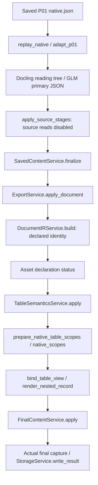

# MO-Parse Lite：Native有限研究与正式评价状态

## 第十六阶段：Native有限研究范围核验与正式门槛

2026-11-16，Native有限研究范围核验已完成；S3/S4/S6共24个组合的Native独立读取可靠性为24/24；T/L/B的逐组合准备状态分别为`{'partial': 24}`、`{'partial': 10, 'blocked': 14}`、`{'partial': 12, 'blocked': 12}`，正式评分授权尚未执行。这是固定三个已有开发/诊断暴露selection的有限Native研究，不是独立留出集、完整Lite代表、Product评分或八组总体排名。

接手及当前HEAD为`ce7aad797086fb3314119a07b581b256f330219d`，接手工作区干净。两个入口均解析为`/opt/moparse`。当前评测software_id仍为`ad49afdc37e3bfb2489ec2768638d6b4d7bd18920f57610addc7ad3b1ebda72e`，与第十五阶段相同；评测库、生产公共处理及其支持源码均未修改。原Native执行`20261026-lite-v3`仍绑定`c6e7f5c0cdcbb8801d17595c515fcbe7794111c396bfe58a6d0ab71a199db28e`，公共Final转换历史身份仍为`f8bcef05feaa4406189d395219a4db50afb8cc9446600ee11adce7fb403e0f1f`，后者没有混入本轮Native研究身份。逐份Native/observation完整路径、SHA256、sample/document/selection、原配置、producer来源、主视图、页分支、来源许可和执行状态见[24份输入绑定](../../runs/lite/diagnostics/native-research-phase16/input-binding.json)与唯一[Native研究准备](../../runs/lite/diagnostics/text-readback-phase15/native-research-preparation.json)。

附件给出的`benchmark/requirements/current/index.json`不存在；真实正式索引是`benchmark/runs/lite/requirements/current/index.json`，SHA256仍为`09918d7c652aee0d306dc603cbf7c827c6ca01996b8a436d72fb8d4f803b6884`，没有新建替代索引。三个选段使用各自canonical Expected及原有要求图，完整要求ID、载荷和T/L/B分母在八组间一致，未重编译Expected、改写source-map、合同、权重、分母或Oracle。S3为`zhenye-coupon-seals-p001-003`，S4为`tencent-conditions-entity-payment-definitions-p108-114`，S6为`huawei-management-toc-p014`；没有换成员或筛掉困难要求。

候选读取先独立保存Native观察、候选图、文字投影和原生清单，再由独立进程加载所选Expected比较。实际复用`native_observation → read_saved_native/read_native_relations → read_candidate`及`load_requirements → grade_layers`，只用本地编排收窄Native侧，未调用会读取Final的配对入口，未建立第二评分器。948项原生主文字字段核对及2837项对象/几何/父子引用/原始prov核对无差异；主文字遗漏、重复对象路径、未解释读取异常均为0。原生body/groups顺序、原数组出现位置、HTML语法格、已有页及分支、warning/截断/unknown各自保留；数组位置或bbox不充当全局读序，Markdown缩进不充当法律父链，无原生charspan时只记录本地读取跨度。详见[读取可靠性](../../runs/lite/diagnostics/native-research-phase16/native-reader-reliability.json)。

24份同版[Native逐要求比较](../../runs/lite/diagnostics/native-research-phase16/comparison/diagnostic-execution.json)均执行成功，共4128条要求：T 1224条、L 1936条、B 968条。这些是固定责任记录数，T字符分母另保留，不是正确数、分数或排名。每项的Expected来源、原生/observation绑定、实际候选来源、原始比较器状态、责任状态、原始trace指针及不能比较的确切原因均在[分层矩阵数据](../../runs/lite/diagnostics/native-research-phase16/readiness-matrix.json)及其24份requirement-diagnosis链接中；原outcome和固定责任未被诊断标签覆盖。所有顶层和内层质量分数、分子均 withheld，没有激活正式current。24份文字容量trace复核及无损存储检查见[trace核验](../../runs/lite/diagnostics/native-research-phase16/trace-verification.json)；后续仅细化原生unknown与比较能力限制的归因，已通过且SHA未变的trace没有重复运行。

真实来源例证见[本轮固定案例](../../runs/lite/diagnostics/native-research-phase16/focused-real-cases.json)：S4/P03的`projected-text:32:sentence:0`由自身`#/pages/2/raw/res/parsing_res_list/4`的`[0,232)`可靠提供，法律父链仍独立未决。S6/P01的`projected-text:2:sentence:0`“愿景、使命与战略”和其页码“13”实际存在于自身`#/pages/0/raw/json_result/0/1/content`，T语法单元与导航身份尚不能可靠对应，不能将其记为原生缺字。现有trace中的`software_failure`也用于wording、scope/order或导航能力未支持，并不都表示异常；本轮保留原flag、原reason和来源，将比较能力限制C与原生关系unknown D分开，没有报告成24次读取执行失败。

本轮未把缺少独立位置证明的差异升级为已确认的原生质量错误；这不等于原生零缺陷。所有原始incorrect及其实际候选、格式差异和未决原因均保留，召回无命中或未知关系不作候选零分。 原生文字正确、原生字面错误、原生结构正确/不完整、原生关系unknown、软件读取问题、比较对应限制、Expected责任阻塞和格式差异分别保留。当前所选Expected责任阻塞为0；历史107份全局责任缺口、3份待独立整样本验收和5个输入范围仍保持，不能以全局未决抹掉本范围独立T，也不能以所选责任完整宣称候选B已通过。S4法律条件、否定及例外逐字参与T，父链不能从缩进补造；S6导航/页码身份不能用数值算术等价替代，跨区域顺序无证明时为unknown；S3媒体声明不证明印章或图文关系，未读图片或赋予图像语义。S9/P02真实数字和邮箱缺字沿用同版源码与[历史负例绑定](../../runs/lite/diagnostics/text-readback-phase15/negative-controls.json)，本轮未重跑或计入24组统计，未把历史测试计数继承为本轮结果。

以下ready/partial/blocked描述研究条件，不描述解析质量高低。真实候选错误本身不阻止参与研究；未定位或关系未知保留对应要求。总体partial表达仍能开展独立局部诊断，不是取T/L/B最差值，也不表示正式授权已满足。确切不可比较requirement_id、原因、影响层及trace随每格保存在准备文件中。

| Pipeline | Selection | Native工件 | Native读取 | T | L | B | 成本 | 总体状态 |
| --- | --- | --- | --- | --- | --- | --- | --- | --- |
| P01 | S3 | ready | ready | partial | partial | partial | partial | partial |
| P02 | S3 | ready | ready | partial | partial | partial | partial | partial |
| P03 | S3 | ready | ready | partial | partial | partial | partial | partial |
| P04 | S3 | ready | ready | partial | partial | partial | partial | partial |
| P05 | S3 | ready | ready | partial | blocked | blocked | partial | partial |
| P06 | S3 | ready | ready | partial | partial | partial | partial | partial |
| P07 | S3 | ready | ready | partial | partial | partial | partial | partial |
| P08 | S3 | ready | ready | partial | partial | partial | partial | partial |
| P01 | S4 | ready | ready | partial | blocked | blocked | partial | partial |
| P02 | S4 | ready | ready | partial | blocked | blocked | partial | partial |
| P03 | S4 | ready | ready | partial | blocked | partial | partial | partial |
| P04 | S4 | ready | ready | partial | blocked | partial | partial | partial |
| P05 | S4 | ready | ready | partial | blocked | blocked | partial | partial |
| P06 | S4 | ready | ready | partial | partial | partial | partial | partial |
| P07 | S4 | ready | ready | partial | partial | partial | partial | partial |
| P08 | S4 | ready | ready | partial | partial | partial | partial | partial |
| P01 | S6 | ready | ready | partial | blocked | blocked | partial | partial |
| P02 | S6 | ready | ready | partial | blocked | blocked | partial | partial |
| P03 | S6 | ready | ready | partial | blocked | blocked | partial | partial |
| P04 | S6 | ready | ready | partial | blocked | blocked | partial | partial |
| P05 | S6 | ready | ready | partial | blocked | blocked | partial | partial |
| P06 | S6 | ready | ready | partial | blocked | blocked | partial | partial |
| P07 | S6 | ready | ready | partial | blocked | blocked | partial | partial |
| P08 | S6 | ready | ready | partial | blocked | blocked | partial | partial |

历史Native模型执行完成、历史质量计算发生、历史成绩撤回、当前正式Native成绩未发布、本轮有限诊断五个状态独立保留。[原始成本核验](../../runs/lite/diagnostics/native-research-phase16/original-cost-verification.json)逐一读取并绑定2,080份原observation及各组worker/inference资源与ownership记录：每组quality800为173选段/800页一轮，perf80为28选段/80页三轮，独立预热为3选段/8页；全部原执行状态completed，时钟和页数齐全。[原执行核验](../../runs/lite/diagnostics/native-research-phase16/original-execution-verification.json)另核实八组execution-config与原run一致、各worker完成260条、ExitCode=0且无OOM；Native执行器SHA`0163210d018d45d692bf8516c5c02d9fc134d6ce1f2671dbdc5f869d1bb02139`与原运行记录相同，其Docling V1/V2、MinerU Standard/Advanced等选择通过只读源码核对，未导入或执行模型。旧work-status中的历史计算状态不是当前成绩或零损失证据，未恢复任何历史分数、排名或旧冻结。

下面只核实原始时钟，单位秒。quality800与每轮perf80仅在各自串行、互不重叠的worker处理区间内求和；SDK初始化、GPU服务就绪及预热分别显示，互不相加为新端到端耗时。本轮读取/比较耗时以及公共后处理没有计入。完整原值、CPU秒、硬配额/affinity、RSS、内存采样、客户端并发、retry=0配置及实际request/errors记录保留在成本数据中；配置预算不是实测峰值。

| Pipeline | quality800处理秒 | perf80三轮处理秒 | 8页预热秒 | SDK初始化秒 | GPU服务就绪秒 | GPU归属采样 |
| --- | ---: | --- | ---: | ---: | ---: | --- |
| P01 | 1565.346 | 201.004 / 199.899 / 199.424 | 27.494 | 7.728 | 49.835 | partial |
| P02 | 1478.303 | 186.266 / 186.332 / 187.188 | 22.641 | 8.023 | 50.305 | partial |
| P03 | 11576.992 | 1001.961 / 893.875 / 937.507 | 103.015 | 4.558 | 16.838 | partial |
| P04 | 11826.903 | 778.186 / 967.767 / 778.310 | 105.752 | 4.348 | 15.718 | partial |
| P05 | 2908.116 | 278.233 / 275.325 / 276.465 | 38.007 | 5.406 | 51.165 | partial |
| P06 | 1619.337 | 202.435 / 202.140 / 202.872 | 16.151 | 7.540 | 101.159 | partial |
| P07 | 2411.696 | 279.992 / 276.897 / 274.570 | 31.422 | 7.318 | 100.816 | partial |
| P08 | 3327.525 | 316.181 / 310.530 / 311.491 | 36.183 | 4.675 | 48.354 | partial |

所有组的独立GPU归属历史采样均为partial，只能保留观察窗口内归属聚合值及其下界，不能声明完整峰值、逐组合峰值或据此估算功耗。worker与推理服务窗口、初始化/Graph捕获与样本处理窗口不同，独立峰值不相加。TTS历史共驻、负载不受控及观察缺失均披露，不称独占或空闲GPU。perf80成员不等于本固定三个selection，具体每组是否有该选段三轮记录已逐组合保留，不能拿全局80页成本冒充本选段重复成本。原始成本可支撑保存执行的身份及背景成本研究，不能单独支持24组的完整GPU/功耗比较或全文档类型外推。

| 正式门槛 | 状态 | 具体结论 |
| --- | --- | --- |
| Native输入完整 | ready | 24对Native/observation身份均核实。 |
| Native reader可靠 | ready | 原生主文字、对象、实际提供的元数据保全；未知结构未补造。 |
| T读取及对应 | partial | 可独立诊断部分文字；逐要求未定位、容量或对象歧义仍保留。 |
| L比较能力 | partial | 可诊断明确字段/导航关系；法律父链、范围和多栏全局顺序仍有限制。 |
| B的Expected责任完整 | ready | 所选三个既有视图的来源、结构、比较责任完整，选内责任阻塞为0。 |
| 独立验收证据 | partial | 历史整样本来源验收保留；当前受控测试不重签同版正式scope验收。 |
| 成本身份可靠 | ready | 2,080份原始observation及各组资源记录可追溯；GPU及选段性能外推仍partial。 |
| 软件及配置冻结 | partial | 源码和原配置已绑定，尚无本范围获准的正式冻结。 |
| 正式研究范围批准 | blocked | 本轮仅批准调查准备。 |
| 正式评分授权 | blocked | 目前尚未获得正式Native评分授权。 |
| scoring freeze批准 | blocked | 未创建approved freeze或active current。 |
| 有限Native正式入口 | blocked | 现有正式入口拒绝--sample，省略会扩大到完整Lite；需另行授权最小Native-only范围入口。 |

正式授权申请已写入现有准备文件的`phase16.authorization_application`，逐项绑定研究目的、固定24输入、Expected/要求视图、当前软件、原生运行及成本身份、各层适用条件、全部不可比较要求、失败处理、结果发布边界和待批准事项。申请范围保留三个完整selection及全部八组，不筛选观察后容易通过的要求；未知不转N/A或0。待批准的是该有限正式研究范围、复用原评分器的最小Native-only范围入口，以及先决条件满足后的正式执行和精确scoring freeze，不能把任一批准替代内容验收。

目前尚未获得正式Native评分授权。**当前不存在可安全执行此24组合有限正式研究的正式命令**：现有`evaluate_saved`在正式模式拒绝sample选择，省略sample又会扩大到完整Lite。准备文件保留`formal_command=null`、具体源码门槛、正式命令应满足的完整参数合同及本轮实际执行的诊断命令；没有虚构开关、裁剪manifest/requirements、绕过门禁，或把诊断命令称为正式评分命令。后续授权申请必须先处理这一明确执行条件，再批准相应freeze；本轮不为它扩建评测器。

本轮按`scripts/test_source_only.py`实际执行19个已审查模块，585项通过、0项跳过；历史2249/4282等计数未计入。运行前核对当前imports、tmp_path/monkeypatch fixture、共享helper、文件I/O及子进程站点；只执行自造文字/JSON、Native读取、T/L/B、目录、父链/范围、trace和正式门禁反例。未经核查的全量pytest未运行，现有排除模块仍未收集；导入的两个受控测试helper不另算执行模块。详见[本轮审查](../../runs/lite/diagnostics/native-research-phase16/test-review.json)及[测试回执](../../runs/lite/diagnostics/native-research-phase16/source-only-phase16.json)。本轮只更新主报告和本地研究证据，没有docs或其他通用文档变更；报告和runs按永久规则排除通用Markdown检查。

候选读取、元数据核对、独立比较、trace及测试使用串行、最多8 CPU、8 GiB地址空间、空GPU可见性、独立禁网namespace及仓库只读挂载；候选和测试的Expected根被空只读挂载。所有最终成功执行审计无边界违规，审计覆盖的最大RSS为1168502784字节；本轮诊断时长仅在本地审计中。原执行元数据提取器初次因未识别带类型赋值而失败，异常回溯又被其窄I/O规则拒绝读取自身Python源码及一个不存在的同名路径，共5次拒绝；没有额外候选、Expected或媒体被打开。修正本地元数据提取和自身源码回溯许可后，八组原执行记录核验成功；初次审计及本地绑定失败另保存在development-attempts，没有当作候选失败或测试通过。没有原始PDF/图像字节、字层、OCR/VLM、模型推理、公共转换/Final重生、网络、GPU/TTS/在线服务、部署、正式评分、approved freeze、active current、正式排名、提交或推送。Expected、source-map、selection、manifest、要求索引、合同、分母、Oracle、execution-lock和原始成本保持；保全及所有执行工具/工件绑定见[本轮最终绑定](../../runs/lite/diagnostics/native-research-phase16/final-binding.json)。

以下第十五阶段及更早段落保留其历史身份和当时范围；其历史“当前”及准备状态不替代本节结论。

## 第十五阶段：评测文字读取修复与有限Native研究准备

2026-11-15，已实际修复评测侧三类共同问题：候选长对象、括号标签及显示行路径中的合法文字片段未暴露；同字面出现与父子视图的容量分配不可靠；直接T调用与Native/Final入口、完整trace复核未统一。新增`literal_readback.text_readback/match_text`只依据候选自身语法、原始片段和既有来源生成读取视图，`three_layer._text_layer`统一调用，`expected_report._complete_text_trace`重建视图并验证对应与消费容量。原文字表、剩余文字、T/L/B合同、canonical、0.35召回阈值和正式分母保持；没有公共产品转换或Final正文改善。

U03的677字符Native对象内232字符原句、U04本源Final行路径的“资本充足率”、U05双语标题和U10括号内“注册地址”均已通过真实路径可靠读回；U02保留未决，公司名与董事会之间实际存在“图片未交付。”段落，不能跳过屏障或借页首标题接受文末签名。五例前后来源、实际候选及未选命中见[专项诊断](native-final-diagnostic-review.md#第十五阶段评测文字读取与匹配修复)与[最终锚点trace](../../runs/lite/diagnostics/text-readback-phase15/anchors-after.json)。S9/P02数值及邮箱缺字继续判错，两条表头内部换行转空格的原T差异保留；法律父链、多栏顺序、单位和期间关系没有因T读回自动通过。

固定九个selection、P01–P08的72组Native/Final配对已全部重新读取并比较，共144份候选侧记录，均使用本轮评测身份`ad49afdc37e3bfb2489ec2768638d6b4d7bd18920f57610addc7ad3b1ebda72e`，没有复用旧比较结论。28,608条配对要求保持原身份与责任范围，L/B全部原始判定及载荷逐条未变。4,112条T状态或实际对应变化按语法片段读取、完整出现重分配、明确歧义、非等价定位和无缺失证明的未定位五类复核；其中49条原始正确转错误均为同字面有限容量重新分配，旧文字仍在，审查状态保留未决，不能称为候选新增缺字。没有未解释的批量变化，详见[变化汇总](../../runs/lite/diagnostics/text-readback-phase15/regression-summary.json)、[变化复核](../../runs/lite/diagnostics/text-readback-phase15/transition-review.json)和[容量复核](../../runs/lite/diagnostics/text-readback-phase15/capacity-transition-review.json)；这些记录不构成分数、排名或产品收益。

本轮实际通过99个受影响已审查模块的2,249项source-only测试，81个排除模块未收集，另73个允许模块未执行；未继承历史267或4282计数。独立自造文字/JSON覆盖重复容量、顺序变化、真实缺字与数字/日期/代码/引用差异、否定条件例外、插入屏障、候选与Expected隔离、Final不能借IR和T/L/B独立性。测试及最终真实诊断均使用串行、最多8 CPU、8 GiB、空GPU可见性及禁网隔离；最终I/O审计无违规。开发中失败、拒绝及中断另存于[过程记录](../../runs/lite/diagnostics/text-readback-phase15/development-attempts.json)，不混入最终通过证据。

原Native执行`20261026-lite-v3`仍绑定`c6e7f5c0cdcbb8801d17595c515fcbe7794111c396bfe58a6d0ab71a199db28e`；72份Final仍绑定原公共转换`f8bcef05feaa4406189d395219a4db50afb8cc9446600ee11adce7fb403e0f1f`；历史phase13诊断仍为`8eb9d431864ea4c0baec2cb661c726ba457490b852b682d286a9786c4ac29146`。接手及当前HEAD为`f4c884d14061eb3ffee6a561cafb9f5592ee2f66`，新评测身份不重签这些历史产物。只读保全核对涵盖727份绑定工件、九份既有要求视图、72份Final/Storage正文及83份生产支持源码；原成本段保持原字节，见[保全记录](../../runs/lite/diagnostics/text-readback-phase15/preservation.json)。

S3/S4/S6三个完整既有selection、全部八组共24个Native组合的[研究冻结准备](../../runs/lite/diagnostics/text-readback-phase15/native-research-preparation.json)已形成：先固定全范围，再逐组合列原配置、主视图与来源许可、要求及历史独立依据、当前T/L/B证据、确切未就绪要求和历史成本限制。三者已有开发和诊断暴露，不能称为留出集或完整Lite代表。仍需获准研究范围、同版独立比较验证及具体歧义处置、授权正式scoring freeze；没有创建已批准冻结、正式命令或active current。完整Lite仍为`structure_blocked`，107份责任缺口、3份待独立整样本验收及5个输入范围保留；这些全局数量不作为本次有限准备的清零前提。

本轮`diagnostic_only=true`、`publishable=false`。未修改生产转换、Expected、历史Oracle、选择声明、原生/observation、Final、Storage或requirements/current；没有重跑模型、公共转换、正式评分、PDF/图像、OCR/VLM、网络、GPU/TTS、在线服务、部署、提交或推送。代码、实际执行与交付证据见[最终绑定](../../runs/lite/diagnostics/text-readback-phase15/final-binding.json)。以下第十四阶段及更早内容保留各自历史身份与当时判断，其中“当前”“下一轮”属于对应历史阶段。

## 第十四阶段：产品价值复核与工程路线收敛

2026-11-15，已完成固定证据的只读产品价值复核，未重跑Native、公共转换或72条诊断。两条S2/P01、P02换行差异属于同一表头单元格的合法显示规范化，现有T合同差异仍保留；不修改生产代码，不增加CRLF字符映射。七条S9复合表头表达有同表源格与共同记录支持，证明一张表的一项局部组织增益，不能当作七种独立能力或总体质量提高；P01单位文字存在但表内绑定未证，单列限制。

本次未确认公共处理新增的实质内容或关系缺陷。874条历史“同一错误保留”包含840条T、34条L记录；按本源对象和要求聚合后，既有格式差异、比较粒度限制，也有已确认的原生数值与联系邮箱缺字，不能全列为公共产品修复。23,457条归因未决中只抽查14个要求/管线案例，跨文档及格式确认文字单元读取/匹配限制，其他责任、原生父链、顺序及交付未决继续保留。详细案例、A/B/C/D/E分类、十二项直接答复及停止清单见[产品价值专项复核](native-final-product-value-review.md)。

当前HEAD为`b7c68eb0de7dc24a13aa6e157620fceb13117a9a`，当前完整诊断源码身份仍为`8eb9d431864ea4c0baec2cb661c726ba457490b852b682d286a9786c4ac29146`。72份Final仍绑定公共转换`f8bcef05feaa4406189d395219a4db50afb8cc9446600ee11adce7fb403e0f1f`，生产支持源码与其冻结一致；建议冻结该转换作为受控研究基线。72份实际Storage正文与Final字节一致，交付仍9份completed、63份partial，170项媒体声明没有验证或交付字节。

Native已有独立评价入口，可优先推进有限研究准备；当前不能用诊断子集直接启动正式评分，仍缺获准范围、可靠读回及同版独立冻结。Product还需独立跨文档正反例、具体单位/关系责任及相应成本和交付证据。107份缺口仅在其实际来源依赖上阻断局部问题；完整Lite正式声明仍为`structure_blocked`，3份待独立验收和5个输入范围不变，正式current均未激活。下一轮优先一个有界评测读取任务，不再为显示差异、所有unknown或逐管线接入扩张生产工程。

本轮只更新本主报告和专项产品决策报告；没有修改Expected、Oracle、合同、分母、选择或门禁，没有PDF/图片、OCR/VLM、推理、网络、GPU/TTS、服务、部署、提交或推送。第十三阶段及更早内容保留各自历史身份、执行边界及当时判断；其中两条“退化”的本轮产品解释以上述专项复核为准，原诊断记录未改。

## 第十三阶段：固定9选段的独立Native/Final诊断

固定9个选段、72条Native/Final诊断已完成；实际可诊断要求11525项，未决或软件阻塞17083项；正式成绩仍未发布。

本轮固定8文档、9个独立selection、64个唯一文档/管线组合和72条链；Native及配对observation与phase12同版Final逐条绑定，公共转换software_id为`f8bcef05feaa4406189d395219a4db50afb8cc9446600ee11adce7fb403e0f1f`，未重跑转换。正式质量仍为`structure_blocked`，107份责任缺口、3份完整责任待独立整样本验收及5个输入范围保持，正式service/current与scores/current均未激活。

逐要求证据、T/L/B状态、Native/Final变化、最早阶段、局部有效结论、媒体限制和各管线/文档摘要见[专项诊断](native-final-diagnostic-review.md)及[执行记录](../../runs/lite/diagnostics/native-final-phase13/diagnostic-execution.json)。没有正式分数、百分比或排名。本轮修复的是候选标题字段读回及Native段落来源定位；这些评分读回修复不能冒充交付正文改善。

S3/S4/S6责任完整，其余6个选段仍有具体缺口。S4/P03/P04的232字符“恢复”已证明是读回单元差异：原生677字符对象在各阶段与Final保持原文。S9/P01“资本充足率”也仍有本源格对应的Final字符跨度，不能因文字单元匹配失败认定丢字。其他确证差异及限制按专项证据分别记录。

实际执行7个相关已审查source-only模块、267项测试通过；历史4282项未重跑。72份Final与Storage字节一致，交付仍9份completed、63份partial；媒体声明未验证或交付。PDF/图像、OCR/VLM、模型、网络、GPU/TTS、服务及部署操作均未执行，未提交或推送。一次历史全域诊断元数据检索偏差及调试拒绝已在专项报告和过程记录单列，未用于内容判断。

以下第十二阶段及更早内容保留各自当时的身份和结论；其中“本轮”“当前”均属于对应历史阶段。
## 第十二阶段：固定64组合的实际公共转换与Normalization证据

2026-11-14，64个唯一文档配置组合的跨文档Normalization转换已完成；72个选段与管线授权记录均已核验。固定集合保持8份文档、9个既有选段。第一批16条选段链与第二批56条选段链均实际执行，后者按document_id归并为48个唯一组合；D5的S5、S6分别转换，页范围没有合并。全部本轮有效产物使用software_id `f8bcef05feaa4406189d395219a4db50afb8cc9446600ee11adce7fb403e0f1f`，HEAD仍为`1650637de9bb6bffc8911ee959fa6fde9a6377f9`，没有提交或推送。

本轮复用`close_saved_document`和既有NativeContentContract、SavedContentService、Export、IR、TableContext、TableSemantics、FinalContent及Storage。12,769个从原始native独立枚举的对象逐项连接到实际消费、审计保留、转换、排除或未决去向；72份最终正文与实际Storage文本逐字节一致，504条相邻阶段编辑完成精确重放。Adapted、IR、Semantic和Final仍使用现有evidence内的真实快照，未从旧正文重造或改名。完整[64组合阶段矩阵](data/cross-document-normalization/conversion-stage-matrix.json)、[72选段授权矩阵](data/cross-document-normalization/conversion-selection-matrix.json)、[信息流与逐链绑定](data/cross-document-normalization/conversion-flow.json)及[专项报告](cross-document-normalization-review.md)给出具体对象、来源、阶段与未完成责任。

四层状态独立保留：原执行为{'completed': 72}，读回为{'read': 72}，转换为{'completed': 22, 'partial': 50}，交付为{'partial': 63, 'completed': 9}。其中63条partial仍有必要顺序、未知用途、表格关系或媒体未交付责任；9条completed也不表示Native/Product质量通过。原生未提供的法律父链、跨页续表、扫描来源和字符来源没有补造。S4含限定词的200个原生对象按各自最终跨度保全；S9每组9张物理表分别保留，没有以相邻、同列数或声明替代续表证明。

本轮修复两处公共软件缺陷：单位责任校验与既有数值、比例、引用和每股字面角色不一致；最终对象定位没有重放已有Export行尾空白规范化。前者保留未解析数值字面并继续拒绝真实数额单位脱离，后者在各对象唯一标记前作精确投影，缺少标记时拒绝借用邻项。两处均有独立合成反例；最终源码冻结后重新执行全部72条链，旧尝试没有混入当前矩阵。没有改写原生、Expected或T/L/B合同，也没有按管线编号选择语义答案。

最终[完整source-only回归](../../runs/lite/service/development/cross-document-normalization-phase12/source-only-complete.json)实际执行169个已审查模块、4282项测试，81个排除模块未收集；源码、清单、测试和I/O边界均有当前绑定。转换和回归使用串行外层、最多8 CPU、8 GiB地址空间、空GPU可见性与独立网络命名空间，代码及历史输入只读，原件和Expected根目录被空只读挂载屏蔽；转换最大RSS为838,488,064字节。测试只读取既有软件与自造文本/JSON，未调用未经审查的全量pytest；仅有1条只读pytest缓存无法写入的运行警告。

[保全核验](../../runs/lite/service/development/cross-document-normalization-phase12/preservation.json)确认3590份受保护工程文本工件未变，另单独记录获授权的source-only测试清单更新；72份native/observation/faithful、已有8条开发链、原始成本、execution-lock、原selection/manifest和requirements/current保持。下方原始处理成本段SHA256仍为`e6562dfb197af4ff3889e7852cb59b140e7f8cd915dbc0cccfec0ce8a11d709c`。新开发耗时仅保存在各链evidence和执行日志，不写入Native或正式Product成本。

正式质量仍为`structure_blocked`，107份比较责任缺口、3份完整责任待独立整样本验收和5个输入范围继续保留。未重编译Expected，未进行真实candidate/Expected比较、正式Native/Product评分、八组正式回放、模型推理或媒体交付；正式service/current及scores/current索引均未激活。没有读取原始PDF/图像字节，没有PDF字层、OCR、VLM、网络/GPU/TTS/在线服务、部署或发布操作。Normalization工程闭环与正式质量验收保持分离。

以下第十一阶段及更早记录保留各自当时的身份和结论；其中“本轮”“当前”和缺少64条阶段证据的判断均属于对应历史阶段。

## 第十一阶段：既存证据审查与未完成范围

2026-11-14核对历史原始job、2,080份observation及实际工件：八组`20261026-lite-v3`各完成quality800一次、perf80三轮及独立warmup；旧P07/P08 baseline/current有实际正文与原始CPU后处理成本。当前scores为空，正式T/L/B成绩及排名继续撤回；历史work-status与评分/复现日志不构成当前有效成绩。原始处理成本段保持原字节，本轮没有重跑或重签历史结果。

固定跨文档集合包含8份文档、9个既有授权选段及72份真实native结果。同一公共software_id下的完整既有阶段只覆盖两份文档的8个开发结果，其余64个组合缺同版Adapted/IR等阶段，因此完整横向验证未完成。原生、适配保全和最终产品比较分别记录；107份缺口的分层影响、逐对象信息流及下一步具体任务见[跨文档Normalization审查](cross-document-normalization-review.md)。没有运行新adapter转换、真实回放、candidate/Expected比较或正式评分，没有修改生产代码、Expected、门禁或五个范围。

## 第十阶段：P08 Visual Blocks共同接入（历史）

以下第十阶段及更早记录中的“本轮”均指其各自开发阶段，不能解释为从未发生历史Native解析，也不能推广为第十一阶段的跨文档验收。


P08 Visual Blocks共同适配已完成；真实保存结果纵向转换状态为partial。当前结论限于本组一份三页保存JSON的来源、适配、公共处理及持久化工程验收。P01–P07的七份固定开发结果按最终源码重新生成，正文、表格关系、warning、四层状态及编辑证据与原产物保持。逐格式接入达到进入跨格式验证的最低工程条件；本轮未启动跨文档Normalization、正式candidate比较、Native/Product评分或八组正式回放。

## 第十阶段：接手身份、固定输入与边界

接手HEAD为`265f4318f49d7560750fe8c6d789f9823d120b40`，工作区干净，`/opt/mosaic-parse`与`/opt/moparse`指向同一目录。接手software_id为`52c296f93529246e806d6e4ca121059c7530b7c230ca192eec2ef3c74befb540`；最终源码为`7f15e69534194831f4935a3b6c0cc45b3fe95833224160844fe41455414c18aa`，source-only清单SHA256为`5ac08cab08ec491ffb4094a0e53bea6c506c37c9a518db20f50bdd686aed13e0`。本轮[接手身份](../../runs/lite/service/development/visual-content-closure/intake.json)、[最终冻结](../../runs/lite/service/development/visual-content-closure/freeze-complete.json)和[最终绑定](../../runs/lite/service/development/visual-content-closure/final-binding.json)关联源码、测试、各自native/observation、真实阶段、正文及Storage，未重签历史门禁。

固定P08开发输入为`artifacts/P08/measured-quality800-r1/zhenye-coupon-seals-p001-003/native.json`，SHA256为`f07856b3df2889dc90c5a7d5bbc2a6e3388231cea17e903c4af77cf240f51fd3`；配对observation SHA256为`a6c94a7688cf7d7b4c4629501c831dd41b7ca9f0737bb4e8efca1a06bf4201c9`。选择依据是本组文字、标题、两处图片声明、页面尺寸和旋转元数据，不参考Expected或成绩。[独立格式清单](../../runs/lite/service/development/visual-content-closure/format-inventory.json)从原生JSON建立。另只读检查过本组vanke三页JSON的HTML及空list形状，未转换该P08输入或进行答案比较。其他实样沿用P01–P07各自既有固定vanke输入与配对状态，没有用其他管线补P08。

该P08工件的page是输入文档页包身份；分支局部页号与原PDF物理页映射未提供，明确保留unknown。大小、输入SHA和页数只取本组已有ContentParseResult.source元数据，不重新打开或校验PDF字节；未按样本名猜原页。历史测量没有替换，开发转换时长只列在[串行执行记录](../../runs/lite/service/development/visual-content-closure/serial-development-runs.json)，不作为解析性能或质量成绩。

## 实际原生结构与来源能力

| 项目 | 实际保存内容与限制 |
| --- | --- |
| 顶层 | pipeline、config、pages、documents、page_processing；documents为空，3个页包各有page、branch=visual、raw平面数组和faithful_markdown |
| 区域 | 共22个：14 text、3 header、2 title、2 image、1 page_number；对象没有独立稳定ID，以工件SHA、JSON locator、页包及数组位置标识出现 |
| 文字 | 20个非空content字段来自视觉模型识别；两个image的content为null。type是区域类别，不是额外原文标签 |
| 未提供能力 | 无文档charspan、OCR字层、polygon、父子引用、group、原生标题树、独立caption/description、区域confidence或明确reading_order字段 |
| 空间 | bbox与angle均保留。normalized/TOPLEFT的依据为保存config声明的固定mineru-vl-utils 2.0.7格式契约，不按数值范围推测；未声明固定契约或坐标时保持unknown |
| 页面变换 | 保留各页width/height、rotation_clockwise及原rotation/cropbox元数据；第三页原rotation为270度。没有再次旋转bbox，没有验证原PDF逆变换，未借其他管线的页或坐标 |
| 顺序与关系 | 保留数组出现次序、原始merge_prev=false，不将数组或bbox排序认定为阅读顺序，不按相邻、重叠或视觉包含制造文档父链 |
| 媒体 | 两个research_asset声明及其区域框保留；没有资产内容摘要、读取、解码、存在性验收或实际交付，URI不构成ready |
| 执行观察 | 原执行及3页均completed、errors为空；23项请求终止记录均为stop。请求未给区域对应，未推断逐区域绑定；observation的派生blocks/relations未作为答案 |

共同契约和既有私有区域字典已经能表达上述来源，无需新建IR、视觉专用FinalContentService或公开HTTP字段。区域、文字组件和媒体均有工件绑定；source_components区分native_text、native_caption、model_description及native_region_label，derived_display单独记录显示来源。ContentRegion保留图像和未知布局类别，现有provenance.reason_codes标明视觉来源与文档字符来源不可得。原生描述只以“视觉描述：”显示，标签只以“区域标签：”显示；模型描述内部的HTML或图片语法不成为识别表格或资产。真实输入没有description/polygon/group，相关能力仅由受控反例验证，不能写成真实格式覆盖。

## 实际调用、原生对象去向与正文

`moparse_eval.saved_content_closure.close_saved_document → service_replay_native.replay_native → saved_native.adapt_saved_document → visual_native.read_visual_page → NativeContentContract/NativeContentEvidence → SavedContentService.finalize → ExportService → DocumentIRService → TableContextService/TableSemanticsService → FinalContentService → StorageService`已经实际执行。中立read_visual由原研究读取器原样移动，研究默认行为不变；所有八组保存入口现在直接进入共同契约，旧独立P08 bridge分支已移除。公共语义按来源与内容责任处理，没有pipeline==P08的语义答案分支。

主要修改为`app/adapters/visual_native.py::read_visual_page/visual_geometry/text_components`、独立`visual_inventory.py::inventory_visual`、现有native_config/native_inventory/saved_native交接、native_content_evidence的来源与IR核验，以及共同显示、状态和去向记录。模型只在现有私有契约audit的primary_views增加ContentBlock[]视图；没有复制正文、表格或来源IR。`saved_content_closure`允许未知原PDF页映射，只接受既有输入页数元数据。维护文档同步P08说明、管线索引、架构与技术路线，HTTP schema保持原14条路径及结构，未启动lifespan或发送请求，见[协议核验](../../runs/lite/service/development/visual-content-closure/http-schema-check.json)。

输入清单独立枚举22个区域、20个文字字段、3个页包、3条页面处理元数据及2个媒体声明，共50个对象；全部有去向。区域的原始空间、序号、字段及关系声明随其身份留证。最终去向为6项immutable_native_audit、19项consumed、19项retained、2项unresolved_media_delivery、2项unverified_not_delivered和2项explicitly_excluded_furniture。文字字段与其区域分别计为两个来源对象，页码区域及其文字字段分别显式排除；这些对象数不是质量分母。没有unresolved_native_readback或unresolved_final_location，也不靠final.md反向生成清单。[独立验收与七组保护](../../runs/lite/service/development/visual-content-closure/independent-acceptance.json)逐项检查自己的原生值、来源、区域最终片段及去向，保留原生两处正文日期与两处签署日期，没有按同字面去重。

P08本轮实际[final.md](../../runs/lite/service/current/p08/development/visual-zhenye-3p-delivery/final.md)的SHA256为`9ee4f677c279efc424b74e52bfac5ef5b0fcd277f189d98e8ed0d6b3a907b1b2`。[完整证据](../../runs/lite/service/current/p08/development/visual-zhenye-3p-delivery/evidence.json)记录adapted、source_pages、native_pages、exported、ir、assets、semantic、final共8个真实快照；原件补充阶段明确不适用。7个阶段转移由独立文本编辑重放验证，最终24项编辑逐一核对原区间、删除及插入内容。最终阶段、DocumentParseResult.markdown、ContentParseResult.renderings.markdown和Storage result.md的UTF-8字节一致；正文来自实际公共处理，没有复制faithful.md或旧final，没有创建占位图片。

| 状态层 | P08实际状态与责任 |
| --- | --- |
| original_execution | completed；保存的原执行状态未改写 |
| readback | read；22个区域及20个文字字段来源均保留 |
| conversion | partial；多块正文的阅读顺序未获原生证明，保留数组显示和未知依据，不自动拼接 |
| delivery | partial；上述读序责任以及2项未读取、未验证、未交付图片分别保留 |

22条native_reading_order_unverified与2条saved_native_media_unverified均保留定位。未使用未知几何或原PDF页映射的正文不因此新增partial；受控单个完整文字、单个明确表格或仅空布局区域可以completed。原生失败、超时、截断、processed=false、局部导出失败与纯信息warning分开传播，不能将丢对象、错绑来源或读取失败降为普通unknown。真实实样没有这些失败对象，其覆盖仅来自受控输入。

## P01–P07保护、软件验证与阶段结论

七份固定开发输入分别用最终源码串行生成到各自`service/current/pXX/development/visual-stage-regression-vanke-3p-delivery/`，历史final、原生输入和历史证据未覆盖。独立断言继续保护P01/P02各自Docling V1/V2、GLM主分支及45/46个源格；P03/P04各31组polygon、44个HTML投影格、37个非空格、5条记录和25项值关系；P05自身44格、37非空格及25项值关系；P06/P07各自Middle类型、父链、顺序、44格、37非空格、5条记录及25项值关系。各组最终UTF-8字节、全部semantic_tables、table_fragments、relation_checks、warning、四层状态、去向、content_dispositions、final_text_evidence及8阶段文字均与既有产物相等。P01/P02/P06/P07保持conversion completed、delivery partial；P03/P04仍为partial；P05保持completed。

P07固定DocVortex 0.5.16整页及整文档schema拒绝仍保留，四个嵌套list成员的continues_prev=null未删。既有官方验证记录和结果摘要保持，没有重跑官方schema或把拒绝改成OCR/业务语义失败。P01–P07已验证的是固定开发范围；真实跨文档、可选富文本/公式、完整content_list对应、跨页延续及失败类型仍有原有限制。P08实样未覆盖真实描述、polygon、分组、明确原生阅读顺序或复杂表格，控制例通过不补这些真实证据。

最终source-only相关允许范围为14个模块、468项通过，新增视觉模块实际48项；退出0、测试及软件全程未变、边界违规0，见[本轮最终记录](../../runs/lite/service/development/visual-content-closure/source-only-complete.json)和[JUnit](../../runs/lite/service/development/visual-content-closure/source-only-complete.xml)。169个允许模块中其余155个本轮未收集，另81个原排除模块继续未收集；没有声称重新完成全部允许集合或全量pytest，没有混入历史4225、4175、718等结果。审查覆盖新测试、旧组件fixture、共享finish、conftest（禁用）、依赖、I/O及子进程；并行编译和调度探针不在本轮范围，详见[审查冻结](../../runs/lite/service/development/visual-content-closure/freeze-complete.json)。14模块逐项串行，最多8 CPU、8 GiB地址空间、数值线程1、无GPU可见性，网络及媒体/语料I/O由审查入口拒绝。Ruff对全部18项相关Python文件通过，mypy对11项相关app源码通过，README及4份维护文档Markdown政策通过。

开发尝试单独保留于[过程记录](../../runs/lite/service/development/visual-content-closure/development-attempts.json)。首轮反例发现合法空布局因warning被补写“本页内容未完成”的实际缺口，现保留空区域及来源；另一项快照名称断言改为实际既有回调。旧FinalContent组件fixture原先将自造块序当成P08读取已确认顺序，并允许后续文字补充，与真实保存准入边界冲突；现直接使用明确有序的组件输入和同一个既有显示renderer，所有原测试函数及正文断言AST保持不变，生产准入没有旁路或放宽。独立实样验收曾误将日期次数设为2，已按原生四次出现更正；阶段重放核验补读已有生产者的before/after与deleted_content/inserted_content两种字段表达，不修改生产记录求通过。

56项已绑定输入、observation、历史正文/Storage/证据、原始成本摘要、要求索引和官方验证绑定均保持原字节，见[保全记录](../../runs/lite/service/development/visual-content-closure/preservation.json)。正式requirements/current/index.json仍为SHA256 `09918d7c652aee0d306dc603cbf7c827c6ca01996b8a436d72fb8d4f803b6884`、state=structure_blocked；正式service/current/index.json仍不存在。63份来源验收、107份比较责任缺口、3份待独立验收及5个输入范围均未改动或重新普查，T/L/B、Expected、Oracle和分母未修改。

本轮没有PDF或图片创建/读取/解码/渲染、字层、OCR、VLM/模型初始化或推理、网络调用、GPU/TTS及在线服务操作、部署、实际candidate与Expected比较、正式评分、八组正式回放、完整媒体ZIP、提交或推送。逐格式接入的最低工程条件在固定开发范围内已满足，余项作为明确的局部边界保留；后续固定跨文档集合、Normalization横向验证与Native/Product研究须另定范围和授权，本轮没有提前启动。

## 历史阶段：固定DocVortex 0.5.16官方结构与文本核验

以下保留前期核验记录，其中“本轮”和软件/测试身份属于对应历史阶段，不能混入上述P08本轮结果。

固定依赖与本范围官方核验已完成：P06整份Middle文档及两页schema接受，P07整份文档及第2页schema拒绝、第1页接受；两组各29个原始块的schema和安全文本投影全部执行，来源及文字对照全部保留。P07的拒绝已定位并由独立合成例复现。共同JSON生产路径没有改动，既有两份正文、Storage和媒体未交付的partial保持。本结论仅覆盖同一固定三页输入的格式核验，不提供解析质量成绩或MinerU全格式验收。

接手HEAD为`0687c7313bf12f8fd2d7c2b9e8849f35d7b3da63`，工作区干净，`/opt/mosaic-parse`与`/opt/moparse`指向同一目录。当前源码、输入、实际执行及产物由[本轮最终绑定](../../runs/lite/service/development/mineru-typed-validation/final-binding.json)关联；旧第九阶段final-binding及全部历史正文和成本记录未重签或覆盖。

## 隔离环境与实际官方API

复用本地不可变镜像`sha256:99495729433d9dd3e37caa3f91267a28c2f605754a81c1a465b8e3f0b19e4bc9`，容器使用`/usr/local/bin/python` 3.12.12、真实`docvortex==0.5.16`和Pydantic 2.14.1。没有下载、安装、升级或联网；主`.venv`、生产容器、在线服务及原锁文件均未修改。实际安装清单与原worker锁的112项依赖版本全部一致，另有未列入锁的pip 25.0.1；这只核对包身份，不宣称重建原执行进程、模型或性能环境。镜像没有registry RepoDigest，安装包没有direct_url.json，历史下载URL未知；可复查的来源是这个本地镜像ID，包元数据另声明官方仓库`https://github.com/myhloli/DocVortex`，未将该声明当作已验证下载来源。

[环境实测](../../runs/lite/service/development/mineru-typed-validation/delivery/environment.json)、[准备与复现命令](../../runs/lite/service/development/mineru-typed-validation/delivery/preparation.json)、[安装清单](../../runs/lite/service/development/mineru-typed-validation/validation-environment.freeze.txt)及[原锁对照](../../runs/lite/service/development/mineru-typed-validation/lock-comparison.json)保留解释器、模块实际路径、函数签名、依赖声明和摘要。DocVortex安装Python源树摘要为`f33355acee21a5cd5b8e97f197a4bd88ce5dafa7a4fa81d712981437347be3ba`；`schema.py`为`f1cb73d0f29104df10a59e0663b2884059354ce59c531402a362a4415854b4f4`，与原格式记录一致。METADATA及RECORD摘要也单独保存，未虚构不存在的wheel下载摘要。

新入口`scripts/validate_mineru_typed.py`显式覆盖worker启动命令，只挂载审查代码、单份固定native和新验证输出目录。逐份串行，network=none、runc、无GPU设备、8 CPU、8 GiB、只读根目录，禁用模型导入、媒体文件读取、base64解码和网络调用。实际容器参数、挂载、退出及自身容器清理保留在[环境执行](../../runs/lite/service/development/mineru-typed-validation/delivery/environment-execution.json)、[P06执行](../../runs/lite/service/development/mineru-typed-validation/delivery/P06-execution.json)及[P07执行](../../runs/lite/service/development/mineru-typed-validation/delivery/P07-execution.json)。没有导入native_worker.server、调用lifespan、_initialize、PDFDocument或解析入口。

官方调用为`MiddleJson.from_dict(original_document)`、`PageInfo.model_validate(original_page)`、`TypeAdapter(PageBlock)`、递归`TypeAdapter(Block)`及`TypeAdapter(InlineSpan)`。文本使用实际`LatexDelimitersConfig`、`render_single_block`；嵌套表格附注及内联span直接调用已核实的官方文本函数。表体只作worker已有的body-only显示上下文包装，原schema输入从未删字段或替换；包装字段及原父路径逐项记录。该工具不生产MO-Parse最终正文，也不接回旧bridge。

## 两份固定输入的逐对象结果

主输入均直接来自各自`documents/0`的docvortex.middle 2.0 pages及原始递归content，绝不取增强raw.blocks、faithful.md、旧final或GLM审计内容替代。两组前两页为各自MinerU，第三页为各自GLM主结果，不适用DocVortex schema。物理页、局部page_idx、tier、工件SHA和原始JSON路径均按原绑定保留。

| 范围 | P06 Standard | P07 Advanced |
| --- | --- | --- |
| native SHA256 | `f15b13a9dd4f339a00293ad66b7936e163994925fbda8c591cb4289bbbca7fc4` | `22c5badfb6264ee69c96012778a4478bb85289e36a16f8ec0108733ab85f8c2e` |
| MiddleJson文档：接受 / 拒绝 / 未执行 | 1 / 0 / 0 | 0 / 1 / 0 |
| 适用PageInfo：接受 / 拒绝 / 未执行 | 2 / 0 / 0 | 1 / 1 / 0 |
| 顶层PageBlock：接受 / 拒绝 / 未执行 | 27 / 0 / 0 | 23 / 0 / 0 |
| 递归Block：接受 / 拒绝 / 未执行 | 2 / 0 / 0 | 6 / 0 / 0 |
| 原始InlineSpan：接受 / 拒绝 / 未执行 | 25 / 0 / 0 | 24 / 0 / 0 |
| 块文本投影及来源对照 | 29执行，29保留，无未判断差异 | 29执行，29保留，无未判断差异 |
| 内联文本投影 | 25执行，无失败 | 24执行，无失败 |
| GLM页面 | 1页不适用，未送DocVortex | 1页不适用，未送DocVortex |

逐对象的原载荷观察、父路径、schema结果、序列化、文本和共同读取结果见[P06](../../runs/lite/service/development/mineru-typed-validation/delivery/P06.json)及[P07](../../runs/lite/service/development/mineru-typed-validation/delivery/P07.json)。媒体字段保留声明、长度及摘要，不解码。schema接受只证明这些对象的限定格式一致性，不证明OCR、业务值或最终产品质量。

P07拒绝位置为`#/documents/0/pages/1/blocks/6/content/0`至`/3`四个list成员的`continues_prev: null`。官方PageBlock及ListBlock接受这些对象，但PageInfo校验`continues_prev in child.model_fields_set`，因此显式null也被拒绝；MiddleJson继承该页拒绝。保存调用`_native_snapshot → _plain → model_dump(mode="json")`使用完整默认字段；官方完整model_dump在独立合成list上产生相同回读拒绝，而默认to_dict省略这些字段后合成例可回读。该合成证据只定位序列化与schema字段存在性冲突，没有把真实P07删字段后改称通过，也没有将它归成OCR或业务识别错误。原始四成员、父链、编号及null均由共同JSON路径保留。

## 实质差异、既有正文与保护

[对照明细](../../runs/lite/service/development/mineru-typed-validation/correlation-delivery.json)将差异逐项归类：两组各27个块有官方默认值或序列化差异，包含anchor/continues_prev、空styles及媒体可选字段的省略；类型构造中的BlockType枚举和bbox列表到tuple单独记录。实际schema为strict及extra=forbid，未知字段不静默忽略；None、false、0、空字符串及缺失在工具与独立测试中保持可区分。schema派生默认值从未回填为原生观测，内联规范化也不靠排序ordinal或文字相似强行配对。

合法显示差异有P06两项、P07七项对象记录：table容器通过各自孩子交付而无独立产品段落，官方复杂HTML表体与MO-Parse多层列表分别留证；P07另有list容器及四条成员的产品列表标记。每组44格、37个非空格、7个空字面、5条记录、25项值关系和附注最终位置均通过原有独立原生断言复核。P06四条独立text与P07真实list的差异准确保留，原编号没有被改写。没有发现共同读取或公共转换的内容、列表、表格关系或状态缺陷，因此生产代码没有修改。

官方文本路径在这两份实样中直接消费表体HTML，没有触发媒体回调，回调次数均为0；每组1处image_base64声明仍未读取、未验证、未交付。另用自造媒体声明实际触发官方image_renderer一次，验证其仅产生无I/O占位与声明回执，未创建资产。两份既有最终正文、Storage字节和四层状态`completed / read / completed / partial`均保持：P06正文SHA256为`f1a82e8ea3c7759c0831eeee9efa717e09774cf308ff272b35dd6a7be56e1e97`，P07为`2ce2bb4c8533d4795f3fce975bd04986b504a51b81e34dbe436dce8c7e933a18`。

[接手摘要](../../runs/lite/service/development/mineru-typed-validation/intake.json)及最终对照核实118项受保护的输入、observation、七组历史正文/证据、既有开发绑定、成本摘要及要求current索引原字节保持。P01–P05固定锚点未重新转换，保护证据为这些字节核对与本轮相关合成回归；未继承旧真实转换为新执行。正式service/current/index.json仍不存在，Expected、selection、T/L/B合同、正式分母、五个输入范围和全局structure_blocked未改变。

## 本轮实际测试与边界

隔离固定环境的[14项官方集成测试](../../runs/lite/service/development/mineru-typed-validation/official-tests-delivery/tests.json)全部通过，失败、错误、skip和边界违规均为0；实际调用真实官方类型及renderer。覆盖精确版本及错误版本拒绝、输入不变、坏块和坏子块保留合法兄弟、默认值和省略、列表父链、同字面不同来源、富文本/链接规范化、HTML跨度和附注、无I/O媒体回调、官方投影失败与原生失败/工程异常区分，以及完整dump的嵌套null反例。主环境缺依赖的真实调用明确返回退出2和[not_executed](../../runs/lite/service/development/mineru-typed-validation/main-environment-delivery-not-executed.json)，未模拟metadata、注入替身或使用skip冒充已通过。

主环境使用当前允许清单的7个相关模块重新执行[279项source-only回归](../../runs/lite/service/development/mineru-typed-validation/source-only-related.json)，全部通过，见[JUnit](../../runs/lite/service/development/mineru-typed-validation/source-only-related.xml)；模块为MinerU、七组共同交接、共享保存转换、四层状态、P01、P02和Paddle保存内容。审查清单及全部旧断言未修改，关闭父conftest和插件自动加载，断网、禁GPU、8 CPU及8 GiB；边界违规0，源码和测试身份未变。其余161个允许模块本轮未重跑，81个排除模块未运行；上一轮4225项仅保留为历史记录。没有执行未经审查的全项目pytest。

新增4个软件/测试文件的Ruff及格式检查、6份非语料技术文档和2份脚本的Markdown政策检查、限定文档diff及生产代码保全检查均通过，见[本轮静态检查](../../runs/lite/service/development/mineru-typed-validation/static-checks.json)。通用检查未扫描语料、datasets、runs、reports或reference-decisions；唯一报告只作本任务的专门维护。

本轮只新增验证工具、独立集成测试及文档，没有修改adapter、共享读取、状态、服务代码或生产输出。局部工具开发曾出现Pydantic错误上下文无法JSON序列化及验证器误取容器index两个问题，均在验证工具修正，原尝试保留在[开发尝试](../../runs/lite/service/development/mineru-typed-validation/development-attempts.json)，最终同源码复验和对照通过。安装、依赖准备和数据核验全过程均未使用网络；没有PDF或图片创建/读取/解码/渲染、字层、OCR、VLM、模型初始化或推理、GPU/TTS、服务控制、部署、实际candidate与Expected比较、正式评分、八组回放、P08接入、媒体/ZIP开发、提交或推送。执行边界偏差为0。

本范围没有content_list，不产生多视图对应结论；没有真实公式、独立图块、跨页续接或完整跨页分区，也未新增失败/超时实样。合成测试不计入这些真实格式覆盖。后续任何扩大样本、转换、评价或交付均按新授权办理，不能从本固定官方核验推出整条MinerU或八组质量通过。

## 第九阶段JSON接入记录（历史）

以下是上一轮受限JSON接入记录；其中依赖缺失、4225项测试及“本轮”均属于此前阶段，当前官方执行状态以上述2026-11-14记录为准。

本轮MinerU格式族接入未完成：当前宿主缺少固定`docvortex==0.5.16`，官方Typed投影无法执行。可独立验证的保存Middle JSON读取、共同契约、公共处理和持久化已经实施；P06/P07各用自己的三页保存结果生成真实正文，交付均为partial。P01–P05固定保护复验完成。最终source-only完整允许范围4225项通过，168个模块全部重新执行，边界违规0；没有Native或Product质量成绩，也没有八组正式门禁。

接手HEAD为`4ee31b0162cb68c26c849acc9824754593b370d7`，初始工作区干净，`/opt/mosaic-parse`与`/opt/moparse`为同一入口。冻结software_id为`fd70a231dc621b853ec5bd9d0e21d0958a28a5a2816196637f95ef20920d5745`，清单SHA256为`f6db94b088cc4e71cbbd72d86b6a1a77fdf816dc1f3292b9dff7abbfd22cb7b0`，测试内容身份为`4f9333edc75f6ffb8b8dd94fef5f694f0e6e6d4900bbf6d6a123e7a4767f1f66`。见[接手身份](../../runs/lite/service/development/mineru-content-closure/intake.json)、[冻结](../../runs/lite/service/development/mineru-content-closure/freeze-delivery.json)及[完整审查](../../runs/lite/service/development/mineru-content-closure/source-only-review-delivery.json)。历史软件身份不等于当前正式准入，没有重签旧证据。最后的[证据绑定](../../runs/lite/service/development/mineru-content-closure/final-binding.json)逐项关联同一源码、测试、七组原生/observation、实际阶段、正文、warning和Storage字节，不激活正式索引。

### 固定依赖与本组真实输入

当前Python为`/opt/moparse/.venv/bin/python` 3.13.5。`native_worker/requirements.txt`及lock声明MinerU 4.0.12、DocVortex 0.5.16、mineru-vl-utils 2.0.7；当前`.venv`三者均未安装，find_spec也没有docvortex/mineru模块路径。保存结果config记录这些固定版本，Middle metadata记录producer为MinerU 4.0.12，这些是原执行身份，不是当前宿主已安装的证明。本轮没有安装或升级，也没有仿造官方Typed类。恢复完整Typed验证需要另行准备可导入`docvortex.schema.PageBlock`的固定0.5.16环境及其依赖，再对相同输入执行只读官方投影；不需要重跑模型或借用派生Markdown。

本轮只固定`vanke-repurchase-share-changes-p001-003`，两组分别读取`artifacts/P06`、`artifacts/P07`下`measured-quality800-r1`自己的native.json和observation.json，未遍历其余Lite。选择依据是已有正文、标题、HTML表格、附注、实际list差异、媒体声明及GLM分支覆盖，不参考Expected或成绩。[格式清单](../../runs/lite/service/development/mineru-content-closure/format-inventory.json)保留各自producer、tier、schema、页、字段存在性、对象路径和原状态。

| 项目 | P06 Standard | P07 Advanced |
| --- | --- | --- |
| native SHA256 | `f15b13a9dd4f339a00293ad66b7936e163994925fbda8c591cb4289bbbca7fc4` | `22c5badfb6264ee69c96012778a4478bb85289e36a16f8ec0108733ab85f8c2e` |
| 原生主视图 | docvortex.middle 2.0，standard/txt | docvortex.middle 2.0，advanced/txt |
| 前两页顶层块 | 14 / 13 | 13 / 10 |
| 原生叶块与容器 | 28叶块、1个table容器 | 27叶块、table/list两个容器 |
| 备查文件 | 四个独立text块，保留原编号 | 实际list父链下四个text子块，显示为列表且保留原编号 |
| 表头字面 | 中文全角括号日期 | ASCII括号日期 |
| 格位与实际关系 | 44 HTML投影格，37非空、7空，5记录25值关系 | 44 HTML投影格，37非空、7空，5记录25值关系 |
| 原生输入清单及去向 | 137项 | 132项 |

两组Middle前两页page_idx为0/1，保存执行器明确以物理页减一绑定输入页1/2；第三页是各自GLM json_result，单图局部页0与输入物理页3分开。原PDF页映射仅用已有声明元数据，未读取原件。块序依据实际唯一index和嵌套作用域；缺index或冲突时保留数组位置并标读序unknown，不用bbox排序。原框为归一化TOPLEFT，页方向、尺寸、crop和原执行观测保留，未伪造PDF字符跨度。

两份实样均没有block_id、显式parent/children字段或content_list，父链来自content的真实包含关系，路径身份绑定各自工件SHA。页raw.blocks带有Markdown/research_assets增强；独立核对其原生字段与自身Middle对应页完全一致，但没有稳定跨视图ID，不能据此宣称content_list全部保全或证明多对多映射。原生Markdown、faithful.md及GLM raw_json_result均不补主答案、不重复输出。可选content_list只在独立合成用例中验证逐对象审计、删除及错绑拒绝，不能替代真实格式覆盖。

### 实际代码、共同准入与消费者

`app/adapters/native_readers.py::read_mineru`由研究读取原语原位抽取；默认研究视图政策不变，只有公共保存转换显式使用`primary_only=True`，不回退Markdown。`mineru_native.py::source_page/read_middle_page`核验本组tier、txt、Middle schema、文档引用、物理页与局部页的一致性；保留type、content、index、缺失字段、原生引用/状态、内联span及媒体声明。配置注册只决定身份和允许分支，未将Standard复制改名为Advanced。

`native_inventory.py`调用独立`mineru_inventory.py::inventory_mineru`从输入直接建立页面、容器、叶块、内联span、HTML格、媒体和派生审计对象清单，不从_native_page_blocks倒推。`native_content_evidence.py`校验清单、工件SHA/view/path、父链、原字、类型、index、格位/跨度、媒体和执行状态；派生对象还必须有源绑定审计回执。能力布尔标记不提供准入。读取错误不能通过清空read_error/read_status变成功；表格续接声明和容器角色也须重新对照不可变输入。

`service_replay_native.py`移除P06/P07旧的独立渲染分支，七个配置均进入现有`adapt_saved_document → SavedContentService.finalize → Export → DocumentIRService → TableContext/TableSemantics → FinalContent → Storage`。没有第二套IR、SavedContent或FinalContent，也没有修改公开HTTP字段。共同显示层按真实table_body、公式、list父链及媒体证据处理，原生type与显示role分开；原生level仅作来源观测，doc_title/paragraph_title的有界显示投影留有明确依据，不将level数字当成已确认的文档树；公共语义没有P06/P07编号条件。声明源权限、实际source-free模式、分支及主视图守卫继续存在，原件补充和媒体读取关闭。

表体HTML只是该Typed序列化对象的原生主字段；MO-Parse解析出的消费格通过`primary_html_projection`和HTML语法路径回指原文，独立OCR源格能力为false。现有有界表格规则建立完整列头、行分组、期间和记录关系，不回写原生角色。table_footnote原文和上下文出处保留，实际无脚注标记时不将其伪造成每个数值的note_refs。原生continues_prev声明保留，缺完整跨页表头和源格分区时维持未解决，不执行SDK HTML合并。本轮没有增加T/L/B规则。

### 双向覆盖、状态及失败反例

[独立工程验收](../../runs/lite/service/development/mineru-content-closure/independent-acceptance-delivery.json)从调用方提供的本组native直接遍历，使用独立HTMLParser核对44格、完整表头路径、5条记录、25项值关系及附注来源，并核对最终出现位置。137/132项输入各有正文、转换格、空字面、结构审计或未交付媒体去向，没有未记账的available对象；数量仅说明这个固定范围，不能证明全部MinerU输出或质量。

合成反例保持原生输入不变，破坏适配对象：删除Typed叶块、content_list审计对象、父节点、整页、整表、源格、媒体或公式，修改类型、locator、跨度、原生引用、顺序和失败状态，以邻接同字面或P07来源替换P06，以及重复对象、伪造成功，均由共同验证拒绝。表头、单位、期间、附注和记录错绑由来源关系检查拒绝，数字还在正文也不能代替关系。实际P06/P07证据再分别做7类独立删除/错绑反例，14项均被固定输入断言发现；没有修改Expected或降低P01–P05断言。

原执行状态只读取配对observation的身份、页处理、失败及warning白名单，不读取派生正文或关系作为答案；MinerU嵌套原生失败也单独保留。unknown、局部读错、转换未支持、工程异常、原执行失败和媒体未交付分别传播。实际两份四层状态均为`completed / read / completed / partial`，partial唯一实际原因是表体的一处原生区域媒体声明未读取、未验证、未交付；未将HTML表体转换完成当作图片已交付。普通无消费责任元数据unknown不自动导致partial。

### 真实正文、阶段与五组保护

| 管线 | 本轮实际正文与来源证据 | 原执行 / 读取 / 转换 / 交付 |
| --- | --- | --- |
| P06 | [final.md](../../runs/lite/service/current/p06/development/mineru-vanke-3p-frozen/final.md)、[evidence.json](../../runs/lite/service/current/p06/development/mineru-vanke-3p-frozen/evidence.json) | completed / read / completed / partial |
| P07 | [final.md](../../runs/lite/service/current/p07/development/mineru-vanke-3p-frozen/final.md)、[evidence.json](../../runs/lite/service/current/p07/development/mineru-vanke-3p-frozen/evidence.json) | completed / read / completed / partial |
| P01 | [final.md](../../runs/lite/service/current/p01/development/mineru-stage-regression-vanke-3p-frozen/final.md)、[evidence](../../runs/lite/service/current/p01/development/mineru-stage-regression-vanke-3p-frozen/evidence.json) | completed / read / completed / partial |
| P02 | [final.md](../../runs/lite/service/current/p02/development/mineru-stage-regression-vanke-3p-frozen/final.md)、[evidence](../../runs/lite/service/current/p02/development/mineru-stage-regression-vanke-3p-frozen/evidence.json) | completed / read / completed / partial |
| P03 | [final.md](../../runs/lite/service/current/p03/development/mineru-stage-regression-vanke-3p-frozen/final.md)、[evidence](../../runs/lite/service/current/p03/development/mineru-stage-regression-vanke-3p-frozen/evidence.json) | completed / read / partial / partial |
| P04 | [final.md](../../runs/lite/service/current/p04/development/mineru-stage-regression-vanke-3p-frozen/final.md)、[evidence](../../runs/lite/service/current/p04/development/mineru-stage-regression-vanke-3p-frozen/evidence.json) | completed / read / partial / partial |
| P05 | [final.md](../../runs/lite/service/current/p05/development/mineru-stage-regression-vanke-3p-frozen/final.md)、[evidence](../../runs/lite/service/current/p05/development/mineru-stage-regression-vanke-3p-frozen/evidence.json) | completed / read / completed / completed |

P06最终正文SHA256为`f1a82e8ea3c7759c0831eeee9efa717e09774cf308ff272b35dd6a7be56e1e97`，P07为`2ce2bb4c8533d4795f3fce975bd04986b504a51b81e34dbe436dce8c7e933a18`。各自实际FinalContent输出、result.markdown、parse_result.renderings及Storage的result.md按UTF-8字节一致，没有拷贝原生Markdown或其他管线正文。七份均捕获实际adapted、source_pages、native_pages、exported、ir、assets、semantic、final；来源补充阶段明确不适用，IR为实际构建快照，编辑重放只作为变换一致性证据，未用隐藏IR给final补内容。

P01–P05最终正文UTF-8字节、全部SemanticTableView、relation_checks、warning、四层状态、原生去向、content_dispositions及最终编辑证据均与第八阶段完全相同。P01/P02分别保留45/46格、各自原字和2处未交付媒体；P02的15,386,99及不完整括号没有借V1修复。P03/P04各31个polygon、44 HTML格、37非空格、5记录25值关系及partial保留；P05自身44格、25值关系与completed保留。没有修改历史正文、旧断言或已保存产物。

### 允许范围测试、保全与限制

最终完整允许范围4225 passed、退出0：168个模块全部实际执行，收集与执行nodeid各4225个，12675项setup/call/teardown报告全部passed，未执行允许模块数为0。软件与测试全程未变，边界违规0；pytest运行448.89秒，入口总观测449.27秒。结果只引用最后的[source-only-delivery.json](../../runs/lite/service/development/mineru-content-closure/source-only-delivery.json)和[JUnit](../../runs/lite/service/development/mineru-content-closure/source-only-delivery.xml)为准，不继承历史4175项或中断运行。清单为168个允许模块、18项共享依赖、81个排除模块，审查复核导入、fixture、间接I/O、子进程及新辅助的全部源码；父conftest关闭，插件自动加载关闭，仅显式asyncio，媒体/语料/网络由运行入口拒绝。旧子进程仅执行已审查的自造文字编译或临时锁探针，未把父hook声称为子进程独立审计。

最终格式族、状态、来源及标题边界定向279项通过。完整首轮曾4221通过、2失败，来自旧MinerU两个参数化fixture的伪Typed注入。迁移为有明确schema/tier/index的主JSON后保留全部旧正文、身份、续接和权限断言，增加工件/主视图与注入不执行断言，67项定向通过，见[迁移依据](../../runs/lite/service/development/mineru-content-closure/legacy-fixture-migration.json)。开发中真实依赖失败、格式标记、重导出、非法branch、读取失败/续接声明及独立fixture修正、旧伪Typed注入fixture迁移均留在[尝试记录](../../runs/lite/service/development/mineru-content-closure/development-attempts.json)。两轮完整尝试分别在来源守卫和标题边界复核时主动停止，1009项及1041项部分通过不作最终成果；P07最初一次因并行源码编辑触发software_changed守卫，没有落盘，冻结后重跑才接受。独立附注fixture改为既有明确caret标记，不增加新语义规则或降低真实断言。

限定16个修改软件/测试目标Ruff、10个app模块mypy及限定diff检查通过，见[静态检查](../../runs/lite/service/development/mineru-content-closure/static-checks-delivery.json)。五份非语料技术文档Markdown政策检查通过；通用检查排除全部语料、benchmark/runs、benchmark/reports及reference-decisions，唯一报告只作本任务专门维护。公开HTTP schema SHA256仍为`1c3f5265302c8ee6e757245d96338f4c2a1b3def678642eed5e068f32f6be79e`、14条路径，无lifespan或请求，见[协议保全](../../runs/lite/service/development/mineru-content-closure/http-schema-delivery-check.json)。

七份最终转换逐份串行，affinity最多8 CPU、地址空间8 GiB，GPU可见性关闭；实际命令和独立工程耗时见[运行记录](../../runs/lite/service/development/mineru-content-closure/serial-development-runs-frozen.json)。这些耗时不替换历史原生成本，也不相加冒充端到端测量。50项已绑定输入、配对状态、历史正文及证据、成本摘要和current要求索引保持原字节，见[保全核验](../../runs/lite/service/development/mineru-content-closure/preservation-delivery-check.json)。正式service/current/index.json仍不存在；未激活正式current、重建要求图或重签旧门禁。早期直接错误探针只作诊断，不作为冻结的受限转换验收；observation检查曾打印派生page blocks，但它们未进入答案，状态加载仍按白名单隔离。

当前未完成范围包括官方固定版本Typed投影、真实content_list多视图对应、独立图块和公式、非空跨页续接及完整来源分区、真实失败/超时/未处理页，以及本固定schema之外的SDK结构。合成例不算这些实样已验收。P08没有新增适配或实际输入运行，既有合成回归仅作保护；后续八组Normalization及Native/Product研究各需自身门槛和另行授权。Expected、selection、正式分母及五个输入范围未修改或补答案，63份来源验收、107份覆盖缺口、3份待独立验收保持，55份历史保护集合不与63相加；全局structure_blocked和成绩撤回不变。

本轮没有PDF或图像的创建、读取、解码、渲染、字层、OCR/VLM、模型、网络、GPU/TTS、在线服务、部署、ZIP、真实candidate与expected比较、正式评分、八组真实回放、安装升级、提交或推送。完整Typed验收尚未完成，不能把两组JSON能进入代码或本开发样本的转换通过写成整条MinerU管线质量通过。

## 历史开发与来源保护证据

以下为此前P01纵向闭环及source-only工作保留记录，其中“本轮”和软件身份属于对应历史阶段。当前实施与状态以上述共同契约和横向验收为准；原成本段及历史输入未覆盖。

### 2026-11-11 P01纵向闭环记录

2026-11-11按最新授权完成P01保存原生JSON到最终Markdown的单文档工程闭环。接手HEAD为`9a97fa062156423caada86c62c338c47bbb94d28`，工作区干净，`/opt/mosaic-parse`与`/opt/moparse`指向同一入口。真实原生格式读回和受限服务转换分别验证通过，开发文档因两处图片未交付保持partial；本报告不提供解析质量成绩或排名。

## 实际调用链与首个缺口

历史原生执行由`executors.execute_in_worker`调用`_preprocess`，随后Docling分支的`_docling_run → sdks.docling.convert`与GLM分支的`_glm_page → sdks.glm.process`产生结果；同一执行函数保存`native.json`、`faithful.md`和已取得的资产。这些路径本轮只查源码和已保存JSON，没有重新执行。研究侧`read_saved_native → READERS`与服务转换是独立消费者；原生格式说明不代表最终正文已完成。

接手时的首个实际缺口是Docling/GLM读回块提供`kind/text/service_rendered`，而表格上下文及最终清理消费`type/content/markdown`；`native_scopes`又仅接纳MinerU源格。返回DocumentParseResult没有证明P01实际进入分类、范围绑定和最终清理。另一个必要缺口是DocumentIRService默认读取源文件求SHA256，原生块进入IR时还会被几何排序重排。正式`service_evaluation.execute_case`会打开旋正PDF、补充字层和提取资产，因此没有用它冒充本轮允许的开发入口。



| 阶段 | 实际函数与载体 | 本轮状态与界限 |
| --- | --- | --- |
| 原生解析与保存 | `execute_in_worker`、`_docling_run`、`_glm_page`及原生文件写入 | 只核实既有实现和保存结果；未跑模型或原件处理 |
| 忠实读取 | `read_docling`遍历body/groups引用；P01 `_glm_blocks`读取json_result | 当前实际调用，不借研究Markdown、raw审计答案或expected补内容 |
| 服务适配 | `service_p01_adapter.adapt_p01/_render` | 原生payload与服务角色并存；分支、局部页、物理页、原PDF页及方向元数据分别保留 |
| 原件补充 | `apply_source_stages(allow_source_reads=False)` | source_pages/native_pages明确不适用；PageEvidence、PDFTableEvidence及NativeTextService.apply_async未被调用 |
| 内容分类与表格关系 | `prepare_native_table_scopes → native_scopes → bind_table_view` | 结构完整仍须有局部字段或计量依据；用途未知、混合行与冲突继续保留 |
| 最终正文 | `ExportService.apply_document`、`render_semantic_view/render_nested_record`、`FinalContentService.apply` | 真实生成多层列表、连续正文及最终精确编辑记录；不是拷贝faithful.md或历史final.md |
| 资产 | `SavedContentService.finalize`中的声明状态处理 | 仅处理身份、引用和未交付状态；没有调用MultimodalService提取、裁图、OCR或读取图片 |
| 持久化 | `StorageService.write_result/read_result`及开发审计JSON | 对象内最终renderings与落盘正文按UTF-8字节核对；未启动HTTP、Job worker或在线服务 |

`ParserService._finalize_exports`现在委托同一个`ExportService.apply_document`，当前开发入口与既有在线源码共享导出实现；完整ParserService.parse及其模型、PDF补充、资产分支本轮没有执行。仓库没有名为DocumentEvidenceIR的类型，实际结构化视图为ContentParseResult。P01逐节点进入TextBlock、ContentRegion、ParsedTable，保留原生阅读顺序；TableFragment、CellRef、ValueRelation、SemanticRecord与SemanticTableView承接源格、完整标题路径及限定。原生父子树、原始label、charspan、bbox原点、源节点与媒体声明比公共消费视图更丰富，保留在stage sidecar，未混入普通正文。内部unknown来源与策略已可表达，HTTP OpenAPI没有暴露或新增这些字段。

## 单份真实保存文档与原生信息去向

先按173份P01保存JSON的分支和原生结构作格式盘点，再选择完整既有三页`vanke-repurchase-share-changes-p001-003`；选择依据为两分支、正文、表格、多层表头、列表和图片项的共同覆盖，没有读取expected选答案。仅这一份进入纵向服务验证，没有把其他盘点文档计为完成。其原件身份与页序沿用既有manifest；文件大小只取文件系统stat元数据，未打开PDF或重算原件校验值，已有SHA256不冒充本轮字节验真。

输入位于`benchmark/runs/lite/artifacts/P01/measured-quality800-r1/vanke-repurchase-share-changes-p001-003/native.json`。前两页raw分别以`native_document=#/documents/0`和source_page 1/2指向同一DoclingDocument，第三页是单次GLM图像调用的结果，局部页面列表索引0与输入物理页3分开。Docling body、key_value_area、list、texts、tables、pictures、parent/children及附属引用保全；源格的原始行列起止、rowspan、colspan、表头角色、文字和bbox保持。Docling BOTTOMLEFT与源格TOPLEFT分别转换，GLM bbox_2d按1000归一；不进行第二次旋转，不伪造原PDF坐标逆变换。原始旋转、cropbox、页序和页身份留在内部证据。

GLM只从json_result生成正文；raw_json_result和markdown_result作为独立已有视图保留身份，不补主结果，也不重复输出。此页有两个文字区域，没有表格或输出图片区域，image_files为空，原始页面图片声明没有被当成已交付图片。原生source_prediction为unknown时继续保持unknown，不填成native或sparse。JSON字符串中的decoded路径可由同一指针解析器反向解析，HTML格另有主content字段的JSON指针与语法定位，不冒充Docling/PDF源格。

开发文档含28个内容对象：7个标题、14个普通文字、4个列表项、1个表格和2个图片项。当前真实表格为8行6列、45个原生锚点格，输出5条有来源的记录及其完整多层列路径。37个非空格均在实际最终正文取得位置，8个空字面槽位不补零、不推断“来源空白”含义。25个非表格文字/标题/列表对象保留，1个表格转换，2个图片出现作为未解决交付记录；逐项原生字段核对与最终跨度在`format_readback_checks`和`content_dispositions`，不能把这些数量替代字段、关系和实际打印文字的证明。

最终正文示例来自该真实原生表，完整正文由下述实际final阶段产出：

```markdown
- 股份类别：一、有限售条件股份
  - 本次回购前 （2015 年 8 月 31 日） / 股份数量：15,386,999
  - 本次回购前 （2015 年 8 月 31 日） / 比例：0.14%
  - 本次回购后 拟注销数量：
  - 本次回购股份注销后 （2016 年 1 月 14 日） / 股份数量：15,848,774
  - 本次回购股份注销后 （2016 年 1 月 14 日） / 比例：0.14%
```

表内既有父分组和完整日期路径保留，表前原文范围随各记录打印；没有从业务常识补股数、币种或单位。表后附注、法律声明、四项备查文件、董事会和`二O一六年一月十五日`的原生字形保留，没有按expected修正识别结果。已确认表体不留下GFM或HTML表格，最终正文不含内部IR、来源JSON、物理分页或调试标记。

两个PictureItem既有研究资产路径和内联媒体声明，但本轮没有验证或复制图片字节。正文在对应位置打印“图片未交付。”，引用和元数据留在媒体审计中，不生成空文件、不把文件名当存在证明，也不插入未验证的Markdown嵌图。原生格式读回与MO-Parse交付状态分别判断：文字和表格链路可验收，文档整体仍为partial，两个saved_native_media_unverified警告同步到内部parse_result和持久化warning日志。

## 阶段、编辑、状态与工程证据

实际捕获adapted、source_pages、native_pages、exported、assets、semantic和final。前两项来源补充视图明确applicable=false，其余阶段分别记录实际页面导出、文档组装、资产声明状态、语义正文与最终正文。导出和语义变换有生产者记录的原文、替换文、前后半开跨度、源表/格引用及原因，并按实际字符串重放；FinalContentService的编辑同样逐项重放，附精确最终跨度。此前只靠全局唯一文字定位的重复片段现在还可用生产者拥有的source-text锚点定位，锚点在final阶段删除。隐藏IR不自动生成候选文字。

共用map_text_offset修复了真实链路暴露的半开边界错误：单元格终点等于下一编辑起点时，不能把下一项的空白替换纳入该格。导出、语义和最终三个变换的ledger必须精确重放；不适用阶段与无文字变化阶段分别记录，不制造历史before。已保存原生JSON在执行前后按原始字节核对，最终文件必须等于实际final快照、result.markdown、parse_result.renderings.markdown及StorageService落盘正文；不从IR重新拼答案覆盖输出。

JobService依据parse_result.status传partial，JobRepository.complete选择JobStatus.PARTIAL或COMPLETED，源码链已核实；新增未知、原生失败、未完成表格、媒体未交付及未决续接能保留partial。MO-Parse自身未处理异常继续抛出，不能归成候选原生失败。HTTP 200或processed_pages=3不表示内容与资产完整，本轮只做对象和持久化验证，没有实际启动HTTP或Job流程。

StorageService.build_bundle仍只打包manifest与资产，缺少result.md、包内相对图片引用与正文校验绑定；本轮没有修改或执行它。现有部分结果正文与审计已持久化，但完整离线图片ZIP没有完成。

已完成的定向source-only验证为190 passed，其中64项新增P01独立文本/JSON用例，覆盖多层树、跨页charspan、列表编号、页与分支冲突、原点与源格冲突、缺失字段、主/审计视图隔离、表头、单位、附注、混合网格、内联图片、未知方法、真实服务阶段和文本持久化。5个原有纯文本模块逐个核查后加入允许清单，其原断言未改；其余81个模块仍未收集。应用10个相关源码文件的mypy通过，改动软件的Ruff通过。公开HTTP schema的14条路径及完整结构与修改前完全相等，未启动lifespan，见[协议保全](../../runs/lite/service/development/p01-closure/http-schema-check.json)。

最终source-only允许范围完整回归为4029 passed，163个已审查模块、13个共享依赖，81个模块继续排除，退出码0，边界违规0，源码与测试在运行中保持冻结；见[运行记录](../../runs/lite/service/development/p01-closure/source-only-final.json)及[JUnit](../../runs/lite/service/development/p01-closure/source-only-final.xml)。上述190项定向验证和真实保存JSON转换使用同一software_id=`8e41f4c2c66d808223eb286698d716f3557d11fa2a6c78e78969110518da83e3`。所有软件回归只通过scripts/test_source_only.py执行，父conftest禁用，插件自动加载关闭，仅读取已审查共享依赖；媒体文件及网络I/O由边界钩子拒绝。较早source-only-frozen在2956项通过后主动中止以完成未知状态与IR顺序修复，退出码2，记录仍保留；较早失败及历史媒体偏差亦不改称通过或合规。

真实保存JSON的368项原生字段核对差异为0，原始native.json字节在转换前后保持，SHA256=`2feddedb01493ad21c58b06dfbfea5a94fd763cb89dd93591b4083f0e94b010b`。实际[最终Markdown](../../runs/lite/service/current/p01/development/vertical-closure-vanke-3p/final.md)的SHA256=`9e2c899567e66599ee29fde3ed71cff3d4d8842f154bd3bdf676336335eb81a7`；正文等于final阶段快照、对象renderings和StorageService落盘正文。逐节点内容去向、逐格实际输出跨度、七阶段完整捕获与编辑记录均在[真实转换证据](../../runs/lite/service/current/p01/development/vertical-closure-vanke-3p/evidence.json)，同源码回归及产物约束见[最终绑定](../../runs/lite/service/development/p01-closure/final-binding.json)。source_pages/native_pages的producer ledger为not_applicable，exported、semantic及final为verified，assets为verified_no_text_change；实际编辑分别为1、2及33项，均按真实前后文字精确重放，没有未定位的非空源格。

该开发入口串行限制为8个CPU、8GiB地址空间，关闭GPU可见性并拒绝网络操作；这不是性能测量。仅生成当前P01开发产物，没有创建或激活正式service/current/index.json，没有改动P07/P08历史正文或原始成本。未执行PDF/图片读取、字层、OCR、模型、真实candidate与expected比较、八组回放、正式评分、GPU/TTS/服务操作、部署、提交或推送；公开HTTP schema保持不变。

## 未覆盖结构与后续依赖

真实样本没有GLM表格、GLM输出图片或原生转换失败；这些分支仅有独立合成结构的声明范围验证，不冒充真实多文档覆盖。丰富单元格引用、无完整跨页源格分区的同一TableItem、未知全局读序及GLM媒体清单到区域的完整对应仍需独立验证；不支持的结构保留literal/payload和adapter gap，不能判为完整转换。原生未提供的字段保持unknown，不能用raw审计视图、PDF、其他解析器或expected补全。已确认的主JSON文本HTML布局按DOM顺序保留段落，只有table标签的普通文字网格不会凭标签升级为数据表；混合网格中的未确认行继续保留partial。

共用接口为导出、IR、来源守卫、表格关系、FinalContentService、阶段及文本存储，Docling/GLM的身份映射和原生字段解码留在P01 adapter。P02须另验V2差异后接入；P03/P04须核实Paddle区域、顺序、HTML与媒体；P05须验证全页GLM；P06/P07须使用固定DocVortex typed依赖和各自来源许可；P08须维持严格视觉块来源限制。其他七组没有取得本轮纵向验收，八组真实回放、正式评分及发布仍需其原有门槛和明确授权。

## 接手时的source-only保护基线

下述保留段落来自接手时唯一报告；其中“本轮”指此前T字面投影及固定来源验收阶段，不是本次P01开发验证。63份来源/合同与55份历史保护基线未改，107份比较责任缺口、3份待独立整样本验收和5个输入范围继续保留。没有重新安装173份要求视图，也没有改T/L/B合同、Oracle、比较器、分母或正式selection。原始处理成本段保留原字节和当时语境，其时长不是本次开发转换或软件回归测量。

### 已完成的source-only回归范围与T字面投影修复

固定2份完整样本新增通过2份、仍阻塞0份；原61份完整来源及合同Oracle和五处BIS/IEA局部来源均用最终源码复验通过。当前全局仍为structure_blocked，正式质量成绩及排名暂停。

接手HEAD为`6e9e7b8cc61828ecad4de1681415c122ae363a61`，两个工作区路径指向同一入口，接手工作区干净。初始software_id、198份原测试及断言文件、旧current索引均与既有记录相符；旧记录git_head早于接手提交没有被机械否定。证据在[接手绑定](../../runs/lite/requirements/validation/stage5-intake-binding.json)。上轮固定5份已完成，本轮没有重做其人工普查，也没有重建列表、目录或重复计票框架。

本轮唯一允许范围回归入口为`PYTHONPATH=/opt/moparse .venv/bin/python scripts/test_source_only.py --output benchmark/runs/lite/requirements/validation/新的运行前缀`。已审查清单在`tests/source_only.json`，覆盖157个模块、共享fixture和辅助依赖；86个模块未收集、未执行、未计为通过。明确排除合成PDF、图像、渲染、字层、服务及未经核查的应用执行路径，混合模块保留原断言。父级conftest禁用，插件自动加载关闭，仅显式加载pytest_asyncio；入口核对审查摘要并拒绝媒体文件I/O和网络端点。文本中的媒体或链接引用只解析文字，不加载目标。

最终执行的是“source-only允许范围内的完整受控回归”：3839 passed；退出状态0，边界钩子记录为空，源码和已审查测试保持冻结。JUnit与实际命令见[最终软件证据](../../runs/lite/requirements/validation/stage5-frozen-regression.json)及[JUnit](../../runs/lite/requirements/validation/stage5-frozen-regression.xml)。较早的3833通过、3失败记录及中间定向失败均保留；其中真实的等号字段软换行缺口已修复，集合扩展计数和新测试对空候选既有二元失败政策的错误假设分别更正，没有修改生产失败政策。最后进一步收紧手写标点责任后重新完成冻结回归。历史4618项全项目通过及其合成媒体执行偏差仍保留在原software-validation.json、regression.xml和stage4-execution-scope.json；没有混入本轮计数，也没有追溯改称合规。

接手视图实际重现了历史T家族的30份、349条原始来源义务pending，计数与该历史记录相同，当前逐来源清单另行保留。共同根因的当前证据为7份样本9个原始出现位置：`three_layer._finish`把可见Note标签同单位、期间等字段键一起过滤，正文存在，但T未建标签要求。固定IEA L914的`Note: GW = gigawatt; TWh = terawatt hour.`与平安L624的零售客户定义均缺原始[0,4)的Note。来源完整性为0失败并未掩盖这个字面缺口；来源Oracle在修复前分别实际否决了这两处，原始失败见[来源失败](../../runs/lite/requirements/validation/stage5-intake-source-failures.json)和[根因见证](../../runs/lite/requirements/validation/stage5-root-witnesses.json)。

通用修复保留Note、Condition、Exception及对应中文标签的一次真实字面责任，既有单位、期间、币种和范围键的结构处置保持。直接依赖修复位于`source_requirements.plan_mixed_source`：未完等号字段值中的软换行保留原文跨度，独立字段和明确断言仍分段；`three_layer._Graph.prose`同时保全分段前的原始文字快照，只作来源解析与重放，不追加T全文或第二张内容票。没有改动T定义，也没有将18与18.0归一为同一字面。

| 固定完整样本 | 独立来源case | T原子：接手 → 当前 | 固定B | 固定L | 结论 |
| --- | ---: | ---: | ---: | ---: | --- |
| iea-data-centre-definitions-history-p049-061 | 110 | 237 → 238 | 79 | 206 | 完整独立source-only验收通过 |
| pingan-integrated-finance-p021 | 10 | 18 → 19 | 4 | 16 | 完整独立source-only验收通过 |

120条手写来源声明在新生产编译前定义，逐条涵盖原始selection、标题、正文、列表、图注、引用、单位、期间、情景、限定和顺序，也包括既有explained来源。IEA保留各情景与不确定估计、所有数量和引文，L1004保留一项带can的类型化命题；平安保留(1)定义、客户范围、业务与排名依据及完整标题归属，不把策略改成已发生事实。来源断言在`tests/validation/lite_stage5_assertions.py`，统一Oracle仍是`tests/validation/lite_source_oracle.py`。T按原始身份、局部跨度、顺序和互斥分区逐次核对；语法豁免固定到手写的具体位置，正文内部等号不能借用其他分隔符豁免。原始空白与插入连接空白分开；不同原始出现不合并，也不借邻段或同文覆盖。

最终3839项包含34项新增字面/来源用例，覆盖完整投影、合法软换行、删除字/数字/单位/标点/脚注、重复来源或投影、同文字不同父级、非零偏移、错误来源、表格/链接载体边界、T与B精确数量等价分离、T全而L错以及来源齐全却T遗漏；原有跨片段与突变反例亦在允许范围完整执行。18个独立合成最终场景通过read_expected、要求图编译和图校验、投影、候选文本读取、grade_layers及validate_evidence；固定B/L分母、具体outcomes和序列化重放均保存于[最终比较证据](../../runs/lite/requirements/validation/stage5-controlled-outcomes.json)。已支持的准确表达通过，未决证据拒绝发布。合成表格Note缺失限定来源和混合scalar/modal对应的既有未决边界仍明确拒绝，未借本轮转为完整比较能力。真实expected没有用作candidate。

本轮T审计剩余23份、340条来源义务pending；没有宣称其余pending均是生产漏字。7份9处新增真实Note要求，T字符分母合计增加36；固定两份各增加4字符。173份全部旧T字面payload的出现次数保留，B/L固定计票、完整payload、内容所有权和selection逐项保持，没有B/L数量下降。逐来源变化及全量保护证据在[保全记录](../../runs/lite/requirements/validation/stage5-preservation.json)。

1639项明确单位完整计量和2341项原retained数字payload逐项核对身份、值、单位、期间、限定、来源与实际承担方式，丢失0。当前实际保全2371项数字外形payload，额外30项是上轮已建立的字面目录页码，另按原身份与字面核对，不计为计量比较。保全脚本曾把历史2341保护子集误当当前总数而停在安装前；失败保留在stage5-source-preservation-initial-failure.json，核实后复用相同173份暂存视图完成验证，没有重编译求0。顺丰221项原payload保持，其中161项typed、60项既有完整内容；不能称221项均为类型化计量比较。华为L1586三项、平安C首句一项类型化命题和4条关系、[76,538)互斥余段及混合顺序保持。五个输入范围逐项保全：Alibaba L230、Midea L417、PBOC L540和PBOC L252两项既有选段。Alibaba L2353双附着不变。

最终以16个CPU分析进程同版重建173份JSON/XML，来源完整性失败0。编译退出码2反映保留的集合外阻塞；未改门禁、裁selection或反复执行求0。核验后安装为唯一current并删除过期生成视图，原始材料和历史运行证据保留。当前绑定的63份完整Oracle重新编译后与current逐一相等，五处局部来源亦通过；45项比较能力均对应本次实际执行的通过case。最终software_id=`279041a7896ce2dca90646e088978fa754128be253fe179e52ea46ad95a25af4`，测试审查聚合=`6bfae2574f32e086120f4dfd4585f0a1abb69831c976a173c8bc5ba287e0f3a3`，手写断言聚合=`8ff38e32c4e1bf10996c09cf79a22975a232bd03fbc63c63b1abcb2852177ab6`，current索引SHA-256=`09918d7c652aee0d306dc603cbf7c827c6ca01996b8a436d72fb8d4f803b6884`；见[最终绑定](../../runs/lite/requirements/validation/stage5-final-binding.json)。

173份最新状态：独立来源及合同验收63份，比较责任仍有缺口107份，责任完整但缺独立整样本验收3份，保留输入范围目标5个。公共修复使集合外3份新达到责任完整，只列为待独立验收：iea-adoption-ai-types-p025-031, pingan-business-highlights-p012-013, pingan-health-senior-care-p025-030。本轮没有扩展其人工来源验收；不能把它们自动计为通过。

来源验收、软件比较能力、真实格式及保存候选诊断、执行许可和质量发布继续分开。当前全局仍需闭合其余比较责任、待独立验收样本及五个输入范围，并按新的明确授权完成真实格式/实际候选、回放和正式评分门槛。本轮没有读取或创建PDF、图像、字层，没有OCR、VLM、模型、真实candidate比较、八组回放、正式评分、GPU/TTS/服务操作、部署、公开API变更、提交或推送；最终受限运行没有新的执行边界偏差。只读输入和原始处理成本保持，下面原始成本正文SHA-256仍为`e6562dfb197af4ff3889e7852cb59b140e7f8cd915dbc0cccfec0ce8a11d709c`。


## 原始处理成本

以下为原始执行观测，单位为秒；不含本轮source-only软件耗时，没有重新运行解析或后处理。数值未改写或补零。原生边界为worker开始处理到原生产物及忠实导出就绪，初始化/预热单列。quality800为800输入页的一次执行，perf80为相同80输入页的三次执行；各轮值为原case处理时长之和，不是整批作业首尾墙钟时长，重复轮次不增加独立文档样本。每组native的173次quality执行及84次perf执行均记录completed，原始时长没有缺测；这是执行状态，不是内容正确率。逐轮值、初始化/预热、资源范围及缺测政策见[原始成本数据](data/processing-cost-summary.json)。

| 原生组 | quality800 | perf80中位数（最小–最大） |
| --- | ---: | ---: |
| P01 | 1565.35 | 199.90（199.42–201.00） |
| P02 | 1478.30 | 186.33（186.27–187.19） |
| P03 | 11576.99 | 937.51（893.87–1001.96） |
| P04 | 11826.90 | 778.31（778.19–967.77） |
| P05 | 2908.12 | 276.46（275.32–278.23） |
| P06 | 1619.34 | 202.44（202.14–202.87） |
| P07 | 2411.70 | 276.90（274.57–279.99） |
| P08 | 3327.53 | 311.49（310.53–316.18） |

服务表保留既存实际正文的独立CPU后处理成本；本次八组新回放尚未执行，不继承这些时长为新实现测量。后处理成本不与native相加或解释为新的端到端时长。右列为quality800实际执行状态，partial和警告均保留，不转为质量分数或采用依据。

| 服务后处理组 | quality800 | perf80中位数（最小–最大） | completed / warnings / partial / failed |
| --- | ---: | ---: | --- |
| P07 baseline | 216.09 | 28.02（27.74–28.40） | 126 / 16 / 31 / 0 |
| P07 current | 216.84 | 28.04（27.91–28.22） | 126 / 16 / 31 / 0 |
| P08 baseline | 194.05 | 28.91（28.82–29.27） | 127 / 14 / 32 / 0 |
| P08 current | 181.99 | 27.37（27.18–27.39） | 128 / 14 / 31 / 0 |

原生配置的CPU预处理分配为8核及8GiB内存、推理进程分配为4核及20GiB内存，自有评测GPU显存预算16GiB；原服务后处理为8核及8GiB内存、无GPU、并发1。原始执行存在TTS共驻和未受控制的活动：起止持久任务计数71至76，观测到5个新增任务；短调用可能没有被这些观测捕捉。不得据此宣称GPU独占或TTS空闲。数据分别保存分配与实测使用、RSS/cgroup峰值及观测覆盖；未记录的GPU指标保持未知，单页allocator峰值不等于整个设备占用。本轮16个CPU分析进程仅用于source-only要求图重建，不改变原执行资源与时长。
