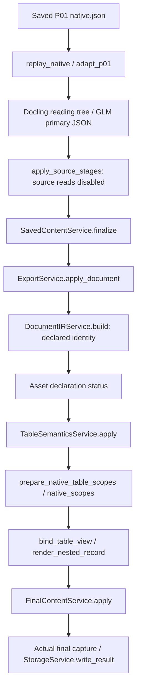

# MO-Parse Lite：Paddle格式族接入与公共内容链横向工程验收

Paddle格式族共同适配已完成；P03/P04真实保存结果纵向转换分别为partial和partial。各组使用自己的native.json及配对observation，经既有共同契约、公共source-free处理和Storage生成实际正文；P01/P05用同一冻结源码完成回归，分别保持partial和completed。本轮是固定格式及受限转换的工程验收，没有Native或Product质量成绩，不代表八组或完整Paddle格式已验收。

接手HEAD为`cb59cee158f75c0419c332d7adc387c4067539b5`，工作区干净，/opt/mosaic-parse与/opt/moparse指向同一入口。初始software_id为`67eb3d2cbd3300130bcef89dc59657f154731ca92431724cd81fccd4f6bf0849`；输入、历史产物、测试清单及索引身份见[接手记录](../../runs/lite/service/development/paddle-content-closure/intake.json)。最终代码、718项实际测试、手写断言及四份真实复验同绑software_id=`a93a04b6f01fd145e2af7bc762ecfb43b5a741488f3f2b65b00444eca16c16e0`，测试清单SHA256=`c9ed05ba35cb48ea02288a50cfd7e1f4865187f49d046a10abff8f577efc839e`，见[最终绑定](../../runs/lite/service/development/paddle-content-closure/final-binding.json)。HEAD未变，改动留在工作区，未提交或推送。

## P03/P04自己的实际输入与正文

仅固定vanke-repurchase-share-changes-p001-003：P03/P04各自measured-quality800-r1目录内的三页native.json及observation，选择依据是区域、HTML表格、polygon、nullable rank和媒体声明的格式覆盖。没有遍历转换全部Lite，没有访问expected、原件或媒体，也未从原生导出、历史final或另一组结果补文。

| 项目 | P03 | P04 |
| --- | --- | --- |
| 自身原生输入 | [native.json](../../runs/lite/artifacts/P03/measured-quality800-r1/vanke-repurchase-share-changes-p001-003/native.json) | [native.json](../../runs/lite/artifacts/P04/measured-quality800-r1/vanke-repurchase-share-changes-p001-003/native.json) |
| 实测原生SHA256 | `6483f74c8859d7c25367872f2c079afd86f49966229ad0e2928e7ef6c86a485d` | `48cc533a25fad62b2c84377e12fc2e055084ea63179c439503aeb7735b1d2556` |
| 实际正文 | [final.md](../../runs/lite/service/current/p03/development/paddle-vanke-3p-final/final.md) | [final.md](../../runs/lite/service/current/p04/development/paddle-vanke-3p-final/final.md) |
| 阶段、来源、状态、持久化 | [evidence.json](../../runs/lite/service/current/p03/development/paddle-vanke-3p-final/evidence.json) | [evidence.json](../../runs/lite/service/current/p04/development/paddle-vanke-3p-final/evidence.json) |
| 原执行 / 格式读取 / 公共转换 / 交付 | completed / read / partial / partial | completed / read / partial / partial |
| 主结果区域 | 31：8标题、19文字、1表、3图片出现位置 | 31：8标题、19文字、1表、3图片出现位置 |
| HTML投影与关系 | 44格，37非空、7空；5记录、25值关系 | 44格，37非空、7空；5记录、25值关系 |
| 几何与媒体 | 31组polygon保留；3处图片未读取、未验证、未交付 | 31组polygon保留；3处图片未读取、未验证、未交付 |
| 正文SHA256 | `9c7f5af0f85f520fbdb128a00febd6b0cbc11bcfaa9a6f7e693d7421ae291e58` | `8d09a279ca9c2cd14af4e0af7bc96c66fac8ae363306b87fa548b2814d231b06` |

两份原执行均为completed，三页已处理、原始errors为空；当前unknown读序、unknown group语义及媒体未交付由共同链分别保留，未把适配器漏字段归为上游unknown。三个页面各记录native_reading_order_unverified和native_group_semantics_unknown，三处图片记录saved_native_media_unverified；工程异常仍抛出，不伪装成原生失败。Paddle页或generation batch的已有状态、stop reason、EOS与长度标记保留原始路径，批内region索引未冒充SDK block_id；真实stop_reason未知仍未知，不由可读文字补成成功。

## 实际格式差异、group、顺序与几何

下表仅描述固定输入的真实字段和同版SDK静态依据，详细字段清单、两处字面差异、配置及缓存源码SHA见[格式清单](../../runs/lite/service/development/paddle-content-closure/format-inventory.json)。SDK缓存仅作源码阅读，未导入、执行裁剪或启动模型。

| 维度 | P03 | P04 | 实际结论 |
| --- | --- | --- | --- |
| 保存配置 | PaddleOCR-VL-1.5；revision `2a4195faa5e7914c12f2fc601d72c81caf8d2da5` | PaddleOCR-VL-1.6；revision `c5630abae1d940eafe0697512a0325494b02ab42` | 独立配置和工件身份；不是当前运行或在线模型证明 |
| 共同依赖与保存镜像 | paddleocr 3.7.0、paddlex 3.7.2、paddle_transformers 5.10.2 | 相同包声明和镜像SHA | 保存配置可核对；不据此断言所有差异只由模型版本造成 |
| 顶层与页面 | pipeline/config/pages/documents/page_processing；三页raw.res | 相同字段族 | 各自读取，不互借对象 |
| 主视图与区域 | res.parsing_res_list；14、14、3个区域 | 相同结构和数量 | block_id/label/content/bbox/order/group_id/polygon均保留 |
| group_id | 页内唯一、跨页重复，无global_group_id | 同样观察 | 仅页内group identity；父链和跨页关系未知 |
| block_order | 部分序号递增，表格、附注和图片为None | 同样观察 | 保留rank和数组位置，未证明完整全局读序 |
| bbox/polygon | 1654×2339像素、TOPLEFT；31组polygon | 相同尺寸和区域几何 | 原框和polygon分开保留，不用一者覆盖另一者 |
| 表格 | 主content内HTML，8行6列、44个td锚点格 | 同结构，部分原字不同 | rowspan/colspan可读；无独立SDK OCR cell list、cell几何或显式header role |
| 页面身份 | res.page_index/page_count为None | 同样缺少局部页索引 | 物理页取保存调用清单；原PDF映射只使用已有声明，None不改0 |
| 原生导出 | research_region_exports与faithful_markdown存在 | 同样存在 | 仅审计保留，缺主结果时不回退 |
| 原执行失败 | 当前三页无failed/timeout/unprocessed | 当前三页亦无 | 失败传播只有独立合成JSON验证，不冒充实样覆盖 |
| 读取器与公共处理 | 同一个read_paddle/read_paddle_blocks及finalization | 同一实现 | 公共语义没有P03/P04选择分支 |

同版PaddleX 3.7.2的_to_json在原group_id缺失时可回退为idx，合并工具也可能给多个区域同组值；本样本不能区分其来源，更不能据值相同生成父子。block_order只为未列入skip_order_labels的区域编号，不能覆盖被跳过区域；共同链保留数组显示顺序并标记原生阅读顺序unknown，不按bbox重排、不续接同组文字。真实多成员组、跨页组及完整原生父链在当前固定范围不可用。

像素单位和TOPLEFT有同版CropByBoxes的xyxy及img[ymin:ymax,xmin:xmax]源码依据；页面width/height来自处理后图像shape。当前use_doc_preprocessor=false支持处理帧到已声明输入帧的identity，原PDF逆变换仍unknown；已有旋转/cropbox仅保留元数据，不套Docling坐标。缺尺寸、退化框、无效polygon或预处理变换不明时，保留原字面及unknown/partial；源raster媒体框与可用于输入裁剪的框明确分开，未读取媒体字节。

实际区域字段差异只有第一页区域4的正文空格和第二页区域2的表格content。P03保留“证券简称：万科 A、万科 H 代”，P04保留“证券简称：万科A、万科H代”；P04表头的反斜杠+n是两个原生字符，不是换行，没有反转义或替换为P03答案。两份number标签中的“万科企业股份有限公司”均作为文字保留，未据标签删成页码；vision_footnote（含2,810,500股）各在自身正文位置保留，未以邻近关系补造记录附注。

HTML本身是原生B类结构，从DOM得到的44格为C类投影；当前没有A类独立OCR源格。行列、span及文字的locator绑定实际content路径与DOM语法位置，cell bbox/polygon保持缺少。5个记录及25值关系为既有公共用途/计量规则的D类推导，逐项核对原生记录行、完整表头、期间和实际最终跨度，不写成原生header role；37个非空格全部定位到final，7个空字面没有补0或业务解释。普通文字网格和混合/不足结构仍保守保留或partial，没有本轮新增表格业务规则。

## 实际代码、共同准入与公共消费者

实际调用为`saved_content_closure.close_saved_document → replay_native → app.adapters.saved_native.adapt_saved_document → read_paddle_blocks → NativeContentContract核验 → SavedContentService.finalize → StorageService.write_result`。finalize沿用同一Export、DocumentIRService、TableContext、TableSemantics、FinalContent；未建立PaddleParserService、另一套IR或FinalContent实现，未复制P01/P05正文，未将原生Markdown直接充当final。

| 文件与函数 | 本轮实际改变 |
| --- | --- |
| app/adapters/native_readers.py；moparse_eval/adapters.py | 将已有read_paddle无损移到中性模块，研究入口重新导入同一函数；研究主视图和评分责任未变 |
| app/adapters/paddle_native.py；read_paddle_blocks/paddle_geometry/paddle_group_identity/paddle_execution_states | 共享Paddle解码、原生字段和显示映射、polygon、未知顺序/分组、局部页和原状态路径；无答案补全 |
| app/adapters/native_config.py；saved_native.adapt_saved_document | 配置身份和允许分支集中声明，P03/P04都只允许paddle；各自producer与工件SHA保留，接入既有适配调度 |
| app/adapters/native_inventory.py；inventory_native | 直接独立遍历输入区域、HTML语法格、媒体及审计对象；不调用读取器或从适配块反推清单 |
| app/services/native_content_evidence.py | 校验配置、原生对象和页映射、group/rank/polygon/原点、媒体来源及不可变原状态；沿用IR和表格关系守卫 |
| app/services/native_content_service.py | 依据结构共享HTML/GFM投影；number保守留文；区分原生raster框与未知输入变换的媒体框 |
| app/services/ir_service.py；app/models/native_content.py | 配置locator绑定工件SHA；Paddle来源留在私有契约，公开来源枚举不扩张，selected_source为空并记原因，不伪造Docling来源 |
| moparse_eval/service_replay_native.py；saved_content_closure.py | 将这两个已声明配置交给同一适配/受限开发入口；其余真实格式未启动 |

共同层没有P03/P04专用语义规则。保留配置/producer、允许branch、主视图、实际SHA、出现位置、物理页与局部页、原生关系、完整格位与范围守卫；能力由输入结构核实，不靠validated/supports_tables等布尔标记。主视图缺少、locator错绑、格位不足或页映射冲突不会因pipeline被接纳而通过。未提升的布局检测、导出和原始字段绑定不可变原生工件、视图和路径作审计，不变成另一份答案。

## 双向完整性、负向反例与真实阶段

每份Paddle原生清单分别覆盖27个文字/标题对象、1表、3图片出现位置、44个HTML语法格、3媒体声明及64项结构/纯元数据审计。去向分别为实际正文、公共表格转换、37个非空格的final位置、7个未补值空字面、明确媒体未交付或不可变原生审计。清单直接从输入建立；适配、消费模型及最终去向按同一工件和occurrence身份核验，同字面不同区域不能替代。不要求布局检测或纯元数据打印为正文，也没有未定位正文或非空格用partial豁免。

[独立原生断言](../../../tests/validation/paddle_native_assertions.py)直接依据各自输入手写31组polygon、原生文字、页、格位/跨度、记录与完整表头、期间、媒体和实际final位置，未导入app、评分器或来源Oracle。新增[test_paddle_saved_content.py](../../../tests/unit/test_paddle_saved_content.py)在输入不变时分别破坏正文、标题、列表成员、group成员、group_id、block_order、polygon、bbox原点/数值、整表、HTML格、页映射、媒体声明、原生ID、locator、显示文字及未知顺序；相邻同字面替换、虚构group父链和失败改成功均被拒绝。重复对象、跨分支借用、表头/单位/期间/附注错绑继续由已执行的共同契约用例保护，没有以数量相等或字符串命中替代关系核验。

中间170项定向回归曾揭示bbox与输入列表别名、非对象区域缺页身份两个实际缺口，已分别以深拷贝和明确物理页投影修复；失败及修复前后证据保留，未把这些遗漏标为上游unknown。合成P03/P04包装的相同Paddle结构经同一finalization得到相同正文和语义，pipeline、producer和工件身份仍各自保留；实际两组则各用自身原字，未作改标签实样验证。

四份真实结果均捕获adapted、source_pages、native_pages、exported、ir、assets、semantic、final八个观察点。source_pages/native_pages明确不适用；ir在实际DocumentIRService构建后捕获消费对象，无相邻快照复制。exported、semantic、final的生产者编辑精确重放；ir/assets记录无文字变化及各自真实对象/状态。关系正确性由独立原生格位及断言核验，edit重放只证明变换一致性，未从隐藏IR再生正文补内容。

四份final.md、实际final快照、result.markdown、parse_result.renderings及Storage落盘result.md按UTF-8字节相等。实际输入native与配对observation在前后SHA相等，原PDF SHA仍只是已有声明。P03/P04本次串行开发转换分别约1.42秒和1.41秒，仅为工程运行观测，未替换、相加或补成历史解析成本。

## P01/P05迁移保护

P01/P05固定输入未改，以最终源码重新走同一公共链。新正文、全部SemanticTableView及记录/表头/期间/限定关系与上阶段开发基线完全相等，历史正文、证据和原始输入字节保留。P01 Docling与GLM分支隔离、P05全页GLM仍由各自来源合同控制，没有为Paddle降低旧断言。

| 保护项 | P01 | P05 |
| --- | --- | --- |
| 本次实际正文 | [final.md](../../runs/lite/service/current/p01/development/paddle-stage-regression-vanke-3p-final/final.md) | [final.md](../../runs/lite/service/current/p05/development/paddle-stage-regression-vanke-3p-final/final.md) |
| 本次实际证据 | [evidence.json](../../runs/lite/service/current/p01/development/paddle-stage-regression-vanke-3p-final/evidence.json) | [evidence.json](../../runs/lite/service/current/p05/development/paddle-stage-regression-vanke-3p-final/evidence.json) |
| 原生字段与源格 | 368项历史字段核对；45格、37非空、8空 | 44个HTML格、37非空、7空 |
| 关系 | 5条记录、25值关系、完整表头/期间来源保持 | 5条记录、25值关系、完整表头/期间来源保持 |
| 正文与状态 | 原SHA `9e2c899567e66599ee29fde3ed71cff3d4d8842f154bd3bdf676336335eb81a7`；partial | 原SHA `f8556a2134167b7e66b2df93ce47a85230c015497215525f2d43ca30d6fc3349`；completed |
| 媒体与持久化 | 两处媒体未交付及warning保持；实际落盘一致 | 当前主结果无待交付媒体；实际落盘一致 |

旧Paddle合成测试曾把未知输入变换的raster框放在_picture_candidates；本轮改为验证绑定媒体声明中的同一精确数值框、producer_output_raster及input_transform=unknown，并要求输入框为空、bytes_accessed=false。改动发生在旧Paddle断言及审核摘要，不是降低P01/P05的368项、源格、正文或关系基线。

## 实际测试、执行边界与未完成能力

冻结后通过scripts/test_source_only.py实际执行718项：19个已审查模块、15个共享依赖，退出0、边界违规0、运行中源码和测试未变。清单内其余146个已审查模块及81个混合/媒体/未接纳模块本轮未执行，未继承旧JUnit。见[运行JSON](../../runs/lite/service/development/paddle-content-closure/source-only-verified.json)及[JUnit](../../runs/lite/service/development/paddle-content-closure/source-only-verified.xml)。新增模块、独立断言、fixture、辅助依赖和旧Paddle断言先逐项读入审查再更新摘要/哈希；父conftest禁用，插件自动加载关闭。保留原始六项失败、170项定向回归中的失败及较早716通过/2失败的旧Paddle接口回归，不改称通过；历史执行边界偏差原记录未改。

当前执行范围包含共同契约、Paddle/P01转换、阶段/ledger、FinalContent、表格入口、原生读回和必要T/L/B纯文本回归。相关比较只用独立合成文字/结构，未改T/L/B规则、Oracle或分母，未实际比较candidate与canonical expected。四份真实开发转换各由同一入口串行执行，限制8 CPU、8 GiB，关闭GPU可见性并拒绝网络、原件、媒体及参考答案I/O，见[串行运行记录](../../runs/lite/service/development/paddle-content-closure/serial-development-runs.json)。

16个相关app源码目标mypy通过，限定软件/测试Ruff通过，见[静态检查](../../runs/lite/service/development/paddle-content-closure/static-checks.json)。[读取抽取核验](../../runs/lite/service/development/paddle-content-closure/readback-extraction-check.json)确认read_paddle函数AST仅移动归属，研究read_glm未变，生产适配不导入评测器或测试辅助。公开HTTP schema与旧SHA完全相同，14条路径，未启动lifespan或发送请求，见[协议保全](../../runs/lite/service/development/paddle-content-closure/http-schema-check.json)。6份实际修改的非语料Markdown政策检查0违规，限定软件/文档diff检查通过，见[文档检查](../../runs/lite/service/development/paddle-content-closure/documentation-checks.json)；通用检查没有扫描语料、运行产物或报告。本报告只作当前授权范围的专门维护，历史后缀和原成本段保留。

未执行PDF/图像创建、读取、解码、渲染、字层、OCR、VLM或模型，没有网络、GPU/TTS、在线服务操作、部署、完整ZIP、正式评分、八组真实回放、提交或推送。原生、原状态、P01/P05历史正文/证据、原成本和current要求索引SHA保持；formal service/current/index.json仍不存在，未激活正式current、重编要求图或重签旧门禁。Expected、selection、正式分母和五个输入范围未编辑或补答案；63份来源及合同、107份缺口、3份待独立验收保持，55份为历史保护集合、不与63相加。全局structure_blocked及正式成绩撤回不变。

当前只完成上述Paddle固定格式与共同链的有界验收，真实多成员组/父链/跨页组、独立OCR cell list、cell几何、真实失败/超时/未处理页均未在固定实样出现；相关JSON合成测试不算真实覆盖。全局读序和group父关系未知、三处媒体交付及完整离线包尚未完成，公开来源枚举暂不能表达Paddle的细项，完整来源仍在私有证据根；图片语义解释不在目标内。下一依赖依次为P02的Docling V2差异、P06/P07 typed及Standard/Advanced差异、P08 visual来源限制，须另行明确授权，本轮未启动。只有八组共同处理及独立真实格式门槛稳定后，才可按授权开展Native/Product诊断、受控回放和正式评分。

## 历史开发与来源保护证据

以下为此前P01纵向闭环及source-only工作保留记录，其中“本轮”和软件身份属于对应历史阶段。当前实施与状态以上述共同契约和横向验收为准；原成本段及历史输入未覆盖。

### 2026-11-11 P01纵向闭环记录

2026-11-11按最新授权完成P01保存原生JSON到最终Markdown的单文档工程闭环。接手HEAD为`9a97fa062156423caada86c62c338c47bbb94d28`，工作区干净，`/opt/mosaic-parse`与`/opt/moparse`指向同一入口。真实原生格式读回和受限服务转换分别验证通过，开发文档因两处图片未交付保持partial；本报告不提供解析质量成绩或排名。

## 实际调用链与首个缺口

历史原生执行由`executors.execute_in_worker`调用`_preprocess`，随后Docling分支的`_docling_run → sdks.docling.convert`与GLM分支的`_glm_page → sdks.glm.process`产生结果；同一执行函数保存`native.json`、`faithful.md`和已取得的资产。这些路径本轮只查源码和已保存JSON，没有重新执行。研究侧`read_saved_native → READERS`与服务转换是独立消费者；原生格式说明不代表最终正文已完成。

接手时的首个实际缺口是Docling/GLM读回块提供`kind/text/service_rendered`，而表格上下文及最终清理消费`type/content/markdown`；`native_scopes`又仅接纳MinerU源格。返回DocumentParseResult没有证明P01实际进入分类、范围绑定和最终清理。另一个必要缺口是DocumentIRService默认读取源文件求SHA256，原生块进入IR时还会被几何排序重排。正式`service_evaluation.execute_case`会打开旋正PDF、补充字层和提取资产，因此没有用它冒充本轮允许的开发入口。



| 阶段 | 实际函数与载体 | 本轮状态与界限 |
| --- | --- | --- |
| 原生解析与保存 | `execute_in_worker`、`_docling_run`、`_glm_page`及原生文件写入 | 只核实既有实现和保存结果；未跑模型或原件处理 |
| 忠实读取 | `read_docling`遍历body/groups引用；P01 `_glm_blocks`读取json_result | 当前实际调用，不借研究Markdown、raw审计答案或expected补内容 |
| 服务适配 | `service_p01_adapter.adapt_p01/_render` | 原生payload与服务角色并存；分支、局部页、物理页、原PDF页及方向元数据分别保留 |
| 原件补充 | `apply_source_stages(allow_source_reads=False)` | source_pages/native_pages明确不适用；PageEvidence、PDFTableEvidence及NativeTextService.apply_async未被调用 |
| 内容分类与表格关系 | `prepare_native_table_scopes → native_scopes → bind_table_view` | 结构完整仍须有局部字段或计量依据；用途未知、混合行与冲突继续保留 |
| 最终正文 | `ExportService.apply_document`、`render_semantic_view/render_nested_record`、`FinalContentService.apply` | 真实生成多层列表、连续正文及最终精确编辑记录；不是拷贝faithful.md或历史final.md |
| 资产 | `SavedContentService.finalize`中的声明状态处理 | 仅处理身份、引用和未交付状态；没有调用MultimodalService提取、裁图、OCR或读取图片 |
| 持久化 | `StorageService.write_result/read_result`及开发审计JSON | 对象内最终renderings与落盘正文按UTF-8字节核对；未启动HTTP、Job worker或在线服务 |

`ParserService._finalize_exports`现在委托同一个`ExportService.apply_document`，当前开发入口与既有在线源码共享导出实现；完整ParserService.parse及其模型、PDF补充、资产分支本轮没有执行。仓库没有名为DocumentEvidenceIR的类型，实际结构化视图为ContentParseResult。P01逐节点进入TextBlock、ContentRegion、ParsedTable，保留原生阅读顺序；TableFragment、CellRef、ValueRelation、SemanticRecord与SemanticTableView承接源格、完整标题路径及限定。原生父子树、原始label、charspan、bbox原点、源节点与媒体声明比公共消费视图更丰富，保留在stage sidecar，未混入普通正文。内部unknown来源与策略已可表达，HTTP OpenAPI没有暴露或新增这些字段。

## 单份真实保存文档与原生信息去向

先按173份P01保存JSON的分支和原生结构作格式盘点，再选择完整既有三页`vanke-repurchase-share-changes-p001-003`；选择依据为两分支、正文、表格、多层表头、列表和图片项的共同覆盖，没有读取expected选答案。仅这一份进入纵向服务验证，没有把其他盘点文档计为完成。其原件身份与页序沿用既有manifest；文件大小只取文件系统stat元数据，未打开PDF或重算原件校验值，已有SHA256不冒充本轮字节验真。

输入位于`benchmark/runs/lite/artifacts/P01/measured-quality800-r1/vanke-repurchase-share-changes-p001-003/native.json`。前两页raw分别以`native_document=#/documents/0`和source_page 1/2指向同一DoclingDocument，第三页是单次GLM图像调用的结果，局部页面列表索引0与输入物理页3分开。Docling body、key_value_area、list、texts、tables、pictures、parent/children及附属引用保全；源格的原始行列起止、rowspan、colspan、表头角色、文字和bbox保持。Docling BOTTOMLEFT与源格TOPLEFT分别转换，GLM bbox_2d按1000归一；不进行第二次旋转，不伪造原PDF坐标逆变换。原始旋转、cropbox、页序和页身份留在内部证据。

GLM只从json_result生成正文；raw_json_result和markdown_result作为独立已有视图保留身份，不补主结果，也不重复输出。此页有两个文字区域，没有表格或输出图片区域，image_files为空，原始页面图片声明没有被当成已交付图片。原生source_prediction为unknown时继续保持unknown，不填成native或sparse。JSON字符串中的decoded路径可由同一指针解析器反向解析，HTML格另有主content字段的JSON指针与语法定位，不冒充Docling/PDF源格。

开发文档含28个内容对象：7个标题、14个普通文字、4个列表项、1个表格和2个图片项。当前真实表格为8行6列、45个原生锚点格，输出5条有来源的记录及其完整多层列路径。37个非空格均在实际最终正文取得位置，8个空字面槽位不补零、不推断“来源空白”含义。25个非表格文字/标题/列表对象保留，1个表格转换，2个图片出现作为未解决交付记录；逐项原生字段核对与最终跨度在`format_readback_checks`和`content_dispositions`，不能把这些数量替代字段、关系和实际打印文字的证明。

最终正文示例来自该真实原生表，完整正文由下述实际final阶段产出：

```markdown
- 股份类别：一、有限售条件股份
  - 本次回购前 （2015 年 8 月 31 日） / 股份数量：15,386,999
  - 本次回购前 （2015 年 8 月 31 日） / 比例：0.14%
  - 本次回购后 拟注销数量：
  - 本次回购股份注销后 （2016 年 1 月 14 日） / 股份数量：15,848,774
  - 本次回购股份注销后 （2016 年 1 月 14 日） / 比例：0.14%
```

表内既有父分组和完整日期路径保留，表前原文范围随各记录打印；没有从业务常识补股数、币种或单位。表后附注、法律声明、四项备查文件、董事会和`二O一六年一月十五日`的原生字形保留，没有按expected修正识别结果。已确认表体不留下GFM或HTML表格，最终正文不含内部IR、来源JSON、物理分页或调试标记。

两个PictureItem既有研究资产路径和内联媒体声明，但本轮没有验证或复制图片字节。正文在对应位置打印“图片未交付。”，引用和元数据留在媒体审计中，不生成空文件、不把文件名当存在证明，也不插入未验证的Markdown嵌图。原生格式读回与MO-Parse交付状态分别判断：文字和表格链路可验收，文档整体仍为partial，两个saved_native_media_unverified警告同步到内部parse_result和持久化warning日志。

## 阶段、编辑、状态与工程证据

实际捕获adapted、source_pages、native_pages、exported、assets、semantic和final。前两项来源补充视图明确applicable=false，其余阶段分别记录实际页面导出、文档组装、资产声明状态、语义正文与最终正文。导出和语义变换有生产者记录的原文、替换文、前后半开跨度、源表/格引用及原因，并按实际字符串重放；FinalContentService的编辑同样逐项重放，附精确最终跨度。此前只靠全局唯一文字定位的重复片段现在还可用生产者拥有的source-text锚点定位，锚点在final阶段删除。隐藏IR不自动生成候选文字。

共用map_text_offset修复了真实链路暴露的半开边界错误：单元格终点等于下一编辑起点时，不能把下一项的空白替换纳入该格。导出、语义和最终三个变换的ledger必须精确重放；不适用阶段与无文字变化阶段分别记录，不制造历史before。已保存原生JSON在执行前后按原始字节核对，最终文件必须等于实际final快照、result.markdown、parse_result.renderings.markdown及StorageService落盘正文；不从IR重新拼答案覆盖输出。

JobService依据parse_result.status传partial，JobRepository.complete选择JobStatus.PARTIAL或COMPLETED，源码链已核实；新增未知、原生失败、未完成表格、媒体未交付及未决续接能保留partial。MO-Parse自身未处理异常继续抛出，不能归成候选原生失败。HTTP 200或processed_pages=3不表示内容与资产完整，本轮只做对象和持久化验证，没有实际启动HTTP或Job流程。

StorageService.build_bundle仍只打包manifest与资产，缺少result.md、包内相对图片引用与正文校验绑定；本轮没有修改或执行它。现有部分结果正文与审计已持久化，但完整离线图片ZIP没有完成。

已完成的定向source-only验证为190 passed，其中64项新增P01独立文本/JSON用例，覆盖多层树、跨页charspan、列表编号、页与分支冲突、原点与源格冲突、缺失字段、主/审计视图隔离、表头、单位、附注、混合网格、内联图片、未知方法、真实服务阶段和文本持久化。5个原有纯文本模块逐个核查后加入允许清单，其原断言未改；其余81个模块仍未收集。应用10个相关源码文件的mypy通过，改动软件的Ruff通过。公开HTTP schema的14条路径及完整结构与修改前完全相等，未启动lifespan，见[协议保全](../../runs/lite/service/development/p01-closure/http-schema-check.json)。

最终source-only允许范围完整回归为4029 passed，163个已审查模块、13个共享依赖，81个模块继续排除，退出码0，边界违规0，源码与测试在运行中保持冻结；见[运行记录](../../runs/lite/service/development/p01-closure/source-only-final.json)及[JUnit](../../runs/lite/service/development/p01-closure/source-only-final.xml)。上述190项定向验证和真实保存JSON转换使用同一software_id=`8e41f4c2c66d808223eb286698d716f3557d11fa2a6c78e78969110518da83e3`。所有软件回归只通过scripts/test_source_only.py执行，父conftest禁用，插件自动加载关闭，仅读取已审查共享依赖；媒体文件及网络I/O由边界钩子拒绝。较早source-only-frozen在2956项通过后主动中止以完成未知状态与IR顺序修复，退出码2，记录仍保留；较早失败及历史媒体偏差亦不改称通过或合规。

真实保存JSON的368项原生字段核对差异为0，原始native.json字节在转换前后保持，SHA256=`2feddedb01493ad21c58b06dfbfea5a94fd763cb89dd93591b4083f0e94b010b`。实际[最终Markdown](../../runs/lite/service/current/p01/development/vertical-closure-vanke-3p/final.md)的SHA256=`9e2c899567e66599ee29fde3ed71cff3d4d8842f154bd3bdf676336335eb81a7`；正文等于final阶段快照、对象renderings和StorageService落盘正文。逐节点内容去向、逐格实际输出跨度、七阶段完整捕获与编辑记录均在[真实转换证据](../../runs/lite/service/current/p01/development/vertical-closure-vanke-3p/evidence.json)，同源码回归及产物约束见[最终绑定](../../runs/lite/service/development/p01-closure/final-binding.json)。source_pages/native_pages的producer ledger为not_applicable，exported、semantic及final为verified，assets为verified_no_text_change；实际编辑分别为1、2及33项，均按真实前后文字精确重放，没有未定位的非空源格。

该开发入口串行限制为8个CPU、8GiB地址空间，关闭GPU可见性并拒绝网络操作；这不是性能测量。仅生成当前P01开发产物，没有创建或激活正式service/current/index.json，没有改动P07/P08历史正文或原始成本。未执行PDF/图片读取、字层、OCR、模型、真实candidate与expected比较、八组回放、正式评分、GPU/TTS/服务操作、部署、提交或推送；公开HTTP schema保持不变。

## 未覆盖结构与后续依赖

真实样本没有GLM表格、GLM输出图片或原生转换失败；这些分支仅有独立合成结构的声明范围验证，不冒充真实多文档覆盖。丰富单元格引用、无完整跨页源格分区的同一TableItem、未知全局读序及GLM媒体清单到区域的完整对应仍需独立验证；不支持的结构保留literal/payload和adapter gap，不能判为完整转换。原生未提供的字段保持unknown，不能用raw审计视图、PDF、其他解析器或expected补全。已确认的主JSON文本HTML布局按DOM顺序保留段落，只有table标签的普通文字网格不会凭标签升级为数据表；混合网格中的未确认行继续保留partial。

共用接口为导出、IR、来源守卫、表格关系、FinalContentService、阶段及文本存储，Docling/GLM的身份映射和原生字段解码留在P01 adapter。P02须另验V2差异后接入；P03/P04须核实Paddle区域、顺序、HTML与媒体；P05须验证全页GLM；P06/P07须使用固定DocVortex typed依赖和各自来源许可；P08须维持严格视觉块来源限制。其他七组没有取得本轮纵向验收，八组真实回放、正式评分及发布仍需其原有门槛和明确授权。

## 接手时的source-only保护基线

下述保留段落来自接手时唯一报告；其中“本轮”指此前T字面投影及固定来源验收阶段，不是本次P01开发验证。63份来源/合同与55份历史保护基线未改，107份比较责任缺口、3份待独立整样本验收和5个输入范围继续保留。没有重新安装173份要求视图，也没有改T/L/B合同、Oracle、比较器、分母或正式selection。原始处理成本段保留原字节和当时语境，其时长不是本次开发转换或软件回归测量。

### 已完成的source-only回归范围与T字面投影修复

固定2份完整样本新增通过2份、仍阻塞0份；原61份完整来源及合同Oracle和五处BIS/IEA局部来源均用最终源码复验通过。当前全局仍为structure_blocked，正式质量成绩及排名暂停。

接手HEAD为`6e9e7b8cc61828ecad4de1681415c122ae363a61`，两个工作区路径指向同一入口，接手工作区干净。初始software_id、198份原测试及断言文件、旧current索引均与既有记录相符；旧记录git_head早于接手提交没有被机械否定。证据在[接手绑定](../../runs/lite/requirements/validation/stage5-intake-binding.json)。上轮固定5份已完成，本轮没有重做其人工普查，也没有重建列表、目录或重复计票框架。

本轮唯一允许范围回归入口为`PYTHONPATH=/opt/moparse .venv/bin/python scripts/test_source_only.py --output benchmark/runs/lite/requirements/validation/新的运行前缀`。已审查清单在`tests/source_only.json`，覆盖157个模块、共享fixture和辅助依赖；86个模块未收集、未执行、未计为通过。明确排除合成PDF、图像、渲染、字层、服务及未经核查的应用执行路径，混合模块保留原断言。父级conftest禁用，插件自动加载关闭，仅显式加载pytest_asyncio；入口核对审查摘要并拒绝媒体文件I/O和网络端点。文本中的媒体或链接引用只解析文字，不加载目标。

最终执行的是“source-only允许范围内的完整受控回归”：3839 passed；退出状态0，边界钩子记录为空，源码和已审查测试保持冻结。JUnit与实际命令见[最终软件证据](../../runs/lite/requirements/validation/stage5-frozen-regression.json)及[JUnit](../../runs/lite/requirements/validation/stage5-frozen-regression.xml)。较早的3833通过、3失败记录及中间定向失败均保留；其中真实的等号字段软换行缺口已修复，集合扩展计数和新测试对空候选既有二元失败政策的错误假设分别更正，没有修改生产失败政策。最后进一步收紧手写标点责任后重新完成冻结回归。历史4618项全项目通过及其合成媒体执行偏差仍保留在原software-validation.json、regression.xml和stage4-execution-scope.json；没有混入本轮计数，也没有追溯改称合规。

接手视图实际重现了历史T家族的30份、349条原始来源义务pending，计数与该历史记录相同，当前逐来源清单另行保留。共同根因的当前证据为7份样本9个原始出现位置：`three_layer._finish`把可见Note标签同单位、期间等字段键一起过滤，正文存在，但T未建标签要求。固定IEA L914的`Note: GW = gigawatt; TWh = terawatt hour.`与平安L624的零售客户定义均缺原始[0,4)的Note。来源完整性为0失败并未掩盖这个字面缺口；来源Oracle在修复前分别实际否决了这两处，原始失败见[来源失败](../../runs/lite/requirements/validation/stage5-intake-source-failures.json)和[根因见证](../../runs/lite/requirements/validation/stage5-root-witnesses.json)。

通用修复保留Note、Condition、Exception及对应中文标签的一次真实字面责任，既有单位、期间、币种和范围键的结构处置保持。直接依赖修复位于`source_requirements.plan_mixed_source`：未完等号字段值中的软换行保留原文跨度，独立字段和明确断言仍分段；`three_layer._Graph.prose`同时保全分段前的原始文字快照，只作来源解析与重放，不追加T全文或第二张内容票。没有改动T定义，也没有将18与18.0归一为同一字面。

| 固定完整样本 | 独立来源case | T原子：接手 → 当前 | 固定B | 固定L | 结论 |
| --- | ---: | ---: | ---: | ---: | --- |
| iea-data-centre-definitions-history-p049-061 | 110 | 237 → 238 | 79 | 206 | 完整独立source-only验收通过 |
| pingan-integrated-finance-p021 | 10 | 18 → 19 | 4 | 16 | 完整独立source-only验收通过 |

120条手写来源声明在新生产编译前定义，逐条涵盖原始selection、标题、正文、列表、图注、引用、单位、期间、情景、限定和顺序，也包括既有explained来源。IEA保留各情景与不确定估计、所有数量和引文，L1004保留一项带can的类型化命题；平安保留(1)定义、客户范围、业务与排名依据及完整标题归属，不把策略改成已发生事实。来源断言在`tests/validation/lite_stage5_assertions.py`，统一Oracle仍是`tests/validation/lite_source_oracle.py`。T按原始身份、局部跨度、顺序和互斥分区逐次核对；语法豁免固定到手写的具体位置，正文内部等号不能借用其他分隔符豁免。原始空白与插入连接空白分开；不同原始出现不合并，也不借邻段或同文覆盖。

最终3839项包含34项新增字面/来源用例，覆盖完整投影、合法软换行、删除字/数字/单位/标点/脚注、重复来源或投影、同文字不同父级、非零偏移、错误来源、表格/链接载体边界、T与B精确数量等价分离、T全而L错以及来源齐全却T遗漏；原有跨片段与突变反例亦在允许范围完整执行。18个独立合成最终场景通过read_expected、要求图编译和图校验、投影、候选文本读取、grade_layers及validate_evidence；固定B/L分母、具体outcomes和序列化重放均保存于[最终比较证据](../../runs/lite/requirements/validation/stage5-controlled-outcomes.json)。已支持的准确表达通过，未决证据拒绝发布。合成表格Note缺失限定来源和混合scalar/modal对应的既有未决边界仍明确拒绝，未借本轮转为完整比较能力。真实expected没有用作candidate。

本轮T审计剩余23份、340条来源义务pending；没有宣称其余pending均是生产漏字。7份9处新增真实Note要求，T字符分母合计增加36；固定两份各增加4字符。173份全部旧T字面payload的出现次数保留，B/L固定计票、完整payload、内容所有权和selection逐项保持，没有B/L数量下降。逐来源变化及全量保护证据在[保全记录](../../runs/lite/requirements/validation/stage5-preservation.json)。

1639项明确单位完整计量和2341项原retained数字payload逐项核对身份、值、单位、期间、限定、来源与实际承担方式，丢失0。当前实际保全2371项数字外形payload，额外30项是上轮已建立的字面目录页码，另按原身份与字面核对，不计为计量比较。保全脚本曾把历史2341保护子集误当当前总数而停在安装前；失败保留在stage5-source-preservation-initial-failure.json，核实后复用相同173份暂存视图完成验证，没有重编译求0。顺丰221项原payload保持，其中161项typed、60项既有完整内容；不能称221项均为类型化计量比较。华为L1586三项、平安C首句一项类型化命题和4条关系、[76,538)互斥余段及混合顺序保持。五个输入范围逐项保全：Alibaba L230、Midea L417、PBOC L540和PBOC L252两项既有选段。Alibaba L2353双附着不变。

最终以16个CPU分析进程同版重建173份JSON/XML，来源完整性失败0。编译退出码2反映保留的集合外阻塞；未改门禁、裁selection或反复执行求0。核验后安装为唯一current并删除过期生成视图，原始材料和历史运行证据保留。当前绑定的63份完整Oracle重新编译后与current逐一相等，五处局部来源亦通过；45项比较能力均对应本次实际执行的通过case。最终software_id=`279041a7896ce2dca90646e088978fa754128be253fe179e52ea46ad95a25af4`，测试审查聚合=`6bfae2574f32e086120f4dfd4585f0a1abb69831c976a173c8bc5ba287e0f3a3`，手写断言聚合=`8ff38e32c4e1bf10996c09cf79a22975a232bd03fbc63c63b1abcb2852177ab6`，current索引SHA-256=`09918d7c652aee0d306dc603cbf7c827c6ca01996b8a436d72fb8d4f803b6884`；见[最终绑定](../../runs/lite/requirements/validation/stage5-final-binding.json)。

173份最新状态：独立来源及合同验收63份，比较责任仍有缺口107份，责任完整但缺独立整样本验收3份，保留输入范围目标5个。公共修复使集合外3份新达到责任完整，只列为待独立验收：iea-adoption-ai-types-p025-031, pingan-business-highlights-p012-013, pingan-health-senior-care-p025-030。本轮没有扩展其人工来源验收；不能把它们自动计为通过。

来源验收、软件比较能力、真实格式及保存候选诊断、执行许可和质量发布继续分开。当前全局仍需闭合其余比较责任、待独立验收样本及五个输入范围，并按新的明确授权完成真实格式/实际候选、回放和正式评分门槛。本轮没有读取或创建PDF、图像、字层，没有OCR、VLM、模型、真实candidate比较、八组回放、正式评分、GPU/TTS/服务操作、部署、公开API变更、提交或推送；最终受限运行没有新的执行边界偏差。只读输入和原始处理成本保持，下面原始成本正文SHA-256仍为`e6562dfb197af4ff3889e7852cb59b140e7f8cd915dbc0cccfec0ce8a11d709c`。


## 原始处理成本

以下为原始执行观测，单位为秒；不含本轮source-only软件耗时，没有重新运行解析或后处理。数值未改写或补零。原生边界为worker开始处理到原生产物及忠实导出就绪，初始化/预热单列。quality800为800输入页的一次执行，perf80为相同80输入页的三次执行；各轮值为原case处理时长之和，不是整批作业首尾墙钟时长，重复轮次不增加独立文档样本。每组native的173次quality执行及84次perf执行均记录completed，原始时长没有缺测；这是执行状态，不是内容正确率。逐轮值、初始化/预热、资源范围及缺测政策见[原始成本数据](data/processing-cost-summary.json)。

| 原生组 | quality800 | perf80中位数（最小–最大） |
| --- | ---: | ---: |
| P01 | 1565.35 | 199.90（199.42–201.00） |
| P02 | 1478.30 | 186.33（186.27–187.19） |
| P03 | 11576.99 | 937.51（893.87–1001.96） |
| P04 | 11826.90 | 778.31（778.19–967.77） |
| P05 | 2908.12 | 276.46（275.32–278.23） |
| P06 | 1619.34 | 202.44（202.14–202.87） |
| P07 | 2411.70 | 276.90（274.57–279.99） |
| P08 | 3327.53 | 311.49（310.53–316.18） |

服务表保留既存实际正文的独立CPU后处理成本；本次八组新回放尚未执行，不继承这些时长为新实现测量。后处理成本不与native相加或解释为新的端到端时长。右列为quality800实际执行状态，partial和警告均保留，不转为质量分数或采用依据。

| 服务后处理组 | quality800 | perf80中位数（最小–最大） | completed / warnings / partial / failed |
| --- | ---: | ---: | --- |
| P07 baseline | 216.09 | 28.02（27.74–28.40） | 126 / 16 / 31 / 0 |
| P07 current | 216.84 | 28.04（27.91–28.22） | 126 / 16 / 31 / 0 |
| P08 baseline | 194.05 | 28.91（28.82–29.27） | 127 / 14 / 32 / 0 |
| P08 current | 181.99 | 27.37（27.18–27.39） | 128 / 14 / 31 / 0 |

原生配置的CPU预处理分配为8核及8GiB内存、推理进程分配为4核及20GiB内存，自有评测GPU显存预算16GiB；原服务后处理为8核及8GiB内存、无GPU、并发1。原始执行存在TTS共驻和未受控制的活动：起止持久任务计数71至76，观测到5个新增任务；短调用可能没有被这些观测捕捉。不得据此宣称GPU独占或TTS空闲。数据分别保存分配与实测使用、RSS/cgroup峰值及观测覆盖；未记录的GPU指标保持未知，单页allocator峰值不等于整个设备占用。本轮16个CPU分析进程仅用于source-only要求图重建，不改变原执行资源与时长。
