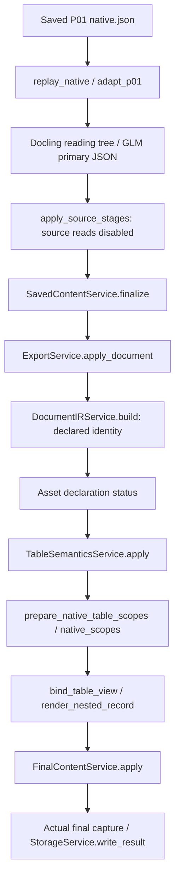

# MO-Parse Lite：P02 V2真实交接、公共状态与完整source-only工程验收

P02 Docling V2真实保存结果适配及公共处理已完成；unknown/partial状态契约已验证；source-only允许范围回归通过。固定P02文档交付为partial，实际原因是两处媒体未交付；原执行completed、格式读取read、当前转换completed分别留证。P01/P05/P03/P04固定保护复验完成，正文及关系不变。本轮仅为Normalization和受限内容链工程验收，没有Native或Product质量成绩，没有取得八组正式门禁。

接手HEAD为c91f1f71397f37f55dc993b4066cf845a7d19b9b，工作区干净，两条工作区路径均指向/opt/moparse。初始software_id为a93a04b6f01fd145e2af7bc762ecfb43b5a741488f3f2b65b00444eca16c16e0；输入、历史产物及索引身份见[接手绑定](../../runs/lite/service/development/docling-v2-content-closure/intake.json)。最终源码software_id为`ecca8275b3b2ae9b50b4205bfc4de0c29724e206bf6669311c6dc6b527205b07`，测试清单SHA256为`bbbf0134b26468ed7f746470f72199fc5b017656df7ff02920172c330e8d73da`，tests_sha256为`07f29011ff54ecb4421eaee62d5bbe666bc364ec85e889d16134f4e28f677645`。完整回归、五份最终转换及独立断言绑定相同冻结身份，见[冻结](../../runs/lite/service/development/docling-v2-content-closure/freeze.json)和[最终绑定](../../runs/lite/service/development/docling-v2-content-closure/final-binding.json)。HEAD未改，代码留在工作区，未提交或推送。

## P02自己的实际输入与正文

仅固定vanke-repurchase-share-changes-p001-003，选择依据为真实V2树、列表、多层表格源格、图片出现位置及GLM分支覆盖；没有遍历转换全部Lite。输入为[P02 native.json](../../runs/lite/artifacts/P02/measured-quality800-r1/vanke-repurchase-share-changes-p001-003/native.json)，实测SHA256=`666c32a82e47e3cbe86dfc93787b06196b8bf05640a4665b2fca6667ba6a09cb`；配对observation实测SHA256=`edfba49a175483c6c5a1c2ddf0858408f7e50492b9b4ac6a26ba5d84b03cda29`。前两页Docling局部页1/2指向本组documents/0，第三页为本组GLM单图调用，局部页0与物理页3分开。

实际[P02 final.md](../../runs/lite/service/current/p02/development/docling-v2-vanke-3p-final/final.md)的SHA256为`4a778a3fb3ccc91626fad9226c0dfe58403517cfbbc62415aa3b025ed88985b5`，来源、阶段和状态见[evidence.json](../../runs/lite/service/current/p02/development/docling-v2-vanke-3p-final/evidence.json)。正文等于实际final快照、result.markdown、parse_result.renderings和[Storage result.md](../../runs/lite/service/current/p02/development/docling-v2-vanke-3p-final/persistence/jobs/vanke-repurchase-share-changes-p001-003/output/result.md)的UTF-8字节。没有复制V1正文、原生Markdown或历史final，也未读取原件、媒体或expected补文。

实际调用为`close_saved_document → replay_native → adapt_saved_document → 既有Docling/GLM投影 → NativeContentContract及来源核验 → SavedContentService.finalize → Export → 实际IR → TableContext/TableSemantics → FinalContent → Storage`。P02没有独立的公共内容处理器，已有Docling读取器可承接此实际字段族，因此未复制V1 adapter或新增V2语义分支。

## V1/V2实际差异与共享边界

V1/V2在此指TableFormer配置；两组保存的docling均为2.139.0、docling-core均为2.101.1，DoclingDocument schema均为1.10.0。P02配置另声明TableFormer V2 revision e41ba5da7ef69004f4b329168791c2987abf917c；P01 V1 revision为fc0f2d45e2218ea24bce5045f58a389aed16dc23。它们是各自保存执行的身份，未在线核验权重或重新运行模型，不能由结果长相推断版本或归因全部差异。详细字段和每格原始值见[实际格式清单](../../runs/lite/service/development/docling-v2-content-closure/format-inventory.json)。

| 维度 | P01 V1实样 | P02 V2实样 | 共享处理结论 |
| --- | --- | --- | --- |
| 文档树 | body、furniture、2 groups；23 texts、1表、2 pictures | 相同树和对象字段族 | 共用引用遍历，不以texts数组重排阅读树 |
| 正文及父子 | label/text/level/content_layer、parent/children、prov/charspan | 相同字段和本范围树 | 原生角色及父链保留，显示角色另投影 |
| 表格对象 | data.table_cells、num_rows/cols、orientation/grid及引用 | 相同字段族，均为8行6列 | table_cells为主结构；其余已有字段保留在不可变根，不补主答案 |
| 原生源格 | 45锚点格，37非空、8空 | 46锚点格，37非空、9空 | V2自己的源格独立建清单，不照搬V1数量 |
| 跨行跨列 | (0,3) rowspan=2，(1,3)为跨度覆盖 | (0,3) rowspan=1，另有空header格(1,3) | 逐原始offset/span交接，不补成V1跨度 |
| 原生角色 | 9 column_header | 10 column_header | row_header、row_section、fillable在两份实样均为false；缺少与false分开 |
| 原文字面 | 较完整的日期表头和该格15,386,999 | (0,1)无右括号，(2,1)字面15,386,99 | V2原样交接，不按V1或业务常识修复 |
| 来源几何 | 节点/表框BOTTOMLEFT、源格TOPLEFT；原页尺寸及charspan | 同坐标合同，源格框数值不同 | 分别转换原点，原框和来源仍留在自身工件 |
| 页面与GLM | Docling物理1/2，GLM物理3 | 各自相同分支范围和本组调用 | GLM只读自身json_result；raw/Markdown视图只审计 |
| caption/footnote及富格 | 此表引用为空，无丰富ref | 同样未出现非空引用 | 不借其他组或相邻文字补附注，非空引用仅有合成验证 |
| 原执行 | ConversionStatus.SUCCESS、errors为空，配对三页completed | 本组同样状态 | 状态不从当前可读文字重新推定 |

P02的375项字段读回核对相等。原生清单独立包含4容器、25个文字/列表对象、1表、2图片出现位置、46格、2媒体声明和2项元数据；它们分别有适配、消费、正文或不可变审计去向。5条记录、25值关系逐项核对本组记录行、完整已有表头路径、期间和实际最终跨度；37个非空格均定位，9个空字面未补值。原生未提供单位或附注引用时不捏造关系。字面差异没有被反推成原执行截断，更没有被修复成P01答案。

独立[docling_v2_native_assertions.py](../../../tests/validation/docling_v2_native_assertions.py)直接依据P02输入声明源值、跨度、角色、父链、完整列路径、GLM分支及最终位置，不导入app或评分器。实际图像URI只核对未读取声明，完整原根仍由工件SHA绑定；没有解码图像。其手写断言曾误认CRLF为字面转义、误把审计URI声明当完整payload，均据原输入代码点和既有审计策略纠正，未改生产文字或读取媒体，见[核对说明](../../runs/lite/service/development/docling-v2-content-closure/assertion-authoring-corrections.json)。

## 公共状态契约与实际实现

共同层保留unknown事实，再核对当前输出责任。每项impact带code、来源工件/视图/路径、对象、受影响输出字段、正文/读序/表格/资产影响、实际依赖、是否阻断转换、是否需partial及warning-only判断。状态不再由local_read_errors非空或reason白名单直接决定，也不按P01/P02/P03/P04/P05编号选择结果。

| 实际证据与输出责任 | 当前处理 |
| --- | --- |
| 单独正文，rank缺少、group未解释，但没有成对排序或归属消费 | unknown和warning保留；原执行completed、读取read、转换/交付可completed |
| 多个输出区域，原生没有可核验的必要读序 | 逐对象记录排序依赖，转换/交付partial；数组和bbox不升级为读序 |
| group元数据未知，当前转换未消费其父链 | 仅元数据warning，不制造父链；明确续接实际依赖仍无解时另行阻断 |
| 裁剪变换或原点未知，当前纯文字不消费几何 | 原框及unknown保留，IR框不伪造，不因这项元数据单独降级 |
| 用途未知、缺格、未支持结构或未承担表格转换 | 保留原生内容，按实际缺口及未决责任partial；不以table标签冒充已转换 |
| 原执行failed/timeout、已知截断、未处理页或处理覆盖未获证明 | 原执行身份与原因保留，交付独立partial；当前读取/转换另判，不能反写原执行成功 |
| 媒体声明未读取、未验证、未交付 | 独立资产partial；不以文件名、URI或文字读取成功覆盖 |
| 适配或内容交接自身工程异常 | 抛出工程错误，不改为上游unknown或原生failed，不生成虚假成功正文 |

| 文件与函数 | 实际修改 |
| --- | --- |
| native_config.CONFIGURATIONS；service_replay_native.replay_native | P02交给同一个有来源守卫的适配入口，保留独立producer/configuration和Docling/GLM分支权限 |
| native_content_status.native_status_impacts/execution_incomplete | 从核验对象和实际消费依赖计算影响，区分元数据、读取/转换、未决输出、原执行和资产责任 |
| native_content_evidence._execution/native_partial | 原observation只消费状态allowlist；Docling文档、GLM调用和Paddle批状态保留自身路径，当前状态按影响判定 |
| native_content_evidence._cell_matches/validate_native_content | 逐格保全offset、row_section、fillable及缺少状态，错误内容类型不能擦除读取标记后宣称成功 |
| native_content_service._table | 原始格网有洞时在投影处保留并记录结构不足；后续删格/错绑仍由原来源守卫拒绝 |
| FinalContentService.apply | 续接须有已确认原生顺序；实际生产者跨度记录非表格出现位置到final的去向 |
| SavedContentService.finalize | 验证最终编辑重放和出现位置，不把工程遗漏包装成partial；conversion和delivery分别保存原因 |
| scripts/test_source_only.py | 完整允许集合受控执行，新增实际收集/执行nodeid及阶段结果；禁止仓库语料和媒体I/O |

配置、实际SHA、主视图、物理/局部页、locator、父链、源格/跨度/角色、源关系及范围守卫保留。生产app没有导入expected、评分器或来源Oracle，没有改公开HTTP schema。GLM没有获得PDF字符来源，Paddle仍在私有证据根保留来源细节，公开来源枚举的限制未借本轮扩张。

## 独立反例、状态迁移与阶段

[初始三个失败](../../runs/lite/service/development/docling-v2-content-closure/initial-failures.json)分别复现：单独Paddle正文被无关unknown降级，多段GLM无可靠顺序却completed，P02未进入共同契约。新增[状态测试](../../../tests/unit/test_native_content_status.py)和[V2测试](../../../tests/unit/test_p02_saved_content.py)分别断言四层状态、warning、影响来源和实际文字；覆盖单区域缺rank/未知group、多区域顺序、同group及跨页重复、未知用途/缺格、媒体、failed/timeout/截断、信息warning、未知与独立未完成并存、原失败与可读正文共存，以及工程异常不产出伪成功。

后续独立反例还发现未知数组序可被续接逻辑误用、擦除reader issue列表可漏掉实际unsupported对象。现在续接保留待解决状态，公共层直接依据核验后的内容角色与未承担责任判断。正文在final前被删时，公共finalizer直接报工程交接错误；开发入口既有edit ledger此前也会拒绝该变换，未将它说成原来完全无检测。表格转换未记账、恶意清除读取失败标记和源格flag/offset错绑同样有拒绝或partial反例。删除/替换/重复、跨分支、同字面邻源、表头/单位/期间/附注错绑继续由完整允许集合中的共同测试保护；编辑重放只证明变换一致性，不能代替来源关系Oracle。

唯一旧状态断言迁移是P01的纯合成unknown_origin用例：其阅读树已知、文字保留、无资产及裁剪责任，旧的无条件partial与本轮合同冲突。现在要求四层状态、原点仍UNKNOWN、service_bbox为空、warning保留且没有输出依赖；其余文字和结构断言保留，真实P01的368项、45格及历史产物未改。依据见[状态迁移记录](../../runs/lite/service/development/docling-v2-content-closure/status-policy-migration.json)，不是为兼容Paddle降低真实保护基线。

五份真实结果均捕获adapted、source_pages、native_pages、exported、ir、assets、semantic、final。来源补充两阶段明确不适用；IR来自实际构建，未复制相邻快照。exported、semantic、final生产者编辑精确重放，IR/assets保留实际无文字变化及对象差异。P02另有27项非表格出现位置的最终生产者跨度核对；所有原生对象去向均有来源，不从隐藏IR重新拼答案补final。实际命令和串行资源见[运行记录](../../runs/lite/service/development/docling-v2-content-closure/serial-development-runs.json)。

## 四组保护与当前真实状态

| 管线 | 本次实际正文与证据 | 原执行 / 读取 / 转换 / 交付 | 保护结果 |
| --- | --- | --- | --- |
| P01 | [final.md](../../runs/lite/service/current/p01/development/docling-v2-stage-regression-vanke-3p-final/final.md)、[evidence](../../runs/lite/service/current/p01/development/docling-v2-stage-regression-vanke-3p-final/evidence.json) | completed / read / completed / partial | 368字段、45格、37非空、25值关系；2处媒体未交付 |
| P05 | [final.md](../../runs/lite/service/current/p05/development/docling-v2-stage-regression-vanke-3p-final/final.md)、[evidence](../../runs/lite/service/current/p05/development/docling-v2-stage-regression-vanke-3p-final/evidence.json) | completed / read / completed / completed | 44 HTML格、37非空、25值关系；自身footnote文字保持 |
| P03 | [final.md](../../runs/lite/service/current/p03/development/docling-v2-stage-regression-vanke-3p-final/final.md)、[evidence](../../runs/lite/service/current/p03/development/docling-v2-stage-regression-vanke-3p-final/evidence.json) | completed / read / partial / partial | 31 polygon、44 HTML投影格、37非空、5记录25值关系；3媒体未交付 |
| P04 | [final.md](../../runs/lite/service/current/p04/development/docling-v2-stage-regression-vanke-3p-final/final.md)、[evidence](../../runs/lite/service/current/p04/development/docling-v2-stage-regression-vanke-3p-final/evidence.json) | completed / read / partial / partial | 同样数量，全部使用自身输入和原字；3媒体未交付 |

四组最终正文UTF-8字节、全部SemanticTableView、原生对象去向、warning及实际最终编辑与上一阶段完全相等，四层状态也相同；没有改历史正文或历史状态。P03/P04每组31项group未知仅作元数据warning，31个输出出现位置各有同页多对象读序依赖、加3个媒体未交付责任，仍有实际partial依据；没有因unknown影响修正而自动completed。数量仅描述固定开发范围，不能推导全部Docling、Paddle或八组质量。

## 完整source-only范围、保全与限制

最终`source-only-frozen`实际4175 passed、退出0：167个允许模块全部执行，17个共享依赖，允许模块未执行数为0；81个既有排除模块未收集，原因逐项保留在清单及运行记录。4175个收集nodeid与4175个实际执行nodeid完整记录，12525项setup/call/teardown报告全部passed，没有继承历史718项。见[运行JSON](../../runs/lite/service/development/docling-v2-content-closure/source-only-frozen.json)、[JUnit](../../runs/lite/service/development/docling-v2-content-closure/source-only-frozen.xml)和[完整审查](../../runs/lite/service/development/docling-v2-content-closure/source-only-review-frozen.json)。

执行前读取全部允许模块及共享辅助，检查导入、模块级执行、fixture、间接I/O和子进程。父conftest禁用，插件自动加载关闭，仅显式asyncio；SDK只构造文字/表格对象，不运行converter。受控编译及调度子进程只处理自造文字/JSON/XML和临时锁，不是实际管线回放；子进程调用路径已审查，未把父进程audit hook宣称为独立的子进程审计。Oracle只调用纯结构校验/常量目录等已审查辅助，不执行真实来源验收CLI；合成报告仅写tmp_path，不再生成正式成绩或覆盖维护报告。

首次完整预检为4169通过、1失败，揭示公共几何warning仍错误降级无裁剪责任文字；该失败、较早定向失败和210项定向修复验证均保留。最终全量是在源码及断言冻结后执行，software_unchanged/tests_unchanged均true，边界违规0。既有历史执行偏差仍保留原记录，未追溯改称合规。

17个相关app源码目标mypy通过，限定修改软件/测试Ruff及diff检查通过，见[静态检查](../../runs/lite/service/development/docling-v2-content-closure/static-checks.json)。7份修改的非语料技术文档Markdown政策检查0违规，见[文档检查](../../runs/lite/service/development/docling-v2-content-closure/documentation-checks.json)。公开HTTP schema与上一阶段SHA完全相同，14条路径，未启动lifespan或发送请求，见[协议保全](../../runs/lite/service/development/docling-v2-content-closure/http-schema-check.json)。通用检查没有扫描语料、运行产物、报告或reference-decisions；唯一报告只作本任务当前章节及历史保全的专门维护。

五份开发转换逐份串行，CPU affinity最多8个、地址空间8 GiB、外层并发1，GPU可见性关闭，网络、原件、媒体和参考答案I/O由入口拒绝。开发耗时只记工程运行观测，未替换原解析成本或相加冒充端到端成本。原生/observation、四组历史正文及证据、原成本摘要、current要求索引SHA保持；正式service/current/index.json仍不存在，未激活正式current、重编正式要求图或重签旧门禁。较早git_head的历史证据保留其原语境，不冒充当前正式准入。

Expected、selection、正式分母及五个输入范围未修改或补答案；63份来源及合同、107份覆盖缺口、3份待独立验收保持，55份为历史保护集合，不与63相加。全局structure_blocked及正式成绩撤回不变。本轮没有PDF/图像创建、读取、解码、渲染、字层、OCR/VLM、模型、网络、GPU/TTS、在线服务操作、部署、完整ZIP、真实candidate与expected比较、正式评分、八组真实回放、提交或推送。

本次真实P02未覆盖跨页表、丰富cell ref、非空caption/footnote、row_section/fillable=true、原生失败/超时/未处理页；纯合成例不算这些实样已验收。P03/P04真实多成员group/父链及全局读序仍未知，媒体及完整输出包未交付，公开来源枚举的Paddle细项限制保留。后续依赖为P06/P07 Typed与Standard/Advanced差异，再到P08 Visual来源边界，均未在本轮启动；Native/Product真实诊断及正式比较仍需独立授权和既有门槛。

## 历史开发与来源保护证据

以下为此前P01纵向闭环及source-only工作保留记录，其中“本轮”和软件身份属于对应历史阶段。当前实施与状态以上述共同契约和横向验收为准；原成本段及历史输入未覆盖。

### 2026-11-11 P01纵向闭环记录

2026-11-11按最新授权完成P01保存原生JSON到最终Markdown的单文档工程闭环。接手HEAD为`9a97fa062156423caada86c62c338c47bbb94d28`，工作区干净，`/opt/mosaic-parse`与`/opt/moparse`指向同一入口。真实原生格式读回和受限服务转换分别验证通过，开发文档因两处图片未交付保持partial；本报告不提供解析质量成绩或排名。

## 实际调用链与首个缺口

历史原生执行由`executors.execute_in_worker`调用`_preprocess`，随后Docling分支的`_docling_run → sdks.docling.convert`与GLM分支的`_glm_page → sdks.glm.process`产生结果；同一执行函数保存`native.json`、`faithful.md`和已取得的资产。这些路径本轮只查源码和已保存JSON，没有重新执行。研究侧`read_saved_native → READERS`与服务转换是独立消费者；原生格式说明不代表最终正文已完成。

接手时的首个实际缺口是Docling/GLM读回块提供`kind/text/service_rendered`，而表格上下文及最终清理消费`type/content/markdown`；`native_scopes`又仅接纳MinerU源格。返回DocumentParseResult没有证明P01实际进入分类、范围绑定和最终清理。另一个必要缺口是DocumentIRService默认读取源文件求SHA256，原生块进入IR时还会被几何排序重排。正式`service_evaluation.execute_case`会打开旋正PDF、补充字层和提取资产，因此没有用它冒充本轮允许的开发入口。



| 阶段 | 实际函数与载体 | 本轮状态与界限 |
| --- | --- | --- |
| 原生解析与保存 | `execute_in_worker`、`_docling_run`、`_glm_page`及原生文件写入 | 只核实既有实现和保存结果；未跑模型或原件处理 |
| 忠实读取 | `read_docling`遍历body/groups引用；P01 `_glm_blocks`读取json_result | 当前实际调用，不借研究Markdown、raw审计答案或expected补内容 |
| 服务适配 | `service_p01_adapter.adapt_p01/_render` | 原生payload与服务角色并存；分支、局部页、物理页、原PDF页及方向元数据分别保留 |
| 原件补充 | `apply_source_stages(allow_source_reads=False)` | source_pages/native_pages明确不适用；PageEvidence、PDFTableEvidence及NativeTextService.apply_async未被调用 |
| 内容分类与表格关系 | `prepare_native_table_scopes → native_scopes → bind_table_view` | 结构完整仍须有局部字段或计量依据；用途未知、混合行与冲突继续保留 |
| 最终正文 | `ExportService.apply_document`、`render_semantic_view/render_nested_record`、`FinalContentService.apply` | 真实生成多层列表、连续正文及最终精确编辑记录；不是拷贝faithful.md或历史final.md |
| 资产 | `SavedContentService.finalize`中的声明状态处理 | 仅处理身份、引用和未交付状态；没有调用MultimodalService提取、裁图、OCR或读取图片 |
| 持久化 | `StorageService.write_result/read_result`及开发审计JSON | 对象内最终renderings与落盘正文按UTF-8字节核对；未启动HTTP、Job worker或在线服务 |

`ParserService._finalize_exports`现在委托同一个`ExportService.apply_document`，当前开发入口与既有在线源码共享导出实现；完整ParserService.parse及其模型、PDF补充、资产分支本轮没有执行。仓库没有名为DocumentEvidenceIR的类型，实际结构化视图为ContentParseResult。P01逐节点进入TextBlock、ContentRegion、ParsedTable，保留原生阅读顺序；TableFragment、CellRef、ValueRelation、SemanticRecord与SemanticTableView承接源格、完整标题路径及限定。原生父子树、原始label、charspan、bbox原点、源节点与媒体声明比公共消费视图更丰富，保留在stage sidecar，未混入普通正文。内部unknown来源与策略已可表达，HTTP OpenAPI没有暴露或新增这些字段。

## 单份真实保存文档与原生信息去向

先按173份P01保存JSON的分支和原生结构作格式盘点，再选择完整既有三页`vanke-repurchase-share-changes-p001-003`；选择依据为两分支、正文、表格、多层表头、列表和图片项的共同覆盖，没有读取expected选答案。仅这一份进入纵向服务验证，没有把其他盘点文档计为完成。其原件身份与页序沿用既有manifest；文件大小只取文件系统stat元数据，未打开PDF或重算原件校验值，已有SHA256不冒充本轮字节验真。

输入位于`benchmark/runs/lite/artifacts/P01/measured-quality800-r1/vanke-repurchase-share-changes-p001-003/native.json`。前两页raw分别以`native_document=#/documents/0`和source_page 1/2指向同一DoclingDocument，第三页是单次GLM图像调用的结果，局部页面列表索引0与输入物理页3分开。Docling body、key_value_area、list、texts、tables、pictures、parent/children及附属引用保全；源格的原始行列起止、rowspan、colspan、表头角色、文字和bbox保持。Docling BOTTOMLEFT与源格TOPLEFT分别转换，GLM bbox_2d按1000归一；不进行第二次旋转，不伪造原PDF坐标逆变换。原始旋转、cropbox、页序和页身份留在内部证据。

GLM只从json_result生成正文；raw_json_result和markdown_result作为独立已有视图保留身份，不补主结果，也不重复输出。此页有两个文字区域，没有表格或输出图片区域，image_files为空，原始页面图片声明没有被当成已交付图片。原生source_prediction为unknown时继续保持unknown，不填成native或sparse。JSON字符串中的decoded路径可由同一指针解析器反向解析，HTML格另有主content字段的JSON指针与语法定位，不冒充Docling/PDF源格。

开发文档含28个内容对象：7个标题、14个普通文字、4个列表项、1个表格和2个图片项。当前真实表格为8行6列、45个原生锚点格，输出5条有来源的记录及其完整多层列路径。37个非空格均在实际最终正文取得位置，8个空字面槽位不补零、不推断“来源空白”含义。25个非表格文字/标题/列表对象保留，1个表格转换，2个图片出现作为未解决交付记录；逐项原生字段核对与最终跨度在`format_readback_checks`和`content_dispositions`，不能把这些数量替代字段、关系和实际打印文字的证明。

最终正文示例来自该真实原生表，完整正文由下述实际final阶段产出：

```markdown
- 股份类别：一、有限售条件股份
  - 本次回购前 （2015 年 8 月 31 日） / 股份数量：15,386,999
  - 本次回购前 （2015 年 8 月 31 日） / 比例：0.14%
  - 本次回购后 拟注销数量：
  - 本次回购股份注销后 （2016 年 1 月 14 日） / 股份数量：15,848,774
  - 本次回购股份注销后 （2016 年 1 月 14 日） / 比例：0.14%
```

表内既有父分组和完整日期路径保留，表前原文范围随各记录打印；没有从业务常识补股数、币种或单位。表后附注、法律声明、四项备查文件、董事会和`二O一六年一月十五日`的原生字形保留，没有按expected修正识别结果。已确认表体不留下GFM或HTML表格，最终正文不含内部IR、来源JSON、物理分页或调试标记。

两个PictureItem既有研究资产路径和内联媒体声明，但本轮没有验证或复制图片字节。正文在对应位置打印“图片未交付。”，引用和元数据留在媒体审计中，不生成空文件、不把文件名当存在证明，也不插入未验证的Markdown嵌图。原生格式读回与MO-Parse交付状态分别判断：文字和表格链路可验收，文档整体仍为partial，两个saved_native_media_unverified警告同步到内部parse_result和持久化warning日志。

## 阶段、编辑、状态与工程证据

实际捕获adapted、source_pages、native_pages、exported、assets、semantic和final。前两项来源补充视图明确applicable=false，其余阶段分别记录实际页面导出、文档组装、资产声明状态、语义正文与最终正文。导出和语义变换有生产者记录的原文、替换文、前后半开跨度、源表/格引用及原因，并按实际字符串重放；FinalContentService的编辑同样逐项重放，附精确最终跨度。此前只靠全局唯一文字定位的重复片段现在还可用生产者拥有的source-text锚点定位，锚点在final阶段删除。隐藏IR不自动生成候选文字。

共用map_text_offset修复了真实链路暴露的半开边界错误：单元格终点等于下一编辑起点时，不能把下一项的空白替换纳入该格。导出、语义和最终三个变换的ledger必须精确重放；不适用阶段与无文字变化阶段分别记录，不制造历史before。已保存原生JSON在执行前后按原始字节核对，最终文件必须等于实际final快照、result.markdown、parse_result.renderings.markdown及StorageService落盘正文；不从IR重新拼答案覆盖输出。

JobService依据parse_result.status传partial，JobRepository.complete选择JobStatus.PARTIAL或COMPLETED，源码链已核实；新增未知、原生失败、未完成表格、媒体未交付及未决续接能保留partial。MO-Parse自身未处理异常继续抛出，不能归成候选原生失败。HTTP 200或processed_pages=3不表示内容与资产完整，本轮只做对象和持久化验证，没有实际启动HTTP或Job流程。

StorageService.build_bundle仍只打包manifest与资产，缺少result.md、包内相对图片引用与正文校验绑定；本轮没有修改或执行它。现有部分结果正文与审计已持久化，但完整离线图片ZIP没有完成。

已完成的定向source-only验证为190 passed，其中64项新增P01独立文本/JSON用例，覆盖多层树、跨页charspan、列表编号、页与分支冲突、原点与源格冲突、缺失字段、主/审计视图隔离、表头、单位、附注、混合网格、内联图片、未知方法、真实服务阶段和文本持久化。5个原有纯文本模块逐个核查后加入允许清单，其原断言未改；其余81个模块仍未收集。应用10个相关源码文件的mypy通过，改动软件的Ruff通过。公开HTTP schema的14条路径及完整结构与修改前完全相等，未启动lifespan，见[协议保全](../../runs/lite/service/development/p01-closure/http-schema-check.json)。

最终source-only允许范围完整回归为4029 passed，163个已审查模块、13个共享依赖，81个模块继续排除，退出码0，边界违规0，源码与测试在运行中保持冻结；见[运行记录](../../runs/lite/service/development/p01-closure/source-only-final.json)及[JUnit](../../runs/lite/service/development/p01-closure/source-only-final.xml)。上述190项定向验证和真实保存JSON转换使用同一software_id=`8e41f4c2c66d808223eb286698d716f3557d11fa2a6c78e78969110518da83e3`。所有软件回归只通过scripts/test_source_only.py执行，父conftest禁用，插件自动加载关闭，仅读取已审查共享依赖；媒体文件及网络I/O由边界钩子拒绝。较早source-only-frozen在2956项通过后主动中止以完成未知状态与IR顺序修复，退出码2，记录仍保留；较早失败及历史媒体偏差亦不改称通过或合规。

真实保存JSON的368项原生字段核对差异为0，原始native.json字节在转换前后保持，SHA256=`2feddedb01493ad21c58b06dfbfea5a94fd763cb89dd93591b4083f0e94b010b`。实际[最终Markdown](../../runs/lite/service/current/p01/development/vertical-closure-vanke-3p/final.md)的SHA256=`9e2c899567e66599ee29fde3ed71cff3d4d8842f154bd3bdf676336335eb81a7`；正文等于final阶段快照、对象renderings和StorageService落盘正文。逐节点内容去向、逐格实际输出跨度、七阶段完整捕获与编辑记录均在[真实转换证据](../../runs/lite/service/current/p01/development/vertical-closure-vanke-3p/evidence.json)，同源码回归及产物约束见[最终绑定](../../runs/lite/service/development/p01-closure/final-binding.json)。source_pages/native_pages的producer ledger为not_applicable，exported、semantic及final为verified，assets为verified_no_text_change；实际编辑分别为1、2及33项，均按真实前后文字精确重放，没有未定位的非空源格。

该开发入口串行限制为8个CPU、8GiB地址空间，关闭GPU可见性并拒绝网络操作；这不是性能测量。仅生成当前P01开发产物，没有创建或激活正式service/current/index.json，没有改动P07/P08历史正文或原始成本。未执行PDF/图片读取、字层、OCR、模型、真实candidate与expected比较、八组回放、正式评分、GPU/TTS/服务操作、部署、提交或推送；公开HTTP schema保持不变。

## 未覆盖结构与后续依赖

真实样本没有GLM表格、GLM输出图片或原生转换失败；这些分支仅有独立合成结构的声明范围验证，不冒充真实多文档覆盖。丰富单元格引用、无完整跨页源格分区的同一TableItem、未知全局读序及GLM媒体清单到区域的完整对应仍需独立验证；不支持的结构保留literal/payload和adapter gap，不能判为完整转换。原生未提供的字段保持unknown，不能用raw审计视图、PDF、其他解析器或expected补全。已确认的主JSON文本HTML布局按DOM顺序保留段落，只有table标签的普通文字网格不会凭标签升级为数据表；混合网格中的未确认行继续保留partial。

共用接口为导出、IR、来源守卫、表格关系、FinalContentService、阶段及文本存储，Docling/GLM的身份映射和原生字段解码留在P01 adapter。P02须另验V2差异后接入；P03/P04须核实Paddle区域、顺序、HTML与媒体；P05须验证全页GLM；P06/P07须使用固定DocVortex typed依赖和各自来源许可；P08须维持严格视觉块来源限制。其他七组没有取得本轮纵向验收，八组真实回放、正式评分及发布仍需其原有门槛和明确授权。

## 接手时的source-only保护基线

下述保留段落来自接手时唯一报告；其中“本轮”指此前T字面投影及固定来源验收阶段，不是本次P01开发验证。63份来源/合同与55份历史保护基线未改，107份比较责任缺口、3份待独立整样本验收和5个输入范围继续保留。没有重新安装173份要求视图，也没有改T/L/B合同、Oracle、比较器、分母或正式selection。原始处理成本段保留原字节和当时语境，其时长不是本次开发转换或软件回归测量。

### 已完成的source-only回归范围与T字面投影修复

固定2份完整样本新增通过2份、仍阻塞0份；原61份完整来源及合同Oracle和五处BIS/IEA局部来源均用最终源码复验通过。当前全局仍为structure_blocked，正式质量成绩及排名暂停。

接手HEAD为`6e9e7b8cc61828ecad4de1681415c122ae363a61`，两个工作区路径指向同一入口，接手工作区干净。初始software_id、198份原测试及断言文件、旧current索引均与既有记录相符；旧记录git_head早于接手提交没有被机械否定。证据在[接手绑定](../../runs/lite/requirements/validation/stage5-intake-binding.json)。上轮固定5份已完成，本轮没有重做其人工普查，也没有重建列表、目录或重复计票框架。

本轮唯一允许范围回归入口为`PYTHONPATH=/opt/moparse .venv/bin/python scripts/test_source_only.py --output benchmark/runs/lite/requirements/validation/新的运行前缀`。已审查清单在`tests/source_only.json`，覆盖157个模块、共享fixture和辅助依赖；86个模块未收集、未执行、未计为通过。明确排除合成PDF、图像、渲染、字层、服务及未经核查的应用执行路径，混合模块保留原断言。父级conftest禁用，插件自动加载关闭，仅显式加载pytest_asyncio；入口核对审查摘要并拒绝媒体文件I/O和网络端点。文本中的媒体或链接引用只解析文字，不加载目标。

最终执行的是“source-only允许范围内的完整受控回归”：3839 passed；退出状态0，边界钩子记录为空，源码和已审查测试保持冻结。JUnit与实际命令见[最终软件证据](../../runs/lite/requirements/validation/stage5-frozen-regression.json)及[JUnit](../../runs/lite/requirements/validation/stage5-frozen-regression.xml)。较早的3833通过、3失败记录及中间定向失败均保留；其中真实的等号字段软换行缺口已修复，集合扩展计数和新测试对空候选既有二元失败政策的错误假设分别更正，没有修改生产失败政策。最后进一步收紧手写标点责任后重新完成冻结回归。历史4618项全项目通过及其合成媒体执行偏差仍保留在原software-validation.json、regression.xml和stage4-execution-scope.json；没有混入本轮计数，也没有追溯改称合规。

接手视图实际重现了历史T家族的30份、349条原始来源义务pending，计数与该历史记录相同，当前逐来源清单另行保留。共同根因的当前证据为7份样本9个原始出现位置：`three_layer._finish`把可见Note标签同单位、期间等字段键一起过滤，正文存在，但T未建标签要求。固定IEA L914的`Note: GW = gigawatt; TWh = terawatt hour.`与平安L624的零售客户定义均缺原始[0,4)的Note。来源完整性为0失败并未掩盖这个字面缺口；来源Oracle在修复前分别实际否决了这两处，原始失败见[来源失败](../../runs/lite/requirements/validation/stage5-intake-source-failures.json)和[根因见证](../../runs/lite/requirements/validation/stage5-root-witnesses.json)。

通用修复保留Note、Condition、Exception及对应中文标签的一次真实字面责任，既有单位、期间、币种和范围键的结构处置保持。直接依赖修复位于`source_requirements.plan_mixed_source`：未完等号字段值中的软换行保留原文跨度，独立字段和明确断言仍分段；`three_layer._Graph.prose`同时保全分段前的原始文字快照，只作来源解析与重放，不追加T全文或第二张内容票。没有改动T定义，也没有将18与18.0归一为同一字面。

| 固定完整样本 | 独立来源case | T原子：接手 → 当前 | 固定B | 固定L | 结论 |
| --- | ---: | ---: | ---: | ---: | --- |
| iea-data-centre-definitions-history-p049-061 | 110 | 237 → 238 | 79 | 206 | 完整独立source-only验收通过 |
| pingan-integrated-finance-p021 | 10 | 18 → 19 | 4 | 16 | 完整独立source-only验收通过 |

120条手写来源声明在新生产编译前定义，逐条涵盖原始selection、标题、正文、列表、图注、引用、单位、期间、情景、限定和顺序，也包括既有explained来源。IEA保留各情景与不确定估计、所有数量和引文，L1004保留一项带can的类型化命题；平安保留(1)定义、客户范围、业务与排名依据及完整标题归属，不把策略改成已发生事实。来源断言在`tests/validation/lite_stage5_assertions.py`，统一Oracle仍是`tests/validation/lite_source_oracle.py`。T按原始身份、局部跨度、顺序和互斥分区逐次核对；语法豁免固定到手写的具体位置，正文内部等号不能借用其他分隔符豁免。原始空白与插入连接空白分开；不同原始出现不合并，也不借邻段或同文覆盖。

最终3839项包含34项新增字面/来源用例，覆盖完整投影、合法软换行、删除字/数字/单位/标点/脚注、重复来源或投影、同文字不同父级、非零偏移、错误来源、表格/链接载体边界、T与B精确数量等价分离、T全而L错以及来源齐全却T遗漏；原有跨片段与突变反例亦在允许范围完整执行。18个独立合成最终场景通过read_expected、要求图编译和图校验、投影、候选文本读取、grade_layers及validate_evidence；固定B/L分母、具体outcomes和序列化重放均保存于[最终比较证据](../../runs/lite/requirements/validation/stage5-controlled-outcomes.json)。已支持的准确表达通过，未决证据拒绝发布。合成表格Note缺失限定来源和混合scalar/modal对应的既有未决边界仍明确拒绝，未借本轮转为完整比较能力。真实expected没有用作candidate。

本轮T审计剩余23份、340条来源义务pending；没有宣称其余pending均是生产漏字。7份9处新增真实Note要求，T字符分母合计增加36；固定两份各增加4字符。173份全部旧T字面payload的出现次数保留，B/L固定计票、完整payload、内容所有权和selection逐项保持，没有B/L数量下降。逐来源变化及全量保护证据在[保全记录](../../runs/lite/requirements/validation/stage5-preservation.json)。

1639项明确单位完整计量和2341项原retained数字payload逐项核对身份、值、单位、期间、限定、来源与实际承担方式，丢失0。当前实际保全2371项数字外形payload，额外30项是上轮已建立的字面目录页码，另按原身份与字面核对，不计为计量比较。保全脚本曾把历史2341保护子集误当当前总数而停在安装前；失败保留在stage5-source-preservation-initial-failure.json，核实后复用相同173份暂存视图完成验证，没有重编译求0。顺丰221项原payload保持，其中161项typed、60项既有完整内容；不能称221项均为类型化计量比较。华为L1586三项、平安C首句一项类型化命题和4条关系、[76,538)互斥余段及混合顺序保持。五个输入范围逐项保全：Alibaba L230、Midea L417、PBOC L540和PBOC L252两项既有选段。Alibaba L2353双附着不变。

最终以16个CPU分析进程同版重建173份JSON/XML，来源完整性失败0。编译退出码2反映保留的集合外阻塞；未改门禁、裁selection或反复执行求0。核验后安装为唯一current并删除过期生成视图，原始材料和历史运行证据保留。当前绑定的63份完整Oracle重新编译后与current逐一相等，五处局部来源亦通过；45项比较能力均对应本次实际执行的通过case。最终software_id=`279041a7896ce2dca90646e088978fa754128be253fe179e52ea46ad95a25af4`，测试审查聚合=`6bfae2574f32e086120f4dfd4585f0a1abb69831c976a173c8bc5ba287e0f3a3`，手写断言聚合=`8ff38e32c4e1bf10996c09cf79a22975a232bd03fbc63c63b1abcb2852177ab6`，current索引SHA-256=`09918d7c652aee0d306dc603cbf7c827c6ca01996b8a436d72fb8d4f803b6884`；见[最终绑定](../../runs/lite/requirements/validation/stage5-final-binding.json)。

173份最新状态：独立来源及合同验收63份，比较责任仍有缺口107份，责任完整但缺独立整样本验收3份，保留输入范围目标5个。公共修复使集合外3份新达到责任完整，只列为待独立验收：iea-adoption-ai-types-p025-031, pingan-business-highlights-p012-013, pingan-health-senior-care-p025-030。本轮没有扩展其人工来源验收；不能把它们自动计为通过。

来源验收、软件比较能力、真实格式及保存候选诊断、执行许可和质量发布继续分开。当前全局仍需闭合其余比较责任、待独立验收样本及五个输入范围，并按新的明确授权完成真实格式/实际候选、回放和正式评分门槛。本轮没有读取或创建PDF、图像、字层，没有OCR、VLM、模型、真实candidate比较、八组回放、正式评分、GPU/TTS/服务操作、部署、公开API变更、提交或推送；最终受限运行没有新的执行边界偏差。只读输入和原始处理成本保持，下面原始成本正文SHA-256仍为`e6562dfb197af4ff3889e7852cb59b140e7f8cd915dbc0cccfec0ce8a11d709c`。


## 原始处理成本

以下为原始执行观测，单位为秒；不含本轮source-only软件耗时，没有重新运行解析或后处理。数值未改写或补零。原生边界为worker开始处理到原生产物及忠实导出就绪，初始化/预热单列。quality800为800输入页的一次执行，perf80为相同80输入页的三次执行；各轮值为原case处理时长之和，不是整批作业首尾墙钟时长，重复轮次不增加独立文档样本。每组native的173次quality执行及84次perf执行均记录completed，原始时长没有缺测；这是执行状态，不是内容正确率。逐轮值、初始化/预热、资源范围及缺测政策见[原始成本数据](data/processing-cost-summary.json)。

| 原生组 | quality800 | perf80中位数（最小–最大） |
| --- | ---: | ---: |
| P01 | 1565.35 | 199.90（199.42–201.00） |
| P02 | 1478.30 | 186.33（186.27–187.19） |
| P03 | 11576.99 | 937.51（893.87–1001.96） |
| P04 | 11826.90 | 778.31（778.19–967.77） |
| P05 | 2908.12 | 276.46（275.32–278.23） |
| P06 | 1619.34 | 202.44（202.14–202.87） |
| P07 | 2411.70 | 276.90（274.57–279.99） |
| P08 | 3327.53 | 311.49（310.53–316.18） |

服务表保留既存实际正文的独立CPU后处理成本；本次八组新回放尚未执行，不继承这些时长为新实现测量。后处理成本不与native相加或解释为新的端到端时长。右列为quality800实际执行状态，partial和警告均保留，不转为质量分数或采用依据。

| 服务后处理组 | quality800 | perf80中位数（最小–最大） | completed / warnings / partial / failed |
| --- | ---: | ---: | --- |
| P07 baseline | 216.09 | 28.02（27.74–28.40） | 126 / 16 / 31 / 0 |
| P07 current | 216.84 | 28.04（27.91–28.22） | 126 / 16 / 31 / 0 |
| P08 baseline | 194.05 | 28.91（28.82–29.27） | 127 / 14 / 32 / 0 |
| P08 current | 181.99 | 27.37（27.18–27.39） | 128 / 14 / 31 / 0 |

原生配置的CPU预处理分配为8核及8GiB内存、推理进程分配为4核及20GiB内存，自有评测GPU显存预算16GiB；原服务后处理为8核及8GiB内存、无GPU、并发1。原始执行存在TTS共驻和未受控制的活动：起止持久任务计数71至76，观测到5个新增任务；短调用可能没有被这些观测捕捉。不得据此宣称GPU独占或TTS空闲。数据分别保存分配与实测使用、RSS/cgroup峰值及观测覆盖；未记录的GPU指标保持未知，单页allocator峰值不等于整个设备占用。本轮16个CPU分析进程仅用于source-only要求图重建，不改变原执行资源与时长。
