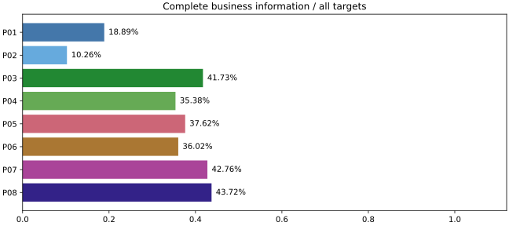
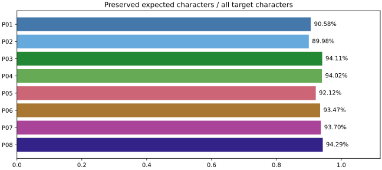

# MO-Parse Lite：原生信息保全与正文转换

保存的 800 页、173 个样本、44 份文档、33 个家族。共同比较 8160 个文字目标、1,413,582 个expected字符及 5850 个业务字段；图片alt字面诊断另列。唯一答案是 canonical expected 的现有声明选段。评分协议 `mo-parse-expected-only-v2`，代码与依赖身份 `bcb3b2d3ac3a2546c0108f75a178a065c27d81aef8a8756afcbeabb51704a9f7`。

## 八组原生输出

值与标签、完整业务信息均以全部业务目标为分母；字符指标以完整普通文字目标为分母。已对齐 CER 只描述已定位范围，整段完全匹配仅保留在诊断数据中。

| 管线 | 值与标签正确/全部 | 完整信息正确/全部 | 文字定位覆盖 | 字符定位覆盖 | 字符保全 | 对齐严格CER |
| --- | ---: | ---: | ---: | ---: | ---: | ---: |
| P01 | 1201/5850 | 1201/5850 | 64.63% | 61.57% | 61.22% | 1.95% |
| P02 | 669/5850 | 669/5850 | 64.06% | 61.17% | 60.79% | 1.99% |
| P03 | 2715/5850 | 2715/5850 | 73.05% | 75.73% | 75.54% | 0.74% |
| P04 | 2277/5850 | 2277/5850 | 75.07% | 78.33% | 78.12% | 0.69% |
| P05 | 2454/5850 | 2454/5850 | 65.12% | 62.44% | 62.10% | 0.82% |
| P06 | 1839/5850 | 1839/5850 | 68.69% | 66.20% | 66.01% | 0.86% |
| P07 | 2179/5850 | 2179/5850 | 69.75% | 67.67% | 67.48% | 0.89% |
| P08 | 3255/5850 | 3255/5850 | 78.88% | 82.11% | 81.90% | 0.76% |

P08距离expected的缺口：2595 个业务字段未满足完整要求，其中 2459 个未定位到满足身份与关系要求的值，136 个已定位但值字面不同，另有 0 个值与标签正确但附加限定不完整。未定位项保留具体身份、单位、表头和范围原因，不直接称为数字识别错误。普通文字有 1723 个目标未定位，已定位范围的严格CER为 0.76%。这些缺口保留在全部目标分母中。

一条已定位的P08文字型业务差异：expected为“打造行业绿电一站式解决方案，帮助企业在降低用能成本的同时提升绿电消费比例，助力千行百业绿色低碳转型”，保存原生输出为“打造行业绿电一站式解决方案，帮助企业在降低用能成本的同时提升绿电消纳比例，助力千行百业绿色低碳转型”。样本 `huawei-digital-energy-p037-040`、目标 `expected:L1028-1028:field:0`；[直白案例页](examples.html)保留该字段的实际来源与身份检查。这是两段文字的差异，不据此推断数字识别错误。





## 原始成本与失败

| 管线 | quality800秒 | perf80三轮秒 | 工作内存GiB | 推理内存GiB | 推理侧归属显存GiB | 输出状态 |
| --- | ---: | --- | ---: | ---: | ---: | --- |
| P01 | 1,565.35 | 201.00, 199.90, 199.42 | 5.20 | 3.64 | 4.36 | {'completed': 173} |
| P02 | 1,478.30 | 186.27, 186.33, 187.19 | 5.17 | 3.58 | 4.36 | {'completed': 173} |
| P03 | 11,576.99 | 1,001.96, 893.87, 937.51 | 1.50 | 3.21 | 3.18 | {'completed': 173} |
| P04 | 11,826.90 | 778.19, 967.77, 778.31 | 1.34 | 3.18 | 3.18 | {'completed': 173} |
| P05 | 2,908.12 | 278.23, 275.32, 276.46 | 4.06 | 6.79 | 5.47 | {'completed': 173} |
| P06 | 1,619.34 | 202.44, 202.14, 202.87 | 6.61 | 6.90 | 8.03 | {'completed': 173} |
| P07 | 2,411.70 | 279.99, 276.90, 274.57 | 6.35 | 10.60 | 8.18 | {'completed': 173} |
| P08 | 3,327.53 | 316.18, 310.53, 311.49 | 1.33 | 7.04 | 3.82 | {'completed': 173} |

800页为一轮质量运行，80页三次性能重复不增加独立文档数。初始化及预热见[执行明细](data/execution.json)。内存和显存是原协议全程采样峰值，涵盖初始化、预热及全部轮次；独立峰值不相加，不称为quality800专属峰值。工作进程GPU归属缺测，不当作零，也不把推理侧峰值改称管线总峰值。TTS共驻且负载不受控，整卡与TTS显存均不归给管线；观测窗口、间隔和缺失见[资源明细](data/resources.json)。

## P07/P08原生、唯一基线与当前正文

| 组别 | 值与标签正确/全部 | 完整信息正确/全部 | 字符保全 | 对齐严格CER |
| --- | ---: | ---: | ---: | ---: |
| P07 | 2179/5850 | 2179/5850 | 67.48% | 0.89% |
| P07-baseline | 2205/5850 | 2205/5850 | 76.65% | 0.77% |
| P07-current | 2215/5850 | 2215/5850 | 76.65% | 0.77% |
| P08 | 3255/5850 | 3255/5850 | 81.90% | 0.76% |
| P08-baseline | 3122/5850 | 3122/5850 | 82.55% | 0.75% |
| P08-current | 3307/5850 | 3307/5850 | 82.56% | 0.75% |

P07：实际正文新增正确 10 项，原正确损失 0 项。原生正确内容在当前正文丢失 0 项，其中业务信息 0 项。采用门槛：通过。逐项前后文字与判定位于本地private/paired.json，[配对索引](data/paired.json)保留计数和路径。

P08：实际正文新增正确 185 项，原正确损失 0 项。原生正确内容在当前正文丢失 0 项，其中业务信息 0 项。采用门槛：通过。逐项前后文字与判定位于本地private/paired.json，[配对索引](data/paired.json)保留计数和路径。

### 实际Markdown前后片段

以下内容读取唯一基线与当前final.md，保留相邻原文及目标所在行，独立的省略号表示省略表行；不是从内部IR重建的示意文本。相同数值的已有表头、单位与归属被实际打印，才构成交付改善。完整片段及来源见[正文变化](data/conversion-examples.json)，HTML中选择对应current组可并列查看。

**P07：债券及应收款项类投资收入 / 金额，expected值 `55,960`**

样本 `spdb-summary-financials-p001-004`，目标 `expected:L103-103:field:0`。修改前：

```markdown
- 项目：买入返售收入；金额：17,147（单位：人民币百万元）；占业务总收入比重：7.20；较上年同期增减(%)：5.96。
2014 年年度报告摘要
|  |  |  |  |
…
| 债券及应收款项类投资收入 | 55,960 | 23.51 | 48.16 |
```

修改后：

```markdown
- 项目：买入返售收入；金额：17,147（单位：人民币百万元）；占业务总收入比重：7.20；较上年同期增减(%)：5.96。
2014 年年度报告摘要
- 项目：债券及应收款项类投资收入；金额：55,960（单位：人民币百万元）；占业务总收入比重：23.51；较上年同期增减(%)：48.16。
- 项目：手续费及佣金收入；金额：22,321（单位：人民币百万元）；占业务总收入比重：9.38；较上年同期增减(%)：53.17。
- 项目：融资租赁；金额：1,637（单位：人民币百万元）；占业务总收入比重：0.69；较上年同期增减(%)：59.09。
- 项目：其他收入；金额：3,814（单位：人民币百万元）；占业务总收入比重：1.60；较上年同期增减(%)：227.10。
- 项目：合计；金额：237,988（单位：人民币百万元）；占业务总收入比重：100.00；较上年同期增减(%)：23.11。
## （三）公司财务状况与经营成果分析
```

**P08：除上述各项之外的其他营业外收入和支出 / 2024年金额，expected值 `-42,713,924.90`**

样本 `moutai-introduction-p001-008`，目标 `expected:L192-192:field:0`。修改前：

```markdown
- 非经常性损益项目：除同公司正常经营业务相关的有效套期保值业务外,非金融企业持有金融资产和金融负债产生的公允价值变动损益以及处置金融资产和金；2024年金额：26,539,092.99（单位：元 币种：人民币）；附注(如适用)：；2023年金额：2,439,902.57（单位：元 币种：人民币）；2022年金额：（单位：元 币种：人民币）。
贵州茅台酒股份有限公司 2024 年年度报告
|  |  |  |  |  |
…
| 除上述各项之外的其他营业外收入和支出 | -42,713,924.90 |  | -47,733,771.71 | -157,251,041.33 |
```

修改后：

```markdown
| --- | --- | --- | --- | --- |
| 融负债产生的损益 |  |  |  |  |
- 非经常性损益项目：除上述各项之外的其他营业外收入和支出；2024年金额：-42,713,924.90（单位：元 币种：人民币）；附注(如适用)：；2023年金额：-47,733,771.71（单位：元 币种：人民币）；2022年金额：-157,251,041.33（单位：元 币种：人民币）。
- 非经常性损益项目：其他符合非经常性损益定义的损益项目；2024年金额：2,395,600.72（单位：元 币种：人民币）；附注(如适用)：；2023年金额：4,710,466.67（单位：元 币种：人民币）；2022年金额：63,840,000.00（单位：元 币种：人民币）。
- 非经常性损益项目：减:所得税影响额；2024年金额：-4,034,573.45（单位：元 币种：人民币）；附注(如适用)：；2023年金额：-5,573,340.60（单位：元 币种：人民币）；2022年金额：-24,751,373.49（单位：元 币种：人民币）。
- 非经常性损益项目：少数股东权益影响额(税后)；2024年金额：655,835.44（单位：元 币种：人民币）；附注(如适用)：；2023年金额：1,772,852.96（单位：元 币种：人民币）；2022年金额：1,174,838.97（单位：元 币种：人民币）。
- 非经常性损益项目：合计；2024年金额：-12,759,555.80（单位：元 币种：人民币）；附注(如适用)：；2023年金额：-18,492,874.77（单位：元 币种：人民币）；2022年金额：-75,428,959.45（单位：元 币种：人民币）。
对公司将《公开发行证券的公司信息披露解释性公告第1号——非经常性损益》未列举的项目认定为非经常性损益项目且金额重大的，以及将《公开发行证券的公司信息披露解释性公告第1号——非经常性损益》中列举的非经常性损益项目界定为经常性损益的项目，应说明原因。
```

正文评分只读实际final.md。评分读取修复对所有原生与正文共同生效，不能计为交付收益；旧评分已删除，无合法旧分数可计算“补读增益”。原生到正文的失败是可观察阶段定位，不冒充已证实的识别或适配内部根因。[直白案例页](examples.html)并列expected、当前候选及全部候选的排除理由。

CPU回放与原生历史耗时分列于[执行明细](data/execution.json)，不相加伪造新端到端成本。图片资产及引用交付见[分项数据](data/results.json)，不提供图片内容或语义正确性成绩。

## 范围、剩余错误和复现

共同程序对声明选段中的文字范围及明确业务要求逐项比较。提取和范围追溯见[覆盖明细](data/coverage.json)，全部错误的expected范围、候选路径、限定状态及最早可见失败阶段见[错误索引](data/errors.json)，完整字面与判定证据在其指向的本地评分JSON中。各组剩余错误不退出分母。

文档、家族和已有类别的配对数据见[文档与家族](data/documents-families.csv)、[类别](data/cohorts.csv)及[逐组配对差](data/paired-dimensions.csv)。类别可重叠，性能重复不增加这些独立对象。Lite参考语法及候选已用于开发，不能称为独立未见集。程序范围核对不重新认证参考材料，也不证明所有输出正确。

本轮不重跑模型，不调用视觉或OCR，不操作GPU、TTS及在线服务，不部署。完整方法、对齐限制和复现命令见[附录](appendix.md)。

## 剩余缺陷

| 原生组 | 未定位可比较业务值 | 已定位业务值字面不同 | 值与标签正确但限定不完整 | 未定位文字目标 | 已定位但未完整正确的文字目标 |
| --- | ---: | ---: | ---: | ---: | ---: |
| P01 | 4455 | 194 | 0 | 2886 | 2466 |
| P02 | 5009 | 172 | 0 | 2933 | 2459 |
| P03 | 2992 | 143 | 0 | 2199 | 1269 |
| P04 | 3282 | 291 | 0 | 2034 | 1300 |
| P05 | 3328 | 68 | 0 | 2846 | 1817 |
| P06 | 3887 | 124 | 0 | 2555 | 1235 |
| P07 | 3537 | 134 | 0 | 2468 | 1285 |
| P08 | 2459 | 136 | 0 | 1723 | 1435 |

这些是当前保存原生输出与expected的程序差异，涵盖值/标签、限定、文字缺失与文字或归属错误，不等同于已证实的识别内部根因。具体数字字面差异见[附录示例](appendix.md#原生数值字面差异示例)，数字/符号、名称字面与否定条件的字符差异片段另见[缺陷诊断计数](data/remaining-defects.json)及错误索引。后续需按这些错误继续改进解析和转换，不能由执行成功推定内容合格。
