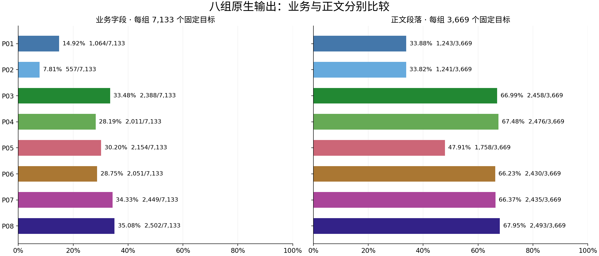
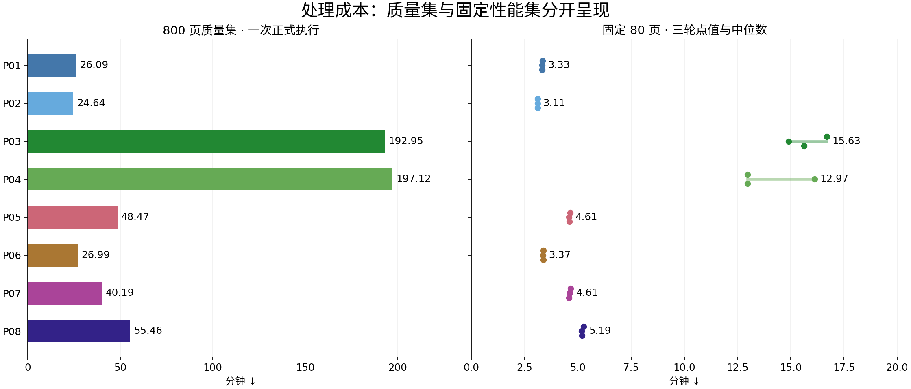
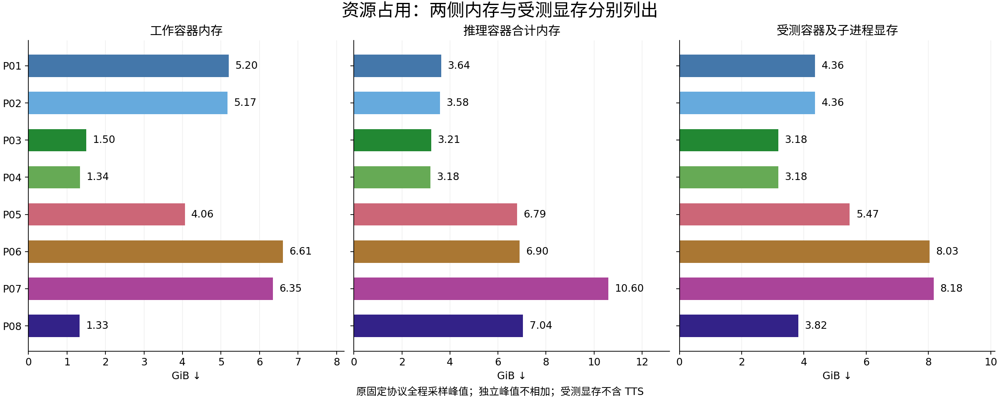
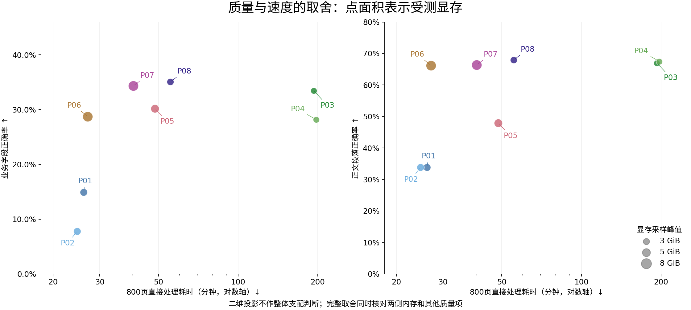
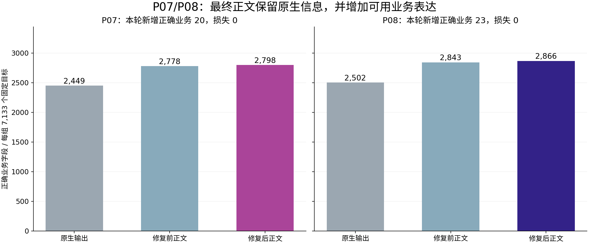
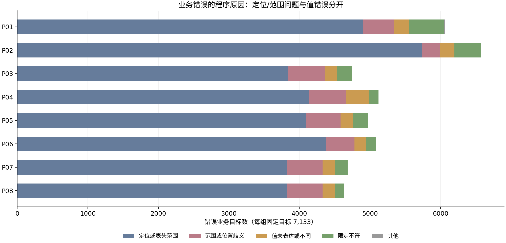
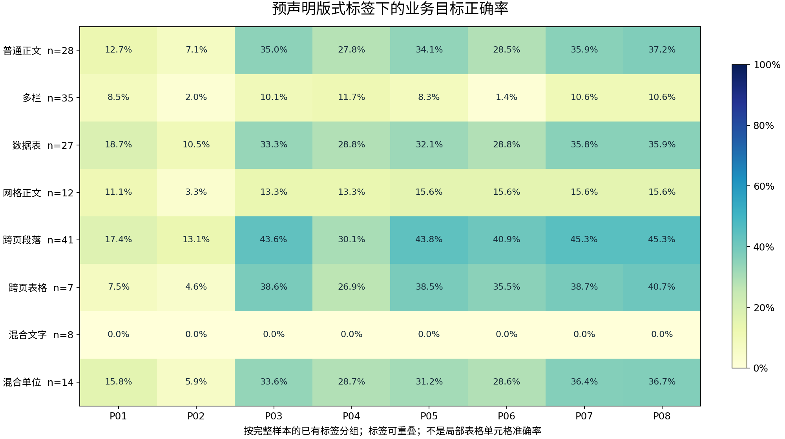

# MO-Parse Lite：解析质量、处理成本与正文优化

同一批 **800页 / 173个样本 / 44份文档 / 33个家族**；expected是唯一答案来源，八组原生结果与P07/P08后处理分别比较。

## 结果先看

- 原生业务目标正确率：P08为35.08%、P07为34.33%、P03为33.48%；正文段落正确率分别为67.95%、66.37%、66.99%。分母包含全部目标。
- 800页原生处理约24.64至197.12分钟。P03/P04受测显存采样峰约3.18GiB，P07约8.18GiB；质量、速度和占用需要一起比较。
- P07/P08修复后的实际Markdown分别新增20、23项正确业务目标，改前改后损失及原生信息保留见配对表。
- 最终正文仍有4,335、4,267项业务目标错误，均计入分母，并保留逐项证据。

**导航：** [八组质量](#八组原生质量) · [耗时与资源](#耗时与资源) · [P07/P08正文收益](#p07p08正文收益) · [错误与分组](#错误与分组) · [方法和复现](appendix.md)

## 八组原生质量

每组固定7,133个业务目标。业务正确同时要求值、主体、单位、期间、分组和附注满足expected；普通正文按完整段落或连续文字比较，允许已声明的表达等价。标题、列表、单位说明和图片alt字面另报，不合成加权总分。

| 管线 | 固定配置 | 业务正确 / 7,133 | 正文正确 / 3,669 |
| --- | --- | ---: | ---: |
| P01 | Docling TableFormer V1 + GLM | 1,064/7,133（14.92%） | 1,243/3,669（33.88%） |
| P02 | Docling TableFormer V2 + GLM | 557/7,133（7.81%） | 1,241/3,669（33.82%） |
| P03 | PaddleOCR-VL 1.5 | 2,388/7,133（33.48%） | 2,458/3,669（66.99%） |
| P04 | PaddleOCR-VL 1.6 | 2,011/7,133（28.19%） | 2,476/3,669（67.48%） |
| P05 | GLM-OCR SDK | 2,154/7,133（30.20%） | 1,758/3,669（47.91%） |
| P06 | MinerU Standard + GLM | 2,051/7,133（28.75%） | 2,430/3,669（66.23%） |
| P07 | MinerU Advanced + GLM | 2,449/7,133（34.33%） | 2,435/3,669（66.37%） |
| P08 | MinerU 全页视觉 | 2,502/7,133（35.08%） | 2,493/3,669（67.95%） |

P01/P02仅改变TableFormer版本，P03/P04仅改变PaddleOCR-VL模型版本，P06/P07仅改变MinerU层级；P05/P08是各自完整视觉管线。各分支、模型和原生格式见[固定配置](../../pipelines-to-test.md)及[逐管线说明](../../../docs/pipelines/README.md)。

Paddle 1.6相对1.5，正文段落新增正确+18项，业务正确变化-377项。版本变化对内容类型的影响不同，不能只用正文字符指标代表业务关系质量。

## 耗时与资源

| 管线 | 800页分钟 | 80页三轮中位数分钟 | 工作内存GiB | 推理内存GiB | 受测显存GiB |
| --- | ---: | ---: | ---: | ---: | ---: |
| P01 | 26.09 | 3.33 | 5.20 | 3.64 | 4.36 |
| P02 | 24.64 | 3.11 | 5.17 | 3.58 | 4.36 |
| P03 | 192.95 | 15.63 | 1.50 | 3.21 | 3.18 |
| P04 | 197.12 | 12.97 | 1.34 | 3.18 | 3.18 |
| P05 | 48.47 | 4.61 | 4.06 | 6.79 | 5.47 |
| P06 | 26.99 | 3.37 | 6.61 | 6.90 | 8.03 |
| P07 | 40.19 | 4.61 | 6.35 | 10.60 | 8.18 |
| P08 | 55.46 | 5.19 | 1.33 | 7.04 | 3.82 |

800页只有一次质量执行；80页三轮衡量重复波动，不增加独立文档样本。图中80页文字标中位数，点保留每轮实际值。初始化和预热单列，直接处理边界包含所需渲染、原生解析、忠实导出与资产准备，排除HTTP和MO-Parse后处理。

内存和显存是原固定协议全程的采样峰值，包含初始化、预热、800页和80页重复；不是800页阶段的精确峰值。工作容器与推理侧分开采样，不把各自峰值相加。受测显存按容器及子进程归属汇总，TTS和整卡占用另列于附录。

点面积表示受测显存。完整比较同时核对六类内容正确率、耗时、两侧内存及受测显存；本批已观测向量没有全面支配者。TTS共驻、负载不受控；原始采样间隔通常约2秒，P06/P07推理侧约4秒，[覆盖、缺失和原始文件身份见附录](appendix.md#资源采样与共驻环境)。

P07比P06多保留398个正确业务目标，800页多用13.21分钟。P08比P07再多53项，耗时再增15.26分钟，但受测显存峰值降低4.35GiB，两侧内存也更低。这是本批配置的实际取舍，不能据此推定其他文档上的固定胜者。

## P07/P08正文收益

这里只比较同组原生输出、本轮修复前正文和修复后正文。修复前是原06版，修复后是原08版；expected始终不变。早期04版仅用于附录中的累计对照，不混入本轮收益。

| 管线 | 原生正确业务 | 修复前 | 修复后 | 新增正确业务 | 原正确目标损失 | 原生正确内容损失 |
| --- | ---: | ---: | ---: | ---: | ---: | ---: |
| P07 | 2449 | 2778 | 2798 | 20 | 0 | 0 |
| P08 | 2502 | 2843 | 2866 | 23 | 0 | 0 |

改善来自实际打印的Markdown：阻止年龄继承股份单位，保全属性字段、完整表头与表名，并将期间绑定到实际年份片段。评分器读取改善对全部版本共同生效，不算正文收益；内部IR或隐藏关系不补分。具体前后文字及采用门槛见[附录](appendix.md#正文修复与信息保留)。

P07/P08的800页CPU后处理分别为216.09秒、194.05秒；进程RSS采样峰值为0.816GiB、0.787GiB，均未挂载GPU。后处理与原生执行来自不同运行，不相加为新的端到端耗时。

## 错误与分组

这些是程序给出的目标错误原因。定位/表头范围不足、范围歧义、值不符和限定不符分开统计，不能将它们一律解释成模型识别缺字。当前P07/P08原生正确而最终正文错误的目标共0个；剩余失败仍需从保存的原生结果和读取证据逐项诊断。

分组只使用既有样本标签；标签可重叠，不能相加成数据集分区。每行比较该标签下完整样本的业务目标，不称局部表格或局部栏位准确率。完整文档、家族、字符诊断与资产交付见[附录](appendix.md)。

## 覆盖、证据与复现

本轮10,524个expected内容元素全部进入程序对照，展开为每组14,672个目标，遗漏0；同一列表元素可包含多个业务字段。全部目标只有正确或错误。14个比较组共2,422份评分，质量主表只用800页，性能重复不充当额外独立质量样本。

Lite内容已用于读取和转换开发，不宣称独立未见测试集。图片语义理解不在范围内；alt文字、引用和资产交付分别处理。

- [完整分项与采用门槛](data/results.json)
- [P07/P08逐项错误及证据入口](data/errors.json)
- [资源数据与测量来源](data/resources.json) · [各轮耗时、预热及环境观察](data/execution.json)
- [文档明细](data/documents.csv) · [家族明细](data/families.csv) · [样本标签明细](data/cohorts.csv)
- [目录用途、方法和复现命令](appendix.md)

[目录迁移、评分复算、图件字体与报告重现验证](data/verification.json)。

评分：`mo-parse-expected-only-v1` / `canonical_expected_8`；软件身份：`b2d1a022a2a4225608203449ef64d19571112320c05e2b91be69cc9fdae83643`。本次整理复用保存输出，未新增模型推理、部署或服务操作。
