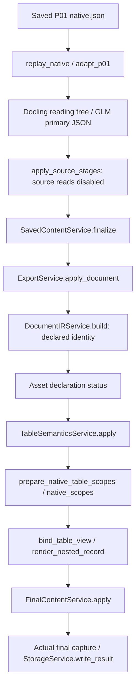

# MO-Parse Lite：MinerU Standard/Advanced受限JSON接入与Typed依赖缺口

本轮MinerU格式族接入未完成：当前宿主缺少固定`docvortex==0.5.16`，官方Typed投影无法执行。可独立验证的保存Middle JSON读取、共同契约、公共处理和持久化已经实施；P06/P07各用自己的三页保存结果生成真实正文，交付均为partial。P01–P05固定保护复验完成。最终source-only完整允许范围4225项通过，168个模块全部重新执行，边界违规0；没有Native或Product质量成绩，也没有八组正式门禁。

接手HEAD为`4ee31b0162cb68c26c849acc9824754593b370d7`，初始工作区干净，`/opt/mosaic-parse`与`/opt/moparse`为同一入口。冻结software_id为`fd70a231dc621b853ec5bd9d0e21d0958a28a5a2816196637f95ef20920d5745`，清单SHA256为`f6db94b088cc4e71cbbd72d86b6a1a77fdf816dc1f3292b9dff7abbfd22cb7b0`，测试内容身份为`4f9333edc75f6ffb8b8dd94fef5f694f0e6e6d4900bbf6d6a123e7a4767f1f66`。见[接手身份](../../runs/lite/service/development/mineru-content-closure/intake.json)、[冻结](../../runs/lite/service/development/mineru-content-closure/freeze-delivery.json)及[完整审查](../../runs/lite/service/development/mineru-content-closure/source-only-review-delivery.json)。历史软件身份不等于当前正式准入，没有重签旧证据。最后的[证据绑定](../../runs/lite/service/development/mineru-content-closure/final-binding.json)逐项关联同一源码、测试、七组原生/observation、实际阶段、正文、warning和Storage字节，不激活正式索引。

## 固定依赖与本组真实输入

当前Python为`/opt/moparse/.venv/bin/python` 3.13.5。`native_worker/requirements.txt`及lock声明MinerU 4.0.12、DocVortex 0.5.16、mineru-vl-utils 2.0.7；当前`.venv`三者均未安装，find_spec也没有docvortex/mineru模块路径。保存结果config记录这些固定版本，Middle metadata记录producer为MinerU 4.0.12，这些是原执行身份，不是当前宿主已安装的证明。本轮没有安装或升级，也没有仿造官方Typed类。恢复完整Typed验证需要另行准备可导入`docvortex.schema.PageBlock`的固定0.5.16环境及其依赖，再对相同输入执行只读官方投影；不需要重跑模型或借用派生Markdown。

本轮只固定`vanke-repurchase-share-changes-p001-003`，两组分别读取`artifacts/P06`、`artifacts/P07`下`measured-quality800-r1`自己的native.json和observation.json，未遍历其余Lite。选择依据是已有正文、标题、HTML表格、附注、实际list差异、媒体声明及GLM分支覆盖，不参考Expected或成绩。[格式清单](../../runs/lite/service/development/mineru-content-closure/format-inventory.json)保留各自producer、tier、schema、页、字段存在性、对象路径和原状态。

| 项目 | P06 Standard | P07 Advanced |
| --- | --- | --- |
| native SHA256 | `f15b13a9dd4f339a00293ad66b7936e163994925fbda8c591cb4289bbbca7fc4` | `22c5badfb6264ee69c96012778a4478bb85289e36a16f8ec0108733ab85f8c2e` |
| 原生主视图 | docvortex.middle 2.0，standard/txt | docvortex.middle 2.0，advanced/txt |
| 前两页顶层块 | 14 / 13 | 13 / 10 |
| 原生叶块与容器 | 28叶块、1个table容器 | 27叶块、table/list两个容器 |
| 备查文件 | 四个独立text块，保留原编号 | 实际list父链下四个text子块，显示为列表且保留原编号 |
| 表头字面 | 中文全角括号日期 | ASCII括号日期 |
| 格位与实际关系 | 44 HTML投影格，37非空、7空，5记录25值关系 | 44 HTML投影格，37非空、7空，5记录25值关系 |
| 原生输入清单及去向 | 137项 | 132项 |

两组Middle前两页page_idx为0/1，保存执行器明确以物理页减一绑定输入页1/2；第三页是各自GLM json_result，单图局部页0与输入物理页3分开。原PDF页映射仅用已有声明元数据，未读取原件。块序依据实际唯一index和嵌套作用域；缺index或冲突时保留数组位置并标读序unknown，不用bbox排序。原框为归一化TOPLEFT，页方向、尺寸、crop和原执行观测保留，未伪造PDF字符跨度。

两份实样均没有block_id、显式parent/children字段或content_list，父链来自content的真实包含关系，路径身份绑定各自工件SHA。页raw.blocks带有Markdown/research_assets增强；独立核对其原生字段与自身Middle对应页完全一致，但没有稳定跨视图ID，不能据此宣称content_list全部保全或证明多对多映射。原生Markdown、faithful.md及GLM raw_json_result均不补主答案、不重复输出。可选content_list只在独立合成用例中验证逐对象审计、删除及错绑拒绝，不能替代真实格式覆盖。

## 实际代码、共同准入与消费者

`app/adapters/native_readers.py::read_mineru`由研究读取原语原位抽取；默认研究视图政策不变，只有公共保存转换显式使用`primary_only=True`，不回退Markdown。`mineru_native.py::source_page/read_middle_page`核验本组tier、txt、Middle schema、文档引用、物理页与局部页的一致性；保留type、content、index、缺失字段、原生引用/状态、内联span及媒体声明。配置注册只决定身份和允许分支，未将Standard复制改名为Advanced。

`native_inventory.py`调用独立`mineru_inventory.py::inventory_mineru`从输入直接建立页面、容器、叶块、内联span、HTML格、媒体和派生审计对象清单，不从_native_page_blocks倒推。`native_content_evidence.py`校验清单、工件SHA/view/path、父链、原字、类型、index、格位/跨度、媒体和执行状态；派生对象还必须有源绑定审计回执。能力布尔标记不提供准入。读取错误不能通过清空read_error/read_status变成功；表格续接声明和容器角色也须重新对照不可变输入。

`service_replay_native.py`移除P06/P07旧的独立渲染分支，七个配置均进入现有`adapt_saved_document → SavedContentService.finalize → Export → DocumentIRService → TableContext/TableSemantics → FinalContent → Storage`。没有第二套IR、SavedContent或FinalContent，也没有修改公开HTTP字段。共同显示层按真实table_body、公式、list父链及媒体证据处理，原生type与显示role分开；原生level仅作来源观测，doc_title/paragraph_title的有界显示投影留有明确依据，不将level数字当成已确认的文档树；公共语义没有P06/P07编号条件。声明源权限、实际source-free模式、分支及主视图守卫继续存在，原件补充和媒体读取关闭。

表体HTML只是该Typed序列化对象的原生主字段；MO-Parse解析出的消费格通过`primary_html_projection`和HTML语法路径回指原文，独立OCR源格能力为false。现有有界表格规则建立完整列头、行分组、期间和记录关系，不回写原生角色。table_footnote原文和上下文出处保留，实际无脚注标记时不将其伪造成每个数值的note_refs。原生continues_prev声明保留，缺完整跨页表头和源格分区时维持未解决，不执行SDK HTML合并。本轮没有增加T/L/B规则。

## 双向覆盖、状态及失败反例

[独立工程验收](../../runs/lite/service/development/mineru-content-closure/independent-acceptance-delivery.json)从调用方提供的本组native直接遍历，使用独立HTMLParser核对44格、完整表头路径、5条记录、25项值关系及附注来源，并核对最终出现位置。137/132项输入各有正文、转换格、空字面、结构审计或未交付媒体去向，没有未记账的available对象；数量仅说明这个固定范围，不能证明全部MinerU输出或质量。

合成反例保持原生输入不变，破坏适配对象：删除Typed叶块、content_list审计对象、父节点、整页、整表、源格、媒体或公式，修改类型、locator、跨度、原生引用、顺序和失败状态，以邻接同字面或P07来源替换P06，以及重复对象、伪造成功，均由共同验证拒绝。表头、单位、期间、附注和记录错绑由来源关系检查拒绝，数字还在正文也不能代替关系。实际P06/P07证据再分别做7类独立删除/错绑反例，14项均被固定输入断言发现；没有修改Expected或降低P01–P05断言。

原执行状态只读取配对observation的身份、页处理、失败及warning白名单，不读取派生正文或关系作为答案；MinerU嵌套原生失败也单独保留。unknown、局部读错、转换未支持、工程异常、原执行失败和媒体未交付分别传播。实际两份四层状态均为`completed / read / completed / partial`，partial唯一实际原因是表体的一处原生区域媒体声明未读取、未验证、未交付；未将HTML表体转换完成当作图片已交付。普通无消费责任元数据unknown不自动导致partial。

## 真实正文、阶段与五组保护

| 管线 | 本轮实际正文与来源证据 | 原执行 / 读取 / 转换 / 交付 |
| --- | --- | --- |
| P06 | [final.md](../../runs/lite/service/current/p06/development/mineru-vanke-3p-frozen/final.md)、[evidence.json](../../runs/lite/service/current/p06/development/mineru-vanke-3p-frozen/evidence.json) | completed / read / completed / partial |
| P07 | [final.md](../../runs/lite/service/current/p07/development/mineru-vanke-3p-frozen/final.md)、[evidence.json](../../runs/lite/service/current/p07/development/mineru-vanke-3p-frozen/evidence.json) | completed / read / completed / partial |
| P01 | [final.md](../../runs/lite/service/current/p01/development/mineru-stage-regression-vanke-3p-frozen/final.md)、[evidence](../../runs/lite/service/current/p01/development/mineru-stage-regression-vanke-3p-frozen/evidence.json) | completed / read / completed / partial |
| P02 | [final.md](../../runs/lite/service/current/p02/development/mineru-stage-regression-vanke-3p-frozen/final.md)、[evidence](../../runs/lite/service/current/p02/development/mineru-stage-regression-vanke-3p-frozen/evidence.json) | completed / read / completed / partial |
| P03 | [final.md](../../runs/lite/service/current/p03/development/mineru-stage-regression-vanke-3p-frozen/final.md)、[evidence](../../runs/lite/service/current/p03/development/mineru-stage-regression-vanke-3p-frozen/evidence.json) | completed / read / partial / partial |
| P04 | [final.md](../../runs/lite/service/current/p04/development/mineru-stage-regression-vanke-3p-frozen/final.md)、[evidence](../../runs/lite/service/current/p04/development/mineru-stage-regression-vanke-3p-frozen/evidence.json) | completed / read / partial / partial |
| P05 | [final.md](../../runs/lite/service/current/p05/development/mineru-stage-regression-vanke-3p-frozen/final.md)、[evidence](../../runs/lite/service/current/p05/development/mineru-stage-regression-vanke-3p-frozen/evidence.json) | completed / read / completed / completed |

P06最终正文SHA256为`f1a82e8ea3c7759c0831eeee9efa717e09774cf308ff272b35dd6a7be56e1e97`，P07为`2ce2bb4c8533d4795f3fce975bd04986b504a51b81e34dbe436dce8c7e933a18`。各自实际FinalContent输出、result.markdown、parse_result.renderings及Storage的result.md按UTF-8字节一致，没有拷贝原生Markdown或其他管线正文。七份均捕获实际adapted、source_pages、native_pages、exported、ir、assets、semantic、final；来源补充阶段明确不适用，IR为实际构建快照，编辑重放只作为变换一致性证据，未用隐藏IR给final补内容。

P01–P05最终正文UTF-8字节、全部SemanticTableView、relation_checks、warning、四层状态、原生去向、content_dispositions及最终编辑证据均与第八阶段完全相同。P01/P02分别保留45/46格、各自原字和2处未交付媒体；P02的15,386,99及不完整括号没有借V1修复。P03/P04各31个polygon、44 HTML格、37非空格、5记录25值关系及partial保留；P05自身44格、25值关系与completed保留。没有修改历史正文、旧断言或已保存产物。

## 允许范围测试、保全与限制

最终完整允许范围4225 passed、退出0：168个模块全部实际执行，收集与执行nodeid各4225个，12675项setup/call/teardown报告全部passed，未执行允许模块数为0。软件与测试全程未变，边界违规0；pytest运行448.89秒，入口总观测449.27秒。结果只引用最后的[source-only-delivery.json](../../runs/lite/service/development/mineru-content-closure/source-only-delivery.json)和[JUnit](../../runs/lite/service/development/mineru-content-closure/source-only-delivery.xml)为准，不继承历史4175项或中断运行。清单为168个允许模块、18项共享依赖、81个排除模块，审查复核导入、fixture、间接I/O、子进程及新辅助的全部源码；父conftest关闭，插件自动加载关闭，仅显式asyncio，媒体/语料/网络由运行入口拒绝。旧子进程仅执行已审查的自造文字编译或临时锁探针，未把父hook声称为子进程独立审计。

最终格式族、状态、来源及标题边界定向279项通过。完整首轮曾4221通过、2失败，来自旧MinerU两个参数化fixture的伪Typed注入。迁移为有明确schema/tier/index的主JSON后保留全部旧正文、身份、续接和权限断言，增加工件/主视图与注入不执行断言，67项定向通过，见[迁移依据](../../runs/lite/service/development/mineru-content-closure/legacy-fixture-migration.json)。开发中真实依赖失败、格式标记、重导出、非法branch、读取失败/续接声明及独立fixture修正、旧伪Typed注入fixture迁移均留在[尝试记录](../../runs/lite/service/development/mineru-content-closure/development-attempts.json)。两轮完整尝试分别在来源守卫和标题边界复核时主动停止，1009项及1041项部分通过不作最终成果；P07最初一次因并行源码编辑触发software_changed守卫，没有落盘，冻结后重跑才接受。独立附注fixture改为既有明确caret标记，不增加新语义规则或降低真实断言。

限定16个修改软件/测试目标Ruff、10个app模块mypy及限定diff检查通过，见[静态检查](../../runs/lite/service/development/mineru-content-closure/static-checks-delivery.json)。五份非语料技术文档Markdown政策检查通过；通用检查排除全部语料、benchmark/runs、benchmark/reports及reference-decisions，唯一报告只作本任务专门维护。公开HTTP schema SHA256仍为`1c3f5265302c8ee6e757245d96338f4c2a1b3def678642eed5e068f32f6be79e`、14条路径，无lifespan或请求，见[协议保全](../../runs/lite/service/development/mineru-content-closure/http-schema-delivery-check.json)。

七份最终转换逐份串行，affinity最多8 CPU、地址空间8 GiB，GPU可见性关闭；实际命令和独立工程耗时见[运行记录](../../runs/lite/service/development/mineru-content-closure/serial-development-runs-frozen.json)。这些耗时不替换历史原生成本，也不相加冒充端到端测量。50项已绑定输入、配对状态、历史正文及证据、成本摘要和current要求索引保持原字节，见[保全核验](../../runs/lite/service/development/mineru-content-closure/preservation-delivery-check.json)。正式service/current/index.json仍不存在；未激活正式current、重建要求图或重签旧门禁。早期直接错误探针只作诊断，不作为冻结的受限转换验收；observation检查曾打印派生page blocks，但它们未进入答案，状态加载仍按白名单隔离。

当前未完成范围包括官方固定版本Typed投影、真实content_list多视图对应、独立图块和公式、非空跨页续接及完整来源分区、真实失败/超时/未处理页，以及本固定schema之外的SDK结构。合成例不算这些实样已验收。P08没有新增适配或实际输入运行，既有合成回归仅作保护；后续八组Normalization及Native/Product研究各需自身门槛和另行授权。Expected、selection、正式分母及五个输入范围未修改或补答案，63份来源验收、107份覆盖缺口、3份待独立验收保持，55份历史保护集合不与63相加；全局structure_blocked和成绩撤回不变。

本轮没有PDF或图像的创建、读取、解码、渲染、字层、OCR/VLM、模型、网络、GPU/TTS、在线服务、部署、ZIP、真实candidate与expected比较、正式评分、八组真实回放、安装升级、提交或推送。完整Typed验收尚未完成，不能把两组JSON能进入代码或本开发样本的转换通过写成整条MinerU管线质量通过。

## 历史开发与来源保护证据

以下为此前P01纵向闭环及source-only工作保留记录，其中“本轮”和软件身份属于对应历史阶段。当前实施与状态以上述共同契约和横向验收为准；原成本段及历史输入未覆盖。

### 2026-11-11 P01纵向闭环记录

2026-11-11按最新授权完成P01保存原生JSON到最终Markdown的单文档工程闭环。接手HEAD为`9a97fa062156423caada86c62c338c47bbb94d28`，工作区干净，`/opt/mosaic-parse`与`/opt/moparse`指向同一入口。真实原生格式读回和受限服务转换分别验证通过，开发文档因两处图片未交付保持partial；本报告不提供解析质量成绩或排名。

## 实际调用链与首个缺口

历史原生执行由`executors.execute_in_worker`调用`_preprocess`，随后Docling分支的`_docling_run → sdks.docling.convert`与GLM分支的`_glm_page → sdks.glm.process`产生结果；同一执行函数保存`native.json`、`faithful.md`和已取得的资产。这些路径本轮只查源码和已保存JSON，没有重新执行。研究侧`read_saved_native → READERS`与服务转换是独立消费者；原生格式说明不代表最终正文已完成。

接手时的首个实际缺口是Docling/GLM读回块提供`kind/text/service_rendered`，而表格上下文及最终清理消费`type/content/markdown`；`native_scopes`又仅接纳MinerU源格。返回DocumentParseResult没有证明P01实际进入分类、范围绑定和最终清理。另一个必要缺口是DocumentIRService默认读取源文件求SHA256，原生块进入IR时还会被几何排序重排。正式`service_evaluation.execute_case`会打开旋正PDF、补充字层和提取资产，因此没有用它冒充本轮允许的开发入口。



| 阶段 | 实际函数与载体 | 本轮状态与界限 |
| --- | --- | --- |
| 原生解析与保存 | `execute_in_worker`、`_docling_run`、`_glm_page`及原生文件写入 | 只核实既有实现和保存结果；未跑模型或原件处理 |
| 忠实读取 | `read_docling`遍历body/groups引用；P01 `_glm_blocks`读取json_result | 当前实际调用，不借研究Markdown、raw审计答案或expected补内容 |
| 服务适配 | `service_p01_adapter.adapt_p01/_render` | 原生payload与服务角色并存；分支、局部页、物理页、原PDF页及方向元数据分别保留 |
| 原件补充 | `apply_source_stages(allow_source_reads=False)` | source_pages/native_pages明确不适用；PageEvidence、PDFTableEvidence及NativeTextService.apply_async未被调用 |
| 内容分类与表格关系 | `prepare_native_table_scopes → native_scopes → bind_table_view` | 结构完整仍须有局部字段或计量依据；用途未知、混合行与冲突继续保留 |
| 最终正文 | `ExportService.apply_document`、`render_semantic_view/render_nested_record`、`FinalContentService.apply` | 真实生成多层列表、连续正文及最终精确编辑记录；不是拷贝faithful.md或历史final.md |
| 资产 | `SavedContentService.finalize`中的声明状态处理 | 仅处理身份、引用和未交付状态；没有调用MultimodalService提取、裁图、OCR或读取图片 |
| 持久化 | `StorageService.write_result/read_result`及开发审计JSON | 对象内最终renderings与落盘正文按UTF-8字节核对；未启动HTTP、Job worker或在线服务 |

`ParserService._finalize_exports`现在委托同一个`ExportService.apply_document`，当前开发入口与既有在线源码共享导出实现；完整ParserService.parse及其模型、PDF补充、资产分支本轮没有执行。仓库没有名为DocumentEvidenceIR的类型，实际结构化视图为ContentParseResult。P01逐节点进入TextBlock、ContentRegion、ParsedTable，保留原生阅读顺序；TableFragment、CellRef、ValueRelation、SemanticRecord与SemanticTableView承接源格、完整标题路径及限定。原生父子树、原始label、charspan、bbox原点、源节点与媒体声明比公共消费视图更丰富，保留在stage sidecar，未混入普通正文。内部unknown来源与策略已可表达，HTTP OpenAPI没有暴露或新增这些字段。

## 单份真实保存文档与原生信息去向

先按173份P01保存JSON的分支和原生结构作格式盘点，再选择完整既有三页`vanke-repurchase-share-changes-p001-003`；选择依据为两分支、正文、表格、多层表头、列表和图片项的共同覆盖，没有读取expected选答案。仅这一份进入纵向服务验证，没有把其他盘点文档计为完成。其原件身份与页序沿用既有manifest；文件大小只取文件系统stat元数据，未打开PDF或重算原件校验值，已有SHA256不冒充本轮字节验真。

输入位于`benchmark/runs/lite/artifacts/P01/measured-quality800-r1/vanke-repurchase-share-changes-p001-003/native.json`。前两页raw分别以`native_document=#/documents/0`和source_page 1/2指向同一DoclingDocument，第三页是单次GLM图像调用的结果，局部页面列表索引0与输入物理页3分开。Docling body、key_value_area、list、texts、tables、pictures、parent/children及附属引用保全；源格的原始行列起止、rowspan、colspan、表头角色、文字和bbox保持。Docling BOTTOMLEFT与源格TOPLEFT分别转换，GLM bbox_2d按1000归一；不进行第二次旋转，不伪造原PDF坐标逆变换。原始旋转、cropbox、页序和页身份留在内部证据。

GLM只从json_result生成正文；raw_json_result和markdown_result作为独立已有视图保留身份，不补主结果，也不重复输出。此页有两个文字区域，没有表格或输出图片区域，image_files为空，原始页面图片声明没有被当成已交付图片。原生source_prediction为unknown时继续保持unknown，不填成native或sparse。JSON字符串中的decoded路径可由同一指针解析器反向解析，HTML格另有主content字段的JSON指针与语法定位，不冒充Docling/PDF源格。

开发文档含28个内容对象：7个标题、14个普通文字、4个列表项、1个表格和2个图片项。当前真实表格为8行6列、45个原生锚点格，输出5条有来源的记录及其完整多层列路径。37个非空格均在实际最终正文取得位置，8个空字面槽位不补零、不推断“来源空白”含义。25个非表格文字/标题/列表对象保留，1个表格转换，2个图片出现作为未解决交付记录；逐项原生字段核对与最终跨度在`format_readback_checks`和`content_dispositions`，不能把这些数量替代字段、关系和实际打印文字的证明。

最终正文示例来自该真实原生表，完整正文由下述实际final阶段产出：

```markdown
- 股份类别：一、有限售条件股份
  - 本次回购前 （2015 年 8 月 31 日） / 股份数量：15,386,999
  - 本次回购前 （2015 年 8 月 31 日） / 比例：0.14%
  - 本次回购后 拟注销数量：
  - 本次回购股份注销后 （2016 年 1 月 14 日） / 股份数量：15,848,774
  - 本次回购股份注销后 （2016 年 1 月 14 日） / 比例：0.14%
```

表内既有父分组和完整日期路径保留，表前原文范围随各记录打印；没有从业务常识补股数、币种或单位。表后附注、法律声明、四项备查文件、董事会和`二O一六年一月十五日`的原生字形保留，没有按expected修正识别结果。已确认表体不留下GFM或HTML表格，最终正文不含内部IR、来源JSON、物理分页或调试标记。

两个PictureItem既有研究资产路径和内联媒体声明，但本轮没有验证或复制图片字节。正文在对应位置打印“图片未交付。”，引用和元数据留在媒体审计中，不生成空文件、不把文件名当存在证明，也不插入未验证的Markdown嵌图。原生格式读回与MO-Parse交付状态分别判断：文字和表格链路可验收，文档整体仍为partial，两个saved_native_media_unverified警告同步到内部parse_result和持久化warning日志。

## 阶段、编辑、状态与工程证据

实际捕获adapted、source_pages、native_pages、exported、assets、semantic和final。前两项来源补充视图明确applicable=false，其余阶段分别记录实际页面导出、文档组装、资产声明状态、语义正文与最终正文。导出和语义变换有生产者记录的原文、替换文、前后半开跨度、源表/格引用及原因，并按实际字符串重放；FinalContentService的编辑同样逐项重放，附精确最终跨度。此前只靠全局唯一文字定位的重复片段现在还可用生产者拥有的source-text锚点定位，锚点在final阶段删除。隐藏IR不自动生成候选文字。

共用map_text_offset修复了真实链路暴露的半开边界错误：单元格终点等于下一编辑起点时，不能把下一项的空白替换纳入该格。导出、语义和最终三个变换的ledger必须精确重放；不适用阶段与无文字变化阶段分别记录，不制造历史before。已保存原生JSON在执行前后按原始字节核对，最终文件必须等于实际final快照、result.markdown、parse_result.renderings.markdown及StorageService落盘正文；不从IR重新拼答案覆盖输出。

JobService依据parse_result.status传partial，JobRepository.complete选择JobStatus.PARTIAL或COMPLETED，源码链已核实；新增未知、原生失败、未完成表格、媒体未交付及未决续接能保留partial。MO-Parse自身未处理异常继续抛出，不能归成候选原生失败。HTTP 200或processed_pages=3不表示内容与资产完整，本轮只做对象和持久化验证，没有实际启动HTTP或Job流程。

StorageService.build_bundle仍只打包manifest与资产，缺少result.md、包内相对图片引用与正文校验绑定；本轮没有修改或执行它。现有部分结果正文与审计已持久化，但完整离线图片ZIP没有完成。

已完成的定向source-only验证为190 passed，其中64项新增P01独立文本/JSON用例，覆盖多层树、跨页charspan、列表编号、页与分支冲突、原点与源格冲突、缺失字段、主/审计视图隔离、表头、单位、附注、混合网格、内联图片、未知方法、真实服务阶段和文本持久化。5个原有纯文本模块逐个核查后加入允许清单，其原断言未改；其余81个模块仍未收集。应用10个相关源码文件的mypy通过，改动软件的Ruff通过。公开HTTP schema的14条路径及完整结构与修改前完全相等，未启动lifespan，见[协议保全](../../runs/lite/service/development/p01-closure/http-schema-check.json)。

最终source-only允许范围完整回归为4029 passed，163个已审查模块、13个共享依赖，81个模块继续排除，退出码0，边界违规0，源码与测试在运行中保持冻结；见[运行记录](../../runs/lite/service/development/p01-closure/source-only-final.json)及[JUnit](../../runs/lite/service/development/p01-closure/source-only-final.xml)。上述190项定向验证和真实保存JSON转换使用同一software_id=`8e41f4c2c66d808223eb286698d716f3557d11fa2a6c78e78969110518da83e3`。所有软件回归只通过scripts/test_source_only.py执行，父conftest禁用，插件自动加载关闭，仅读取已审查共享依赖；媒体文件及网络I/O由边界钩子拒绝。较早source-only-frozen在2956项通过后主动中止以完成未知状态与IR顺序修复，退出码2，记录仍保留；较早失败及历史媒体偏差亦不改称通过或合规。

真实保存JSON的368项原生字段核对差异为0，原始native.json字节在转换前后保持，SHA256=`2feddedb01493ad21c58b06dfbfea5a94fd763cb89dd93591b4083f0e94b010b`。实际[最终Markdown](../../runs/lite/service/current/p01/development/vertical-closure-vanke-3p/final.md)的SHA256=`9e2c899567e66599ee29fde3ed71cff3d4d8842f154bd3bdf676336335eb81a7`；正文等于final阶段快照、对象renderings和StorageService落盘正文。逐节点内容去向、逐格实际输出跨度、七阶段完整捕获与编辑记录均在[真实转换证据](../../runs/lite/service/current/p01/development/vertical-closure-vanke-3p/evidence.json)，同源码回归及产物约束见[最终绑定](../../runs/lite/service/development/p01-closure/final-binding.json)。source_pages/native_pages的producer ledger为not_applicable，exported、semantic及final为verified，assets为verified_no_text_change；实际编辑分别为1、2及33项，均按真实前后文字精确重放，没有未定位的非空源格。

该开发入口串行限制为8个CPU、8GiB地址空间，关闭GPU可见性并拒绝网络操作；这不是性能测量。仅生成当前P01开发产物，没有创建或激活正式service/current/index.json，没有改动P07/P08历史正文或原始成本。未执行PDF/图片读取、字层、OCR、模型、真实candidate与expected比较、八组回放、正式评分、GPU/TTS/服务操作、部署、提交或推送；公开HTTP schema保持不变。

## 未覆盖结构与后续依赖

真实样本没有GLM表格、GLM输出图片或原生转换失败；这些分支仅有独立合成结构的声明范围验证，不冒充真实多文档覆盖。丰富单元格引用、无完整跨页源格分区的同一TableItem、未知全局读序及GLM媒体清单到区域的完整对应仍需独立验证；不支持的结构保留literal/payload和adapter gap，不能判为完整转换。原生未提供的字段保持unknown，不能用raw审计视图、PDF、其他解析器或expected补全。已确认的主JSON文本HTML布局按DOM顺序保留段落，只有table标签的普通文字网格不会凭标签升级为数据表；混合网格中的未确认行继续保留partial。

共用接口为导出、IR、来源守卫、表格关系、FinalContentService、阶段及文本存储，Docling/GLM的身份映射和原生字段解码留在P01 adapter。P02须另验V2差异后接入；P03/P04须核实Paddle区域、顺序、HTML与媒体；P05须验证全页GLM；P06/P07须使用固定DocVortex typed依赖和各自来源许可；P08须维持严格视觉块来源限制。其他七组没有取得本轮纵向验收，八组真实回放、正式评分及发布仍需其原有门槛和明确授权。

## 接手时的source-only保护基线

下述保留段落来自接手时唯一报告；其中“本轮”指此前T字面投影及固定来源验收阶段，不是本次P01开发验证。63份来源/合同与55份历史保护基线未改，107份比较责任缺口、3份待独立整样本验收和5个输入范围继续保留。没有重新安装173份要求视图，也没有改T/L/B合同、Oracle、比较器、分母或正式selection。原始处理成本段保留原字节和当时语境，其时长不是本次开发转换或软件回归测量。

### 已完成的source-only回归范围与T字面投影修复

固定2份完整样本新增通过2份、仍阻塞0份；原61份完整来源及合同Oracle和五处BIS/IEA局部来源均用最终源码复验通过。当前全局仍为structure_blocked，正式质量成绩及排名暂停。

接手HEAD为`6e9e7b8cc61828ecad4de1681415c122ae363a61`，两个工作区路径指向同一入口，接手工作区干净。初始software_id、198份原测试及断言文件、旧current索引均与既有记录相符；旧记录git_head早于接手提交没有被机械否定。证据在[接手绑定](../../runs/lite/requirements/validation/stage5-intake-binding.json)。上轮固定5份已完成，本轮没有重做其人工普查，也没有重建列表、目录或重复计票框架。

本轮唯一允许范围回归入口为`PYTHONPATH=/opt/moparse .venv/bin/python scripts/test_source_only.py --output benchmark/runs/lite/requirements/validation/新的运行前缀`。已审查清单在`tests/source_only.json`，覆盖157个模块、共享fixture和辅助依赖；86个模块未收集、未执行、未计为通过。明确排除合成PDF、图像、渲染、字层、服务及未经核查的应用执行路径，混合模块保留原断言。父级conftest禁用，插件自动加载关闭，仅显式加载pytest_asyncio；入口核对审查摘要并拒绝媒体文件I/O和网络端点。文本中的媒体或链接引用只解析文字，不加载目标。

最终执行的是“source-only允许范围内的完整受控回归”：3839 passed；退出状态0，边界钩子记录为空，源码和已审查测试保持冻结。JUnit与实际命令见[最终软件证据](../../runs/lite/requirements/validation/stage5-frozen-regression.json)及[JUnit](../../runs/lite/requirements/validation/stage5-frozen-regression.xml)。较早的3833通过、3失败记录及中间定向失败均保留；其中真实的等号字段软换行缺口已修复，集合扩展计数和新测试对空候选既有二元失败政策的错误假设分别更正，没有修改生产失败政策。最后进一步收紧手写标点责任后重新完成冻结回归。历史4618项全项目通过及其合成媒体执行偏差仍保留在原software-validation.json、regression.xml和stage4-execution-scope.json；没有混入本轮计数，也没有追溯改称合规。

接手视图实际重现了历史T家族的30份、349条原始来源义务pending，计数与该历史记录相同，当前逐来源清单另行保留。共同根因的当前证据为7份样本9个原始出现位置：`three_layer._finish`把可见Note标签同单位、期间等字段键一起过滤，正文存在，但T未建标签要求。固定IEA L914的`Note: GW = gigawatt; TWh = terawatt hour.`与平安L624的零售客户定义均缺原始[0,4)的Note。来源完整性为0失败并未掩盖这个字面缺口；来源Oracle在修复前分别实际否决了这两处，原始失败见[来源失败](../../runs/lite/requirements/validation/stage5-intake-source-failures.json)和[根因见证](../../runs/lite/requirements/validation/stage5-root-witnesses.json)。

通用修复保留Note、Condition、Exception及对应中文标签的一次真实字面责任，既有单位、期间、币种和范围键的结构处置保持。直接依赖修复位于`source_requirements.plan_mixed_source`：未完等号字段值中的软换行保留原文跨度，独立字段和明确断言仍分段；`three_layer._Graph.prose`同时保全分段前的原始文字快照，只作来源解析与重放，不追加T全文或第二张内容票。没有改动T定义，也没有将18与18.0归一为同一字面。

| 固定完整样本 | 独立来源case | T原子：接手 → 当前 | 固定B | 固定L | 结论 |
| --- | ---: | ---: | ---: | ---: | --- |
| iea-data-centre-definitions-history-p049-061 | 110 | 237 → 238 | 79 | 206 | 完整独立source-only验收通过 |
| pingan-integrated-finance-p021 | 10 | 18 → 19 | 4 | 16 | 完整独立source-only验收通过 |

120条手写来源声明在新生产编译前定义，逐条涵盖原始selection、标题、正文、列表、图注、引用、单位、期间、情景、限定和顺序，也包括既有explained来源。IEA保留各情景与不确定估计、所有数量和引文，L1004保留一项带can的类型化命题；平安保留(1)定义、客户范围、业务与排名依据及完整标题归属，不把策略改成已发生事实。来源断言在`tests/validation/lite_stage5_assertions.py`，统一Oracle仍是`tests/validation/lite_source_oracle.py`。T按原始身份、局部跨度、顺序和互斥分区逐次核对；语法豁免固定到手写的具体位置，正文内部等号不能借用其他分隔符豁免。原始空白与插入连接空白分开；不同原始出现不合并，也不借邻段或同文覆盖。

最终3839项包含34项新增字面/来源用例，覆盖完整投影、合法软换行、删除字/数字/单位/标点/脚注、重复来源或投影、同文字不同父级、非零偏移、错误来源、表格/链接载体边界、T与B精确数量等价分离、T全而L错以及来源齐全却T遗漏；原有跨片段与突变反例亦在允许范围完整执行。18个独立合成最终场景通过read_expected、要求图编译和图校验、投影、候选文本读取、grade_layers及validate_evidence；固定B/L分母、具体outcomes和序列化重放均保存于[最终比较证据](../../runs/lite/requirements/validation/stage5-controlled-outcomes.json)。已支持的准确表达通过，未决证据拒绝发布。合成表格Note缺失限定来源和混合scalar/modal对应的既有未决边界仍明确拒绝，未借本轮转为完整比较能力。真实expected没有用作candidate。

本轮T审计剩余23份、340条来源义务pending；没有宣称其余pending均是生产漏字。7份9处新增真实Note要求，T字符分母合计增加36；固定两份各增加4字符。173份全部旧T字面payload的出现次数保留，B/L固定计票、完整payload、内容所有权和selection逐项保持，没有B/L数量下降。逐来源变化及全量保护证据在[保全记录](../../runs/lite/requirements/validation/stage5-preservation.json)。

1639项明确单位完整计量和2341项原retained数字payload逐项核对身份、值、单位、期间、限定、来源与实际承担方式，丢失0。当前实际保全2371项数字外形payload，额外30项是上轮已建立的字面目录页码，另按原身份与字面核对，不计为计量比较。保全脚本曾把历史2341保护子集误当当前总数而停在安装前；失败保留在stage5-source-preservation-initial-failure.json，核实后复用相同173份暂存视图完成验证，没有重编译求0。顺丰221项原payload保持，其中161项typed、60项既有完整内容；不能称221项均为类型化计量比较。华为L1586三项、平安C首句一项类型化命题和4条关系、[76,538)互斥余段及混合顺序保持。五个输入范围逐项保全：Alibaba L230、Midea L417、PBOC L540和PBOC L252两项既有选段。Alibaba L2353双附着不变。

最终以16个CPU分析进程同版重建173份JSON/XML，来源完整性失败0。编译退出码2反映保留的集合外阻塞；未改门禁、裁selection或反复执行求0。核验后安装为唯一current并删除过期生成视图，原始材料和历史运行证据保留。当前绑定的63份完整Oracle重新编译后与current逐一相等，五处局部来源亦通过；45项比较能力均对应本次实际执行的通过case。最终software_id=`279041a7896ce2dca90646e088978fa754128be253fe179e52ea46ad95a25af4`，测试审查聚合=`6bfae2574f32e086120f4dfd4585f0a1abb69831c976a173c8bc5ba287e0f3a3`，手写断言聚合=`8ff38e32c4e1bf10996c09cf79a22975a232bd03fbc63c63b1abcb2852177ab6`，current索引SHA-256=`09918d7c652aee0d306dc603cbf7c827c6ca01996b8a436d72fb8d4f803b6884`；见[最终绑定](../../runs/lite/requirements/validation/stage5-final-binding.json)。

173份最新状态：独立来源及合同验收63份，比较责任仍有缺口107份，责任完整但缺独立整样本验收3份，保留输入范围目标5个。公共修复使集合外3份新达到责任完整，只列为待独立验收：iea-adoption-ai-types-p025-031, pingan-business-highlights-p012-013, pingan-health-senior-care-p025-030。本轮没有扩展其人工来源验收；不能把它们自动计为通过。

来源验收、软件比较能力、真实格式及保存候选诊断、执行许可和质量发布继续分开。当前全局仍需闭合其余比较责任、待独立验收样本及五个输入范围，并按新的明确授权完成真实格式/实际候选、回放和正式评分门槛。本轮没有读取或创建PDF、图像、字层，没有OCR、VLM、模型、真实candidate比较、八组回放、正式评分、GPU/TTS/服务操作、部署、公开API变更、提交或推送；最终受限运行没有新的执行边界偏差。只读输入和原始处理成本保持，下面原始成本正文SHA-256仍为`e6562dfb197af4ff3889e7852cb59b140e7f8cd915dbc0cccfec0ce8a11d709c`。


## 原始处理成本

以下为原始执行观测，单位为秒；不含本轮source-only软件耗时，没有重新运行解析或后处理。数值未改写或补零。原生边界为worker开始处理到原生产物及忠实导出就绪，初始化/预热单列。quality800为800输入页的一次执行，perf80为相同80输入页的三次执行；各轮值为原case处理时长之和，不是整批作业首尾墙钟时长，重复轮次不增加独立文档样本。每组native的173次quality执行及84次perf执行均记录completed，原始时长没有缺测；这是执行状态，不是内容正确率。逐轮值、初始化/预热、资源范围及缺测政策见[原始成本数据](data/processing-cost-summary.json)。

| 原生组 | quality800 | perf80中位数（最小–最大） |
| --- | ---: | ---: |
| P01 | 1565.35 | 199.90（199.42–201.00） |
| P02 | 1478.30 | 186.33（186.27–187.19） |
| P03 | 11576.99 | 937.51（893.87–1001.96） |
| P04 | 11826.90 | 778.31（778.19–967.77） |
| P05 | 2908.12 | 276.46（275.32–278.23） |
| P06 | 1619.34 | 202.44（202.14–202.87） |
| P07 | 2411.70 | 276.90（274.57–279.99） |
| P08 | 3327.53 | 311.49（310.53–316.18） |

服务表保留既存实际正文的独立CPU后处理成本；本次八组新回放尚未执行，不继承这些时长为新实现测量。后处理成本不与native相加或解释为新的端到端时长。右列为quality800实际执行状态，partial和警告均保留，不转为质量分数或采用依据。

| 服务后处理组 | quality800 | perf80中位数（最小–最大） | completed / warnings / partial / failed |
| --- | ---: | ---: | --- |
| P07 baseline | 216.09 | 28.02（27.74–28.40） | 126 / 16 / 31 / 0 |
| P07 current | 216.84 | 28.04（27.91–28.22） | 126 / 16 / 31 / 0 |
| P08 baseline | 194.05 | 28.91（28.82–29.27） | 127 / 14 / 32 / 0 |
| P08 current | 181.99 | 27.37（27.18–27.39） | 128 / 14 / 31 / 0 |

原生配置的CPU预处理分配为8核及8GiB内存、推理进程分配为4核及20GiB内存，自有评测GPU显存预算16GiB；原服务后处理为8核及8GiB内存、无GPU、并发1。原始执行存在TTS共驻和未受控制的活动：起止持久任务计数71至76，观测到5个新增任务；短调用可能没有被这些观测捕捉。不得据此宣称GPU独占或TTS空闲。数据分别保存分配与实测使用、RSS/cgroup峰值及观测覆盖；未记录的GPU指标保持未知，单页allocator峰值不等于整个设备占用。本轮16个CPU分析进程仅用于source-only要求图重建，不改变原执行资源与时长。
