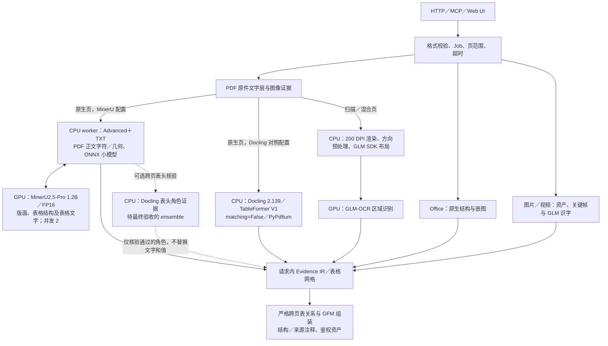

# Architecture

moparse 是 PDF/Office/图片/视频到 GFM Markdown 的解析层。详细坐标证据是
请求内的解析中间表示，不是交给业务 LLM 的输出；EventRail 等下游直接消费可读正文、
列表和表格，再完成实体、关系、事件与财务指标抽取。

这一输出边界见
[ADR-0001：以忠实的逻辑表 GFM 作为文档内容与下游抽取边界](adr/0001-faithful-gfm-for-downstream-extraction.md)。



## PDF 路由与候选组合

原生页保留 PDF 文字证据，不做无条件全页 OCR。服务端的 `NATIVE_PARSER_BACKEND`
选择原生管线；公共 HTTP／MCP 请求不增加模型选择参数。

- **Primary 候选**：MinerU 4.0.12 Advanced＋TXT，官方视觉 SDK `mineru-vl-utils==2.0.7`；
  正文的 PDF 源文字提取、字符方向匹配、ONNX 小模型及文档处理在 CPU worker 中执行；
  版面、表格结构及单元格文字仍由独立 FP16 vLLM 服务识别，请求并发及
  `max_num_seqs` 均为 2。TXT 不保证表格内文字来自 PDF 文字层。
- **Docling 表头核验 ensemble 候选**：在同一 primary 上开启
  `MINERU_HEADER_VERIFIER=docling`。Docling 只核验跨页候选的结构角色；该组合仍需独立的
  完整 HTTP 验收，不能把 primary 的结果直接记为 ensemble 的结果。
- **Docling 基线**：`NATIVE_PARSER_BACKEND=docling`，Docling 2.139.0、TableFormer V1
  Accurate、`do_cell_matching=False`、PyPdfium，推理在 CPU 上执行，可独立部署。

MinerU 的原生文字匹配修复位于依赖字符归属层：使用原 PDF 书写方向检查字符位置，
不包含文档 ID、页码、财务名称或固定语句补丁。依赖版本及修复后的文件 SHA256
`616f44e2a1749f4b82074df36c3da852694a9401828c6c36aad62553b2a182cf`
由构建和 worker 就绪检查验证。使用官方 typed-block 完整渲染，正文、页眉、页脚、
页码、公式及业务附注保留可见内容，不把辅助角色自动等同于可删除内容。

表头核验只针对跨页候选。两端的完整表头带、合并跨度、唯一可匹配的源几何、列边界，
以及标题和单位上下文必须共同一致，才允许把已证实的表头角色转移到 MinerU 表格。
Docling 不替换 MinerU 的正文、单元格文字或值。证据有缺失、冲突或歧义时保持角色未知，
保留两个片段及各自表头；相同列数、近似排版或部分文字相同不能授权删头。
后续跨页组装仍执行完整表头及列义、跨度、标题、单位和上下文一致性检查，并保留
`table-source` 逐行来源；不能只凭核验器名称决定合并。

`scan_policy=auto` 下，扫描、混合页由 GLM-OCR＋官方 SDK 0.1.5 处理：200 DPI 渲染，
先在 CPU 旋正，再执行 CPU PP-DocLayoutV3 布局和 GPU GLM-OCR 区域识别。原始来源页关联
保留，结构验证不依据指标名补期间或用另一模型重写冲突数值。
`scan_policy=skip` 关闭 PDF 扫描 OCR，只保留可信原生文字、明确跳过提示和整页图像资产。

主 API、原生文档 worker 和 GLM SDK sidecar 均不挂载 GPU；两个视觉模型服务分别管理
GPU 资源。图片及视频关键帧识字复用 GLM-OCR，`describe_images` 仍只生成可见文字。
视频摘要按采样时间列出识别文字，不推断未采样片段或无文字场景。

## 评测、选择和实际部署身份

[benchmark/report.md](../benchmark/report.md) 是唯一维护中的当前比较报告。
数据集包含 14 个完整输入／543 页：既有 504 页回归输入，以及新增 39 页封存输入。
新增封存集目前只有 36 项原件确认断言，属于部分标注；未标注页面或内容不能算正确。
已有难页与 209／402 等验收集存在来源重叠，分母分别报告。

方法登记的 `candidate` 仅表示待评测组合。`live_selected` 必须有同一配方的完整 HTTP
最终 GFM 验收、模型／代码／镜像实际读回及部署后复验记录支持。当前线上身份以该报告
关联的 release proof 为准；本架构文档不把候选、历史组件成绩或旧部署快照当成当前上线事实。
详细部署和离线权重步骤见 [deployment.md](deployment.md)。

## 内部证据与公共输出

内部 `ContentParseResult`/Evidence IR 保存页、区域、候选来源、bbox、表格单元格和质量，
仅用于同一次解析中的融合、质量判断、跨页关系和资产裁剪。它不进入 OpenAPI，不作为
结果文件持久化，也不发给下游 LLM。

公共 GFM Markdown 包含：

- 标准 Markdown 正文、标题和列表；
- 解析器识别出的 GFM 表格，包括多级/分段表头；
- 合并后的跨页逻辑表，续页重复表头仅在完整表头及列义一致时去重；
- 无坐标结构注释，携带来源模型或经核验的表头角色、合并跨度和来源页；未确认的结构明确标记未知；
- 图片/视频资产的普通 Markdown 列表、描述和下载链接。

解析层不判断某张表应变成财务事实、公司字段或股东关系，也不依据固定首行生成字段名。
公司实体消歧、关系/事件 ontology、财务指标归一化、事件去重和修订由 EventRail 或其他
下游负责。需要审计时使用任务 ID 回到原 PDF 和资产，而不是把全页坐标送入抽取提示词。

## 持久化

```text
/data
├── jobs.db
└── jobs/<job_id>
    ├── input/original.<ext>
    ├── output/result.md
    ├── output/asset-index.json   # 仅资产下载元数据，不含坐标、正文或表格 IR
    ├── output/assets.zip         # 按需生成
    ├── assets/original/*
    ├── assets/derived/keyframes/*
    ├── assets/derived/previews/*
    └── logs/warnings.json        # 无正文诊断
```

`result.md` 是唯一文档结果。SQLite 是 Job 状态真值，SSE 只是增量体验层。资产索引、
告警和 ZIP manifest 是运维/下载控制数据，不是替代的解析 JSON。

## 安全与边界

上传与 URL 均不可信：校验 magic、OOXML 关系、ZIP 展开边界、FFprobe、大小、单元数、
协议、解析 IP 与每次重定向。模型 URL、模型名和 prompt 只能由服务端配置。
图像字节、内部候选正文和模型请求不进入诊断日志；公开正文只包含采用的解析结果。

本项目不负责 Embedding、索引、问答、公司/人物消歧、领域关系与事件编排；它负责把
下游真正需要的可见内容和结构恢复为可高效消费的一份 Markdown 文档。
