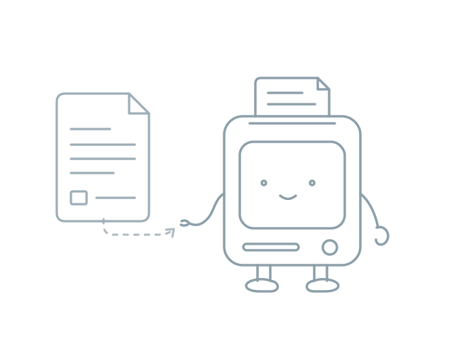
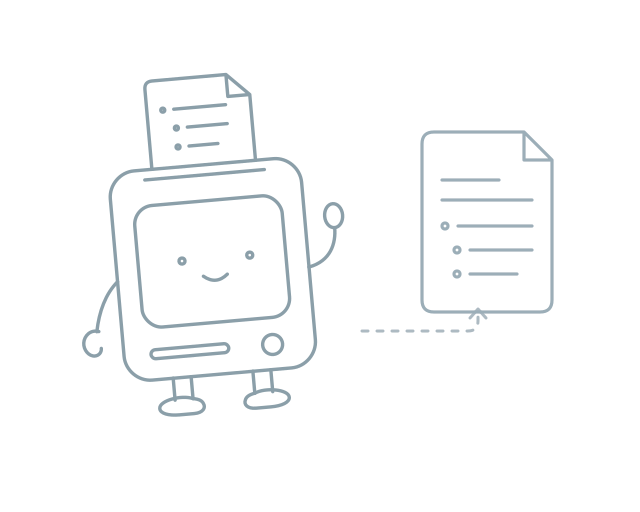
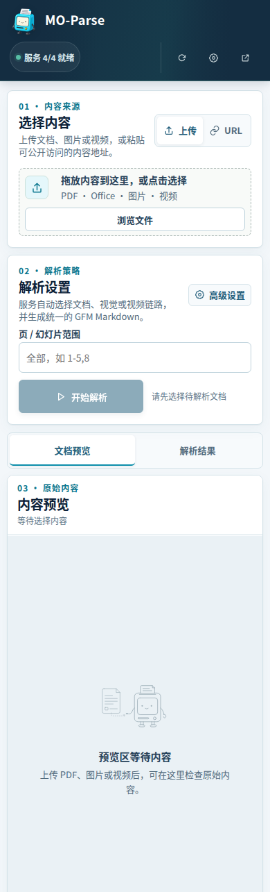

# MO-Parse 品牌与界面

正式展示名称为 **MO-Parse**。项目探索消费级 GPU 与 CPU 上的高质量文档内容解析，主标志以一个蓝青色立式文档终端表达本地、亲切和可掌握的工具体验。

## 主标志


主标志采用立式伙伴款：蓝青色机身、浅色屏幕上的小眼睛与克制笑容、顶部文档、单个琥珀色按钮，以及松弛细长的手脚。屏幕与机身构成一个整体，没有独立头部。透明 PNG 母版保存在 [assets/moparse-logo-3d-master.png](../assets/moparse-logo-3d-master.png)，沿用历史文件名以保持资源路径兼容。README 与网页主标志从该母版导出，保持原始构图比例；生成提示与素材来源见 [brand-generation.json](../assets/brand-generation.json)。

## 小尺寸图标

Favicon 使用独立的透明 PNG 母版 [assets/moparse-favicon-master.png](../assets/moparse-favicon-master.png)。它保留文档终端的蓝青机身、浅屏表情与顶部纸页，改为正面视图，去掉四肢并减少纸面细节，以高对比和清楚轮廓适配 16、32、48、64 像素。Favicon 从这张简化母版独立导出，Apple Touch Icon 使用同一简化造型导出为 180×180；主标志不直接缩小为 favicon。

## 线框空状态插画

输入、Markdown 输出、纯文本、页面、加载、说明和错误七种状态使用[线框 SVG 母版](../assets/illustrations/document-terminal-outline.svg)。文档终端采用二维线稿，以低饱和度的灰蓝描边表达纸页、表情与细长四肢；所有轮廓使用 `fill="none"`，不使用大面积填色、渐变、阴影或内嵌位图。场景内的纸页、列表、箭头和状态符号也使用线稿。

输入图以伸手接纸、视线朝向原件和较短的纸页表达等待接收；Markdown 输出图以轻微侧倾、抬手招呼、列表纸页和自然站姿表达整理与展示。两图共用机身轮廓，动作由导出脚本组合；姿态可随场景调整，其他状态保留中性站姿。

场景保留 640×512 透明画布，并同步导出 PNG 兼容资产。标题和说明仍由界面提供；应用原有就绪、错误等状态颜色与交互语义保持独立。空状态图直接使用可编辑矢量路径，主标志和 favicon 继续使用各自母版。此前生成的彩色插画是未采用的候选，生成记录保存在[历史记录](../assets/illustrations/generation.json)。





## 一致导出

在项目开发环境中运行以下命令，从主标志 PNG 母版生成根目录、README 与前端使用的 PNG 标志，从独立线框 SVG 母版生成七种状态图，从独立 favicon 母版生成 16、32、48、64 像素图标及 180 像素 Apple Touch Icon。导出保持透明度与图形比例。

根目录仅保留 `logo.png` 这一张图片。Favicon 与 Apple Touch Icon 的项目导出文件统一放在 `assets/icons/`，前端使用的副本保存在 `frontend/public/`；母版、候选图与文档截图继续保存在各自的资源子目录中。

```bash
.venv/bin/python scripts/export_brand_assets.py
```

生成脚本 [export_brand_assets.py](../scripts/export_brand_assets.py) 分别读取主标志、favicon 与线框插画母版，保证重新导出后仍使用无填色线稿。

原有 `moparse` 包名、仓库路径、配置标识、浏览器存储键和公共 API 保持兼容；资源文件仍使用 `moparse-logo` 前缀。维护中的展示文案使用 MO-Parse，历史实验、模型名称及冻结证据保持原名。

## 首页视觉

首页顶部使用深蓝底色、细线纸页、表格网格与结构连线，替换旧随机马赛克画布。背景为静态装饰 SVG，不接收指针事件、不进入辅助技术阅读顺序、不依赖 Canvas、随机数或动画；窄手机屏幕隐藏装饰并将操作图标排列为一行，避免占用正文空间。服务就绪、不可用、未知与检查中的状态语义及操作逻辑保持独立。

## README 架构图与工作台截图

README 的[整体架构图](assets/mo-parse-overview-poster.png)专门说明组件关系与数据去向：接入与任务控制、解析执行、原生结果适配、分类型的内容处理、组装交付，以及任务库、文件和来源证据。布局采用统一栅格、低饱和配色和无衬线字体，实线模块表示已有组件，虚线模块表示覆盖仍待补齐的目标；独立解析研究单列，不作为运行时路由。组件定义与实际缺口以[架构文档](engineering/architecture.md)为准。

[架构图生成器](../scripts/build_overview_poster.py)直接生成可维护的 SVG 与高分辨率 PNG，不依赖截图或图片生成模型。SVG 的拉丁文字使用 DejaVu Sans，中文使用 Noto Sans CJK SC，并声明 `sans-serif` 回退；PNG 导出时按文字片段明确选择字体，避免中文字形缺失。

架构图页头将正式的机器人 Logo、MO-Parse 名称和架构标题排在同一行，与 README 和网页品牌一致；生成器读取现有 PNG 标志并将其内嵌到 SVG，保证离线查看时不依赖外部图片路径。

工作台截图单独放在 README 架构图下方。截图来自本地 Vite 前端，读取现有服务的状态，不替换 API 响应、不上传原件、不创建解析任务。当前桌面与手机截图及采集报告保存在 [workspace-preview/](assets/workspace-preview/capture-report.json)，报告记录地址、时间、浏览器、素材来源和校验值；画面里的服务状态只代表采集时响应，不能当作部署验收。

生成架构图需要项目 Python 环境中的 CairoSVG、DejaVu Sans 和 Noto Sans CJK 字体；无需先运行工作台或采集截图。

```bash
.venv/bin/python scripts/build_overview_poster.py
```

更新界面截图时，先运行本地前端，再在另一个终端执行采集。采集脚本需要可用的 `playwright-core` 与 Chromium，可用环境变量指定其路径。

```bash
npm --prefix frontend run dev -- --port 5179 --strictPort
```

```bash
PLAYWRIGHT_MODULE=/path/to/playwright-core/index.mjs \
CHROMIUM_EXECUTABLE=/path/to/chromium \
node scripts/capture_brand_screenshots.mjs \
  --base-url http://127.0.0.1:5179/ \
  --output-dir docs/assets/workspace-preview
```




此前已部署界面的历史截图继续保留为 [mo-parse-web-desktop.png](assets/mo-parse-web-desktop.png) 与 [mo-parse-web-mobile.png](assets/mo-parse-web-mobile.png)，不将其当作本次修改已部署的证据。
