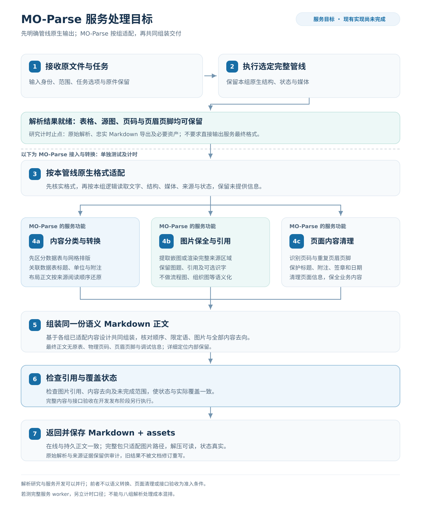

# MO-Parse 架构与调整目标

本文说明 MO-Parse 的组件与内部表示；交付要求及当前缺口统一见[输出规范](../specs/moparse-output-spec.md)，逐管线格式及适配逻辑见[输出与适配说明](../pipelines/README.md)，执行约束见 [AGENTS.md](../../AGENTS.md)，决策变更见[ADR-0001](../adr/0001-faithful-gfm-for-downstream-extraction.md)。2026-10-21 的范围调整不修改代码或部署，图片语义化不属于目标架构。

## 目标处理流程

2026-10-30工作区的`table_context_service`从已保全原生块和`TableFragment`读取局部计量或记录字段及文字限定，补充原生结构证据；`table_semantics_service`分别检查来源冲突、用途与记录范围，使用`CellRef`或`TextRef`渲染实际正文。PDF来源补充继续独立运行，P08不进入该路径。评分器的`information_reading`独立读取候选表和实际正文限定，不调用服务关系判断；只共用既有忠实格式读取，不循环认定正确。运行身份、后处理计时和统一评分冻结分别保存。



图描述目标运行流程，第 6 步是程序对引用和覆盖状态的检查；完整内容与接口验收属于开发发布阶段，见[技术路线](technical-route.md#4-验证与发布条件)。第 2 步取得声明管线的原始解析，第 3 至 7 步属于 MO-Parse 服务处理。解析研究按[研究框架](../research/research-framework.md#2-管线研究的顺序)比较原始结果与费用，服务转换按[技术路线](technical-route.md)开发与验收，两者不能共用最终格式门槛或混合计时。

## 目标职责划分

| 部分 | 职责 | 已有实现与缺口 |
| --- | --- | --- |
| 解析后端 | 产生本方法的文字、布局、表格、图像及已有结构 | 后端能力各异；不要求直接生成语义列表或共同内部模型 |
| MO-Parse 管线适配 | 依据本组已核实的输出读取已有结果，保全原文、结构、来源和媒体 | 逐组设计和验证；SDK 具备的信息、传输遗漏与读取遗漏分开 |
| MO-Parse 分类与转换 | 区分数据表、网格排版及未知区域；处理确认的数据表关系和布局正文 | 工作区支持部分PDF来源绑定及明确原生计量/记录入口；复杂表格、布局回流与未保存层级仍有限，覆盖由配对评测记录 |
| MO-Parse 图片处理 | 保存可读原图或区域渲染图，关联正文引用与资产 | 当前按后端图片候选导出；可选 OCR 仅识字 |
| MO-Parse 内容清理 | 区分物理页码、重复页眉页脚和业务标题、附注、签章日期 | 工作区FinalContentService处理明确角色、内部标记和原生续接，未判定范围保留；实际覆盖由配对评测报告 |
| MO-Parse 组装与返回 | 统一正文、图片引用、状态和持久结果，准备离线输出包 | 当前仍有 GFM 和分页信息；bundle 尚无 Markdown |

后端可以输出 Markdown、HTML、XML、JSON 或 SDK 结构，服务按本后端已有信息接入，不要求候选先实现共同语义接口。先逐组核实原生输出，再明确服务转换需要的信息；若还需从原件恢复缺失表格关系，应单独验证服务方法及费用，不把这些答案算成后端原生能力。来源与关系证据统一见[表格来源与证据约定](../specs/table-source.md)。

设计顺序为原生输出盘点 → 本组适配逻辑 → 内容转换 → 共同组装；运行时按已经确定的适配器读取结果。相同格式可共享读取函数，混合管线仍保留分支身份及页序，不能先转 GFM 再恢复上游已有结构。表格来源、语义关系和本链路审计只维护当前定义。

研究侧忠实导出可保留原表和页面信息；服务最终正文则必须遵守[输出契约](../specs/moparse-output-spec.md)。原生或纯视觉输入限制适用于各声明解析配置，不能用服务后来的原件恢复修改候选解析成绩。

## 逐管线适配与共同组装

每条管线的最终原生产物由结构、Markdown、媒体和状态组成，可能是多个分支的不同格式集合。格式事实及各组逻辑在[逐组说明](../pipelines/README.md#管线索引)维护，架构不凭框架名猜字段，也不要求八个适配器分别复制全部读取代码。

研究读取只做无损转译与忠实导出，服务适配负责把已有内容交给用途判断、表格关联、图片保全和页面清理；有损或补答案的逻辑不能进入研究出口。媒体字节、图题、源格、嵌套富文本与失败均有去向，无法获得的信息明确保留缺口。

现有 `DocumentEvidenceIR`、`ContentRegion`、`TextBlock` 和表格类型是有限的服务内部实现。先核对各组输出及其映射，再决定保留、扩展或调整哪些内部字段；不能把当前表示的缺项误报为上游没有，也不把它预设为候选必须提供的统一语义接口。共同组装消费已适配并处理的实际内容，生成正文、图片引用和覆盖信息。

2026-10-29工作区的`FinalContentService`在图片与表格处理之后生成实际发布正文，私有`_final_text_evidence`及内部日志保存编辑前组装文字、精确编辑区间和续接状态。业务正文与内部定位分开，评分读取通过编辑区间映射回实际发布字符，不能使用已移除文字给分。PDF图片保全保留实际图片引用，资产ID、物理位置和操作说明留在IR；未解决表格通过文档partial及警告传递。P08视觉块由`mineru_visual_result`独立适配，当前用于保存产物的CPU服务replay；其来源分支不调用P07的PDF原生文字和矢量表格补充。逐组边界仍由[适配专文](../pipelines/README.md)维护，工作区变更不表示线上已切换。

## 当前 PDF 路由与来源能力

服务端 `NATIVE_PARSER_BACKEND` 选择原生后端，公共 HTTP/MCP 不增加模型选择参数。原生页可以保留 PDF 文字证据；扫描、混合页经现有 GLM SDK 处理。现有来源规则和解析分工属于待评价的实现起点，八个主比较配置仍须在统一协议下重新测量。

- MinerU 路径使用 MinerU 4.0.12 Advanced + TXT，CPU native worker 执行 PDF 与 ONNX 工作，FP16 vLLM 执行视觉布局和表格任务。TXT 不保证表内字值全部来自 PDF 字层。
- Docling 仍是独立可选原生后端，使用 TableFormer、`do_cell_matching=False` 与 PyPdfium；MinerU 后不调用第二个 Docling 解析器。
- 扫描与混合页的现有 GLM SDK 先在 CPU 旋正，再做布局与区域识别。`scan_policy=skip` 保留原图和未处理状态，不能算完成目标语义转换。

MinerU 原生匹配层使用 PDF 书写方向检查字符归属，不包含文档身份或固定业务词补丁。完整 typed-block 渲染保留正文和页面家具，供后续区分与清理；这属于来源层要求，最终正文必须清理页面家具。公式、业务附注与页边签章日期继续保全。

直接PDF证据可从完整矢量网格或后端明确单元格分区绑定源字形与跨度；ROI只裁取实际相交线段。结构、表头作用范围和字段关系分别处理，支持有限的多层期间、行分组及无底纹短字段，样式和角色规则不构成普适语义真值。显式单元格分区入口不扩张跨页继承授权，关系仍须有完整标题、跨度、单位及延续范围；未确认时内部保留完整物理片段。

[原生正文服务](../../app/services/native_text_service.py)位于来源结构处理之后、最终文档导出之前。它根据管线已有块位置及唯一显示片段选择同区原生文字，并在有明确同栏顺序锚点时恢复遗漏正文；表、图、未知区域和页面家具不作为普通正文展开。已知标题、列表和引用角色保留，冲突和未确定范围登记来源诊断，不以字体生成新标题或整页替换。该服务属于MO-Parse处理，不加入八组原生执行器。

原生文字不能仅凭可读字符被视为可靠替换来源。证据采集保留同位line/span叠印风险，原生正文服务对涉及该风险或来源覆盖不完整的区域保留已有解析正文；原始字层不去重或改写。受保护内容同时按实际显示片段及来源位置保全，重复页边块虽不进入正文来源选择，其位置仍参与区域保护。

已有parser单段内的PDF物理line/block只作文字分块，不自动产生段落或英文词间空格；边界只沿唯一支持的既有空白投影。字宽与排版等价内容保留原parser格式，preserved与真实actions分别记账，原始块文字及最终替换文字分别保存。

当前 CPU 方法从原 PDF 深色矢量格线重建闭合矩形单元格，全部字形、文字和跨度与原生网格逐格对应后才补充来源框和列边界。角色规则限于完整、居中、非数值的来源行与后续数据行具有着色或数值列对齐对比的窄模式，证据来源记为 `pdf_vector_glyph_style`；单独的居中、粗体、着色或相似内容不够。跨物理网格的继承证据记为 `pdf_vector_glyph_style_and_native_continuation`，还须满足[来源约定](../specs/table-source.md#跨页来源与继承)中的各项条件，不增加第二个推理模型。

模型准备、配额、CUDA Graphs 和部署身份核验见[运行手册](../operations/runtime-recipes.md)，既有发布证据见[历史记录](../research/research-framework.md#102-2026-10-19-服务发布记录)。主 API、native worker 与 GLM SDK 无 GPU 挂载，模型服务分离；架构文档不凭软件版本断言部署或内容验收。

## 内容分类与表格关系层

当前 `TableCell`、`ParsedTable`、`TableFragment` 保留来源网格与角色观测，`CellRef`、`ValueRelation`、`SemanticRecord`、`SemanticTableView` 保存有界表格关系和状态。来源视图登记精确拥有的范围，现有语义服务在资产处理后替换 Markdown 片段；这是有限实现，不是所有原生格式的通用接入方式。后续组装需依据各组真实输出设计，并保护有效邻接内容。

局部关系不再因后续一行未解决而全部丢弃：partial视图在保留原始源格的同时，按原行顺序交错确定记录和剩余显示片段，完整共享跨度不被切开。完整转换、部分转换与原表保全分开统计；实际测量与状态由[评测索引](../../benchmark/reports/README.md)维护，工作区实现不代表线上部署。

2026-10-28的[服务保全修复](../../benchmark/diagnostics/service-postprocessing.md)补齐了已绑定单位、期间、附注引用的校验与渲染，空字面量不再自动变成“原表留空”。正文导出保护实际代码和比较式；无表格归属的竖线正文继续进入结构化blocks。它们只处理已有信息的交接，不增加独立限定语识别或网格用途推断，也没有更新线上部署或原生管线成绩。

同一800页服务配对评测及80页三轮后处理计时的当前执行、评分与报告状态由[评测索引](../../benchmark/reports/README.md)维护。最终输出、字段读取及转换完成状态分别呈现；线上部署保持原状态。

来源网格进入关系转换前，需区分数据表、排版容器和未知用途；现有矢量格线及字形绑定不自动完成此分类。布局正文保持阅读顺序，图片保留为资产及引用。分类与数据表关联的证据规则见[来源约定](../specs/table-source.md#先确认网格用途)，不建立图片节点或连线关系层。

确认的数据表按字段区、记录区、比较区及说明区分别关联，单位、期间和附注具有各自作用域；不能因一条说明行不支持而把所有区域标为语义不明确。现有 `describe_images` 只为图片资产识字，不改变其作为图片交付的角色。

## 最终转换与状态

最终渲染在所用管线的输出和适配逻辑明确后设计，接收已适配、分类和处理的正文、数据表描述及图片引用；未解决状态随内容进入组装。格式、覆盖与失败状态的唯一验收定义见[输出契约第 7、8 节](../specs/moparse-output-spec.md#7-未完成失败与覆盖)；现有 Job 终态与内容完整性的联动仍需实现和接口验证。图片按原图交付，不以图片未语义化为失败。

## 内部证据与持久化

当前转换登记精确拥有的显示片段，并在资产处理后替换，保护有效邻接内容；目标最终渲染不以匹配 GFM 字符串作为普遍前提。[表格来源与证据约定](../specs/table-source.md)规定来源保全和关系使用，[表格关系与来源引用](../specs/api.md#表格关系与来源引用)说明当前引用及有限转换状态。历史证据保持原字节与校验值，不因此维护旧格式兼容代码。

```text
/data
├── jobs.db
└── jobs/<job_id>
    ├── input/original.<ext>
    ├── output/result.md
    ├── output/asset-index.json
    ├── output/assets.zip
    ├── assets/original/*
    ├── assets/derived/*
    └── logs/*
```

以上是当前磁盘布局。`output/assets.zip` 目前仅含清单与资产；完整输出包和离线引用规则见[输出契约](../specs/moparse-output-spec.md#12-markdown-与图片的输出包)，尚未实现。内部 Evidence IR、网格、页位置和审计记录用于可追溯处理；图片本身属于公开交付资产。请求取消与清理所有权见 [AGENTS.md](../../AGENTS.md)。

## 表格显示映射

本节只说明现有 GFM 与 HTML 显示代码，不规定候选解析管线或最终文档的通用表示。来源结构与显示映射分别生成，单表、内部表头分段和已确认的跨页逻辑表使用同一套无版本定义。显示所需的新增语法行不进入源格、来源行数、原始跨度或语义引用。

`table-fragment` 或 `logical-table` 打开表格显示作用域，其后的 `table-source`、`table-structure` 和 `table-view-segment` 绑定到该表。`table-source` 的来源页、来源行和逻辑行范围从 1 起算，记录各物理片段和已删除的确认重复头；结构、跨度及分段来源行从 0 起算。合表后的逻辑坐标不能代替 PDF 来源坐标，物理位置须结合 `table-source` 读取。

`table-structure` 声明 `row_coordinate_space="source_logical_rows"`。`num_rows`、`num_cols`、`header_rows` 和 `spans` 描述不含新增语法行的来源逻辑网格；`encoding="anchor_and_blanks"` 表示只在跨度锚点存文字，覆盖位置为空。`structure_valid` 只说明已有网格与跨度证据可用，不证明角色、内容或覆盖完整。

GFM显示映射统一保存在 `gfm.segments`，单段也使用列表；`gfm.rendered_num_rows_total` 为各段显示行数之和，不额外生成单段别名。每段之前的 `table-view-segment` 声明同一表身份与连续片段编号，不创建新的物理表。

| 字段 | 含义 |
| --- | --- |
| `index` | 从 0 起算的连续片段编号 |
| `source_rows` | 本段连续来源逻辑行；全部片段按序恰好覆盖 `0..num_rows-1` |
| `header_rows` | 本段已确认的来源表头行，未知时为 `[]` |
| `synthetic_header_rows` | 本段显示坐标中的新增语法行，只允许 `[]` 或 `[0]` |
| `rendered_num_rows` | 本段全部显示行数，含新增语法行，不含 GFM 分隔线 |
| `source_to_rendered_row_offset` | `本段显示行号 = 来源逻辑行号 + offset` |
| `source_header_scope_complete` | 本段是否有完整来源前置表头证据 |

完整物理表的单元格覆盖有效且含明确跨度时，当前显示直接输出HTML的`rowspan`和`colspan`，复制既有标签与值，不因网格存在而新增表头语义。结构未知的表仍保留原用途状态。含嵌入Markdown图片的单元格保留原显示路径，图片引用不因表格显示切换丢失。部分转换后的剩余片段与跨页组合表仍使用下面的GFM映射，不能宣称所有跨度表达均已覆盖。

GFM 语法要求分隔线之前有一行表头。来源首行角色未知时，显示增加一行全空语法头并声明 `[0]`，原首行仍作为数据；来源真实空白首行也继续保留。角色未知的一行来源 `Alpha, 12` 对应以下显示与映射，新增行不代表原件内容：

```markdown
<!-- table-view-segment: {"table_id":"example_t1","index":0} -->

|  |  |
| --- | --- |
| Alpha | 12 |
```

```json
{"index":0,"source_rows":[0],"header_rows":[],"synthetic_header_rows":[0],"rendered_num_rows":2,"source_to_rendered_row_offset":1,"source_header_scope_complete":false}
```

完整内部表头开始新显示片段，前面的未知段使用空语法头。例如五行来源的表头位于行 1 和行 3，分段来源行为 `[0]`、`[1,2]`、`[3,4]`，offset 为 `1`、`-1`、`-3`。切分点穿过 rowspan 时不切断源格；多层表头的完整角色结合来源表头、跨度与作用域读取，不能仅凭 HTML 渲染后的 `<th>` 数量判断。

重建来源行前，核对表身份、连续片段编号、段标记数量、列数、分隔线、声明与实际显示行数、offset、完整来源分区及显示总行数。只有明确声明、实际全空且不绑定来源表头的新增语法行才可剥离；错位、漏段、重段和未声明空行不能静默投影。不满足当前定义时记录无法重建，不回退到假定首行表头或旧格式解码。

显示刷新只替换当前表精确拥有的结构标记与显示片段，并同步更新归属记录；重复刷新不重复插入分段标记或语法头。来源网格保持原样，前后正文、未知邻接结构和资产引用不被吞入。投影成功只证明行映射可重建，不证明语义或最终输出合格；显示行映射不用于语义段落。

## 研究、验收与边界

研究框架定义解析问题、类别与方法证据；[评测任务](../../benchmark/evaluation-tasks.md)核对原始解析质量与直接处理成本；[八条配置](../../benchmark/pipelines-to-test.md)共享忠实导出和比较条件，MinerU 调优独立维护。MO-Parse 的数据表转换、布局还原、图片保全、清理、组装和最终接口另作功能验收与费用测量，不是八组管线的共同出口或前置条件。

现有服务调用与计时字段见下节。八组比较使用独立研究执行器直接调用固定SDK，保留原生结果、忠实导出和必要资产；不会调用服务的来源补充或最终语义转换，也不改写既有duration字段。

接入端消费最终语义内容，不负责补表头或隐藏失败。实体消歧、指标归一、事实去重、事件编排、Embedding、索引和问答仍由下游负责。上传、URL、资产及模型配置继续遵守既有校验与认证边界，本次不增加公开 XML 或详细坐标接口。

## 独立评测实现

[moparse_eval](../../moparse_eval/README.md)提供授权的本地入口，不增加公开API。数据包和评分标准由[评测任务](../../benchmark/evaluation-tasks.md)维护。存在执行缺陷的比较及旧执行锁已撤销；修复并冻结新配置后，实际模型、镜像、资源和参数由新锁及各次运行快照记录。打包只执行人工清单，评分参考对解析worker不可见；服务转换仍是独立工程。

| 模块 | 职责 |
| --- | --- |
| cli、packaging | package/run/score/report编排；复制人工资料清单和提取声明页对象 |
| preparation、runtime、executors | 固定依赖、隔离worker、完整SDK执行与直接处理时钟；SDK跨样本保留，初始化与预热单列 |
| adapters、native_relations | 忠实读取已有原生字段、顺序、格位、媒体和关系，不接收expected |
| native_readback | 评分侧从已有原生产物补读明确关系，独立保存派生观察与分析耗时，不修改执行产物或解析时间 |
| matching、metrics、scoring、adjudications | 冻结参考的内容定位、字符与关系评分、明确的人工待判排除；不提供语料验收或修复 |
| reporting | 从已有运行及评分记录重生覆盖、分项质量、成本、失败与分组比较 |
| maintenance、request_control、cuda_graphs | 授权GPU 1维护窗口及恢复、在途所有权、预算内图捕获与真实例外记录 |

评分软件和执行软件分别保存身份及源码快照；修复评分读取后统一重评已有八组产物，不将分析耗时回填worker主耗时。实现验证使用合成材料，正式质量与服务恢复状态以[新运行记录](../../benchmark/reports/README.md)为准。

## 现有调用与计时字段

以下记录现有服务调用承担的工作与计时区间。独立研究入口不复用这些时长；关闭语义开关不会移除其他服务处理，字段也不能通过相减或重叠求和变成完整解析耗时。

| 位置 | 当前实际工作 | 与解析研究的关系 |
| --- | --- | --- |
| [ParserService.parse](../../app/services/parser_service.py) | 调用原生/SDK 分支后，执行 PDF 表格证据补充、来源日志、导出、IR、资产、表格语义转换及最终正文处理 | 这是服务处理入口，不能整个用于八组原始解析对照；关掉语义开关也未排除其余服务处理 |
| 同文件的 `_parse_native_pages` 与 `_apply_scan_ocr` | 来源观测后调用所选原生后端及 GLM SDK | 可复用声明的分类和分支逻辑，但单个分支返回不是完整混合配置的结束 |
| [DoclingStandardParser.parse](../../app/parsers/docling_standard.py) | 原生页转换及其结构导出，返回页面、表格和图片候选 | 是现有服务接入起点；研究P01/P02在独立执行器显式选择模型并执行共同前处理 |
| [MinerUNativeRemoteParser.parse](../../app/parsers/mineru_native_remote.py) | HTTP 提交与轮询、原始证据写入，再读回和渲染原生结果 | 可参考原始响应读法；其客户端耗时包含传输和日志，不是完整解析耗时 |
| [native worker 的 `_parse`](../../native_worker/server.py) | 先读页数尺寸，再调用 MinerU `parse_async` 并导出 source blocks；tier 写为 advanced | 是现有服务的原生分支；研究执行器另显式选择Standard/Advanced，并覆盖共同前处理、GLM分支及完整导出 |
| [PDF 表格来源服务](../../app/services/pdf_table_evidence_service.py)及[表格语义转换](../../app/services/table_semantics_service.py) | 服务在后端返回后从原件补充来源，再进行有限关系转换 | 归 MO-Parse 服务能力，不能在原始结果比较中免费修复标题或关系 |

| 现有字段 | 源码中的区间 | 正式研究处理方式 |
| --- | --- | --- |
| 服务 `usage.duration_ms`、IR `runtime.duration_ms` | 从进入服务处理前开始，包含内部等待、可能的初始化、来源日志及语义转换，最终阶段又更新 | 保留原字段含义，不能当八组解析计时或由减去语义时长得到 |
| MinerU 远程适配器的 `usage.duration_ms` | 含 HTTP 提交、轮询、响应及来源写入，记录点又早于后续逐页读回 | 仅为当前客户端区间，不作为正式成本指标 |
| native worker 响应 `duration_ms` | 从 MinerU 调用前到 source-block 导出后；前置页数与尺寸读取不在该区间 | 只能作局部诊断，不能冒充完整 PDF 或混合管线耗时 |
| `_semantic_duration_ms` | 现有表格语义转换 的 `apply` 调用区间 | 仅是服务转换的局部费用，不代表完整语义服务或全部后处理 |

研究与后续服务工程的实施顺序见[实施路线](technical-route.md#3-当前缺口与近期顺序)；正式处理计时口径见[研究框架](../research/research-framework.md#6-实验执行质量与计时)及[评测标准](../../benchmark/evaluation-tasks.md)。
