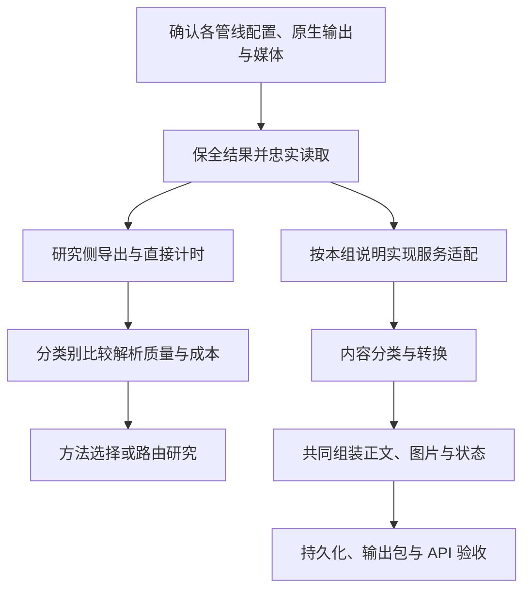

# MO-Parse 实施路线

本文维护开发依赖、交付物和完成条件。逐管线格式与适配设计见[管线索引](../pipelines/README.md)，最终交付要求见[输出规范](../specs/moparse-output-spec.md)，代码职责见[架构](architecture.md)。以下状态依据 2026-10-21 的静态检查，实际样本、实现和验收分别记录。

## 1. 总体依赖

每条管线先有自己的输出与适配说明，相同格式可共享读取函数。服务适配按实际接入需要实现；研究侧读取、导出和计时就绪的组可以开展解析比较，无需等待服务转换。解析方法选择由[研究框架](../research/research-framework.md)规定的质量与成本证据决定。

## 2. 实施阶段与交付物

| 阶段 | 具体工作及代码位置 | 交付物 | 完成条件 |
| --- | --- | --- | --- |
| A. 确认配置与输出 | 按[八组固定配置](../../benchmark/pipelines-to-test.md)核对包、模型、入口、分支及原生产物 | 每组独立说明；原生结构、媒体、页序、状态及限制清单 | 源码核对与固定配置的实际样本确认分开；未固定或不可得的信息明确列出 |
| B. 保全与忠实读取 | 处理 SDK、HTTP、worker 导出中的信息损失；复用原生读取代码 | 可回读的原始结果、真实媒体、研究 Markdown 与直接计时入口 | 已有文字、结构、跨度、图题及失败不因传输或导出丢失；不加入服务修正 |
| C. 管线服务适配 | 按本组说明映射已有字段、顺序、来源和缺口，调整不足的内部类型 | 所选管线的适配器、字段去向及固定结果验证 | 分支页序不丢不重；坐标变换和媒体可追溯；未提供字段保持未知 |
| D. 内容分类与转换 | 分开改进用途判断、表格关系、布局阅读顺序及页面清理；现有入口为表格来源与语义服务 | 各方法的输入要求、实现、验证记录和未支持范围 | 先用受控正确结构检查转换，再以真实解析输入和独立标注检查；补充原件证据另计成本 |
| E. 共同组装与交付 | 调整 `ParserService` 的组装、IR、资产与 `StorageService.build_bundle` | 同一份最终正文、图片引用、manifest、ZIP 及状态传递 | 适配后的实际内容均有去向；包内引用可解析；响应、持久化和下载一致 |
| F. 完整服务验收与发布 | 在声明范围的外部完整原件上验收，再按[运行手册](../operations/runtime-recipes.md)发布 | 内容与接口验收记录、实际镜像及模型身份、回退依据 | 覆盖和未完成状态符合输出规范；通过内容验收后发布并读回部署身份 |

B 同时支撑解析研究和服务适配。D 的方法研究可以使用外部交接的正确结构开展，但与某条管线集成时必须验证该组 C 的真实输入。打包等确定的工程功能可并行修复；不以全部八组适配完成作为单组接入或解析比较的前提。

## 3. 当前缺口与近期顺序

| 工作 | 已有基础 | 下一项具体交付 |
| --- | --- | --- |
| 固定执行配置 | Docling、GLM SDK、MinerU Advanced 分支；P01–P08 已分别有输出与适配说明 | 补齐 P02 的 V2 选择与模型锁、P03/P04 的包和模型锁及执行器、P05 全页入口、P06 Standard 入口、P08 纯视觉执行器；逐组状态以[管线索引](../pipelines/README.md)为准 |
| 原生产物交接 | 当前客户端能读取部分结构；worker 可返回投影结果 | 核对并保全 GLM SDK 媒体、MinerU 原生元数据和媒体；确认混合配置的完整页清单与两类分支产物 |
| 独立研究入口 | 当前服务和 worker 有可复用调用，但计时区间不完整 | 从完整 PDF 开始直接覆盖声明的前处理、全部分支、忠实导出与必要资产；调用及字段限制见[现有代码边界](architecture.md#现有调用与计时字段) |
| 服务适配与转换 | 当前 `DocumentEvidenceIR` 和表格语义实现有限 | 先为实际接入组验证无损映射，再分别验证数据表与网格排版分类、表格关系和页面清理 |
| 最终组装与输出包 | 已有正文持久化和资产 ZIP | 补齐包内 Markdown、相对图片引用与清单；随后接入完整覆盖及状态传递，详见[输出缺口](../specs/moparse-output-spec.md#9-当前实现差距与迁移) |

近期先落实“固定本组配置 → 保全完整原生产物 → 验证忠实读回”。现有服务结果不能直接替代研究原始结果；后续适配和共同组装据实际读取到的信息设计，不以现有有限 IR 或 GFM 为所有后端的前置格式。

## 4. 验证与发布条件

| 验证层次 | 输入与核对对象 | 通过后能说明什么 |
| --- | --- | --- |
| 格式与适配 | 固定原生结果、媒体及失败样本；逐项核对读取和映射 | 本组交接保真，不代表解析质量或最终转换正确 |
| 转换组件 | 正确受控结构，再加入真实解析输入；核对用途、关系、阅读顺序和清理 | 声明输入范围内的方法表现；组件错误与上游识别错误可分开 |
| 解析比较 | 外部版本化原件与独立标注；按[评测任务](../../benchmark/evaluation-tasks.md)检查原始输出及直接处理成本 | 本组在实际覆盖类别上的质量、成本和失败情况 |
| 服务验收 | 完整 PDF 的最终正文、图片、manifest、ZIP、任务状态及持久结果 | 所选部署配置在声明范围内满足[输出规范](../specs/moparse-output-spec.md)；操作检查见[运行手册](../operations/runtime-recipes.md#5-检查升级与故障定位) |

缺陷按最早丢失或改变信息的位置归因：原生结果、传输、适配、转换、组装与交付分别记录。图片按资产及原位引用验收，不增加图片语义任务。执行授权、外部原件范围和资源约束统一见 [AGENTS.md](../../AGENTS.md)。
