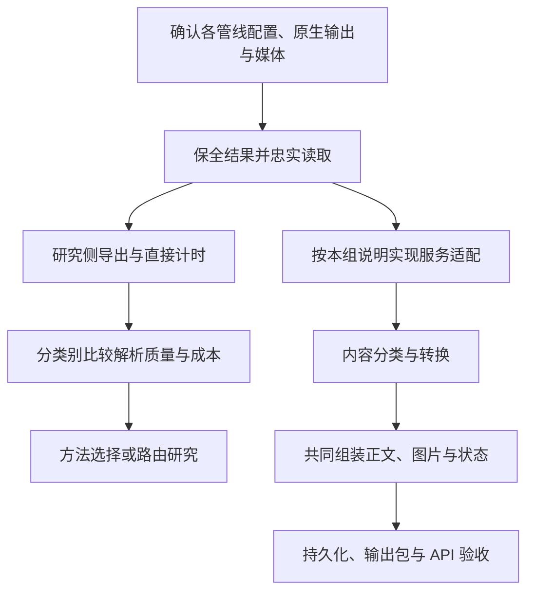

# MO-Parse 实施路线

本文维护开发依赖、交付物和完成条件。逐管线格式与适配设计见[管线索引](../pipelines/README.md)，最终交付要求见[输出规范](../specs/moparse-output-spec.md)，代码职责见[架构](architecture.md)。2026-10-24新增独立数据集与Lite评测实现；实际样本、运行、评分覆盖及服务验收分别记录，不能互相替代。

第九阶段已将MinerU Standard/Advanced自己的保存Middle JSON接入同一NativeContentContract和公共source-free链，并将原生、派生、消费及最终文字分开留证。2026-11-14复用本地固定DocVortex 0.5.16镜像，完成同两份保存输入的实际官方schema与安全文本投影核验；P06整文档接受，P07因嵌套list成员显式continues_prev=null保留整页及文档拒绝，各29个块的文字与共同读取对照完成。共同生产路径、历史正文及partial未改变。后续未覆盖真实结构、P08、Native/Product成绩及正式回放仍需各自授权和证据；实际状态见[唯一报告](../../benchmark/reports/lite/report.md)。

## 1. 总体依赖

2026-11-13接入P02自己的Docling V2及GLM保存结果，复用已有Docling投影、共同契约和公共source-free链；同时按实际输出责任修正unknown与partial的边界，并对完整已审查source-only允许集合及P01/P05/P03/P04固定输入复验。P02原生字面、跨度及缺口不由V1补全，五个配置的状态和工程证据见[唯一报告](../../benchmark/reports/lite/report.md)。后续为P06/P07 typed格式及Standard/Advanced差异，再到P08 visual来源限制，须另行明确授权，本轮未启动。真实candidate/expected比较、正式评分、八组回放、媒体/ZIP或发布未执行；63份来源及合同、55份历史保护集合、107份缺口、3份待独立验收和5个输入范围保持。

原统一评价主线仍需保全原生结果、原始测量及唯一`service/baseline/`正文，用独立反例、真实格式和实际保存输出诊断支持冻结与同版重评，再分别完成八组原生比较和P07/P08交付正文配对。其完整分母、表达等价、执行与发布条件由[评测任务](../../benchmark/evaluation-tasks.md#current-task-expected-only)维护，当前P01开发验证不替代这些门槛，也不恢复旧成绩或扩大本轮执行许可。

质量仅采用[三层等权定义](../../benchmark/evaluation-tasks.md#three-layer-evaluation)，具体计分合同、匹配、覆盖和独立验证由该文档维护。旧普通文字指标与两列业务指标已撤回。当前三层核心部分实现，真实格式仍存在未支持范围，正式成绩暂停；软件测试、诊断遍历和报告复现不等于内容比较完成。

2026-11-03 的重做必须实际验证检索链：字符串召回保留全部命中，关键要素和候选上下文逐项核对，明确冲突排除，位置确定后再比较值；唯一候选同样执行全部检查，范围不符时禁止回退。各步证据和独立扰动验收由[评测任务](../../benchmark/evaluation-tasks.md#business-accuracy)维护。2026-11-04用户进一步确定[三层各占1/3](../../benchmark/evaluation-tasks.md#three-layer-evaluation)，先明确文字、关系及重要业务要求的独立计分与验证，再实现评分；旧两列业务指标不构成新三层。先验证不同真实格式的整个链路，再冻结，不以修复一个用户示例代表全部评分正确；评分软件缺陷与输出缺失分开，前者阻止成绩发布。

候选处理不访问expected，不新增模型、OCR、视觉或来源补充。原生历史耗时与CPU后处理分列，不相加冒充端到端成本。当前状态见[评测索引](../../benchmark/reports/README.md)，后续任务见[续做提示词](prompts/expected-output-optimization.md)。本轮不启动Full，不操作GPU、TTS及在线服务，不部署。

每条管线保留自己的输出与适配说明，按Docling、GLM、Paddle、typed MinerU和visual五个格式族交接到共同消费契约，公共内容服务不按管线名称选择行为。Native质量、适配保全验收和Final产品质量分阶段归属，研究侧读取、导出和计时就绪不以最终服务转换完成为前提；当前真实比较仍须原有独立验证与执行授权。解析方法选择由[研究框架](../research/research-framework.md)规定的质量与成本证据决定。

## 2. 实施阶段与交付物

| 阶段 | 具体工作及代码位置 | 交付物 | 完成条件 |
| --- | --- | --- | --- |
| A. 确认配置与输出 | 按[八组固定配置](../../benchmark/pipelines-to-test.md)核对包、模型、入口、分支及原生产物 | 每组独立说明；原生结构、媒体、页序、状态及限制清单 | 源码核对与固定配置的实际样本确认分开；未固定或不可得的信息明确列出 |
| B. 保全与忠实读取 | 处理 SDK、HTTP、worker 导出中的信息损失；复用原生读取代码 | 可回读的原始结果、真实媒体、研究 Markdown 与直接计时入口 | 已有文字、结构、跨度、图题及失败不因传输或导出丢失；不加入服务修正 |
| C. 管线服务适配 | 按本组说明映射已有字段、顺序、来源和缺口，调整不足的内部类型 | 所选管线的适配器、字段去向及固定结果验证 | 分支页序不丢不重；坐标变换和媒体可追溯；未提供字段保持未知 |
| D. 内容分类与转换 | 分开改进用途判断、表格关系、布局阅读顺序及页面清理；现有入口为表格来源与语义服务 | 各方法的输入要求、实现、验证记录和未支持范围 | 先用受控正确结构检查转换，再以真实解析输入和独立标注检查；补充原件证据另计成本 |
| E. 共同组装与交付 | 调整 `ParserService` 的组装、IR、资产与 `StorageService.build_bundle` | 同一份最终正文、图片引用、manifest、ZIP 及状态传递 | 适配后的实际内容均有去向；包内引用可解析；响应、持久化和下载一致 |
| F. 完整服务验收与发布 | 在声明范围的外部完整原件上验收，再按[运行手册](../operations/runtime-recipes.md)发布 | 内容与接口验收记录、实际镜像及模型身份、回退依据 | 覆盖和未完成状态符合输出规范；通过内容验收后发布并读回部署身份 |

B 同时支撑解析研究和服务适配。D 的方法研究可以使用外部交接的正确结构开展，但与某条管线集成时必须验证该组 C 的真实输入。打包等确定的工程功能可并行修复；不以全部八组适配完成作为单组接入或解析比较的前提。

## 3. 当前缺口与近期顺序

| 工作 | 当前基础 | 后续或验收依据 |
| --- | --- | --- |
| 固定执行配置 | 八组均有独立入口、显式版本及分支；模型、镜像、依赖和资源已锁定 | 逐组事实见[管线索引](../pipelines/README.md)，实际执行身份与例外随[新运行](../../benchmark/reports/README.md)保存 |
| 原生产物交接 | 研究worker保存完整原生文档、媒体、页序、分支和失败；GLM主结果与审计视图分开 | 原生读取与有限实际个案分别留证，不把导出完成当作内容或媒体全量正确；缺失和未知保留 |
| 独立研究入口 | moparse_eval直接覆盖共同前处理、完整SDK、忠实导出及必要资产，使用worker直接处理时钟 | 初始化、预热及持久化分开；生产服务调用和原有字段不作为主计时，见[代码边界](architecture.md#现有调用与计时字段) |
| 数据集与统一评分 | 人工选页及目读标注后冻结Lite，Full保留历史范围和审核状态；评分只读参考 | 按[评测任务](../../benchmark/evaluation-tasks.md)交付分项质量、覆盖、未知、成本和失败；修复评分器后同版重评，不改原生产物 |
| 服务适配与转换 | P01/P02、P05及P03/P04交接到共同NativeContentContract和source-free调度，按输出依赖判定unknown影响 | 固定实样与受控边界分别留证；MinerU保存JSON的受限接入、实际官方结构与文本核验及P07文档拒绝分别留证，visual仍须真实纵向验收，见[架构](architecture.md#当前私有适配交接)和唯一报告 |
| 最终组装与输出包 | 已有正文持久化和资产 ZIP | 补齐包内 Markdown、相对图片引用与清单；随后接入完整覆盖及状态传递，详见[输出缺口](../specs/moparse-output-spec.md#9-当前实现差距与迁移) |

统一评价仍遵循“数据与参考冻结 → 执行锁 → 忠实读回 → 正式测量 → 统一评分及报告”的依赖，当前受限开发转换不构成其中的正式执行。现有服务结果不能替代研究原始结果；后续服务适配和共同组装据实际读取到的信息设计，不以现有有限IR或GFM为所有后端的前置格式，也不因研究运行完成就宣称最终服务已验收。

## 4. 验证与发布条件

| 验证层次 | 输入与核对对象 | 通过后能说明什么 |
| --- | --- | --- |
| 格式与适配 | 固定原生结果、媒体及失败样本；逐项核对读取和映射 | 本组交接保真，不代表解析质量或最终转换正确 |
| 转换组件 | 正确受控结构，再加入真实解析输入；核对用途、关系、阅读顺序和清理 | 声明输入范围内的方法表现；组件错误与上游识别错误可分开 |
| 解析比较 | 外部版本化原件与独立标注；按[评测任务](../../benchmark/evaluation-tasks.md)检查原始输出及直接处理成本 | 本组在实际覆盖类别上的质量、成本和失败情况 |
| 服务验收 | 完整 PDF 的最终正文、图片、manifest、ZIP、任务状态及持久结果 | 所选部署配置在声明范围内满足[输出规范](../specs/moparse-output-spec.md)；操作检查见[运行手册](../operations/runtime-recipes.md#5-检查升级与故障定位) |

缺陷按最早丢失或改变信息的位置归因：原生结果、传输、适配、转换、组装与交付分别记录。图片按资产及原位引用验收，不增加图片语义任务。执行授权、外部原件范围和资源约束统一见 [AGENTS.md](../../AGENTS.md)。
