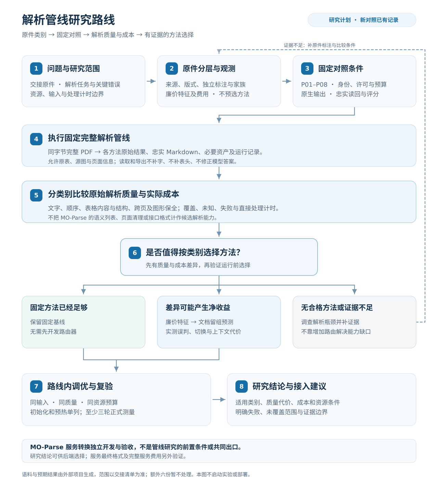

# MO-Parse 研究框架

状态：2026-10-20 明确两项研究目标，将公开接口归入工程交付，统一表格来源与语义表示的当前定义。本轮不执行推理、参数实验或部署。八组新对照尚未完成，历史 MO-Parse 表格转换记录单列于 10.1，不充当管线排名。

本项目有两项研究目标：一是比较解析管线恢复原件内容和结构的质量与成本，二是研究如何将管线解析结果忠实转换为 MO-Parse 的目标结果。后端接入和公开接口按既定契约实现与验收，不单列为研究目标。

处理流程为管线原始结果 → MO-Parse 结果转换 → 目标文档。内部表格来源、语义关系和相关审计只维护当前定义，直接随代码修改，不为早期实现维护版本兼容。GFM 是具体显示格式，候选解析与服务转换都不以先生成 GFM 为统一要求；来源使用规则见[表格来源与证据约定](table-source.md)。

## 1. 两项研究目标与工程交付

| 研究目标 | 输入与输出 | 要回答的问题 |
| --- | --- | --- |
| 解析管线研究 | 完整原 PDF → 声明配置的原始解析结果及研究侧忠实 Markdown 导出 | 不同来源与版式中，哪些方法能以可接受的实际成本恢复文字、顺序、表格结构及图形内容 |
| 解析结果到目标结果的转换研究 | 管线解析结果及必要原件证据 → 符合[最终输出契约](output-contract.md)的 `result.md` | 如何完整保留内容、正确表达表格与图形关系并清理页面信息，各类转换方法的适用范围、质量与成本怎样 |

### 1.1 解析管线研究

管线可以保留表格、页码和页眉页脚。研究侧统一 Markdown 导出只是便于保存、比较与读回，允许表格显示及来源结构；各管线原始 Markdown、HTML、XML、JSON 或 SDK 结构一并保留。不能要求它们先输出多层语义列表、实现 MO-Parse 清理逻辑或满足接口的 `result.md` 规则。

服务目标可以帮助确认关心哪些原件信息，但不能转化成对候选输出语法的限制。MO-Parse 转换代码失败不等于解析管线错误；原始解析本身漏字、错格和丢失源图也不能归给转换器。具体工程边界见[技术路线](technical-route.md)。

### 1.2 解析结果到目标结果的转换研究

输入是选定管线实际给出的文字、表格、图形、阅读顺序、来源与资产，允许沿用其 Markdown、HTML、XML、JSON 或 SDK 结构。输出是面向下游信息抽取的同一份 `result.md`：用标题、段落和多层列表表达业务内容，完整表达表格、流程图和组织图的来源关系，清理物理页码、页眉页脚及分页调试信息，保留业务标题、单位、期间、附注、签字和日期。

已有明确做法的字段映射和格式转写按工程实现。研究重点是从解析表示到目标内容与关系的转换：表格值如何绑定完整行列标题和限定语，图形如何恢复节点与关系，跨页内容如何保持作用域，以及如何在清理页面信息时保全业务内容。最终正文不含 GFM 或 HTML 表格、XML 区域定义及完整坐标 JSON；只把表格改成列表或删除原图，不足以证明转换正确。

转换所需信息已由管线提供时，保真读取并验证其关系；信息不足时区分上游缺失、转换未支持、关系冲突与原件歧义。必要时使用直接原件证据的补充方法，须单独说明来源权限、适用类别、质量和费用，不把补充后的内容算作管线原生能力。研究保留原始解析结果，并按外部交接的独立内容与关系标注比较转换方法；未知与未完成不能靠补造关系或删掉区域消除。

该目标的研究产物是转换方法的适用边界、语义正确性、完整覆盖、失败与未知范围及实际成本；其工程落地包括后端接入、转换实现、清理和文档组装。它可以使用现有后端的实际结果推进，不必等待八组比较完成，也不作为八组的准入条件。转换研究与解析管线研究分别评价和计时。

### 1.3 公开接口的工程交付

MO-Parse 公开接口不作为第三项研究目标。按[现有 API 协议](api.md)和最终输出契约完成同步响应、异步任务、持久化、下载、资产引用及状态一致性，使用功能测试和完整服务验收检查交付。接口能成功返回与正文是否完成语义转换分别判断；接口测试通过不作为解析或转换方法优越性的证据。

## 2. 管线研究的顺序

| 顺序 | 工作与产物 | 要回答的问题 |
| --- | --- | --- |
| 1. 明确问题与范围 | 外部交接的原件与标注版本、任务、关键解析错误、资源和处理边界 | 本轮比较什么解析能力与费用，结论适用于哪些材料 |
| 2. 原件分层与低成本观测 | 独立来源及版式标签、廉价特征定义、费用与文档家族 | 页面有哪些可复核差异，运行前能观察到什么 |
| 3. 固定对照条件 | 八组配置、模型身份、允许输入、共同前处理及忠实导出、评分与计时 | 除声明差异外，比较条件是否一致 |
| 4. 执行固定完整管线 | 同字节完整 PDF 的原始结果、解析侧导出、运行与资源记录 | 每组真实恢复了什么，发生哪些失败和缺失 |
| 5. 分类别分析质量与成本 | 按原件及类别的内容、结构、覆盖、失败与处理费用 | 方法差异是否真实、稳定且值得利用 |
| 6. 决定固定方法或研究选择策略 | 固定基线；有差异时研究特征预测与实际路由 | 选择收益能否抵偿特征、误判、切换和上下文损失 |
| 7. 路线内调优与复验 | 同方法同质量的并发、线程、窗口和执行方式对照 | 能否在既定预算内降低解析费用 |
| 8. 形成研究结论 | 适用类别、质量代价、资源条件、未覆盖范围和接入建议 | 哪些结论有证据，哪些仍待研究 |

八组中预先声明的原生/视觉分工是固定配置的一部分，共同自动来源规则及误路由一并评价。第 6 步才研究根据方法差异新增的选择策略。既有字符量或图像阈值是待评价起点，不能用人工来源金标免费选择运行路径。

本节及第 4 至 9 节规定第一项研究目标的方法。目标结果转换研究独立推进，其转换功能、最终格式和接口验收不放进这八步的管线准入条件。服务接入采用研究结论时另验证实际调用与结果；服务发布不是解析比较本身的研究终点。

## 3. 研究问题

### 3.1 解析管线研究问题

| 问题 | 独立证据 | 不足时的结论 |
| --- | --- | --- |
| 来源与版式差异能否被稳定标注和廉价观察 | 原 PDF 对象、原件渲染、人工类别与特征费用 | 类别不稳定、不可辨或观测成本不足以支持选择 |
| 各固定管线在不同类别中恢复效果怎样 | 原件文字、完整表格结构、阅读顺序、图形保全及原始解析结果 | 明确错误、未知与未覆盖，不以模型名或结果分歧选优 |
| 质量差异对应什么完整解析费用 | 同条件 worker 处理计时、资源、初始化与预热记录 | 未测、失败或超预算，不填零或估算不存在的速度收益 |
| 是否有可被运行前观测预测的方法差异 | 固定对照、文档留组预测、选择损失与实路由结果 | 没有净收益则保留固定方法，不必开发路由 |
| 参数和执行方式能否改进既定路线 | 同输入、同方法、同出口和质量的单因素对照 | 不把模型变化、漏处理或资源增加归因于参数加速 |

### 3.2 目标结果转换研究问题

| 问题 | 独立证据 | 不足时的结论 |
| --- | --- | --- |
| 各类解析结果提供了哪些目标转换所需信息 | 实际原始响应、原件与外部独立内容和结构标注 | 区分上游缺失与读取丢失，不能要求候选先实现统一语义接口 |
| 表格内容能否完整、正确地转成语义描述 | 完整源格、跨度、行列标题路径、单位期间、附注及跨页关系标注 | 未确认作用域、漏值与错绑分别报告，未知首行不能冒充表头 |
| 流程图和组织图能否恢复并表达来源关系 | 独立节点、连线、方向、条件、分支回路、层级与关系类型标注 | 文字识别或原图保全不等于关系正确，不按业务常识补连线 |
| 页面清理与正文组装能否保全业务内容和连续关系 | 独立页面角色、业务正文、阅读顺序及跨页范围标注 | 保留误删、残留、断裂和歧义，不能仅靠最终格式通过判定成功 |
| 哪些转换方法在适用类别中值得采用 | 同一批实际解析输入、独立标注、预先约定的覆盖与质量要求、直接转换计时及资源记录 | 保留质量与费用取舍；未完成、未测及失败不能算正确或零成本 |

先使用已知正确的受控结构检验关联与表达，再用真实解析结果检查完整转换；分别说明输入质量与转换错误。方法比较使用配对输入和固定来源权限，必要原件补充计入转换成本，初始化与预热单列；授权性能测量遵循至少三次正式重复的要求。目标及评价单位、适用类别和采用条件在运行前明确，具体实现步骤见[技术路线](technical-route.md#3-mo-parse-服务处理路线)。这些工作不改变八组解析比较的输入、输出或计时边界，公开接口仍按工程契约验收。

## 4. 原件分类、低成本特征与标注

### 4.1 范围与研究单位

解析预期结果与语料的生成已在其他项目开展，本仓库不再维护原本地样本目录或重复生成语料与金标。后续研究以明确交接的完整原件、独立标注及冻结版本为输入，具体范围和覆盖以交接清单为准，当前尚未声明替代语料已交付。额外六份 `pdf_sample_extra/` 原件暂不处理，也不用于预热、回归、调优或上线判断。Office、独立图片和视频不自动加入本轮。

完整文档与公司/模板家族是输入和分组单位，页面用于来源与版式分层，完整段落、物理表、图形区域及跨页关系用于内容评价。裁图、旋转件和同一文档其他页不是新的未见样本，也不能作为相互独立的验证组。

### 4.2 来源与版式标签

独立记录原生文字、图像来源、混合、稀疏、方向与字层可用性，以及多栏、显式/弱格线、无格线表、复杂跨度、长单元格和跨页上下文。原生页不天然适合某框架，扫描页也可能有隐藏 OCR；解析器输出和方法错误不能作为来源类别本身。

页面上的表格、图形、正文和页边内容分别清点。研究解析是否忠实保留这些内容及实际提供的结构，不把保留原表、源图或页眉页脚当作违反服务最终格式的错误。业务内容丢失和误归属仍按原件检查。

### 4.3 廉价观测与验证

F0 研究 PDF 对象、字符与字体异常、图像区域并集覆盖、方向及矢量概况；F1 研究固定尺寸缩略图、墨迹及粗版式线索；必要时 F2 才比较基于上述观测的规则或简单分类器。完整 OCR、TableFormer 或 VLM 结果不能伪装为免费前置特征。

先登记来源类别和可取得的观测，不必在固定方法比较前训练分类器。先验证廉价观测是否能描述来源差异；只有后续发现可利用的方法差异，才研究用于方法选择的规则或分类器。分别评价来源分类和方法选择，前者准确不代表后者有收益。特征、阈值和选择规则只在开发组确定，留出组用于冻结后的验证。

### 4.4 原件标注与覆盖

外部项目交接的标注应在查看待测结果前冻结来源清单、完整评价单位及分母。正文标注原文与顺序，表格标注完整文字、空位、跨度、表头及期间单位原文，跨页标出应连接与应分开的范围，图形标注区域、原图、caption 和需要检查的可见内容。若某方法额外给出图的节点、连线或层级，可以按独立标注评价其原生能力，但不强制所有方法先输出这种结构或多层列表。

页眉页脚和业务正文分别标注，以便区分业务文字质量和非业务噪声；保留页眉页脚本身不是管线比较的格式失败。服务后续是否正确清理是另一项功能测试。未标注、来源不可辨、未检测、方法未提供和失败分别记录，不能将处理页数说成完整标注覆盖页数。

### 4.5 小语料与来源真值

按完整文档或家族分组，原件文字、结构和可辨状态独立于候选输出。歧义项复核，单标注者明确其局限。旧开发线索须回看原件后才能形成新版本标注，已删除旧基准的分数、报告与工具不恢复，也不用于新结论。

## 5. 比较条件与原始结果

### 5.1 八个固定配置

P01 至 P08 的身份与差异仅在[管线计划](../benchmark/pipelines-to-test.md)维护。主比较固定同字节完整 PDF、来源判断与方向处理、模型版本、资源预算、忠实导出及评价方法。固定混合配置的扫描分支共用 GLM SDK，不把同一分支重复算成原生框架的独立能力证据。

### 5.2 允许不同原生输出

每组保留原始响应和本身提供的文字、结构与媒体引用，不规定必须实现统一的“信息接口”或语义关系模型。为评分而读取字段、转译已有跨度或导出 Markdown，是接入与评价代码的工作；不能在其中补字、补标题、推断图关系或修正模型结果。

原方法有信息但读回代码丢掉时，先修读取错误；原方法本身缺失时记录实际能力缺口。不能只因没有某个私有字段、矢量网格或目标层级格式判定解析失败，也不能用后续 MO-Parse 转换器替原方法补齐答案。

### 5.3 来源与公共处理边界

各配置使用声明允许的来源。纯视觉路径不能用原生字层、矢量文字匹配或其他解析器修正解析结果；原生路径也不能借评分金标补值。尺寸、方向和必要渲染按配置记录，公共处理版本固定且费用计入。

公共处理限于预先声明的前处理、忠实结果整理、Markdown 导出和必要资产生成，不包含 MO-Parse 的表格语义化、图形关系补充、页码页眉页脚清理及服务正文组装。候选本身已声明的原生字层匹配与结构恢复属于其方法；服务另行读取 PDF 补标题、绑定关系或合并表格，不能因放在导出之前就算成候选能力。保留补充前结果，不能用服务结果覆盖原始对照。MinerU 后不运行独立 Docling 复核，解析器分歧不是来源真值。

## 6. 实验执行、质量与计时

### 6.1 运行前准备

独立标签、评价单位、模型与配置、读取方式和计时边界先固定。允许对预先声明的子集做读取正确性与执行预检，但不把它们当正式排名；无需先完成 MO-Parse 转换功能或统一语义渲染器才能比较解析管线。

### 6.2 正式完整 PDF 对照

各组接收同字节完整原件，保存原始解析、研究侧 Markdown、必要资产、有效配置、处理时间与资源。失败、缺失及超预算均在结果中保留，不要求所有方法先达到质量门槛才纳入对照。以 PDF 为计时和完整执行单位，分类别质量从其中的已标注内容分层读取，不按金标挑页运行。

同一原件和评价单位逐项配对比较，分别展示文档、类别及总体覆盖，避免长表大量简单单元格掩盖短文档的关键错误。重复执行用于说明时间波动或输出稳定性，不增加独立样本数；已用于开发的材料上的差异不自动推广到未见模板。

### 6.3 原件质量与结论

分别报告业务文字、阅读顺序、表格字值/格位/跨度/表头、单位期间原文及来源、跨页内容、图形保全、失败和未知。某方法原生提供的关系信息另报能力与正确性，不将“没有转成语义列表”算成解析错误。具体指标、分母和宽度政策见[评测任务](../benchmark/evaluation-tasks.md)。

输出关系或结构的精确率与目标召回分别统计，未检测与未输出不能从已标注分母删除；未标注和不可辨不填正确。少量检查中零错误不等于总体零错误，长表中的简单数字不能抵消其他文档的关键回归。框架原始结果和评分读回记录可追踪，服务格式与下游抽取准确率不混入管线分数。

### 6.4 管线处理时间

在 worker 从就绪完整 PDF 开始处理至管线解析结果、研究侧忠实 Markdown 和必要资产内容生成完成直接计时。包含必要渲染、全部管线推理、既定分支或切换及声明公共处理，排除上传、API 排队、轮询、下载和纯持久化。MO-Parse 接入后的语义转换和接口正文清理不在这一终点内。

初始化、模型加载和预热单列，代表性性能工作负载至少三次正式测量，保存每轮值和波动。并行或重叠阶段不能求和作总时间，不用 HTTP 总时长减常数估算；失败和缺测分别保留。CPU、内存、GPU 显存、功率和 CUDA Graphs 按共同资源预算核对，额外资源不能免费增加。

现有服务与适配器的 `duration_ms` 不是本协议已实现的证明：不同入口计时覆盖不同工作，可能包含等待、网络、写盘或服务转换，也可能漏掉前置 PDF 读取。直接计时入口仍待按声明的完整边界准备，不复制字段、不相减修补成完整管线成绩。源码核对见[技术路线](technical-route.md#61-现有调用与计时字段)。

### 6.5 错误定位与服务功能测试

遇到具体问题时检查原件、管线原始结果、读回代码、MO-Parse 转换及返回文件，确认错误最早出现在哪一处。这是定位手段，不是新设的研究阶段或候选管线的准入条件。

对服务转换可以使用已知正确的表格或图结构单独测试，再用实际解析结果做服务验收；这些测试只证明转换代码的行为，不能计为某解析管线的能力，也不要求在管线主比较前完成。接口最终规则单独见[最终契约](output-contract.md)。

## 7. 固定方法与条件性路由

### 7.1 先决定什么算可采用

在看待测输出前，按任务约定关键内容错误、最低覆盖、可接受质量与资源约束，具体标准由[评测任务](../benchmark/evaluation-tasks.md)维护。没有确定阈值就保留待定，不能用当前最好成绩倒推门槛。全部候选仍进入对照，采用条件只用于后续决策，不用于事前剔除失败方法。

先检查每组是否满足关键质量和预算，再比较同条件成本。只有在全部已约定的质量指标与费用上都不差、且至少一项更好时，才能在这个比较范围内认定一种方法占优。质量各有长短或质量与费用相互交换时，保留多项结果及取舍，不自行加权成单一总分或宣称普遍最优。

### 7.2 什么情况下才研究路由

| 固定对照的发现 | 下一步 | 尚不能得到的结论 |
| --- | --- | --- |
| 一条固定方法已满足相关类别需求，替换没有明确收益 | 保留固定方法，研究其执行参数 | 不必为已有分类标签开发路由 |
| 不同方法在有足够来源支持的类别中各有优势 | 检查运行前特征能否预测有用选择，再验证实际路由 | 来源分类准确不等于选型正确 |
| 差异小、类别支持不足或测量不完整 | 保持结论待定，补同协议证据 | 不将事后挑出的几个页面当稳定规律 |
| 关键类别所有方法都不合格 | 调查共同缺陷和未覆盖能力 | 增加路由或第二解析器不能自行产生缺失能力 |

### 7.3 路由必须是可执行的策略

选择单位可以是整份文档或有完整上下文的页组，需根据方法能力与来源关系另行确定。页面标签只是观测单位，不意味着所有解析器应逐页拆开；跨页表、连续正文和共享标题不能为方便路由被切断。拆分、重复处理及必要组装的实际影响一并评价。

开发时按完整文档或家族留组，固定特征、阈值、选择规则和拒判动作，验证时只使用运行前允许观测。事后逐页挑最优结果仅为诊断上界，不能充当运行策略。小语料上无法稳定估计时明确写证据不足，不强行训练分类器或新增模型。

实际路由与同条件固定基线比较完整解析质量及费用，计入特征、误判、切换、重复处理和跨页上下文损失；满足关键质量与覆盖、并证明净收益后才采用。没有收益就保留固定方法；不通过解析器一致或独立 Docling 复核裁定来源真值。

## 8. 路线内调优与研究产物

MinerU 的并发、线程、窗口和执行方式实验仅在[调优计划](../benchmark/mineru-tuning.md)维护，不增加主比较组或冒充跨框架结果。调优保持同输入、同解析出口、同质量及资源口径，预热和正式执行分开。

研究产物是每个方法的适用类别、解析质量、实际费用、限制、失败及选择证据。MO-Parse 可据此选择后端，但接入后的转换与接口仍需单独验收；不因服务输出尚未完成而宣布管线研究不能开展，也不因管线效果好而认为服务最终格式已经完成。

## 9. 当前准备状态与进入条件

| 项目 | 正式对照前要准备什么 | 不属于前置条件 |
| --- | --- | --- |
| 原件与标注 | 外部交接的原件身份、来源类别、完整评价单位、独立金标及版本 | 在本项目重复生成语料与金标、新增额外 PDF 或标注全部下游业务事实 |
| 配置与资源 | 八组身份、实际模型锁、来源权限、统一预算与可执行入口 | 所有方法达到相同质量或实现相同内部模型 |
| 结果保存与读回 | 原始响应、已有结构不丢失、忠实 Markdown 和评分读取 | 统一语义接口、多层列表或 MO-Parse 清理功能 |
| 测量与评价 | 真实计算起止点、预热/正式协议、指标与缺失规则 | 复制现有 `duration_ms`、HTTP 格式验收或服务最终语义正确 |

当前八组仍有模型身份和运行入口待准备项，外部语料、类别与独立金标的交接状态也待确认。现有服务及表格语义转换代码不是最优路线证明；本轮没有新增比较结果、评分器或推理执行。

## 10. 现有 MO-Parse 转换与历史记录

当前表格语义实现部分展开来源矢量表，仍保留部分原表和页面信息，未完成流程/组织关系与最终清理。这描述的是 MO-Parse 接入后的转换能力，不是八条解析管线的输出义务或比较结果。

下面保留已有有界记录的原文和数据，按其当时服务任务解释。后续方法选择仍须按本框架重新准备和测量，不能把其中的局部转换通过数当作解析框架排名。

历史记录末尾的“统一各适配器来源接口”属于当时描述，不是现行八组对照的统一语义接口要求。当前只需正确保存、读取和忠实导出各方法已有结果，按第 5、6 节执行；MO-Parse 转换独立开发和验收。

### 10.1 2026-10-19 表格语义有界实验与实现

本节是最新最终契约确定前的有界表格转换历史记录，保留当次真实观测与局限。原表保留、物理页覆盖及接口通过属于当时协议；不能视为全部表格、流程图、组织结构图及页面家具清理已经完成。下述策略标识、实验文件和镜像名称按当时事实保存，不代表当前继续维护该内部协议版本；本次整理不重新运行或改写这些结果。

本轮回答的是“来源关系如何表达且不固化错误”，不是选择主解析框架。沿用现有 MinerU Advanced/TXT 与 GLM SDK 固定后端，主服务实验容器限制 8 CPU、8 GiB，既有 native worker、模型权重及 GPU 配置不变。MinerU 的 CUDA Graphs 已观察到请求期间 `FULL` 回放，GLM 既有服务保留已捕获的 FULL/PIECEWISE 图；无新增模型、无额外 Docling 解析、无额外 GPU 或框架切换。

只读取十份原件。502 页 F0 对象特征做一次预热和三次正式读取，分别为 6.435、6.057、6.147 秒；这是特征组件费用，包含原件读取、文字、图像并集覆盖及矢量对象统计，不是 PDF 解析耗时。432 个原生候选、44 个图像候选、3 个混合候选和 23 个稀疏候选来自未验证阈值，不作为人工类别金标或分类准确率。

在查看新解析结果前，从原件图像与文字冻结 12 个案例，覆盖同表换期间表头、字段与记录混排、比较矩阵、无充分标题证据及复杂混合结构。原始 136 个值与行列标题目标，加独立列出的 5 个字段或记录目标，共 141 个目标关联。标注只有一名代理标注者，尚无独立人工复核一致率；开发组为 `1210860446`，文档验证组为 `1225474693` 与 `1225473526`，这些原件均曾用于项目开发，不属于全新未见测试。

| 关联处理 | 原值与表头目标正确数 | 错绑 | 保留、未知或未输出目标数 |
| --- | ---: | ---: | ---: |
| 固定使用首行的诊断对照，仅对原始 136 项 | 112 | 24 | 0 |
| 来源标题作用域，仅对原始 136 项 | 112 | 0 | 24 |
| 来源标题作用域加字段样式，包含 5 个混排目标 | 117 / 141 | 0 | 24 |

首行诊断对照把本报告期与期末等内部作用域混用，未作为发布选项。加入字段样式使该混排案例的 5 个目标得到表达；不支持把此结果推广到所有字段表。尚未可靠恢复的 24 项来自缺少充分标题证据的联系人及公告记录表，继续保留原表。

正确文字与网格层面，五张完整比较表的 112 个目标通过来源作用域关联与渲染检查；作用域仍由原 PDF 观测，关系金标不作为线上输入。真实完整原件层面处理 `1210860446`、`1225474693`、`1225473526`、`1225475333`，共 65 页，逐条核对实际 Markdown 的描述及引用，并确认未转换表格的原有视图保持。额外三页正文控制原件 `1211290753` 也已完成处理；完整输入覆盖为五份、68 页，不是十份 502 页的内容标注。

六页原件一次预热后三次真实执行的最终 Markdown SHA 一致。CPU 关联与渲染组件在已有来源结构上三次约 8 毫秒；完整解析内部语义阶段三次为 31.345、32.147、33.563 毫秒，含线程调度、完整视图替换与引用处理，无额外模型调用。直接 `parse` 调用另有约 18 秒的观测，但当前仍含内部证据写入，不作为剔除持久化后的完整处理性能或八组主比较成绩。

字符比较只采用已声明的 ASCII 宽度与排版空白等价，另保存严格字符诊断。117 个已表达目标的值字符串没有严格差异，行标签有 39 处、列标签有 28 处严格差异，来自允许比较等价的宽度或排版空白，仍保留逐项记录。原件恢复、关系和表达分别检查；全量单位维度、复杂附注作用域及下游模型理解收益尚未完成独立验收，不能由上述 141 项推定正确。剩余来源类别及模板也没有因此获得优劣结论。

实现采用 `source-scoped-relations/1`：每个关系保存源格引用，渲染器复制原文；检查跨度、标题路径、原格和非空标题覆盖、重复叶标题、唯一视图范围及取消清理。完整来源网格、已存在的标题作用域或有界字段模式不足时整表保留，扫描与无格线表当前不会强行转换。来源角色规则仍属于有界关联方法，不是真值。

新记录保存在本机忽略目录 `data/research/semantic-20261019/`：`inventory.json`、`features-0.json` 至 `features-3.json`、`relation-gold-v1.json`、`component-results-v1.json`、`strict-character-diagnostics.json`、`real-output-acceptance.json`、各完整运行的原始结构、Markdown 与请求执行记录，以及实际图执行日志。冻结标注 SHA256 为 `ee9355be01903371d40b35764c744d08b93dc5cbe56623d9f7ef1c25c188ad68`。临时实验脚本及修正后的原件网格构造也随本地证据保存；没有恢复旧基准工具或沿用旧成绩。

部署已通过五份完整原件的真实 HTTP、最终持久 Markdown、图片下载与镜像身份核对；部署输出重新检查的 141 个关系目标仍为 117 个正确转换、0 个已观察错绑、24 个保留。任务、镜像和有限覆盖记录于[运行配方](runtime-recipes.md#实现与部署状态)，原始验收结果保存在本机 `production-acceptance.json` 与 `production-relation-acceptance.json`。后续扩展先补类别和关系标注，再比较方法；正式 P01 至 P08 还需统一各适配器来源接口并重新测量。

## 11. 文档职责

| 文档 | 维护范围 |
| --- | --- |
| 本文 | 解析管线与目标结果转换的研究目标、问题、证据和评价边界；管线的来源分层、实验方法与选择顺序 |
| [评测任务](../benchmark/evaluation-tasks.md) | 管线输入、独立标注、解析质量指标与处理计时 |
| [待测管线](../benchmark/pipelines-to-test.md) | 八个固定解析配置及资源和结果导出规则 |
| [MinerU 调优](../benchmark/mineru-tuning.md) | 路线内参数与执行方式实验 |
| [技术路线](technical-route.md) | 管线研究与 MO-Parse 工程的交接边界、服务处理和实现顺序 |
| [最终输出契约](output-contract.md) | MO-Parse 公开接口的语义内容和最终格式，不约束候选管线直接输出 |
| [实现架构](architecture.md)、[运行配方](runtime-recipes.md) | 服务代码职责、当前能力与历史或现场运行记录 |

来源多样性、分任务评价和表格结构诊断可参考已有一手方法：[DocLayNet](https://arxiv.org/abs/2206.01062)、[OmniDocBench](https://arxiv.org/abs/2412.07626)、[GriTS](https://arxiv.org/abs/2203.12555)。这些参考不提供本项目任何模型的优劣结论，也不授权引入其 PDF 或沿用排行榜成绩。
